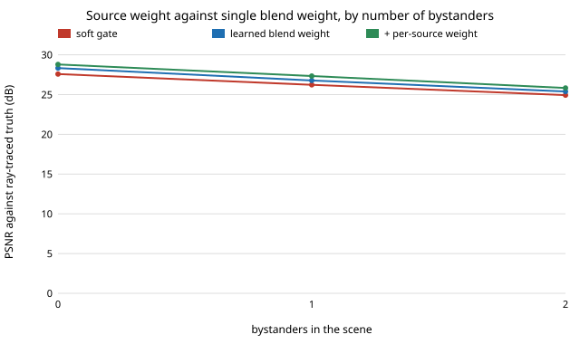

# capture-whichwrong: does telling a learned blend which of two sources is wrong help, or does it need to choose between them?

Follow-up to `capture-learngate` (track 13, autonomous multi-angle capture), taking the first two of its "Next steps". **Headline:** four new features meant to say *which* warped source is wrong (signed depth order and a cross-camera check) add only 0.03 dB to the learned blend (26.78 to 26.81 dB on 40 held-out scenes). Giving the model a second output, a per-pixel mix between the two sources, adds 0.47 dB more (27.28 dB, ahead of the new-features model in 40 of 40 configs, standard error 0.03) and recovers 0.54 of the 2.71 dB between the hard gate and the best possible blend, up from 0.36. With only the old 12 features the source weight already gets 27.24 dB, so the gain is from the extra degree of freedom, not from the new signals. Outside the training ranges the gain over learngate is +0.04 dB.

**Live page:** https://duncan-haywood.github.io/monorepo-projects/research/capture-whichwrong/

**Why this question.** `capture-learngate` left 64% of the headroom unused and guessed the cause was "knowing which source is wrong, not just that the two disagree". That guess has two readings: the model lacks the *information*, or it lacks the *freedom* (it can only blend toward one fixed source, the nearest camera). This project separates them.

**Builds on.** `capture-learngate` (scene, stereo matcher, warp, gates, regressors, copied so the project is self-contained). Cross-checking one view against another through measured depth is the standard left-right consistency idea from stereo and image-based rendering; this is a small numpy version on a toy scene, not a reproduction of any paper, and it claims no connection to the CU Boulder groups in `prompt.md`.

## Method (`src/capture_whichwrong/which.py`, `experiments/run.py`)
- **New features** (appended to learngate's 12): `z_order`, the clipped signed difference of the two warps' target-frame depths (zero outside their overlap); `xerr0`, `xerr1`, each source's cross-check error (the other source warped into this source's camera with the other source's own depth, compared with this source's real image, then carried into the target view with this source's pixels); `xdiff = xerr0 - xerr1`. No truth is used.
- **Per-source weight.** Output = `w*near + (1-w)*base'`, `base' = s*c0 + (1-s)*c1` where both warps are valid (c0 is the warp of the nearer camera) and the plain synthesis elsewhere. A network predicts `s` against its least-squares target `s*`; a second network is then refitted for `w` on the mixed base. Holes still take the raw nearest camera.
- **Systems.** `mlp_old` (learngate's model, reproduced: 26.78 dB, the same number as its README), `mlp_new` (16 features, `w` only), `mlp_src` (16 features, `s` then `w`). Bounds that use the truth: `lstsq` (best `w`), `lstsq_s` (best `s`, then best `w`). Hand-set hard and soft gates are swept on the same training configs.
- **Scenes and splits** are learngate's: configs drawn from stated ranges (gap 6 to 32 degrees, stereo baseline, noise, 0 to 2 bystanders, ground texture); train 0 to 39, validation 40 to 49 (size picked: 64 hidden units vs 24, 0.01 dB apart), **test 100 to 139 with textures 5 to 8 never seen in training**, stress 200 to 224 (outside the ranges).

## Reproduce
```bash
pip install pytest numpy
cd research/capture-whichwrong
python -m pytest -q tests                        # 11 tests
PYTHONPATH=src python experiments/run.py         # writes experiments/results.txt (about 4 minutes)
python experiments/figure.py                     # experiments/bystanders.svg from results.txt
```

## Results (from `experiments/results.txt`; deterministic)
Mean PSNR in dB over configs against the ray-traced midpoint view.

| split | hard | soft | mlp_old | mlp_new | mlp_src | best w (bound) | best s then w (bound) | nearest camera |
|---|---|---|---|---|---|---|---|---|
| test, 40 configs | 25.81 | 26.21 | 26.78 | 26.81 | **27.28** | 28.52 | 29.44 | 22.46 |
| stress, 25 configs | 18.17 | 18.67 | 18.91 | 18.84 | **18.95** | 19.78 | 20.09 | 17.30 |



- **The "which is wrong" features are almost worthless here.** `mlp_new` minus `mlp_old`: +0.03 dB (standard error 0.00), ahead in 35 of 40 test configs, and -0.07 dB on the stress split. Ablation: dropping `z_order` gives 26.80, dropping the cross-check features 26.81, against 26.78 with neither. Most likely cause: the two warps' disagreement already carries most of what the depth order and the cross-check add on this scene; I did not test that directly.
- **The per-source weight is where the gain is.** `mlp_src` minus `mlp_new`: +0.47 dB (standard error 0.03), 40 of 40 configs; headroom recovered 0.54 against 0.37 for `mlp_new` and 0.36 for `mlp_old`. Using only the old features, the source weight gives 27.24 dB, so 0.46 of the 0.50 dB gain over learngate needs no new signal.
- **It holds with occlusion.** By bystanders (test), soft / `mlp_old` / `mlp_new` / `mlp_src`: 0 bystanders 27.58 / 28.33 / 28.38 / 28.79 (11 configs); 1: 26.22 / 26.77 / 26.79 / 27.33 (17); 2: 24.93 / 25.38 / 25.40 / 25.83 (12). The source weight adds 0.41 to 0.54 dB in each.
- **It does not carry far outside the training ranges.** On the stress split (gaps of 36 to 46 degrees, three bystanders, heavy noise) `mlp_src` is +0.04 dB over `mlp_old` (ahead in 18 of 25) and +0.11 over `mlp_new`; the 16-feature `w`-only model is 0.07 dB worse than the 12-feature one there, a hint that the extra features fit the training ranges.
- **Large headroom remains in `s`.** Choosing `s` and then `w` with the truth would give 29.44 dB (test), 0.92 dB above the best `w` alone with the old base, so there is more to find in picking the source; the learned `s` (the mixed synthesis, before the raw-camera blend, 19.30 dB on test against 19.04 for always taking the nearer warp and 19.41 for the best `s`) gets about 70% of the way on the pixels it governs, measured by PSNR over whole images that include holes.

## Limitations
- **Toy scene.** Analytic ground plane, a subject cylinder and bystander cylinders, one texture family, one pinhole camera and a block matcher. Absolute decibels do not transfer to footage.
- **PSNR only.** No seam metric and no human rating; 0.5 dB may not be visible.
- **Same-range test is not independent of the training distribution** (new draws and new textures of the same family); the stress split is the only out-of-range check and it is small.
- **The cross-check is a simple version**: it warps one source into the other camera with a z-buffer and compares colour, with no handling of where the other source cannot see. A visibility-aware or learned cross-check might do better; this run does not show that it cannot.
- **The new-feature comparison is within about 0.03 dB**, near the noise of network initialisation; I trained one network per system and did not repeat over seeds.
- **Network size chosen on 10 validation configs**; the two sizes differed by 0.01 dB.
- All scene parameters are drawn from ranges I chose (not sourced), as in learngate.

## Next steps
- Predict a weight for the raw farther camera as well (a three-way mix), and repeat over several training seeds.
- Run a real open depth model on openly licensed multi-view footage and have people rate the in-between frames; train on rendered scenes and test on footage.

## Owner steps
None for this simulation.

## Outside dependencies
numpy and pytest. Nothing else; the scene is analytic and the learners are written in numpy.

*Produced with AI assistance.*
