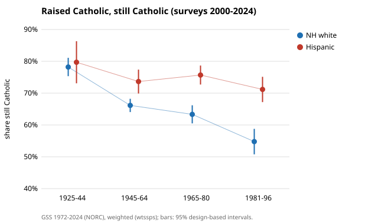
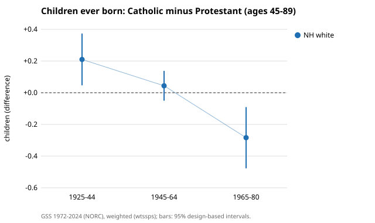

# How do US Catholic subpopulations differ? Hispanic and white Catholics, immigrants, converts and cohorts compared on fertility, retention, Mass attendance and politics (GSS 1972-2024)

A research programme comparing the demography of Catholic subpopulations, starting with the
United States and the General Social Survey (GSS) 1972-2024, with design-based 95% intervals.

**Live page:** https://marisstella.app/research/catholic-demography/

## Headline results (milestone 1, 2026-11-03)

All weighted (`wtssps`), with 95% design-based intervals from the GSS strata and PSUs.

- **The "Catholic fertility" premium is gone, and reversed in the youngest completed cohort.**
  Among non-Hispanic whites aged 45 and over, Catholics born 1925-44 had 0.21 more children than
  Protestants [0.05, 0.37]; born 1945-64, +0.04 [-0.05, 0.14]; born 1965-80, **-0.28
  [-0.48, -0.09]**. What predicts a large Catholic family is attendance, not the label: weekly
  attenders have about 0.5 to 0.6 more children than other Catholics.
- **Retention is falling for white Catholics, much less for Hispanic Catholics.** Of non-Hispanic
  whites raised Catholic, 66% of those born 1945-64 are still Catholic, 63% of those born 1965-80
  and 55% of those born 1981-96. For Hispanics: 74%, 76%, 71%. Across all respondents raised
  Catholic, retention fell from 84% in the 1970s surveys to 62% in 2021-24.
- **Hispanic Catholics are not more likely to go to Mass weekly** than white Catholics (no
  difference in 2010-18; 6 points *less* in 2021-24), but more often read the Bible literally
  and are about 25-30 points less likely to be Republican.
- **The Church is becoming more Hispanic and more immigrant.** Hispanics were 31% of US Catholics
  in 2000-09 and 37% [33, 40] in 2021-24; one in four Catholics is foreign-born.
- **Benchmark.** The GSS 2024 Catholic share is 21.6% [19.3, 23.9]; Pew's 2023-24 Religious
  Landscape Study says 19%. The gap is logged for milestone 2.





Full tables: [`experiments/m1_subgroups/`](experiments/m1_subgroups) (`t1` composition, `t2`
fertility, `t3` retention, `t4` practice, belief and politics by subgroup). Plan and hypotheses:
[`PROPOSAL.md`](PROPOSAL.md). Research log: [`LOG.md`](LOG.md).

## Do older Catholic mothers forget a Catholic upbringing? Not after 60: their own re-interviews show no drift, and the fall sits at 25-44 (milestone 5b, 2026-11-22)

The step before found that, for US-born mothers born 1937-49, the share who say they were raised Catholic is 3.4-3.5
points lower at 45+ than at 25-44, about as much as their current Catholic share falls, so their fall did not look like
leaving. Their own answers in the GSS 2006-10 panels, asked again two and four years later at ages 57-73, do not drift
down: **+0.16 points a year [-0.15, +0.46]** (297 mothers). Four predictions were committed first; 2 of 4 are supported
(one only just) and the two that said the panel would show the same fall are refuted. At the panel's own ages the
cross-section agrees: within each birth year the raised-Catholic share is flat at 57-77 (-0.07 a year [-0.41, +0.27]).
The fall is at 25-44 in the 1977-94 surveys (-0.36 a year, noisy), so mortality and late-life nonresponse are not
needed to explain it. Panel women born 1950-71, seen at about 48, do drift down by 0.31 points a year [0.01, 0.61],
enough over the 12 years between the bands to give the whole fall; that comparison is post hoc. Code
`experiments/m5r_old_cohort_panel/run.py`, tables `t49`, `t50`, details in `LOG.md`.

## Do American Catholic mothers leave the Church after their children grow up? Some do, mostly those born after 1950 (milestone 5b, 2026-11-21)

The previous step found that, compared within 10-year birth-cohort windows, US-born mothers' current Catholic share is
3.7 points higher when they are interviewed at 25-44 than at 45+, and the step after it showed that the parallel gap in
"raised Catholic" was mostly which cohorts sat in each window. Comparing each single birth year with itself keeps most
of the current-Catholic gap: **+3.1 points [+1.1, +5.1]** with the children-based weights (only +0.6 [-0.4, +1.6] was cohort
mix) and +2.9 [+1.6, +4.2] with each birth year weighted by its own size. Net of any fall in reported upbringing, the
own-weighted gap is **+1.9 points [+0.9, +2.8]** over about 18 years of age (in-person surveys 1977-2018), roughly 0.1
points a year of net switching out after the mid-thirties. It is concentrated in mothers born 1950-71 (+2.8 to +3.5,
intervals above zero); for those born 1937-49, who carry most of the children-based weight, the current and
raised-Catholic shares fall together, so their fall is reporting or who is left to interview, not leaving. With the
25-44 share, about two thirds of the gap between what children say about their mothers and what the mothers'
generation reports at 45+ closes (point estimate; interval wide). 4 of 4 predictions are supported, the fourth on its
point estimate. Code `experiments/m5q_cohort_std_switching/run.py`, tables `t47`, `t48`, details in `LOG.md`.

## Do people forget a Catholic upbringing as they age? A little, and no faster than the same people's own re-reports (milestone 5b, 2026-11-19)

Within US-born birth cohorts surveyed in person (GSS 1977-2018, ages 25-64), the share who say they were raised Catholic
falls **0.072 points a year [0.018, 0.124]**, about 1.3 points over 18 years. The 2006-10 panels, which ask the same
people again four years later, show the same people's reports falling **0.084 points a year [-0.082, +0.250]**. The
difference, **+0.012 [-0.163, +0.188]**, is consistent with the whole within-cohort fall being people re-describing
their own upbringing, with no need for mortality or who-responds effects, though the panel is too small to rule a
composition effect out. Among the mothers' cohorts of the previous step (US-born women with children, born 1937-71) the
raised-Catholic difference between interviews at 25-44 and 45+ is only **+0.7 points [-0.7, +2.0]** once each birth
year is weighted by its own size (+0.3 without the 2021-24 web waves), not the +2.4 found when weighting by their
children: that gap was mostly which cohorts the children's mothers came from. 4 of 4 predictions are supported, the
fourth only formally. Code `experiments/m5p_recall_drift/run.py`, tables `t45`, `t46`, details in `LOG.md`.

## Were the mothers more Catholic while raising their children? Partly, and partly a survey artefact (milestone 5b, 2026-11-17)

Mostly closed, but not mostly by switching. m5n left the mothers of US-born adults 3.5 to 5 points more Catholic than US-born
GSS mothers interviewed at 45+. Rebuilding the women's side from mothers interviewed at 25-44, the ages they were
raising children, the gap for adults born 1965-99 to two US-born parents falls from **+4.8 points [+2.3, +7.1] to +1.1
[-1.7, +4.0]**: the same cohorts are 3.7 points [2.1, 5.4] more Catholic at 25-44 than at 45+. But the same women also
report a Catholic upbringing 2.4 points [0.7, 4.2] more often when interviewed young, so they are not simply the same
women before they left. Split post hoc, about 1.5 points is women leaving the Church after child-rearing and 2.2 points
is a cohort's raised-Catholic share differing by survey year and age (recall, attrition or the 2021-24 web waves). 3 of 4
predictions are supported; the "not a different population" check is refuted. Older respondents' mothers (born before
about 1936) are not seen at 25-44 in the GSS and are not tested. Code `experiments/m5o_lifecourse/run.py`, tables `t43`,
`t44`, details in `LOG.md`.

## Did Catholic mothers have more children than surveys show? Siblings say no (milestone 5b, 2026-11-17)

No. The missing Catholics are mothers, not extra children. m5m left adults born 1925-64 to two US-born parents with
mothers 3.4 points more Catholic than the fertility model predicts. Every GSS respondent reports how many brothers and
sisters they had, so the family each child came from can be measured from the child's side, and weighting children by
1/(siblings + 1) recovers their mothers (Preston 1976). Children of Catholic mothers come from families no bigger,
relative to what GSS Catholic women report, than children of other mothers (difference -0.06 children [-0.22, +0.09],
sizes capped at 7 on both sides because `sibs` is top-coded at 6+). Among the mothers themselves, 24.4% were Catholic
against 20.8% of GSS mothers of their cohorts (**+3.5 points [+2.1, +5.3]**), and the Catholic / other fertility ratio is
1.10 by children's reports and 1.09 by women's. So 97% of the gap is the mothers' Catholic share and 3% [-25, +28]
fertility. 3 of 5 predictions are refuted. Across all US-born adults born 1925-64, those raised Catholic come from
families 1.07 [1.06, 1.08] times as large (by the same inversion), far from the 1.27 needed. Rerun with that sibling-based
ratio, m5h's fertility channel falls to 0.13 points of the 1990s Catholic share (from 1.17) and -0.05 of the 1990-99 to
2010-18 change, so H4 (immigration, not fertility) is stronger. Code `experiments/m5n_siblings/run.py`, tables `t39` to
`t42`, details in `LOG.md`.

## Do immigrant mothers explain the model's missing Catholics? (milestone 5b, 2026-11-14)

Only for older immigrant families, and fixing them exposes a gap among US-born ones. The m5h model gave every US-born adult's mother
the Catholic share of all US women of her cohort. Here immigrants' children get the share of foreign-born GSS women, and
US-born mothers' children the share of US-born women. Children of immigrant mothers born 1925-64 then fit (mothers 52.7%
Catholic, model 49.9%, gap +2.7 [-6.4, +12.0], down from +28). Children of US-born mothers do not: their mothers were 26.9%
Catholic against a model of 22.8%, **+4.1 [+2.5, +5.7]**. The overall gap rises from +2.6 to **+4.1 [+2.5, +5.6]**, so 2 of 5
predictions are refuted. In families where both parents were US-born the model would need Catholic mothers to have had 1.27
times the children of others, against the 1.05 that GSS women report (post hoc). H4 is unaffected: fertility's
contribution to the 1990-99 to 2010-18 change is -0.32 [-0.60, +0.04] with nativity-specific fertility (m5h: -0.37), and
immigration's is +1.07. Code `experiments/m5m_mothers_nativity/run.py`, tables `t35` to `t38`, details in `LOG.md`.

## Do children of mixed Catholic marriages explain the extra Catholics? (milestone 5b, 2026-11-13)

Only a little. m5h's model (children take their mother's religion; Catholic mothers have more children) leaves 2-4 points
more US-born adults raised Catholic than it predicts. Using what 5,714 US-born GSS respondents (1988-2018) said about their
parents' religion: of children with only a Catholic **mother**, 72% [67, 77] were raised Catholic; with only a Catholic
**father**, 42% [36, 48] (cohorts 1925-64; the gap is about 30 points in every cohort, before and after the Church dropped
its mixed-marriage promise in 1970). Net, mixed marriages add **+0.56 points [-0.01, +1.01]** to the raised-Catholic share,
**18%** of the gap. Most of the rest is immigrant mothers: the model gave the children of immigrants the Catholic share of
all US women of their mothers' cohort (about 25%), but their mothers were 50% Catholic. The transmission channel's
contribution to the 1990-99 to 2010-18 change is -0.07 [-0.44, +0.28], so H4 (immigration +1.07, fertility -0.37) stands, and
m5h's fertility upper bound is loose. Code `experiments/m5l_parents/run.py`, tables `t32` to `t34`, details in `LOG.md`.

## Did immigrants' contribution to the Catholic share really collapse after 2018? (milestone 5b, 2026-11-13)

Mostly not: the collapse came from the web interviews. m5h found the first-generation contribution to the adult Catholic share
falling from 3.37 points (2010-18) to 1.98 (2021-24), a change of -1.38 [-2.05, -0.72]. Rerunning the same accounting on the
2022 and 2024 in-person respondents gives **-0.44 [-1.38, +0.49]**, and on the randomised face-to-face-first arm -0.63
[-1.46, +0.21]. Neither can be told apart from zero. Web respondents are the reason: 20.9% of Catholics who answered by web are
foreign-born, against 28.9% of those interviewed in person (+8.0 points [+3.6, +12.5]). The randomised arms are balanced on
nativity (-0.2 [-4.0, +3.6]), so this is who completes by web, not an effect of the arm. Dropping the all-web 2021 wave alone
moves the change by +0.51 [+0.14, +0.85]. The fertility channel does not move across samples (within 0.1 points), and H4
(1990-99 to 2010-18, no web interviews) is unaffected. Code `experiments/m5k_inperson/run.py`, table `t31`, details in `LOG.md`.

## Can reweighting on demographics fix the 2021-24 web respondents? (milestone 5b, 2026-11-11)

Mostly not. In the 2016-20 panel, everyone's first interview was in person, so the 11.1-point attendance gap between
people who later chose web and those who later chose phone is pure selection. Raking the web group to the phone group on
age, sex, ethnicity and degree removes 43% of that gap [23, 87]. Adding region, marital status, children, nativity, size of
place, household size, work status and politics removes no more: -6.6 points [-11.9, -1.1] remain. In the 2022 and 2024
cross-sections, Catholics who answered by web report 10.1 points less weekly Mass attendance than in-person Catholics, and
9.6 [4.1, 15.3] less after reweighting. Demographics remove none of that gap. Web respondents are also 10 points more often
"no religion", and reweighting barely moves that. The programme therefore uses in-person 2022-24 estimates as its post-2020
attendance series. Code `experiments/m5j_reweight/run.py` (raking in `cathdem/rake.py`), tables `t29`, `t30`, details in `LOG.md`.

## Are the answers reliable? The same people asked twice (milestone 5b, 2026-11-11)

In the GSS panels of 2006-10, 95.4% of people who said they were raised Catholic said so again two years later (kappa
0.93, net change -0.06 points [-0.65, +0.53]); over four years reports drift slightly *away* from a Catholic upbringing
(-0.77 [-1.44, -0.11]), all of it among current Catholics. So recall error cannot explain the rise of the raised-Catholic
share in the 2021-24 web interviews. In the 2016-20 panel, people who later answered by web already reported 11 points
less weekly attendance [-17.9, -4.2] than people who later answered by phone when both were interviewed in person; their
change to 2020 differs by only -1.6 points [-8.5, +5.4]. The web attendance gap is mostly who chooses web, not the mode.
Code `experiments/m5i_panel/run.py`, tables `t27`, `t28`, details in `LOG.md`.

## Did immigration or fertility hold the US Catholic share up? (milestone 5b, 2026-11-11)

Immigration. Between 1990-99 and 2010-18 the GSS Catholic share of adults slipped from 26.4% to 25.0%. Counterfactual
reweighting (`experiments/m5h_fertility/`) gives first-generation immigrants **+1.07 points [+0.52, +1.68]** of that change and
the higher fertility of Catholic mothers **-0.37 [-0.69, -0.02]**: fertility added about 1 point to the level in both
decades (1.17 in the 1990s, 0.81 in 2010-18; Catholic mothers born 1925-60 had about 1.1 times the children of other
mothers), but that boost was shrinking, while immigrants added 2.3 then 3.4 points. Hypothesis H4 is supported and the
result survives every sensitivity tried. From 2010-18 to 2021-24 the all-mode series shows the immigrant contribution falling
(-1.38). **Corrected 2026-11-13 (m5k):** most of that fall is the web slice; in person it is -0.44 [-1.38, +0.49]. Limits: survivors' fertility, religion at interview, children assumed to take the mother's
religion. The model under-explains the share raised Catholic by 2-4 points for cohorts born 1925-69; crediting all of
that to fertility lifts the fertility level to about 2.2 points, but flat across decades, so its share of the 1990-2018
change stays about zero (details in `LOG.md`). **Update 2026-11-13 (m5l):** parents' religion shows about a fifth of
that gap is mixed-marriage transmission and most of the rest immigrant mothers, so the bound overstates fertility.

## Retention models (milestone 4, 2026-11-04)

Among Catholic-raised adults aged 30+ (GSS 2000-2024, n = 7,155), design-based logistic models
find white retention falling by cohort, 66% (born 1945-64), 61% (1965-80), 48% (1981-96), while
Hispanic retention stays at 74%, 76%, 70% (cohort x Hispanic interaction p = 0.015). First-generation
immigrants retain more than third-generation Catholics at equal cohort (odds ratio 1.41 [1.15, 1.72]), which
explains the Hispanic level advantage but not its flatter trend. The youngest cohort is only
observed to age 43. Details: `experiments/m4_retention/results.txt` and `LOG.md`.

## Milestone 3 (2026-11-04): is the post-2020 attendance drop real or the survey mode?

Weekly Mass attendance of Catholics fell 5.5 points [-9.3, -1.6] between 2016-18 and 2021-24, but
non-Catholics fell as much (-5.7), and the 2022 and 2024 web respondents attend 9 points less than
in-person respondents in the same year (-9.1 [-15.9, -2.4]; unchanged after adjusting for age, sex,
ethnicity and degree). Among in-person respondents only, the change from 2016-18 is -2.2 [-8.9, +4.5]:
not distinguishable from zero, but the samples are small enough that a real fall of up to about 9 points
is not ruled out. So hypothesis H3 is refuted as worded, and the honest reading is "mostly mode, residual
unknown". Selection (web respondents are partly in-person nonrespondents) is not separated from mode.
Code `experiments/m3_mode/run.py`, results `results.txt`. The randomised-arm contrast (`modesequence`) is in `experiments/m3b_randomised/`: Catholic weekly attendance 19.4% (face-to-face first) vs 17.1% (web first), +2.2 points [-3.1, 7.5], so the experiment neither shows nor excludes a mode effect.

## Limits

Descriptive, not causal: attendance is measured at the interview, after the births. Ethnicity is
asked only from 2000. The GSS was English-only until 2006, so early Hispanic estimates cover
English speakers. The 2021-2024 waves were mostly self-completed on the web, so changes from
2018 mix real change with mode effects (milestone 3). Children ever born is top-coded at 8 and
pools men and women. Related-work notes are from abstracts, not a full re-read.

## Reproduce

```sh
sh data/download.sh                          # GSS 1972-2024 R3a from NORC, about 600 MB, checksummed
sh data/download_gssr.sh                     # fallback when gss.norc.org is unreachable: gssr's .rda copies + panels (needs pyreadr)
python3 experiments/m1_subgroups/run.py      # needs pandas and numpy; about 60 s
python3 experiments/m1_subgroups/figure.py   # stdlib only
python3 experiments/m3_mode/run.py           # mode effect on 2021-24 attendance; about 30 s
python3 experiments/m3b_randomised/run.py     # randomised mode arms, 2022 and 2024; about 60 s
python3 experiments/m5h_fertility/run.py      # fertility vs immigration channel (H4); about 10 min with the bootstrap
python3 experiments/m5i_panel/run.py          # panels: test-retest of upbringing, web vs phone attendance; about 1 min
python3 experiments/m5j_reweight/run.py       # demographic raking of web respondents, panel check + 2022-24; about 6 min
python3 experiments/m5k_inperson/run.py       # m5h accounting with 2021-24 in person / by randomised arm / web; about 10 min
python3 experiments/m5l_parents/run.py        # parents' religion: mixed-marriage transmission vs the m5h residual; about 4 min
PY=$(python3 platform/ci/pyenv.py pytest numpy pandas)   # bare python3 lacks all three; scipy is not needed
"$PY" -m pytest -q research/catholic-demography/test_cathdem.py   # from the repo root; no download needed
```

Data: Davern, Bautista, Freese, Herd and Morgan, *General Social Survey 1972-2024*, NORC at the
University of Chicago (https://gss.norc.org); free to use with citation. Only scripts, checksums
and aggregate tables are committed. Written with AI assistance (Claude Code); MIT licence.
Related: [`research/religion-origins`](../religion-origins), [`research/marriage-divorce-evidence`](../marriage-divorce-evidence).
