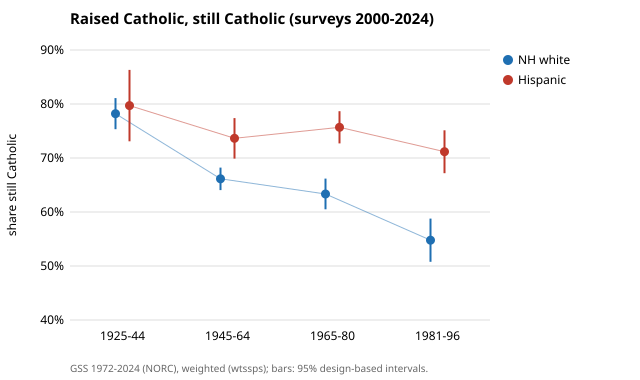
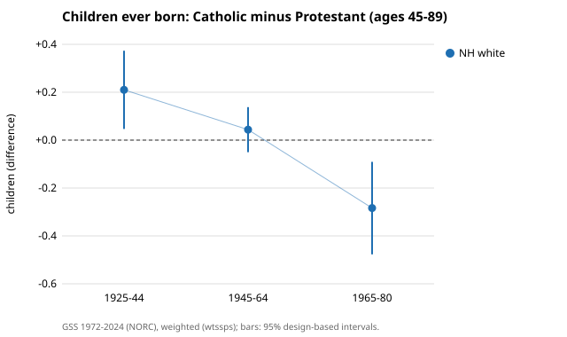

# How do US Catholic subpopulations differ? Hispanic and white Catholics, immigrants, converts and cohorts compared on fertility, retention, Mass attendance and politics (GSS 1972-2024)

A research programme comparing the demography of Catholic subpopulations, starting with the
United States and the General Social Survey (GSS) 1972-2024, with design-based 95% intervals.

**Live page:** https://marisstella.app/research/catholic-demography/

## Headline results (milestone 1, 2026-11-03)

All weighted (`wtssps`), with 95% design-based intervals from the GSS strata and PSUs.

- **The "Catholic fertility" premium is gone, and reversed in the youngest completed cohort.**
  Among non-Hispanic whites aged 45 and over, Catholics born 1925-44 had 0.21 more children than
  Protestants [0.05, 0.37]; born 1945-64, +0.04 [-0.05, 0.14]; born 1965-80, **-0.28
  [-0.48, -0.09]**. What predicts a large Catholic family is attendance, not the label: weekly
  attenders have about 0.5 to 0.6 more children than other Catholics.
- **Retention is falling for white Catholics, much less for Hispanic Catholics.** Of non-Hispanic
  whites raised Catholic, 66% of those born 1945-64 are still Catholic, 63% of those born 1965-80
  and 55% of those born 1981-96. For Hispanics: 74%, 76%, 71%. Across all respondents raised
  Catholic, retention fell from 84% in the 1970s surveys to 62% in 2021-24.
- **Hispanic Catholics are not more likely to go to Mass weekly** than white Catholics (no
  difference in 2010-18; 6 points *less* in 2021-24), but more often read the Bible literally
  and are about 25-30 points less likely to be Republican.
- **The Church is becoming more Hispanic and more immigrant.** Hispanics were 31% of US Catholics
  in 2000-09 and 37% [33, 40] in 2021-24; one in four Catholics is foreign-born.
- **Benchmark.** The GSS 2024 Catholic share is 21.6% [19.3, 23.9]; Pew's 2023-24 Religious
  Landscape Study says 19%. The gap is logged for milestone 2.





Full tables: [`experiments/m1_subgroups/`](experiments/m1_subgroups) (`t1` composition, `t2`
fertility, `t3` retention, `t4` practice, belief and politics by subgroup). Plan and hypotheses:
[`PROPOSAL.md`](PROPOSAL.md). Research log: [`LOG.md`](LOG.md).

## Can reweighting on demographics fix the 2021-24 web respondents? (milestone 5b, 2026-11-11)

Mostly not. In the 2016-20 panel, everyone's first interview was in person, so the 11.1-point attendance gap between
people who later chose web and those who later chose phone is pure selection. Raking the web group to the phone group on
age, sex, ethnicity and degree removes 43% of that gap [23, 87]. Adding region, marital status, children, nativity, size of
place, household size, work status and politics removes no more: -6.6 points [-11.9, -1.1] remain. In the 2022 and 2024
cross-sections, Catholics who answered by web report 10.1 points less weekly Mass attendance than in-person Catholics, and
9.6 [4.1, 15.3] less after reweighting. Demographics remove none of that gap. Web respondents are also 10 points more often
"no religion", and reweighting barely moves that. The programme therefore uses in-person 2022-24 estimates as its post-2020
attendance series. Code `experiments/m5j_reweight/run.py` (raking in `cathdem/rake.py`), tables `t29`, `t30`, details in `LOG.md`.

## Are the answers reliable? The same people asked twice (milestone 5b, 2026-11-11)

In the GSS panels of 2006-10, 95.4% of people who said they were raised Catholic said so again two years later (kappa
0.93, net change -0.06 points [-0.65, +0.53]); over four years reports drift slightly *away* from a Catholic upbringing
(-0.77 [-1.44, -0.11]), all of it among current Catholics. So recall error cannot explain the rise of the raised-Catholic
share in the 2021-24 web interviews. In the 2016-20 panel, people who later answered by web already reported 11 points
less weekly attendance [-17.9, -4.2] than people who later answered by phone when both were interviewed in person; their
change to 2020 differs by only -1.6 points [-8.5, +5.4]. The web attendance gap is mostly who chooses web, not the mode.
Code `experiments/m5i_panel/run.py`, tables `t27`, `t28`, details in `LOG.md`.

## Did immigration or fertility hold the US Catholic share up? (milestone 5b, 2026-11-11)

Immigration. Between 1990-99 and 2010-18 the GSS Catholic share of adults slipped from 26.4% to 25.0%. Counterfactual
reweighting (`experiments/m5h_fertility/`) gives first-generation immigrants **+1.07 points [+0.52, +1.68]** of that change and
the higher fertility of Catholic mothers **-0.37 [-0.69, -0.02]**: fertility added about 1 point to the level in both
decades (1.17 in the 1990s, 0.81 in 2010-18; Catholic mothers born 1925-60 had about 1.1 times the children of other
mothers), but that boost was shrinking, while immigrants added 2.3 then 3.4 points. Hypothesis H4 is supported and the
result survives every sensitivity tried. From 2010-18 to 2021-24 the immigrant contribution fell (-1.38), the larger
channel in the recent drop. Limits: survivors' fertility, religion at interview, children assumed to take the mother's
religion. The model under-explains the share raised Catholic by 2-4 points for cohorts born 1925-69; crediting all of
that to fertility lifts the fertility level to about 2.2 points, but flat across decades, so its share of the 1990-2018
change stays about zero (details in `LOG.md`).

## Retention models (milestone 4, 2026-11-04)

Among Catholic-raised adults aged 30+ (GSS 2000-2024, n = 7,155), design-based logistic models
find white retention falling by cohort, 66% (born 1945-64), 61% (1965-80), 48% (1981-96), while
Hispanic retention stays at 74%, 76%, 70% (cohort x Hispanic interaction p = 0.015). First-generation
immigrants retain more than third-generation Catholics at equal cohort (odds ratio 1.41 [1.15, 1.72]), which
explains the Hispanic level advantage but not its flatter trend. The youngest cohort is only
observed to age 43. Details: `experiments/m4_retention/results.txt` and `LOG.md`.

## Milestone 3 (2026-11-04): is the post-2020 attendance drop real or the survey mode?

Weekly Mass attendance of Catholics fell 5.5 points [-9.3, -1.6] between 2016-18 and 2021-24, but
non-Catholics fell as much (-5.7), and the 2022 and 2024 web respondents attend 9 points less than
in-person respondents in the same year (-9.1 [-15.9, -2.4]; unchanged after adjusting for age, sex,
ethnicity and degree). Among in-person respondents only, the change from 2016-18 is -2.2 [-8.9, +4.5]:
not distinguishable from zero, but the samples are small enough that a real fall of up to about 9 points
is not ruled out. So hypothesis H3 is refuted as worded, and the honest reading is "mostly mode, residual
unknown". Selection (web respondents are partly in-person nonrespondents) is not separated from mode.
Code `experiments/m3_mode/run.py`, results `results.txt`. The randomised-arm contrast (`modesequence`) is in `experiments/m3b_randomised/`: Catholic weekly attendance 19.4% (face-to-face first) vs 17.1% (web first), +2.2 points [-3.1, 7.5], so the experiment neither shows nor excludes a mode effect.

## Limits

Descriptive, not causal: attendance is measured at the interview, after the births. Ethnicity is
asked only from 2000. The GSS was English-only until 2006, so early Hispanic estimates cover
English speakers. The 2021-2024 waves were mostly self-completed on the web, so changes from
2018 mix real change with mode effects (milestone 3). Children ever born is top-coded at 8 and
pools men and women. Related-work notes are from abstracts, not a full re-read.

## Reproduce

```sh
sh data/download.sh                          # GSS 1972-2024 R3a from NORC, about 600 MB, checksummed
sh data/download_gssr.sh                     # fallback when gss.norc.org is unreachable: gssr's .rda copies + panels (needs pyreadr)
python3 experiments/m1_subgroups/run.py      # needs pandas and numpy; about 60 s
python3 experiments/m1_subgroups/figure.py   # stdlib only
python3 experiments/m3_mode/run.py           # mode effect on 2021-24 attendance; about 30 s
python3 experiments/m3b_randomised/run.py     # randomised mode arms, 2022 and 2024; about 60 s
python3 experiments/m5h_fertility/run.py      # fertility vs immigration channel (H4); about 10 min with the bootstrap
python3 experiments/m5i_panel/run.py          # panels: test-retest of upbringing, web vs phone attendance; about 1 min
python3 experiments/m5j_reweight/run.py       # demographic raking of web respondents, panel check + 2022-24; about 6 min
PY=$(python3 platform/ci/pyenv.py pytest numpy pandas)   # bare python3 lacks all three; scipy is not needed
"$PY" -m pytest -q research/catholic-demography/test_cathdem.py   # from the repo root; no download needed
```

Data: Davern, Bautista, Freese, Herd and Morgan, *General Social Survey 1972-2024*, NORC at the
University of Chicago (https://gss.norc.org); free to use with citation. Only scripts, checksums
and aggregate tables are committed. Written with AI assistance (Claude Code); MIT licence.
Related: [`research/religion-origins`](../religion-origins), [`research/marriage-divorce-evidence`](../marriage-divorce-evidence).
