# cell-fidelity: when can a lithium-ion cell design search trust a reduced battery model (SPMe) instead of the full DFN model?

Research programme, track 16 (energy), opened 2026-11-11. Proposal: [`PROPOSAL.md`](PROPOSAL.md); log: [`LOG.md`](LOG.md). Produced with AI assistance (Claude). Results are modelled in PyBaMM on `OKane2022`, with transfer checks on `Ecker2015` and `Ai2020` (milestone 5b) `Mohtat2020` and `NCA_Kim2011` (milestones 5c and 5d), and `Marquis2019` and `Chen2020` (milestone 5e), fresh designs on four of those (milestone 5f), stack level, not a tested cell.

**Live page:** https://marisstella.app/research/cell-fidelity/

**Question.** Electrode design searches (thickness, porosity, N/P ratio) are cheap with a reduced electrochemical model (SPM, SPMe) and expensive with the full porous-electrode model (DFN). Which designs does the reduced model mis-score, can that be told from the reduced model's own output before any DFN call, and how much DFN budget does a search save by using that?

**Paper Table 3 with an eighth battery cell, and the recipe changed from a plating gate to a drift gate (2026-11-24, paper step after 7zd): over eight set-conditions, when should a design search correct the ten-cycle fade forecast?** Where the training designs drift, not where the cell plates. [`paper/tables.py`](paper/tables.py) adds 7zc's plating-free SEI cell as Table 3's eighth column and reproduces 7zc's and 7zd's eight-set intervals exactly. Gated on drift size, the corrected forecast saves 14.7 DFN cycles per design against drift-score triage alone (set bootstrap &minus;27.7 to &minus;1.8, 20 of 40 held-out folds cheaper, 8 dearer) and meets 36 of 40 folds against 35; the out-of-fold error gate saves 15.4 (&minus;28.0 to &minus;3.1, sign p = 0.004). The plating-share gate, which the recipe used until now, switches the correction off on the plating-free cell and its interval still reaches +0.1, so it is dropped. Swapping in 7zd's resistive-film cell moves no row by more than 0.33 cycles. Two limits stay in the text: the interval excludes zero only because the engineered eighth cell is in it, and neither gate tests the direction of the drift, so on the four published parameter sets the gated rules still cost +1.9 to +3.3 cycles per design and two folds. [`paper/abstract.md`](paper/abstract.md), [`paper/results.md`](paper/results.md) (section 4.7, findings 8 and 9) and [`paper/discussion.md`](paper/discussion.md) (5.1, new step 4; 5.4) now say this. Descriptive, no new simulation or hypothesis.

**Does the drift result survive a resistive SEI film? (2026-11-24, milestone 7zd): yes, up to a tenth of Marquis2019's resistivity.** 7zc's plating-free cell had an SEI film with no resistance. Giving the film back 200, 2,000 or 20,000 &Omega;&nbsp;m (Marquis2019's is 200,000) changes almost nothing: lithium loss still grows as &radic;t (3.6 to 3.7% of cyclable lithium over cycles 2 to 20), the straight ten-cycle forecast still over-predicts cycle-99 loss about 2.8-fold, the drift-size gate keeps the correction on and the plating-share gate keeps it off, and the corrected rule meets the accuracy target on 5 of 5 held-out pools at 10.0 DFN cycles per design on every rung, against 46.6 to 49.2 for triage alone and 50.0 for a uniform run length. The charge-choking failure 7zb found sets in between 20,000 and 200,000 &Omega;&nbsp;m. Pre-registered ([`LOG.md`](LOG.md), 7zd): H372 to H376 supported. Results: [`experiments/sei7zd/results.txt`](experiments/sei7zd/results.txt).

**Does the corrected fade forecast pay because of lithium plating, or because of large drift? (2026-11-23, milestone 7zc): drift.** With plating switched off and the SEI film's resistance removed, `Marquis2019` with a 100,000-fold SEI solvent diffusivity loses 3.7% of its cyclable lithium over cycles 2 to 20, all of it to SEI, growing as &radic;t. The straight ten-cycle forecast over-predicts its cycle-99 loss about 2.7-fold, and the corrected forecast fixes that: the honest corrected rule meets the accuracy target on 5 of 5 held-out pools at 10.0 DFN cycles per design, against 49.2 for triage alone and 50.0 for a uniform run length. The plating-share gate switches the correction off on every fold; the drift-size gate keeps it on. So the paper's recipe should gate on drift. Over eight set-conditions the drift-gated rule saves 14.7 cycles per design against triage (set bootstrap &minus;27.7 to &minus;1.8), the first deployable interval below zero, though the eighth cell was built to drift. The cell is engineered (an SEI film with no resistance), not measured. Pre-registered ([`LOG.md`](LOG.md), 7zc): H367 to H371 supported. Results: [`experiments/sei7zc/results.txt`](experiments/sei7zc/results.txt).

**Can a battery cell drift without lithium plating? (2026-11-23, milestone 7zb): an SEI-only test of why the corrected fade forecast pays.** Not under this protocol. With plating switched off, no multiplier of `Marquis2019`'s SEI solvent diffusivity from 10 to 1,000,000 makes the cell lose 3 to 20% of its cyclable lithium over cycles 2 to 20: lithium loss peaks at 0.96% and then falls, because the growing SEI film's resistance cuts the charge step short (charge time at cycle 20 drops to 10% of cycle 2's at the 1e5 rung) and the loss limits itself. So the question of whether the correction pays because of plating or because of large drift stays open, and the paper keeps the plating-share gate. Pre-registered ([`LOG.md`](LOG.md), 7zb): H362 refuted, H363 to H366 not run. Results: [`experiments/sei7zb/results.txt`](experiments/sei7zb/results.txt).

**The paper's abstract, and Table 3 with a seventh battery cell (2026-11-23, paper step after 7za): over seven set-conditions, does correcting the ten-cycle fade forecast save DFN simulation against a uniform run length, and against triage alone?** Against a uniform run length, yes: every corrected rule saves 13.5 to 14.4 DFN cycles per design, set bootstrap upper ends &minus;3.8 to &minus;4.7 (23 to 25 of 35 held-out folds cheaper, 4 dearer), while meeting the accuracy target on 28 to 31 folds against the uniform rule's 33. Against drift-score triage alone, no rule with an honest margin is clearly cheaper (best &minus;12.0, interval &minus;25.0 to +0.1); the one interval below zero belongs to the leaky ungated rule and costs two folds. The deployable gates now reach 92% of a hindsight oracle's saving. [`paper/tables.py`](paper/tables.py) rebuilds 7za's `Marquis2019` column and the seven-set pooling, reproducing 7za's stored intervals exactly; [`paper/abstract.md`](paper/abstract.md) is the paper's first abstract, every number traced to a table or log entry. Descriptive, no new simulation or hypothesis.

**The corrected fade forecast on a cell it never saw (2026-11-23, milestone 7za): does correcting the ten-cycle forecast pay on `Marquis2019`, whose lithium loss accelerates rather than slows?** Yes. Every rule and gate was fixed before the cell existed. The honest corrected rule meets its accuracy target on 4 of 5 held-out pools at 14.6 DFN cycles per design, where the straight-forecast triage rule meets 2 of 5 at 34.8 and a uniform run length 4 of 5 at 44.0: &minus;29.4 cycles per design against uniform, every fold cheaper, the same saving as on the two earlier plating cells (three cells together &minus;29.8, &minus;30.0 to &minus;29.4). All three gates switch the correction on. Over seven set-conditions the plating-share recipe saves &minus;12.0 cycles per design against triage alone (set bootstrap &minus;25.0 to +0.1, sign p = 0.041) and meets 31 of 35 folds (triage 30). Pre-registered ([`LOG.md`](LOG.md), 7za): H358 to H360 supported, H361 inconclusive (the interval's upper end moved from +2.5 to +0.1). Results: [`experiments/marq7za/results.txt`](experiments/marq7za/results.txt).

**A seventh battery chemistry for the triage rule (2026-11-22, milestone 7z): is the ten-cycle DFN triage rule still cheaper than a uniform run length across chemistries with `Marquis2019` added?** On average yes, and on the new cell the saving comes with misses. PyBaMM's `Marquis2019` (Kokam pouch) barely fades under the protocol, so 7r's pre-registered ladder scaled its copied OKane2022 plating rate by 3, 10, 30, 100; 30 is the smallest that makes four probe designs lose 3 to 20% of their cyclable lithium (4.2%), and all 56 designs finish 100 cycles. Over seven set-conditions (four committed parameter sets, three tuned plating cells at their probe-chosen rates, 35 held-out folds) the threshold rule costs &minus;4.52 DFN cycles per design against a uniform run length, set bootstrap 95% &minus;7.55 to &minus;1.43 (21 folds cheaper, 6 dearer, sign p = 0.006). But on `Marquis2019` it meets its accuracy target on 2 of 5 folds against the uniform rule's 4, its ten-cycle error q75 is 0.267, and with 7r's cells at the faster rate the seven-set interval spans zero (&minus;6.86 to +2.48). Pre-registered ([`LOG.md`](LOG.md), 7z): H354 and H357 supported, H355 inconclusive, H356 refuted. Results: [`experiments/plating7z/results.txt`](experiments/plating7z/results.txt). Next: 7v's corrected forecast on this cell, whose drift runs the other way (median m 1.29).

**Paper Table 3, the corrected forecast in one table (2026-11-22, paper step after 7y): across every rule tried, when does correcting the ten-cycle battery fade forecast save DFN simulation?** Only on the plating-limited cells, and no gate tried so far picks those out in advance. [`paper/tables.py`](paper/tables.py) now rebuilds milestones 7w to 7y from their committed fold rows into Table 3 of [`paper/results.md`](paper/results.md) (section 4.7, output [`paper/tables.txt`](paper/tables.txt)), reproducing every logged count, mean and six-set interval exactly. On the four committed parameter sets every corrected rule meets 16 or 17 of 20 held-out folds against triage's 19 and costs +1.4 to +3.3 DFN cycles per design more; on the f = 30 plating cells every one stops at ten cycles and meets 10 of 10. Fold for fold, 7y's plating-share gate makes 7x's out-of-fold error gate's choice on all 30 six-set folds, and the drift-size gate makes the ungated rule's, so three gates come down to two decisions. The best deployable gate reaches 89% of the hindsight oracle's six-set saving (&minus;10.58 against &minus;11.83 cycles per design) and meets two fewer committed folds. Descriptive, no new simulation or hypothesis.

**No gate can rescue the correction on the committed sets (2026-11-22, milestone 7y): does a mechanism signal tell the rule when to trust the corrected ten-cycle forecast?** No. Plating is 99.1 to 99.9% of the lithium lost over cycles 2 to 10 on every design of `Chen2020`, `OKane2022` and `NCA_Kim2011`, as on the tuned plating cells, so a plating-share gate fixed in advance makes 7x's choice (17 of 20 held-out folds met at 45.4 DFN cycles per design, against 19 of 20 at 43.5 for triage alone). A gate on the size of the per-design drift is worse (17 of 20 at 46.8; +3.25 cycles per design against triage, 8 folds dearer, none cheaper, sign p = 0.008), because the committed sets drift as far as the plating cells, only in both directions. Post hoc, an oracle that picks corrected or straight per set by the held-out outcome picks straight on all four committed sets, so no gate could do better than triage alone there; the &minus;30 cycles per design the correction saves lives only on the tuned f = 30 cells, and both gates keep it. `NCA_Kim2011` looks like a plating cell on every signal tried and still misses one held-out pool. Results: [`experiments/gate7y/results.txt`](experiments/gate7y/results.txt); log: [`LOG.md`](LOG.md), 7y.

**An out-of-fold gate does not rescue the correction (2026-11-21, milestone 7x): can the training pools tell the rule when to trust the corrected ten-cycle forecast?** Not on the four committed sets. With every corrected error that a decision is scored on computed out of fold, the gated rule switches the correction off on every `Ai2020` fold (recovering that set exactly) and keeps the full &minus;30 DFN cycles per design on the plating cells, but on the four committed sets it meets the accuracy target on 17 of 20 held-out folds, against 19 for the uncorrected rule, and costs +1.9 cycles per design more. Removing 7w's inner-margin leak alone also gives 17 of 20, so the leak was not the cause. The remaining misses are pool shift: on `Chen2020`, `OKane2022` and `NCA_Kim2011` the correction wins on every training pool and still fails on one held-out pool. The recipe stays: straight forecast plus drift-score triage by default, the correction only where plating is known to dominate. Results: [`experiments/gate7x/results.txt`](experiments/gate7x/results.txt); log: [`LOG.md`](LOG.md), 7x. Next: a mechanism gate (plating share of early lithium loss) fixed in advance.

**The correction is cell-specific (2026-11-21, milestone 7w): does the corrected ten-cycle forecast also pay on the four committed parameter sets?** No. On `Ai2020`, `Chen2020`, `OKane2022` and `NCA_Kim2011`, swapping 7c's corrected forecast into the threshold rule costs +1.4 DFN cycles per design more than the uncorrected rule, and the corrected rule meets its accuracy target on 16 of 20 held-out folds instead of 19. On `Ai2020` the correction's chosen observable doesn't carry over and the held-out median ten-cycle error goes from about 0.04 to about 0.4. Only `NCA_Kim2011` gains. The pre-registered hypotheses (H340 to H343) pass as written, because they compared against the uniform run length, and the six-set interval (&minus;22.3 to &minus;1.9 cycles) is driven by 7v's two plating cells. A post-hoc gate on the training pools matches the uncorrected rule's cost (43.5 cycles) but meets fewer folds. So the paper's recipe keeps the straight forecast plus drift-score triage, and the correction is a step for plating-dominated cells only. No new simulation. Results: [`experiments/rule7w/results.txt`](experiments/rule7w/results.txt); log: [`LOG.md`](LOG.md), 7w. Next: a nested correct-or-not gate chosen out of fold.

**Ten DFN cycles and a correction are enough on fast-plating cells (2026-11-21, milestone 7v): does the corrected forecast turn the triage rule's extra cycles into a saving?** Yes, and it makes the triage unnecessary there. Swapping 7c's corrected ten-cycle forecast (fitted per fold on the training pools) for the straight line inside the threshold rule, and changing nothing else, the rule stops every design on the two plating-multiplier-30 cells at ten DFN cycles and still meets its accuracy target (1.25 &times; the held-out pool's all-50 upper-quartile cycle-99 lithium-loss error) on 10 of 10 held-out folds. That is 30 cycles per design cheaper than the uniform run length (40, 10 of 10 folds cheaper, sign p = 0.002) and 35.5 cheaper than the uncorrected rule: 7s's +5.50 becomes &minus;30.00. A uniform run length on the corrected rows also stops at ten, so triage adds nothing once the forecast is corrected (a tie at 0.00). At plating multiplier 10 the gain is &minus;19.2 cycles, all on `Ecker2015`; on `Mohtat2020` the corrected rule meets only 2 of 5 folds. No new simulation; two tuned cells, five folds each. Pre-registered ([`LOG.md`](LOG.md), 7v): H336 to H338 supported, H339 inconclusive. Results: [`experiments/rule7v/results.txt`](experiments/rule7v/results.txt). Next: the same swap on the four committed parameter sets, where the paper's saving comes from.

**Correct the ten-cycle battery fade forecast, don't lengthen it (2026-11-20, milestone 7u).** 7t traced the faster-plating cells' forecast error to a plating reaction that slows itself. Its early signature, the bend of lithium plated over cycles 2 to 10, is the same number as 7c's existing observable O3 (the bend of all lithium lost; equal to within 3e-4 on all 200 designs), and the 7c line on it, fitted leave-one-pool-out, cuts the median cycle-99 error at plating multiplier 30 from 0.105 to 0.038 (`Mohtat2020`) and from 0.249 to 0.072 (`Ecker2015`). That is below the same cells' straight-line error at multiplier 10 (0.045, 0.098) and below a straight 50-cycle look (0.061, 0.131; post hoc). A separate plating observable adds nothing over 7c's correction (medians equal to 2e-5). No new simulation. Pre-registered ([`LOG.md`](LOG.md), 7u): H331 to H333 supported, H334 refuted, H335 inconclusive. Results: [`experiments/bend7u/results.txt`](experiments/bend7u/results.txt).

**Why a ten-cycle battery fade forecast degrades when lithium plating is faster (2026-11-20, milestone 7t).** Because the plating reaction throttles itself. On the two tuned cells, the lithium plated per cycle at cycles 90 to 99 falls to 0.30 and 0.24 of its cycle 2 to 10 rate at plating multiplier 30, against 0.56 and 0.51 at 10. Within each cell that drifts, designs that throttle more drift more from their ten-cycle slope (Spearman +0.83 to +0.88). Across eight set-conditions (four committed parameter sets, two tuned cells at two rates), the median throttle orders the median drift (&rho; = &minus;0.81, permutation p = 0.024). The ten-cycle error is that drift (Spearman +0.79 to +0.99 within every set-condition). A longer look does not fix it: the f = 30 median error is still 0.061 and 0.131 at 50 cycles, against the f = 10 ten-cycle 0.043 and 0.087. A look scaled to the share of fade observed would stop at about 8 cycles, which is worse. No new simulation (288 designs already benched). Pre-registered ([`LOG.md`](LOG.md), 7t): H326, H327 and H330 supported, H328 inconclusive, H329 refuted. Results: [`experiments/bend7t/results.txt`](experiments/bend7t/results.txt).

**The six-set interval depends on the plating rate (2026-11-20, milestone 7s): does 7r's result survive the ladder's other passing multiplier?** No. Rerunning 7r's code with the plating rate scaled by 30 instead of 10 (also inside the committed sets' fade range on the probe), all 112 designs finish 100 cycles, but on both tuned cells the threshold rule is now dearer than a uniform run length (+7.50 on `Mohtat2020`, +3.50 on `Ecker2015` cycles per design; 7 of 10 folds dearer, 1 cheaper). The six-set interval goes back across zero: &minus;1.17 cycles per design, set bootstrap &minus;6.19 to +3.75 (f = 10: &minus;6.94 to &minus;0.57). The rule meets its target on 9 of 10 new folds (f = 10: 5 of 10), so the two multipliers trade a saving for a miss. The forecast is noisier at the faster rate (cycle-10 error q75 0.132 and 0.294) and 7c's correction switches observable (O1 to O3). 7r's "first interval that excludes zero" is withdrawn as a headline; the paper keeps the four-set interval and reports the tuned cells as a sensitivity range. Results: [`experiments/plating7s/results.txt`](experiments/plating7s/results.txt).

**Six battery chemistries, two with a tuned plating rate (2026-11-20, milestone 7r): with a faster plating reaction on `Mohtat2020` and `Ecker2015`, is the triage rule cheaper than a uniform run length across chemistries?** Yes on average, with a caveat. Scaling only the plating exchange-current density by 10 (the smallest step of a pre-registered ladder of 3, 10, 30, 100 that passes the probe) makes both cells lose 4.2% and 5.0% of their cyclable lithium from cycle 2 to 20, like the committed sets; all 112 designs finish 100 cycles and the ten-cycle forecast works (error q75 0.074 and 0.201). Added as a fifth and sixth set, they move the across-chemistry interval of threshold minus uniform below zero for the first time: &minus;3.73 cycles per design, set bootstrap &minus;6.94 to &minus;0.57 (four sets: &minus;8.50 to +0.25). The caveat: on `Mohtat2020` the threshold rule meets its tail target on only 2 of 5 folds (uniform 3 of 5), and over all 30 folds it meets 26 against 27. The two new sets are tuned cells, not published parameterisations. Results: [`experiments/plating7r/results.txt`](experiments/plating7r/results.txt).

**Why Ramadass2004 cannot be the fifth set (2026-11-20, milestone 7q): is the broken forecast the rule's fault or the cell's?** The cell's. PyBaMM 26.10.1.1's `lico2_ocp_Ramadass2004` (matched to 5e-8 V) is a rational fit evaluated at 1.13 y, and that stretch puts three narrow poles inside 0 < y < 1, at y = 0.245, 0.374 and 0.889, the last in the cycling range. The simulated cells charge a median 9.8% of their cathode per cycle (28 to 44% on the committed sets) and about half step across the pole. Repairing the table the forecast law reads helps but does not fix it: the cycle-10 error q75 falls from 12.6 to 0.90 with a running-maximum envelope (committed sets 0.06 to 0.12), and bridging the spikes is worse. Counted as a fifth set anyway, the repaired cell makes the threshold rule dearer (+8.4 cycles per design) and widens the across-chemistry interval to &minus;7.53 to +3.81. The paper keeps four sets and excludes Ramadass2004 for this measured reason; `experiments/poles7q/run.py scan` is a stdlib pre-check for poles in any tabulated OCP. Results: [`experiments/poles7q/results.txt`](experiments/poles7q/results.txt).

**A fifth parameter set (2026-11-19, milestone 7p): do other PyBaMM cells firm up the paper's across-chemistry interval?** No, and the run measured why. Of eight candidate conditions on four cells no triage step had used, only `Ramadass2004@1x` loses lithium fast enough to test (5.0% of nLi from cycle 2 to 20). `Mohtat2020`, `Ecker2015` and `Marquis2019` lose 0.08 to 0.61% even at 3x to 4x current, against 4.8 to 17% on the committed sets. On `Ramadass2004` (45 of 56 designs to cycle 100) the ten-cycle lithium-loss forecast itself breaks (cycle-99 error q75 12.6, against 0.06 to 0.12), so every rule stops at cycle 10 and the pooled threshold-minus-uniform interval stays at &minus;7.53 to +0.33 cycles per design. Post hoc, `Ramadass2004` is the only one of eight cells whose positive OCP table on the 0 to 1 stoichiometry grid is not monotone, which corrupts the forecast law's table inversion. The paper keeps four sets and now states the measured reason. Results: [`experiments/sets7p/results.txt`](experiments/sets7p/results.txt).

**A policy fitted on the runner's own scorer (2026-11-19, milestone 7o): does it matter whether the triage score integrates the plating current with the trapezoid rule or reads it from the solver's state?** No. All 200 designs the policy and its evaluation ever used (5zk, 5zy, 5zz, 7g, 7h) were re-run for their first ten DFN cycles and every step downstream of the observables refit on the state read. The drift estimate moved by a median 1.2&times;10&minus;5 (max 3.2&times;10&minus;4), every set kept its observable (H306), the 64 held-out 7h decisions were identical and the same three of four sets met the accuracy target (H307), and lopo5 stayed at 19 of 20 folds at 43.5 DFN cycles per design, 13% saved (H308). The old pools' ten-cycle looks do not reproduce their committed observables bit for bit (O3 off by up to 1.4%, H305 refuted on its own bar; 7g and 7h exact), which reaches nothing downstream. The runner now ships with a policy fitted on its own read: [`experiments/state7o/triage.py`](experiments/state7o/triage.py), policy `deploy_state`. Results: [`experiments/state7o/results.txt`](experiments/state7o/results.txt). Pre-registered in [`LOG.md`](LOG.md).

**A lean score read (2026-11-19, milestone 7n): how cheap can the triage runner's decision be, and what does that save?** About 9 ms, and 17.2% of wall time. [`experiments/lean7n/triage.py`](experiments/lean7n/triage.py) reads only the observable the policy uses, and takes each cycle's node plating from the change in PyBaMM's dead-lithium state (the solver's exact integral) instead of integrating the plating current over every output step. On the 64 held-out designs of the 7h pool the read fell from a median 0.20 s to 0.009 s (1.09 to 0.043 cycle equivalents, H302); scores moved by a median 1&times;10&minus;4 relative and no decision changed (64 of 64, H301). Each design ran in a mean 0.828 times a plain 50-cycle run, a 17.2% saving (7m: 14.0%; 12.6% of total compute, H303), within 0.010 of the cycle model (H304). Results: [`experiments/lean7n/results.txt`](experiments/lean7n/results.txt). Pre-registered in [`LOG.md`](LOG.md).

**The triage runner (2026-11-19, milestone 7m): can the paper's triage rule run as a tool, one battery design per process, and save wall time on designs its policy never saw?** Yes. [`experiments/runner7m/triage.py`](experiments/runner7m/triage.py) builds one PyBaMM DFN `Simulation` per design, solves 10 cycles, reads the drift score from the cycle-2 and cycle-10 plating, and either stops or keeps solving the same object to cycle 50, with nothing written to disk. On all 64 designs of the 7h pool, under a frozen policy picked without them, its scores match the offline analysis to 3&times;10&minus;13 and its stop/extend decisions agree on 64 of 64 (H297). It ran each design in a mean 0.860 times a plain 50-cycle run, against 0.819 from the cycle model (H298): a 14.0% wall-time saving per design, 9.7% of total compute (H300). Reading the score costs 1.26 cycle equivalents, more than the 0.5 planned (H299 inconclusive). The accuracy side is 7h's: the policy met the tail target on 3 of 4 parameter sets. Results: [`experiments/runner7m/results.txt`](experiments/runner7m/results.txt). Pre-registered in [`LOG.md`](LOG.md).

**In-place continuation (2026-11-19, milestone 7l): can a PyBaMM DFN battery simulation be stopped at cycle 10 and continued to cycle 50 for free?** Yes, if the same `Simulation` object is kept alive. [`experiments/keep7l`](experiments/keep7l/run.py) ran 16 designs through a 10-cycle experiment and then called `sim.solve(starting_solution=sol)` four more times on the same object. Reaching cycle 50 that way took a median 1.000 times one uninterrupted 50-cycle run (IQR 0.95 to 1.06), an extra 0.02 cycle equivalents against a fixed cost of 6.34 (H294 supported), with a bit-identical cycle-50 state (H293). Solving one cycle at a time costs 0.03 cycles per call (H296). So the drift-score triage saves 16.9% of wall time in this bench's units, 17.1% on 7j's runner (H295), where 7k's restart-from-file runner, which rebuilt the model, saved about nothing. Results: [`experiments/keep7l/results.txt`](experiments/keep7l/results.txt). Pre-registered in [`LOG.md`](LOG.md).

**Continuation test (2026-11-19, milestone 7k): does resuming a PyBaMM DFN run from cycle 10 save simulation time?** It gives the same answer but not the saving. [`experiments/resume7k`](experiments/resume7k/run.py) ran 16 designs to cycle 10, saved the solution, and resumed to cycle 50 with `starting_solution`, in a new process and in the same one. The resumed cycle-50 lithium loss matched an uninterrupted run to within 5e-5 (H290 supported), but the resume rebuilds and discretises the model, so it pays the fixed cost again: 13.4 cycle equivalents against 11.8 for a fresh run (H291 refuted), and cycle 10 plus resume took 1.22 times one 50-cycle run (IQR 1.17 to 1.24). Priced in, the 17.1% wall-time saving 7j assumed for continued triage becomes &minus;1.1% (8.3% scaled to 7j's runner; H292 refuted). The triage rule saves wall time only in a runner that keeps the built model between the cycle-10 look and the extension. Results: [`experiments/resume7k/results.txt`](experiments/resume7k/results.txt). Pre-registered in [`LOG.md`](LOG.md).

**Paper draft, discussion section (2026-11-19, milestone 7j): how much wall-clock simulation time does drift-score triage save a battery cell design search?** About 17%, but only if a flagged design's cycle-10 DFN run is continued rather than restarted. [`paper/discussion.md`](paper/discussion.md) turns the results into a three-step recipe and prices it in time with [`paper/cost.py`](paper/cost.py) (output [`paper/cost.txt`](paper/cost.txt)), using wall times already logged with committed runs: on 192 designs run both to cycle 10 and to cycle 100, a DFN run's fixed cost is worth 5.66 cycles (IQR 4.65 to 6.18; 2.63 on a second runner). Because the frozen threshold rule flags 76% of designs, 19.1% fewer DFN cycles become 17.1% less wall time when runs are continued and a 4.3% loss when flagged designs are rerun from cycle 0; restarting breaks even only below 72% flagged. On the cloud container that ran 7g and 7h, 1000 designs to cycle 50 cost 1.3 to 4.3 CPU-hours per parameter set and continued triage returns 0.22 to 0.73 of them. Three figures ([`paper/fig1_insample.svg`](paper/fig1_insample.svg), [`paper/fig2_outofbatch.svg`](paper/fig2_outofbatch.svg), [`paper/fig3_time.svg`](paper/fig3_time.svg)) are drawn from the tables by [`paper/figures.py`](paper/figures.py). Descriptive, computed after every milestone had reported; the continuation numbers assume a resumed run costs the same per cycle, which this programme's runner has not tested.

**Paper draft, results section (2026-11-19): how much DFN simulation budget does drift-score triage save a battery cell design search, with intervals?** [`paper/results.md`](paper/results.md) writes up milestones 5zk to 7h as the paper's results section, with two tables and interval statistics regenerated from the committed summaries by one command ([`paper/tables.py`](paper/tables.py), output [`paper/tables.txt`](paper/tables.txt)). Pooled over the two fresh design pools, the frozen threshold policies meet the tail target in 18 of 24 cases (0.75; Wilson 95% 0.55 to 0.88; set-clustered bootstrap 0.67 to 0.88) at 40.5 DFN cycles per design, 19% saved against running every design to cycle 50 (bootstrap 12% to 27%). On 20 leave-one-pool-out folds the threshold rule and a uniform run length each meet 19, and the threshold rule is cheaper on 14 folds, dearer on 4 (exact sign test p = 0.031), but a bootstrap over the four parameter sets puts its mean saving of 4.5 cycles per design at &minus;8.5 to +0.25: consistent across folds, not yet shown across chemistries. Intervals computed after the fact; no new hypothesis. Limits: modelled fade, one PyBaMM version, 8 to 16 designs per pool.

**Latest headline, milestone 7h (2026-11-19): does a battery design search's DFN-cycle triage rule keep saving simulation budget on a second batch of cell designs it has never seen?** Yes. On a fifth pool of 64 PyBaMM DFN designs simulated for this step only (16 per parameter set, run to 100 cycles), milestone 7f's 12 frozen threshold policies met the upper-quartile cycle-99 lithium-loss target (1.25 times running every design to 50 cycles) in 9 of 12 cases for the second fresh batch in a row, at 39.3 DFN cycles per design against 50 (21% saved; 17% on 7g). Leaving each of the five pools out in turn, the threshold on the ten-cycle drift score meets 19 of 20 held-out pools at 43.5 cycles (13% saved), where a uniform run length meets 19 at 48.0 (4%). A new threshold relative to each batch's median drift score meets 4 of 4 sets at 40.6 cycles and 18 of 20 folds, but does not steady the flagged share, so the absolute threshold stays the rule. Pre-registered ([`LOG.md`](LOG.md), 7h): H285, H288, H289 supported, H286 inconclusive (40.6 against a 40-cycle line), H287 refuted. Results [`experiments/fresh7h/results.txt`](experiments/fresh7h/results.txt), figure [`experiments/fresh7h/fresh7h.svg`](experiments/fresh7h/fresh7h.svg). Limits: 4 sets, 16 designs per fresh pool; modelled fade only.

**Milestone 7g (2026-11-19): does a battery design search's DFN-cycle triage rule still hit its accuracy target on cell designs it has never seen?** Yes, about as often as before, for a sixth to a fifth of the budget. On a fourth pool of 32 PyBaMM DFN designs simulated for this step only (8 per parameter set, run to 100 cycles), milestone 7f's 12 frozen policies met the upper-quartile cycle-99 lithium-loss target (1.25 times running every design to 50 cycles) in 9 of 12 cases both with an absolute threshold on 7c's ten-cycle drift score and with a flag fraction, at 41.7 and 40.5 DFN cycles per design against 50 (17% and 19% saved; 7f's reused pools gave 20%). Refit on all three earlier pools, the threshold rule meets 3 of 4 sets at 41.2 cycles; a uniform run length meets 4 of 4 at 47.5 (5% saved), and widening only the flagged fraction meets 5 of 12. Two misses share one cause, a 40-cycle extension too short on `Ai2020`, and the drift score ran higher on the fresh designs of two sets, so the absolute threshold flagged more than intended. Pre-registered ([`LOG.md`](LOG.md), 7g): H281 and H283 supported, H282 and H284 inconclusive (just over their 40-cycle line). Results [`experiments/fresh7g/results.txt`](experiments/fresh7g/results.txt), figure [`experiments/fresh7g/fresh7g.svg`](experiments/fresh7g/fresh7g.svg). Limits: 8 designs per fresh pool, so the 12 policies are effectively 4 tests; modelled fade only.

**Milestone 7f (2026-11-19): can a battery design search skip DFN cycles on low-risk cell designs and still hit its accuracy target on a new batch of designs?** Yes, for about a fifth of the budget, once the rule carries a margin set out of batch. Choosing the margin by nested leave-one-pool-out on 104 PyBaMM DFN designs, flagging designs by milestone 7c's ten-cycle drift score and running only those to cycle 50 met the held-out upper-quartile cycle-99 lithium-loss target (1.25 times running every design to 50 cycles) in 9 of 12 folds with an absolute threshold on the score and 10 of 12 with a flag fraction, both at 40.0 DFN cycles per design against 50. A uniform run length given the same margin procedure always ends at 50 cycles, and widening only the flagged fraction meets 6 of 12. The in-sample savings of 7d and 7e (33% to 61%) are 20% out of batch. Pre-registered ([`LOG.md`](LOG.md), 7f): H277 and H280 supported (H280 on its 20% line), H279 refuted, H278 inconclusive. Results [`experiments/margin7f/results.txt`](experiments/margin7f/results.txt), figure [`experiments/margin7f/margin7f.svg`](experiments/margin7f/margin7f.svg). Limits: 8 to 12 designs per pool; the drift score's fit saw every pool; no fresh fourth pool yet.

**Milestone 7e (2026-11-19): how long should a battery design search simulate the risky cell designs, and do the DFN cycles it saves hold on a new batch of designs?** In hindsight the triage pays at almost every accuracy target, but the savings do not carry to the next batch. Across 104 PyBaMM DFN designs, flagging designs by milestone 7c's ten-cycle drift score and running only those longer meets an upper-quartile cycle-99 lithium-loss target of 1.00 to 2.00 times the all-50-cycle figure with 33% to 61% fewer DFN cycles than running every design to cycle 50 (mean over targets, per parameter set), against 18% to 39% for the best uniform run length and 30% to 52% for random flags. The extension has to be long: on three of four sets, 30 cycles cannot reach 1.25 times the 50-cycle tail error even for every design. Chosen on two design pools and applied to the third, the triage policy met the held-out target in 4 of 12 folds, against 7 of 12 for a uniform run length chosen the same way, so 7d's and 7e's savings are an in-sample ceiling until the rule carries a margin set out of batch. Pre-registered ([`LOG.md`](LOG.md), 7e): H273 and H275 supported, H274 and H276 refuted. Results [`experiments/frontier7e/results.txt`](experiments/frontier7e/results.txt), figure [`experiments/frontier7e/frontier7e.svg`](experiments/frontier7e/frontier7e.svg). Limits: 8 to 12 designs per held-out pool, so its target is one or two designs; the drift score's fit saw every pool; one law form, one PyBaMM version, modelled fade.

**Milestone 7d (2026-11-19): can a battery design search simulate only the risky cell designs for longer and keep the accuracy of a 50-cycle lithium-plating fade forecast?** On two of four parameter sets, yes, for about half the DFN cycles. Across 104 PyBaMM DFN designs, the real ten-cycle forecast of cycle-99 lithium loss misses by 11.4% at the upper quartile on `Chen2020` (LG M50) against 5.7% for a 50-cycle line. Simulating on to cycle 50 only the designs that milestone 7c's ten-cycle drift score flags reaches 1.25 times the all-50 tail error once 15% of `Chen2020`'s designs are extended (68% of the all-50 DFN cycles saved; random flags need 50%, saving 40%) and 45% of `NCA_Kim2011`'s (44% saved against 20%); on `Ai2020` it saves 36% against random's 24%. On `OKane2022` nothing saves cycles, not even flags chosen with hindsight (85% must be extended), because the tail is spread over most designs. With every input measured, the cycle-2 plating depth alone flags best on LG M50 (20% extended, 64% saved). Pre-registered ([`LOG.md`](LOG.md), 7d): H269, H271 and H272 supported, H270 inconclusive. Results [`experiments/triage7d/results.txt`](experiments/triage7d/results.txt), figure [`experiments/triage7d/triage7d.svg`](experiments/triage7d/triage7d.svg). Limits: 24 to 28 designs per set, so the upper quartile moves by whole designs; one tail target; the flags rank within a batch; one law form, one PyBaMM version, modelled fade.

**Milestone 7c (2026-11-19): can ten battery cycles tell which cell designs will drift away from a lithium-plating fade forecast?** Yes, and that fixes the worst forecasts but not the typical one. Across 104 PyBaMM DFN designs, with every input to the fade law measured, each design's drift multiplier m (how far the law's rate over cycles 10 to 99 departs from its ten-cycle slope) tracks where the plating sits at cycle 2: Spearman &rho; = 0.80 on both LG M50 sets (`Chen2020`, `OKane2022`; Holm-adjusted permutation p = 0.0003), and &minus;0.72 to &minus;0.73 against the bend of lithium loss itself. Plating nearer the separator means the rate speeds up. A leave-one-design-out correction built on that observable leaves the set-median cycle-99 lithium-loss error where it was (1.8% to 2.3% on `Chen2020`, 1.9% to 2.1% on `OKane2022`), because the typical design drifts by only 4%, about the correction's own error. Post hoc, it does what matters for a design search: it halves the upper-quartile error (8.0% to 3.5%, 7.3% to 3.0%) and the 90th percentile (10.1% to 6.5%, 9.0% to 5.3%), so the designs whose ten-cycle line goes most wrong are flagged before cycle 11. On the real ten-cycle forecast it beats the line on all four parameter sets (median 4.0% to 1.4% on `NCA_Kim2011`, 6.7% to 4.6% on `OKane2022`). Pre-registered ([`LOG.md`](LOG.md), 7c): H265 and H268 supported, H266 refuted, H267 inconclusive. Results [`experiments/drift7c/results.txt`](experiments/drift7c/results.txt), tails and per-pool check [`experiments/drift7c/posthoc.txt`](experiments/drift7c/posthoc.txt), figure [`experiments/drift7c/drift7c.svg`](experiments/drift7c/drift7c.svg). Limits: 24 to 28 designs per set; the observable is a model internal (node plating) a real cell shows only through a diagnosis; one law form and &kappa;; one PyBaMM version; modelled fade.

**Milestone 7b (2026-11-19): does fitting a battery fade law on more cycles, or adding a curve, fix a ten-cycle lithium-plating forecast?** Not on LG M50 cells, because the law is not where the error is. With every input to the law measured, the set-median cycle-99 lithium-loss error barely moves as the fit window grows from 10 to 50 cycles (1.8% to 1.6% on `Chen2020`, 1.9% to 1.4% on `OKane2022`), while the real ten-cycle forecast falls from 5.6% to 2.7% and 6.7% to 2.1%: longer windows fix the forecast's inputs, not the law. The law's integral R(L) is a straight line in cycle number at the set median (late slope 0.99 times the early slope over 104 PyBaMM DFN designs), but each design drifts by &plusmn;5 to 10% in either direction, so a curvature borrowed from other designs makes the forecast worse and a free quadratic through ten cycles is worse everywhere. `Ai2020` is the exception: its R accelerates by a quarter over the run on every design, and a borrowed bend cuts its all-measured error from 8.3% to 4.8% (23 of 24 designs). Pre-registered ([`LOG.md`](LOG.md), 7b): H261 supported, H263 inconclusive, H260, H262 and H264 refuted. Results [`experiments/lawfloor/results.txt`](experiments/lawfloor/results.txt), shape check [`experiments/lawfloor/posthoc.txt`](experiments/lawfloor/posthoc.txt), figure [`experiments/lawfloor/lawfloor.svg`](experiments/lawfloor/lawfloor.svg). Limits: one law form and one &kappa;; model internals as inputs; one PyBaMM version; modelled fade.

**Milestone 7a (2026-11-19): what limits a ten-cycle lithium-plating forecast on battery designs it has never seen?** The forecast law itself. 5zu's error budget (each of the anode OCP rise, the plating-overpotential drift and the charge-capacity factor forecast from ten cycles or measured, all eight combinations scored on cycle-99 lithium loss, Shapley split) was repeated on 64 PyBaMM DFN designs no earlier step had used. Every direction replicates: the OCP rise is the largest input on `OKane2022` and `NCA_Kim2011`, the drift on `Chen2020`, the capacity factor adds nothing anywhere, and on `Ai2020` measuring the inputs makes the forecast worse (2.9% to 8.3%). The sizes do not: with every input measured, the forecast still misses by 3.4% on `OKane2022` and 3.2% on `Chen2020` (1.5% and 1.4% in sample), so on fresh LG M50 designs more than half the ten-cycle error is the law's straight-line extrapolation, not any input. Not caused by the in-sample bench's rounding (checked post hoc). Pre-registered ([`LOG.md`](LOG.md), 7a): H256 to H259 supported. The 104-design table is the paper's error budget: [`experiments/heldbudget/results.txt`](experiments/heldbudget/results.txt); figure [`experiments/heldbudget/heldbudget.svg`](experiments/heldbudget/heldbudget.svg). Limits: same pools, chemistry and current; model internals; one PyBaMM version; modelled fade.

**Milestone 5zz (2026-11-19): does the anode thickness-line fix for a ten-cycle lithium-plating forecast survive a second set of fresh battery designs?** No. On 32 more PyBaMM DFN designs (8 per parameter set, run to 100 cycles), the per-node line in anode thickness, now fitted on all 72 earlier designs and used only inside their thickness range, beats the uniform node lever's set-median cycle-99 lithium-loss error on `NCA_Kim2011` only (5.3% to 3.7%) and is worse on `Ai2020` (1.2% to 3.4%), `Chen2020` (4.5% to 4.7%) and `OKane2022` (5.1% to 6.2%); design by design it wins 14 of 29. Across both fresh pools it wins 33 of 64 designs. Even the design's own measured anode OCP rise beats the uniform lever on only 14 of these 32 designs, so outside `NCA_Kim2011` the node lever is not what limits the ten-cycle forecast. Pre-registered ([`LOG.md`](LOG.md), 5zz): H254 (more training designs improve the line) supported; H252, H253, H255 refuted. Figure: [`experiments/rangeline/rangeline.svg`](experiments/rangeline/rangeline.svg). Limits: 8 designs per set; same pools, chemistry and current; model internals; one PyBaMM version; modelled fade.

**Milestone 5zy (2026-11-18): does a lithium-plating forecast's anode node-gain profile, learned on 40 simulated cell designs, hold on 32 designs it never saw?** Partly. On a fresh PyBaMM DFN pool (8 new designs per parameter set, run to 100 cycles), every borrowed profile still reads the cycle-99 anode OCP rise better than the uniform lever on all four sets, and a per-node line in anode thickness has the lowest set-median ten-cycle lithium-loss error on three of four (`OKane2022` 7.2% to 5.6%, `Chen2020` 7.5% to 6.5%, `NCA_Kim2011` 3.3% to 2.5%; `Ai2020` worse, 4.4% to 5.0%). The gains are smaller than in-sample and heavy-tailed: the line beats the uniform lever on 19 of 32 designs and misses two thin `OKane2022` designs by 14 to 15%, at the edge of the training thickness range. The pre-registered monotonicity gate fired on `NCA_Kim2011` only. Pre-registered ([`LOG.md`](LOG.md), 5zy): H248 and H251 supported, H249 and H250 inconclusive. Figure: [`experiments/freshnode/freshnode.svg`](experiments/freshnode/freshnode.svg). Limits: 8 designs per set; same pools, chemistry and current as training; model internals; one PyBaMM version; modelled fade.

**Milestone 5zx (2026-11-18): does matching a borrowed anode node-gain profile to the design improve a ten-cycle lithium-plating forecast?** Not by nearest neighbours. Taking the profile from the three most similar designs of the same chemistry (leave one design out, 40 PyBaMM DFN designs) keeps `OKane2022`'s gain (cycle-99 lithium-loss error 6.7% to 4.5%) but leaves `Chen2020` (6.5%) and `NCA_Kim2011` (4.1%) worse than the uniform lever, as 5zw's set-wide median did; in a four-parameter design space with 8 to 12 designs the neighbours are not near. A per-node line in anode thickness, reported but not pre-registered, reaches 2.7% on `OKane2022` (below the 3.5% measured-OCP ceiling) and 1.5% on `NCA_Kim2011` (from 3.0%), where the separator node's late gain rises with thickness, and fails on `Ai2020` and `Chen2020`, where it does not. Pre-registered ([`LOG.md`](LOG.md), 5zx): H246 supported, H244 and H245 refuted, H247 inconclusive. Figure: [`experiments/nodematch/nodematch.svg`](experiments/nodematch/nodematch.svg). Limits: designs seen before; small pools; the thickness line is a post-hoc lead; model internals; one PyBaMM version; modelled fade.

**Milestone 5zw (2026-11-18): can a lithium-plating forecast borrow how anode nodes lag from other designs of the same cell chemistry?** On `OKane2022`, yes: carrying the median per-node gain profile of the other designs in the set (leave one design out, 40 PyBaMM DFN designs) takes the ten-cycle forecast of cycle-99 lithium loss from 6.7% to 4.1% error (the measured-OCP ceiling is 3.5%), and the transferred profile reads the anode OCP rise better than the uniform lever on all four parameter sets. It does not generalise: `Chen2020` (5.4% to 6.5%) and `NCA_Kim2011` (3.0% to 4.2%) get worse, where the separator node's late gain varies widely across designs, and the transfer beats the uniform lever on 23 of 40 designs. With each design's own late gains a constant per-node gain reaches the ceiling everywhere, so the open problem is predicting the profile from the design. Pre-registered ([`LOG.md`](LOG.md), 5zw): H240 and H241 supported, H242 refuted, H243 inconclusive. Figure: [`experiments/nodetransfer/nodetransfer.svg`](experiments/nodetransfer/nodetransfer.svg). Limits: designs seen before; small pools (8 to 12); model internals; one PyBaMM version; modelled fade.

**Milestone 5zv (2026-11-18): can ten cycles calibrate how each anode node's OCP lags the lithium-plating forecast's uniform shift?** Not well enough to forecast. A gain per anode node, fitted over cycles 3..10 of 40 PyBaMM DFN designs, finds the local OCP rising at 0.1 to 0.8 of the uniform shift's rate on `OKane2022`, but extrapolated to cycle 99 it under-reads the OCP rise by 14.8 mV (the uniform lever: 5.9) and leaves the cycle-99 lithium-loss forecast at 6.9% against 6.7%. It does reach the measured-OCP ceiling on `Chen2020` (5.4% to 3.9%) and helps `NCA_Kim2011` (3.0% to 2.3%); 22 of 40 designs improve. Gains on the separator-side nodes only take `OKane2022` to 4.1% as a set median, but on just 6 of 12 designs and found after the plan, so a lead, not a fix. Pre-registered ([`LOG.md`](LOG.md), 5zv): H237 and H238 refuted, H236 and H239 inconclusive. Figure: [`experiments/nodegain/nodegain.svg`](experiments/nodegain/nodegain.svg). For a design search, fitting the law's line through 30 to 50 cycles is still the advice. Limits: 40 designs seen before; gains weakly determined on plateau nodes; model internals; one PyBaMM version; modelled fade.

**Milestone 5zu (2026-11-18): where does a ten-cycle lithium-plating forecast lose accuracy, the anode OCP, the overpotential drift or the capacity fade?** An error budget over 40 PyBaMM DFN designs answers it: each of the three inputs is forecast from ten cycles or measured, all eight combinations are scored on cycle-99 lithium loss, and a Shapley split assigns the gap. On `OKane2022` (6.7% off against 1.5% all-measured) the node lever's anode OCP rise carries 3.3 points and the drift 1.1; on `Chen2020` (5.4% against 1.4%) they carry 2.1 and 2.0; the charge-capacity factor's share is under 0.3 points on every set. On `Ai2020` measuring the inputs makes the forecast worse (2.3% to 8.0%), so its small ten-cycle error is partly offsetting errors. Pre-registered ([`LOG.md`](LOG.md), 5zu): H232 and H234 supported, H233 and H235 inconclusive. Figure: [`experiments/budget/budget.svg`](experiments/budget/budget.svg). For a design search, fitting the law's line through 30 to 50 cycles is still the advice. Limits: 40 designs seen before; the inputs are model internals; one PyBaMM version; modelled fade.

**Milestone 5zt (2026-11-18): can ten battery cycles forecast the lithium-plating overpotential drift, and does it fix a ten-cycle lithium-plating forecast?** Partly, and no. Tying the non-OCP drift of the plating-weighted plating overpotential to the falling charge overpotential forecasts its cycle-99 value in 40 PyBaMM DFN designs closer than a ten-cycle line on every parameter set (3.5, 6.0 and 4.9 mV off against 13.0, 8.7 and 7.1 on `Ai2020`, `Chen2020`, `OKane2022`), but added to the node lever it makes the cycle-99 lithium-loss forecast worse on all four sets (7.6% against 5.4% on `Chen2020`, 7.9% against 6.7% on `OKane2022`) and beats the law's lever on 17 of 40 designs. On LG M50 the drift turns negative after cycle 10 while every ten-cycle forecast stays positive. The measured drift takes `Chen2020` from 5.4 to 2.4% but leaves `OKane2022` at 6.5%. Pre-registered ([`LOG.md`](LOG.md), 5zt): H228 supported, H229 and H230 refuted, H231 inconclusive. Figure: [`experiments/etadrift/etadrift.svg`](experiments/etadrift/etadrift.svg). For a design search, fitting the law's line through 30 to 50 cycles is still the advice. Limits: 40 designs seen before; a one-slope tie; the drift is a model internal; one PyBaMM version; modelled fade.

**Milestone 5zs (2026-11-18): can ten battery cycles forecast lithium-ion charge capacity fade, and is that what limits a ten-cycle lithium-plating forecast?** Yes, and no longer. A saturating ten-cycle fit of the charge overpotential in the electrode-balance window forecasts the cycle-99 charge-capacity factor of 40 PyBaMM DFN designs within 2.4 to 4.8% on all four parameter sets (5zr's ten-cycle line: 3.6 to 7.6%; a straight line in the factor itself, 5zq: 16 to 51%). Feeding the node lever the measured factor itself changes its cycle-99 lithium-loss error by &minus;0.2, +0.4 and &minus;0.7 points on `Ai2020`, `Chen2020` and `OKane2022` (&minus;1.3 on `NCA_Kim2011`), so no better capacity-factor forecast can help it much. With the saturating factor the node lever's ten-cycle forecast is 2.3% off on `Ai2020`, 5.4% on `Chen2020`, 6.7% on `OKane2022` and 3.0% on `NCA_Kim2011` (the law's own lever: 8.3, 8.2, 5.9, 2.2%) and beats the law's lever on 22 of 40 designs. The remaining error on LG M50 is the plating-overpotential lever. Pre-registered ([`LOG.md`](LOG.md), 5zs): H224, H225 and H226 supported, H227 inconclusive. Figure: [`experiments/saturate/saturate.svg`](experiments/saturate/saturate.svg). For a design search, fitting the law's line through 30 to 50 cycles is still the advice. Limits: 40 designs seen before; half the fitted decay lengths sit on a grid end; &eta; is a symmetric cut-off shift; one PyBaMM version; modelled fade.

**Milestone 5zr (2026-11-18): does lithium-ion charge capacity fade follow the electrode balance, and does knowing it fix a ten-cycle lithium-plating forecast?** Yes, then no. The electrode-balance window (lost lithium sliding the open-circuit window along the two OCP curves), with a ten-cycle line in the charge overpotential, forecasts the cycle-99 charge-capacity factor of 40 PyBaMM DFN designs within 3.6 to 7.6% on all four parameter sets, where 5zq's straight line missed by 16 to 51%; the forecast law's own factor, with the overpotential held, is within 2.4 to 7.1%. So the capacity factor's upward curve is geometry the law already carries, and the effective charge overpotential falls rather than grows (by 6 to 18 mV over ten cycles, then levels). Fed to the law with the node lever, the window factor beats the law's own lever on only 14 of 40 designs (cycle-99 lithium-loss error 2.8% on `Ai2020` against 8.3%, 5.4% on `Chen2020` against 8.2%, 8.1% on `OKane2022` against 5.9%, 5.7% on `NCA_Kim2011` against 2.2%) and is no better than the node lever alone: the ten-cycle forecast's remaining error on LG M50 is the lever, not the capacity factor. Pre-registered ([`LOG.md`](LOG.md), 5zr): H220 and H221 supported, H222 inconclusive, H223 refuted. Figure: [`experiments/window/window.svg`](experiments/window/window.svg). For a design search, fitting the law's line through 30 to 50 cycles is still the advice. Limits: 40 designs seen before; &eta; is a symmetric cut-off shift; one PyBaMM version; modelled fade.

**Milestone 5zq (2026-11-18): can ten battery cycles forecast the two inputs that straighten a lithium-plating degradation forecast?** Not with straight lines. 5zp found the forecast law is close to right on LG M50 when fed the measured non-OCP plating overpotential and charge-capacity factor, but both were read to cycle 99. Extrapolating each from cycles 2..10 on the same 40 PyBaMM DFN designs, the ten-cycle forecast misses cycle-99 lithium loss by 5.7% on `Chen2020` (law's own lever 8.2%, oracle 1.4%), 7.2% on `OKane2022` (5.9%), 10.1% on `NCA_Kim2011` (2.2%) and 7.0% on `Ai2020` (8.3%), and beats the law's lever on only 15 of 40 designs. The capacity factor accelerates after cycle 10 on every set (the line reads 1.20 to 1.59 at cycle 99 against 1.53 to 2.00 measured), and the overpotential drift turns over, so its line has the wrong sign at cycle 99 on LG M50. Pre-registered ([`LOG.md`](LOG.md), 5zq): H217 refuted, H216, H218 and H219 inconclusive. Figure: [`experiments/drift/drift.svg`](experiments/drift/drift.svg). For a design search, fitting the law's line through 30 to 50 cycles is still the advice. Limits: 40 designs seen before; simplest forecasts only; one PyBaMM version; modelled fade.

**Milestone 5zp (2026-11-18): why does a lithium-plating degradation forecast's straight line bend, and what straightens it?** On LG M50 cells it bends because the law holds two inputs at their early-cycle form: the part of the plating overpotential that is not the anode OCP, and the charge-capacity factor. Fed both as 40 PyBaMM DFN designs measured them, the ten-cycle forecast at &alpha;F/RT misses cycle-99 lithium loss by 1.4% (`Chen2020`) and 1.5% (`OKane2022`), against 3.8% and 3.4% with the measured OCP alone (5zo), and the line's bend falls from 0.10 and 0.09 to 0.03 and 0.04; each input alone does little because they pull opposite ways. On `Ai2020` the measured overpotential doubles the bend instead (4.2% to 8.7%), so something else offsets it there. A 10&times; finer integration table changes nothing (bend moves by at most 0.004). Pre-registered ([`LOG.md`](LOG.md), 5zp): H212 supported narrowly, H213 and H214 inconclusive, H215 supported. Figure: [`experiments/rate/rate.svg`](experiments/rate/rate.svg). Limits: these variants read cycle 99, so they diagnose rather than forecast; 40 designs seen before; one PyBaMM version; modelled fade.

**Milestone 5zo (2026-11-18): how much of a lithium-plating degradation forecast's error is the lever and how much is the law?** About half each on LG M50 cells. Fed the measured plating-weighted anode OCP rise of 40 PyBaMM DFN designs (an oracle lever), the forecast law at &alpha;F/RT with its line through ten cycles misses cycle-99 lithium loss by 3.8% on `Chen2020` and 3.4% on `OKane2022`, against 8.2% and 5.9% with the law's own lever (1.2% against 2.2% on `NCA_Kim2011`); the rest is the law's straight line in R against cycle number, whose slope drifts by 9 to 13% across 100 cycles even with the true lever. The node lever's early over-read on `OKane2022` sits next to the separator, where the plating is, not at the collector. Pre-registered ([`LOG.md`](LOG.md), 5zo): H209 supported, H210 inconclusive, H211 refuted. Figure: [`experiments/oracle/oracle.svg`](experiments/oracle/oracle.svg). Limits: 40 designs seen before, the oracle reads cycle 99, one PyBaMM version, modelled fade.

**Milestone 5zn (2026-11-17): why does a lithium-plating degradation forecast need a larger exponent on LG M50 cells?** Because it reads the anode's open-circuit potential in the wrong place. The plating sits 0.15 stoichiometry above the forecast law's window top, off the graphite plateau the law reads; the law's own lithium-to-stoichiometry shift read at each electrode node's cycle-2 state reproduces the plating-weighted OCP rise of 40 PyBaMM DFN designs to within 2% by cycle 99 on `Chen2020` (slope 0.98, against 1.35 to 1.49 for the law's lever) and from cycle 10 (3.25 mV against 2.88 measured and 0.42 for the law). It does not yet make a better ten-cycle forecast everywhere: at &alpha;F/RT it cuts the cycle-99 lithium-loss error on `Ai2020` from 8.3% to 2.3% (7 of 8 designs) and on `Chen2020` from 8.2% to 5.9%, but loses on `OKane2022` (5.9% to 7.6%) and `NCA_Kim2011` (2.2% to 4.8%); 22 of 40 designs. Pre-registered ([`LOG.md`](LOG.md), 5zn): H204 to H208 inconclusive. Figure: [`experiments/plateau/plateau.svg`](experiments/plateau/plateau.svg). Limits: 40 designs seen before, one PyBaMM version, modelled fade.

**Milestone 5zm (2026-11-17): can a short battery simulation tell a lithium-plating degradation forecast which exponent to use?** Not on LG M50 cells. Milestone 5zl found the exponent the forecast needs is &alpha;F/RT times the ratio of the plating-weighted OCP rise to the law's own lever, read over 100 cycles. Cut at 10, 20 or 30 PyBaMM DFN cycles, that reading is 2 to 3 times too high on `Chen2020` and `OKane2022` (100, the clamp, and 49 to 75, against 38 and 34 at cycle 99), because early on the OCP where the plating sits rises several times faster than the law's lever, whose window is still on the graphite plateau; the ratio falls all the way to cycle 99. On `NCA_Kim2011` it is flat from cycle 10 and on `Ai2020` it settles by cycle 30. Forecasts at the early exponent lose to the physical 25.3 V&minus;1 given the same cycles on 4 of 4 sets at 10 cycles and 3 of 4 at 30. The practical answer is plainer: run 30 to 50 DFN cycles and fit the law's line at 25.3, which cuts the cycle-99 lithium-loss error from 8.2% to 2.0% on `Chen2020` and halves it or better on every set. Pre-registered ([`LOG.md`](LOG.md), 5zm): H200 and H202 refuted, H201 and H203 inconclusive. Figure: [`experiments/horizon10/horizon.svg`](experiments/horizon10/horizon.svg). Limits: 40 designs seen before, one PyBaMM version, modelled fade.

**Milestone 5zl (2026-11-17): what sets the lithium-plating exponent a battery degradation forecast needs?** The open-circuit potential rise where the plating actually happens. On 40 PyBaMM DFN designs run to 100 cycles, 25.3 V&minus;1 (&alpha;F/RT) times the ratio of the plating-weighted end-of-charge OCP rise to the forecast law's own lever lands within 3 to 12% of the exponent the forecast needs on LG M50 (`Chen2020` 37.7 against 36.6, `OKane2022` 34.2 against 32.3) and `NCA_Kim2011` (26.4 against 23.6), and 34% high on `Ai2020` (25.2 against 18.8). It is closer than the separator-node reading on 37 of 40 designs (sign test p = 10&minus;8), ranks designs within three sets (Spearman 0.83 to 0.95) and cuts the 100-cycle forecast error by a factor of 3 on LG M50 (0.082 to 0.025, 0.059 to 0.019). This reverses 5zk's reading, which had compared pools at different currents. It is a diagnosis, not yet a forecast: the lever reads cycle 99. Pre-registered ([`LOG.md`](LOG.md), 5zl): H198, H199 supported, H195 to H197 inconclusive. Output: [`experiments/wlever/results.txt`](experiments/wlever/results.txt), [`wlever.svg`](experiments/wlever/wlever.svg).

**Milestone 5zk (2026-11-17): where inside a lithium-ion battery's negative electrode does lithium plating happen, and does it explain why plating forecasts need different exponents on different cells?** It happens mostly inside the electrode, not at the separator: on 40 PyBaMM DFN designs run to 100 cycles, the separator-side node carries only 8 to 19% of a cycle's plating, and the plating-weighted depth is 0.53 to 0.72 of the thickness. That spread explains why a separator-node rate index mis-tracked `NCA_Kim2011`'s plating slowdown (by 0.28 in log there, 0.015 on LG M50). It does not explain the plating exponent: read where the plating is, the potential lever shrinks to 0.64 of the separator node's on `Ai2020` and 0.78 to 0.81 on LG M50, moving the implied exponent from 73 to 47 on `Ai2020` (needed: 21) and further from what `Chen2020` (27 against 52) and `OKane2022` (28 against 38) need. With 5zj, two corrections to where and how the plating potential is read move all sets the same way, so the set differences sit in the law's own lever, not the measured one. Re-runs reproduce 5z's records to 3 &times; 10&minus;7. Pre-registered ([`LOG.md`](LOG.md), 5zk): H191, H192 and H194 supported, H193 refuted. Output: [`experiments/depth/results.txt`](experiments/depth/results.txt), [`depth.svg`](experiments/depth/depth.svg).

**Milestone 5zj (2026-11-17): what gives back the separator-surface lever on the one battery model where it overshoots?** Partly the charge profile and the intercalation overpotential, but not enough. On PyBaMM's `Ai2020` set they give back about 41% of the surface open-circuit potential's lever (about 20% on LG M50). That halves the exponent the lever implies there, from 73 to 43 against the 21 the forecast needs. The same correction moves the other three sets further from theirs, so the plating exponent is not set at the separator node. The milestone first re-checked `Ai2020`'s "unbooked" lithium loss, a question 5p and 5za had already closed, which the plan missed. That loss is plating: PyBaMM 26.10.1.1 books side reactions for one of the cell's 34 parallel electrode pairs. The integrated plating current matches the particles' loss to 0.01%, and a doubled mesh moves it by 0.1%. Pre-registered ([`LOG.md`](LOG.md), 5zj): H187, H189 and H190 supported (H187 a replication), H188 refuted (a replication of 5p); the term split is post hoc. Output: [`experiments/ledger/terms.txt`](experiments/ledger/terms.txt), [`results.txt`](experiments/ledger/results.txt).

**Milestone 5zi (2026-11-17): why does a lithium-plating forecast need a steeper exponent on some battery models than on others?** On two of four PyBaMM parameter sets it is because the potential that slows plating, the negative electrode's open-circuit potential at the separator-side particle surface, rises faster than the law's lever. Scaling the physical exponent &alpha;F/RT by that ratio lands within 25% of the exponent the cycle-99 forecast needs on all 12 `OKane2022` and `NCA_Kim2011` pools. On `Chen2020` it explains 50 to 89% of the steeper exponent. On `Ai2020` it is three times too high (the surface potential rises 102 to 136 mV against the law's 41 to 43 mV, yet the forecast needs about the physical exponent), so across the 24 pools it does not order the exponents (Spearman &minus;0.10). Nor can it be read early: on LG M50 the surface potential has not moved by cycle 10. All 768 committed DFN designs, no new simulation. Pre-registered ([`LOG.md`](LOG.md), 5zi): H185 supported, H184 and H186 refuted, H182 and H183 inconclusive (7 of 12 and 6 of 12).

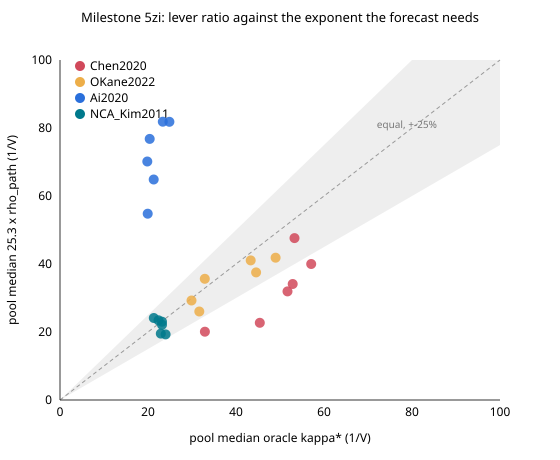

**Milestone 5zh (2026-11-17): how many earlier 100-cycle battery simulations does a calibrated lithium-plating forecast need?** About ten for the typical gain, about 80 to never lose. 5zg calibrated the plating law's exponent once per parameter set on 160 earlier PyBaMM DFN runs. Resampling the 768 committed designs (24 pools, each forecast with &kappa; from k runs of its set's other pools, 500 draws), ten runs put every pool's median cycle-99 lithium-loss error within 0.7 points of the 160-run calibration, and ten runs from one earlier campaign at another current do as well as ten scattered ones. But at ten runs the unlucky draw (90th percentile) is still worse than the physical exponent on 10 of 24 pools, those where physics was already within 6 to 8%; the count falls to 3 at 80 runs and 1 at 160. One run is never enough (worse than physics on all 24 pools at the 90th percentile). Pre-registered ([`LOG.md`](LOG.md), 5zh): H178 to H180 supported, H177 and H181 refuted.

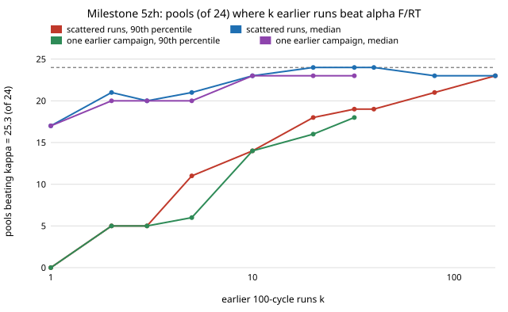

**Milestone 5zg (2026-11-17): can a lithium-plating fade forecast from ten battery cycles be fixed with one calibrated exponent per cell type?** Yes. 5zf found the plating law's kinetic exponent &kappa; cannot be read from a design's own ten cycles, and that LG M50 needs a steeper one than the physical &alpha;F/RT = 25.3 V&minus;1. A design search has earlier 100-cycle runs of the same parameter set to hand, so 5zg calibrates &kappa; once per set as the median of the oracle exponent over those runs (21.0, 22.7, 49.7 and 38.6 V&minus;1 for `Ai2020`, `NCA_Kim2011`, `Chen2020`, `OKane2022`). On 128 fresh PyBaMM DFN designs (SEI + plating, seed 25, new currents) the cycle-99 lithium-loss error falls from 9.3% and 7.6% to 4.9% and 6.5% on LG M50, and from 5.6% and 1.7% to 4.9% and 0.9% on the controls; the signed bias drops from +9% on LG M50 to under 2% on every pool. Letting &kappa; follow a line in the charging current does slightly better on LG M50 (4.6%, 5.8%). Pre-registered ([`LOG.md`](LOG.md), 5zg): H172 to H176 supported.

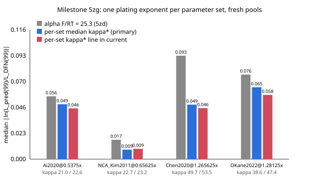

**Milestone 5zf (2026-11-16): can the lithium-plating kinetic exponent be measured from a battery's first ten cycles, and what value does the plating forecast need?** Not on LG M50, and the value it needs there is not the physical one. Every ten-cycle plating forecast since 5zb has used &kappa; = &alpha;F/RT = 25.3 V&minus;1, from OKane2022's plating transfer coefficient, on all four parameter sets. On 128 fresh PyBaMM DFN designs (SEI + plating, seed 24, new currents), estimating &kappa; per design from cycles 2 to 10 makes the cycle-99 lithium-loss forecast worse on all four sets (LG M50 12.7% and 12.2% against 9.9% and 5.9%; `NCA_Kim2011` 5.4% against 1.9%). On LG M50 the potential lever rises by under 1 mV in ten cycles, so the estimate is noise (two thirds of `Chen2020` designs hit the 100 V&minus;1 bound). The oracle exponent that makes each forecast exact says why the law still over-predicts LG M50: it needs 45 and 32 V&minus;1 there (1.2 to 2.3 &times; &alpha;F/RT across ten LG M50 pools), while `Ai2020` and `NCA_Kim2011` need about the physical 20 and 23. Pre-registered ([`LOG.md`](LOG.md), 5zf): H167 to H171 supported.

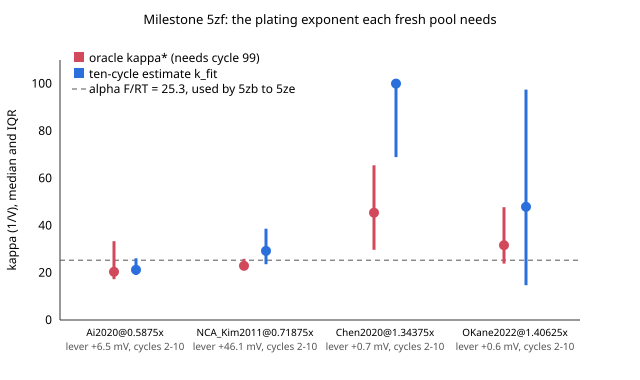

**Milestone 5ze (2026-11-16): why does the ten-cycle lithium-plating forecast miss on Ai2020 battery models, and is it the overpotential?** It is not the overpotential. 5zd blamed its `Ai2020` cost on the effective overpotential &eta; drifting over 100 cycles. On 128 fresh PyBaMM DFN designs (SEI + plating, seed 23, new currents), feeding the law &eta;'s *true* drift to cycle 99 makes the cycle-99 lithium-loss forecast worse on all four sets (`Ai2020` 11.1% against 6.3%; LG M50 15.5% and 12.6% against 10.9% and 9.5%). Splitting &eta; into a discharge side and a charge side, measured from each design's ten-cycle discharge energy as well as its charge Ah, puts the charge side within 2 to 5 mV of the symmetric &eta; and moves the forecast by at most 0.7%. On seen data, extrapolating &eta;'s ten-cycle trend and choosing the reading per design from ten cycles both fail too. 5zd's LG M50 result replicates at a new seed (10.9% and 9.5%, against 19.1% and 16.0% for 5zc). So the gap left on `Ai2020` is in the law's structure, not in how &eta; is measured. Pre-registered ([`LOG.md`](LOG.md), 5ze): H162 to H166 supported.

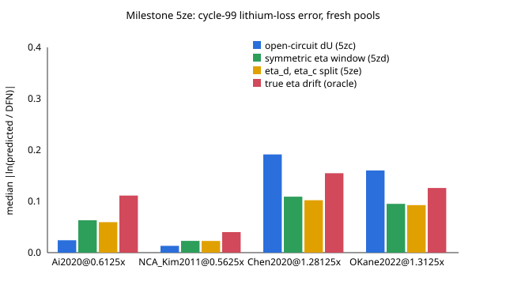

**Milestone 5zd (2026-11-16): can a ten-cycle forecast of lithium-plating fade reach 10% accuracy on LG M50 battery models?** Yes, once both levers of the plating kinetics are read where the loaded charge actually ends. 5zc measured an effective overpotential &eta; from each design's first ten cycles and used it for the charge time; 5zd reads the negative electrode's potential rise at the same &eta;-shortened charge window instead of at the open-circuit cut-off. With no new parameter, the 100-cycle lithium-loss error on fresh LG M50 pools (PyBaMM DFN, SEI + plating, 128 new designs) falls from 20% and 17% to 10% and 6% (59 of 64 designs won; worst pool 0.104 against 0.202), and the separator-surface potential rise is forecast within 17 to 21 mV against 27 to 35 mV. `NCA_Kim2011` improves (3.3% to 2.0%); `Ai2020` worsens from 2.5% to 7.6%, just past the pre-registered harm bar, because its &eta; drifts. Pre-registered ([`LOG.md`](LOG.md), 5zd): H157, H158, H160, H161 supported; H159 (controls no worse by more than 0.05) mixed.

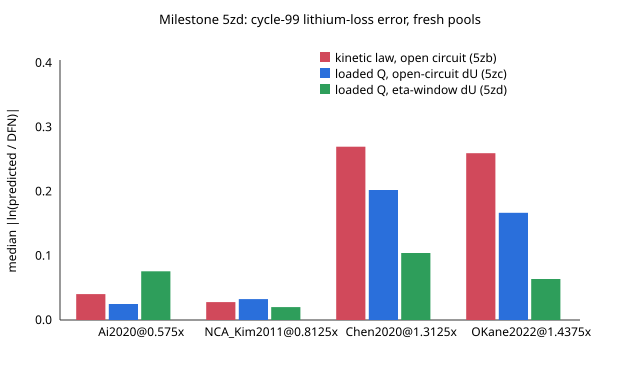

**Milestone 5zc (2026-11-16): does reading the charge time from the loaded charge capacity fix the lithium-plating fade forecast on LG M50 battery models?** Partly, and it locates what is left. Measuring an effective overpotential &eta; from each design's first ten cycles of charge Ah, and reading the charge capacity &eta; short of each voltage cut-off, cuts 5zb's over-prediction of the 100-cycle lithium loss on fresh LG M50 pools (PyBaMM DFN, SEI + plating, 128 new designs) from 28% and 25% to 21% and 16%, winning on all 64 LG M50 designs, while the controls stay at 3.0% (`Ai2020`) and 2.3% (`NCA_Kim2011`). The constant &eta; predicts the cycle-99 charge Ah within 4 to 5% on three pools, where the open-circuit capacity is off by up to 86%. Post hoc, the measured charge Ah plus the measured separator-surface potential rise make LG M50's per-cycle plating steady, so the remaining gap is forecasting that surface rise. Pre-registered ([`LOG.md`](LOG.md), 5zc): H152, H154, H155 supported; H153 (within 15% on both LG M50 pools) and H156 (charge Ah within 5% on all four) mixed.

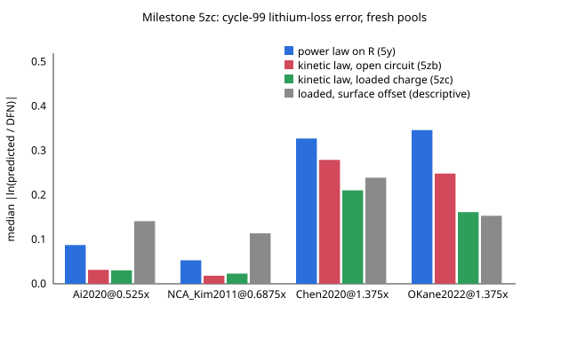

**Milestone 5zb (2026-11-16): can one ten-cycle law forecast lithium-plating fade to 100 cycles across battery models, with its shape fixed by the physics rather than fitted?** Mostly. If the plating per cycle is proportional to the charge capacity left and is slowed by the negative electrode's potential rise, the integrated loss is a straight line in the cycle count. Fitting only that line's level and rate to cycles 2 to 10 beats the earlier power-law forecast on all four fresh pools (PyBaMM DFN, SEI + plating, 128 new designs at currents no milestone had run to 100 cycles), on 122 of 128 designs. The 100-cycle lithium-loss error falls from 15% to 7.6% on `Ai2020` and from 7.8% to 2.4% on `NCA_Kim2011`, and the worst pool goes from 33% to 26%. LG M50 (`Chen2020`, `OKane2022`) is still over-predicted by 24 to 26%. There the loaded charge shrinks faster than the open-circuit capacity the law reads (0.61 against 0.72 of cycle 2), which points to the next step. Pre-registered ([`LOG.md`](LOG.md), 5zb): H147, H149, H150, H151 supported; H148 (within 6% on both controls) mixed. Figure: [`experiments/kinetic/kinetic.svg`](experiments/kinetic/kinetic.svg).

**Milestone 5za (2026-11-16): can a ten-cycle forecast of lithium-plating fade work on LG M50 battery models once the feedback is read at the particle surface?** Partly. Reading PyBaMM's plating feedback at the separator-side particle surface at end of charge, instead of at open circuit, cuts the over-prediction of the 100-cycle lithium loss on two fresh LG M50 pools (`Chen2020`, `OKane2022`, 64 new designs, 100 DFN cycles each) from 35% to 21 to 23%, with no constant fitted, and keeps the ranking (Spearman 0.96). It misses the 15% bar, and on the `NCA_Kim2011` and `Ai2020` controls it makes the forecast worse (0.03 to 0.07, 0.09 to 0.22) even where it predicts the surface rise exactly, which shows the earlier open-circuit predictor works there partly by compensation. The `Ai2020` lithium that milestone 5z found unbooked is PyBaMM's side-reaction bookkeeping omitting the 34 parallel electrodes, as milestone 5p documented: corrected, plating is 99.6% of it. Pre-registered ([`LOG.md`](LOG.md), 5za): H143, H145, H146 supported; H144 (within 15%) mixed. Figure: [`experiments/surface/surface.svg`](experiments/surface/surface.svg).

**Milestone 5z (2026-11-16): why does lithium plating slow down over 100 cycles in LG M50 battery models, when the open-circuit picture says it should not?** Because the negative electrode's open-circuit potential still rises, but at the loaded particle surface next to the separator: by cycle 99 it is up 38 mV at end of charge on `Chen2020` and `OKane2022` (PyBaMM DFN, SEI + plating, 24 re-run designs), where milestone 5x's open-circuit window showed only 0.5 to 9 mV. That one term carries the whole slowdown of the per-cycle plating (about 3.3&times; from cycle 2 to 99), as it does on `NCA_Kim2011`. Plating is 99.8% of the lithium lost on these sets, and a one-node rate index tracks the per-cycle plating change to within 1.5%. (5z also reported that on `Ai2020` only 3% of the lost lithium is booked to plating or SEI; milestone 5za shows that is the parallel-electrode count, 34, missing from PyBaMM's side-reaction totals, already documented in 5p.) Pre-registered ([`LOG.md`](LOG.md), 5z): H139 (plating dominates), H140 (one-node index), H142 (re-runs reproduce) supported; H141 (a different mechanism on LG M50) refuted. Limits: designs seen before, one node at end of charge, modelled fade.

**Milestone 5y (2026-11-15): does the physics-derived lithium-plating correction predict battery fade on cells it has never seen? On fresh pools, yes for the size of the loss; ranking is a separate problem.** On three fresh pools (192 electrode designs run 100 DFN cycles in PyBaMM, at currents no milestone ran to cycle 100) the plating law's own feedback, exp(&minus;&alpha;F&Delta;U/RT) with &alpha; and T from the parameter set and **no constant fitted**, brings the cycle-99 lithium loss to within 2.4% and 3.8% of DFN on two `NCA_Kim2011` pools and 10.2% on `Ai2020` (the uncorrected ten-cycle law: 31%, 30%, 18%). One law, a power law fitted to the feedback-free loss, now serves both cells, which removes milestone 5x's double count on `Ai2020` (32% under-prediction). On `NCA_Kim2011` its energy ranking (Spearman 0.82, 0.93) beats a map calibrated on 8 hundred-cycle runs (0.62, 0.84); on `Ai2020` the smaller error ranks worse (0.875) than 5x's larger, uniform one (0.974), and raw cycle-10 energy ranks at 0.93 to 0.96 on all three pools. Pre-registered ([`LOG.md`](LOG.md), 5y): H135 (beats the uncorrected law on all 3), H137 (ranks), H138 (one law, not two) supported; H136 (error at most 10% on all 3) mixed. Limits: two cell sets, law form chosen on seen pools, SEI treated as plating, modelled fade.

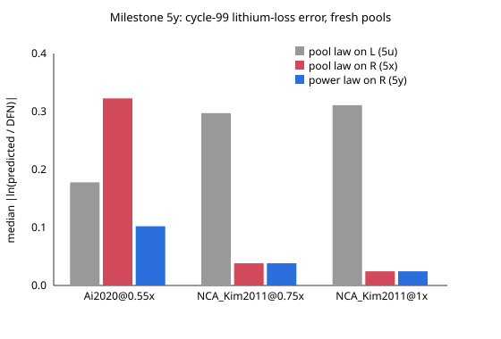

Previous headline, milestone 5x (2026-11-15): can the lithium-ion fade forecast's self-limiting correction be derived from physics instead of fitted? On one cell, yes. PyBaMM's plating rate falls as exp(&minus;&alpha;F&Delta;U/RT) when lost lithium raises the negative electrode's potential at top of charge (&alpha; = 0.65, from the parameter set). Applied to the first ten DFN cycles with **no constant fitted**, it brings the cycle-99 lithium loss on both `NCA_Kim2011` pools to within 5.6% and 3.1% of DFN (the ten-cycle law: 27% and 30%), and its ranking of 100-cycle energy (0.69, 0.91) beats 5w's map calibrated on 8 hundred-cycle runs (0.51, 0.76). Across ten committed pools (622 designs) it orders the cell sets' fitted slopes correctly (Spearman 0.92) and its map beats the &radic;cycle energy fit on 10 of 10. But it double-counts on `Ai2020` (loss under-predicted by about 27%: the &radic;n law already bends) and predicts no feedback on the LG M50 sets (`Chen2020`, `OKane2022`), whose graphite sits on its plateau at top of charge (0.5 to 9 mV of rise). Pre-registered ([`LOG.md`](LOG.md), 5x): H134 (ranks) supported; H131 to H133 (loss size, slope within 0.15) refuted. Limits: pools seen in aggregate, SEI treated as plating, open-circuit cut-off, modelled fade.

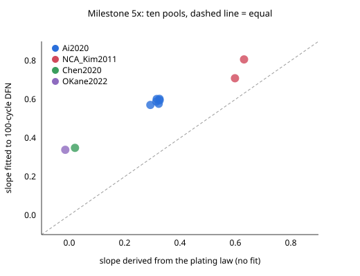

Previous headline, milestone 5w (2026-11-15): does the ten-cycle fade forecast carry from one lithium-ion cell to others? For ranking designs, yes, with one constant recalibrated on 8 designs: on fresh `NCA_Kim2011`, `Chen2020` and `OKane2022` pools (192 designs run 100 DFN cycles, 56 held out per pool) the electrode-balance map fed the corrected forecast ranks the 100-cycle energy at Spearman 0.76, 0.94 and 0.94, against &minus;0.42, 0.80 and 0.80 for 5n's &radic;cycle energy fit. For the size of the loss, no: the correction's slope is cell-specific (about 0.35 on the two LG M50 sets, 0.58 on `Ai2020`, 0.7 to 0.9 on `NCA_Kim2011`), so with `Ai2020`'s slope the cycle-99 lithium loss is off by a median 8.5% on the LG M50 sets.** Raw cycle-10 energy ranks these three pools at 0.93 to 0.96 and already holds each pool's best design in its top 3, so they do not test the screen (see the log).

Previous headline, milestone 5v (2026-11-15): can ten DFN cycles predict which lithium-ion electrode designs fade least by cycle 100? Yes, on the `Ai2020` cell, once the lithium-loss forecast is corrected for loss that slows as a design loses more. On three fresh pools (189 designs run 100 DFN cycles, two at currents no milestone ran) the electrode-balance map fed the corrected ten-cycle forecast ranks the 100-cycle energy at Spearman 0.92 to 0.96, against 0.59 to 0.67 for 5n's &radic;cycle energy fit and 0.61 to 0.82 uncorrected, and within 0.04 of the map fed DFN's true loss.** The diagnosis came first, on 5u's committed pools: the ten-cycle law already ranked the cycle-99 lithium loss at 0.98 to 0.99, but the map is ill-conditioned (a 10% random error on the true loss alone drops its energy ranking to 0.38 to 0.67), and the law's size error grows with the fraction of lithium lost. One line in log space, two constants fitted on 5u's three `Ai2020` pools and frozen, cuts the median cycle-99 loss error from 11 to 18% to 4% on the fresh pools. Pre-registered ([`LOG.md`](LOG.md), 5v): H122 (ranks above the energy fit on 3 of 3, &ge; 0.85 each), H123 (loss within 6%) and H124 (the union of raw top 4 plus corrected top 4 finds the DFN best on every pool, at 6.3 resumed designs against 7.7 for 5n's union) supported; H125 (conditioning) mixed, the drop is 0.19 at 0.6&times; where fade is smallest. Refitting the constants on 8 designs of a new pool gives the same ranking (0.93 to 0.96). Limits: one cell set, the one the constants came from (`NCA_Kim2011` needs its own slope); an empirical correction with no mechanism fitted; three pools (sign test p = 0.25); OKane2022's plating parameters; one PyBaMM version; modelled fade. At 0.6&times; raw cycle-10 energy alone already ranks at 0.98.

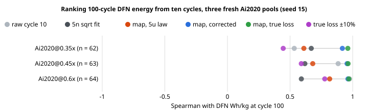

Previous headline, milestone 5u (2026-11-15): can ten DFN cycles predict which lithium-ion electrode designs fade least by cycle 100, on pools nobody has looked at? Not yet, and now we know why: on four fresh pools (241 designs run 100 DFN cycles) the electrode-balance map fed each design's true cycle-99 lithium loss ranks the 100-cycle energy at Spearman 0.95 to 0.97, and a loss law chosen per pool from the ten-cycle curve gets the median loss right (0.94 to 1.05 of the truth on `Ai2020`), but the per-design fit spreads from about 0.8 to 1.45 of the truth, so the map's ranking falls to 0.64 to 0.76 and beats 5n's &radic;cycle energy fit on only 1 of 4 pools. Pre-registered ([`LOG.md`](LOG.md), 5u): the selector picked &radic;n on the three `Ai2020` pools and the power law on `NCA_Kim2011@0.625x`, as 5s's pools predicted (H121 supported); ranking better than the energy fit on 1 of 4 (H117 refuted), fade size on 1 of 4 (H120 refuted); as the union screen's fade list it found the DFN best on three pools and missed by 1.25% on `Ai2020@0.4x`, where 5n's union is exact (H118 mixed, H119 refuted). A three-list union (raw, energy fit, map; 4 each) was exact on all four at 11 resumed designs against 7.8. 5n's union stays the procedure; the next predictor should share the loss curvature across a pool. Limits: four pools, 15 solver drops on the two lowest-current pools, OKane2022's plating parameters, one PyBaMM version, modelled fade.

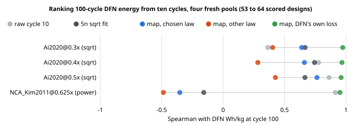

Previous headline, milestone 5t (2026-11-15): does a lithium-loss law that slows down make the electrode-balance map a usable fade predictor? It fixes the ranking but not the screen: fitting a + b&radic;n instead of a power law to ten DFN cycles' lithium loss makes the map rank the 100-cycle DFN energy better than 5s's power law on 12 of 13 test pools, and better than 5n's &radic;cycle energy fit on 8 of 13 (one short of the pre-registered bar), but as the screen's fade list it misses the best design by up to 3.2%. 5s showed the map is accurate and the power-law extrapolation of lithium loss is not. Here the law was swapped for the SEI-growth form a + b&radic;n, chosen on lithium alone from the 27 designs 5s ran to cycle 100, and scored, pre-registered, on the 13 committed 100-cycle pools the diagnostic never touched, with no new simulation ([`LOG.md`](LOG.md)). Ranking: better than the power-law map on 12 of 13 (H116 supported, sign test p = 0.003); better than the &radic;cycle energy fit on 8 of 13 (H112 mixed), by 0.23 to 0.33 in Spearman on `Ai2020@0.625x`, `Chen2020@2x` and `OKane2022@2x`, and worse on both `NCA_Kim2011` pools, where the law over-predicts a loss that decelerates faster. Fade size: worse than the energy fit on 7 of 13 (H113 refuted), under-predicting on `Chen2020` and `OKane2022` and saturating on `NCA_Kim2011`. Screen: the union of the raw top 4 and the map's top 4 misses by 3.17%, 2.17% and 1.19% on three `Ai2020` pools (H114, H115 refuted), and a three-list union (not in the plan) only matches 5n's union at 2.4 more resumed designs per pool. 5n's union screen stays the procedure. Limits: committed pools whose truth earlier milestones read, a law chosen on 27 designs of the same family, one PyBaMM version, modelled fade.

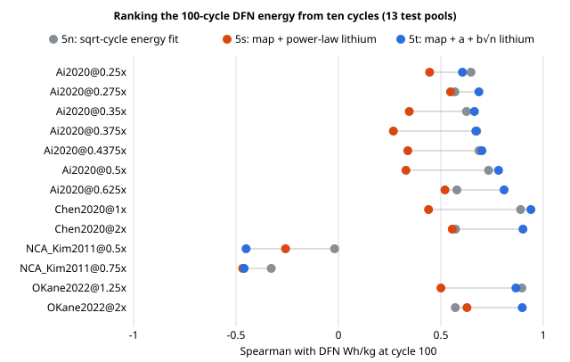

Previous headline, milestone 5s (2026-11-15): can ten cycles of a DFN battery simulation predict a lithium-ion electrode design's capacity fade at cycle 100 by extrapolating its lithium loss? Not with a power law: the electrode-balance map is accurate, but plating slows down after cycle 10, so the extrapolated lithium loss is 1.2 to 2.8 times too high and the predicted fade ranks designs worse than a plain square-root fit of the energy on 15 of 17 conditions. Milestone 5r showed that fade splits into a design-only electrode-balance map and a lithium-loss rate. 5n's screen already runs every design to cycle 10, so its lithium curve comes free. We fitted L(n) = a nb to each run's lithium loss over cycles 2 to 10, read it at cycle 99, mapped it to energy, and pre-registered four tests on 17 committed 100-cycle pools ([`LOG.md`](LOG.md); 1,108 fresh ten-cycle DFN runs, which reproduce the committed cycle-10 energy exactly). All four were refuted. The map's prediction ranks the 100-cycle DFN energy better than 5n's &radic;cycle energy fit on 2 of 17 conditions (H108) and predicts the fade size better on 7, none of them `Ai2020` (H109). Used as the union screen's fade list, it misses the DFN-best design by up to 6.9% (H110), where 5n's union is within 0.32% on all 17 (H111). A post hoc check, on 27 designs run to cycle 100 with their lithium curves, pins down the cause. Fed DFN's own cycle-99 lithium loss, the map is within a mean 0.02 to 0.05 of DFN's fade on `Ai2020`, `Chen2020` and `NCA_Kim2011` (0.12 on `OKane2022`). Fed the power law, it is off by 0.34 to 0.43, because the loss exponent falls from about 0.85 over cycles 2 to 10 to 0.24 to 0.63 over cycles 50 to 99. So the electrode-balance side is solved where cells run near open circuit, and what remains is a self-limiting lithium-loss law. 5n's union screen stays the procedure. Limits: committed pools whose truth earlier milestones read, 9 of the 17 picked by a selection rule with a unit slip (disclosed in the log), one PyBaMM version, modelled fade.

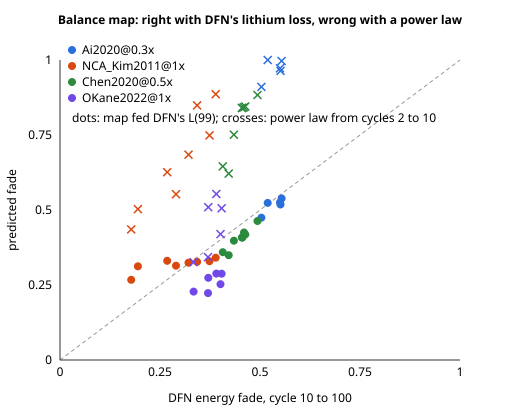

Previous headline, milestone 5r (2026-11-14): why do some lithium-ion electrode designs lose more energy than others for the same lithium lost to plating? Electrode balance: a map from the parameter set and the design alone, with no fitted constant, turns each DFN run's own lithium loss into its energy fade within 0.05 on 34 of 40 fresh fading designs, and ranks fade within a pool far better than the lithium loss does on the fade-limited `Ai2020` cell (Spearman +0.95 against +0.48).** Milestone 5q found that energy lost per unit of lithium lost varies about twofold within one pool, so a lithium-loss rate cannot rank fade by itself. The map finds the open-circuit window between the voltage cut-offs from the two electrodes' lithium capacities, the cyclable lithium and the two OCP curves, and reads off how much energy the window loses as lithium leaves: a design with spare negative capacity slides its window before it shrinks it. Pre-registered ([`LOG.md`](LOG.md); 128 fresh DFN runs, 5p's eight conditions, 8 new designs each, 20 cycles with and without degradation): within 0.05 of DFN's degradation-added fade on 85% of fading designs (H104), mean error 0.038 against 0.053 for the best constant fade-per-lithium (H105), at least as good a within-pool ranking as the lithium share on all 5 fading conditions (H106), and its errors concentrate on designs that deliver little of their open-circuit energy at this current (Spearman &minus;0.73, H107; `NCA_Kim2011`, over-predicted by up to 0.24). So the fade splits into a design-only map and a lithium-loss rate, and only the rate needs simulation. Limits: it is fed DFN's own lithium loss (a decomposition, not yet a predictor), 20 cycles, no rate term, one PyBaMM version, modelled fade.

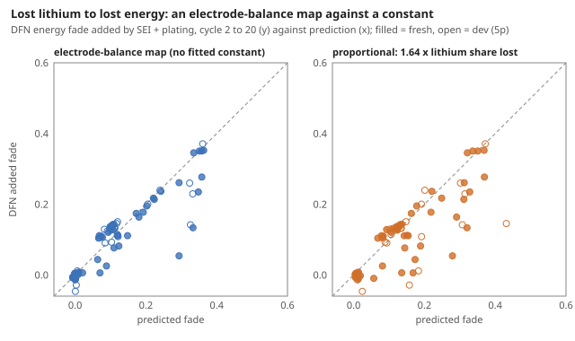

Previous headline, milestone 5q (2026-11-14): can two cheap SPMe cycles that model lithium plating predict which lithium-ion electrode designs will fade over 100 DFN cycles? No: the plating rate they measure does not rank the fade (median Spearman 0.03 on 24 conditions), a plating correction makes SPMe's design ranking worse on 20 of 24, and SPMe cannot run 20% of the designs at all.** Milestone 5p showed the programme's fade is lithium plating, and asked for a near-zero-simulation plating predictor to cut the design pool before any DFN run. We ran SPMe with SEI and plating for two cycles on all 2,324 committed designs of 36 conditions and pre-registered four tests ([`LOG.md`](LOG.md)) on the 24 conditions whose predictor results we had not read; all four were refuted. Keeping the top half by the plating-corrected prediction before 5n's union screen missed the DFN best by up to 6.1% and cost 0.92 to 1.45 of the union screen's time. SPMe failed on 456 designs (salt depletion on high-current pools), including the DFN-best design on 7 of 36 pools. The reason sits in 5p's own runs: energy lost per unit of lithium lost ranges from about 0.9 to 2.1 within one pool, because electrode balance decides how much of the lost lithium was capacity. So a cheap fade predictor needs a lost-lithium-to-capacity map (electrode state of health), not a better plating rate. 5o's salt floor plus 5n's union screen stays the procedure. Committed pools, modelled fade, one PyBaMM version.

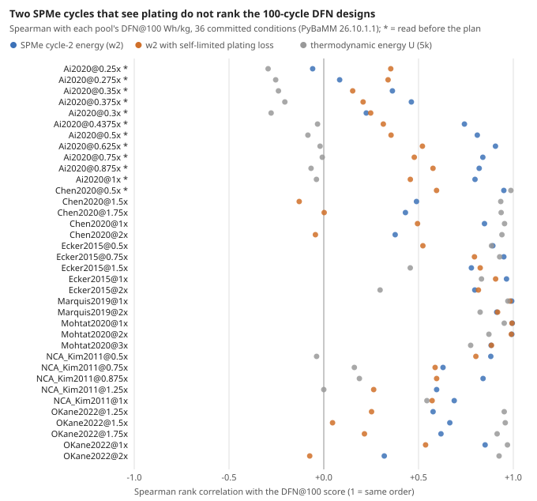

**Milestone 5p (2026-11-14): what makes lithium-ion electrode designs lose capacity in PyBaMM's DFN battery model, SEI growth or lithium plating? Plating, almost entirely: switching off the plating submodel removes 99 to 100% of the fade, switching off SEI removes under 1%. Along the way we found that PyBaMM's side-reaction lithium-loss variables under-count by the cell's parallel-electrode count (34 on `Ai2020`).** Every milestone since 5b runs DFN with solvent-diffusion-limited SEI and irreversible plating, and 5n motivated its &radic;cycle fade fit by SEI growth. Pre-registered ([`LOG.md`](LOG.md); 128 PyBaMM runs: 8 committed conditions, 4 designs each, 20 cycles under both options, plating only, SEI only and neither): on the five conditions that fade (by 5 to 25% from cycle 2 to 20), plating alone reproduces a median 0.998 to 1.015 of the degradation-added fade and SEI alone 0.000 to 0.006 (H97, H98). A closed form of PyBaMM's own SEI law (L2 = L02 + 2VDc t/z) matches the SEI-only runs' lithium loss to under 1e-4 (H99): SEI takes 0.007 to 0.15% of the lithium in 20 cycles, plating 7.8 to 34%. `Total lithium lost [mol]` over `Total lithium lost to side reactions [mol]` equals the parallel-electrode count on all 93 degraded runs (H96); no committed score used those variables, so no earlier number changes, and a ready-to-file upstream report is in [`experiments/attribution/UPSTREAM.md`](experiments/attribution/UPSTREAM.md). What it changes: the fade in 5b to 5o is OKane2022's plating kinetics (copied to six of seven sets by 5b's rule), and a cheap fade predictor has to predict plating, not SEI. 20 cycles, one PyBaMM version, modelled fade.

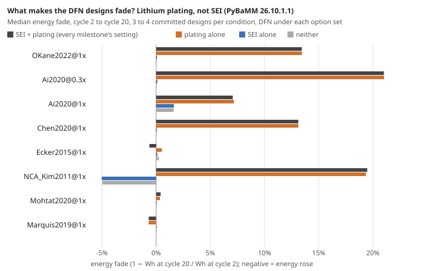

Previous headline, milestone 5o (2026-11-14): can a lithium-ion electrode design search throw away designs before running any battery simulation? Yes, the ones that will badly starve their electrolyte: dropping every design whose closed-form salt number r_kt is below &minus;0.2 kept the DFN-best design on three fresh pools and cut the 10-cycle screen's cost by 21 to 52%.** Milestone 5n's screen cannot cost less than ten DFN cycles of every design. 5i's r_kt, the steady-state minimum salt ratio from the parameter set and the design alone, costs 0.04 s per design. The obvious zero-simulation cut, 5k's (energy, r_kt) Pareto front, fails in development where it would pay: on fade-limited `Ai2020` pools the best design sits on layers 4 to 7, because the highest-energy designs fade fastest, and a 3-layer cut misses by up to 4.7%. A salt floor does not have that problem: over 33 seen conditions the best design never had r_kt below &minus;0.08, while up to 89% of a high-current pool did. Pre-registered on three fresh pools ([`LOG.md`](LOG.md); 192 PyBaMM runs, `NCA_Kim2011`@0.875&times;, `Chen2020`@1.75&times;, `Ai2020`@0.875&times;): the floor dropped 25 to 35 of 64 designs, the answer was the pool's DFN best on all three (H92), the best design's r_kt was &minus;0.04 to +0.36 (H93), and the screen took 0.48 to 0.79 of the plain union screen's time, 0.15 to 0.20 of running DFN to cycle 100 on everything (H94, H95 supported). A floor at 0 would have missed by 9.3% on `Chen2020`, whose best sits just past the salt edge. Over 36 conditions the floor screen is exact on 32, worst 0.32%. It saves nothing on low-current `Ai2020`, where no design starves and fade decides. Three fresh conditions, one PyBaMM version, modelled fade.

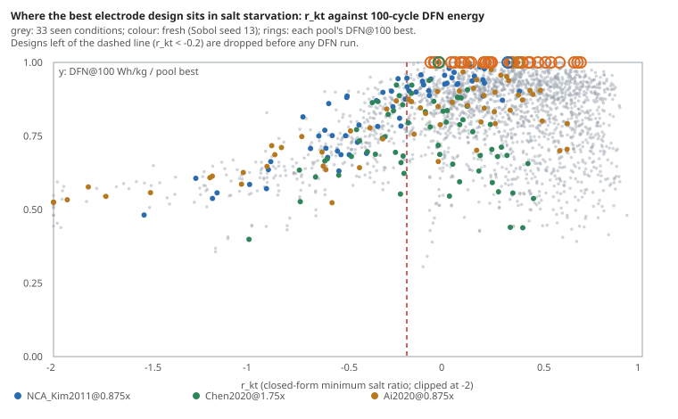

Previous headline, milestone 5n (2026-11-14): can ten cycles of the full DFN battery model predict which lithium-ion electrode design will hold the most energy after 100 cycles, even where capacity fade reorders the designs? Yes, if a square-root-of-cycle fade fit is kept beside the raw energy: the screen came within 0.16% of the best design on three fresh pools, where the 10-cycle screen alone missed by 9.2% and 3.9%.** SEI growth, the first fade term in PyBaMM's degradation model, goes roughly as the square root of time. So the screen fits each design's cycles 5 to 10 with a line in &radic;n, reads it at cycle 100, and resumes to cycle 100 the top 4 by raw cycle-10 energy together with the top 4 by that extrapolation. Pre-registered on three fresh pools ([`LOG.md`](LOG.md); 192 PyBaMM runs, `Ai2020`@0.275&times; and @0.35&times;, `NCA_Kim2011`@1.25&times;). The answer was within 1% everywhere (H87 supported: 0.16%, 0, 0). The extrapolation ranked the 100-cycle score better than raw energy on both low-current `Ai2020` pools (H88 supported: Spearman 0.57 against 0.10, 0.63 against 0.48); on `Ai2020`@0.35&times; the best design was 22nd by raw energy and 3rd by the fit. Its price was 0.24 to 0.32 of running DFN to cycle 100 on every design (H89 mixed, bar 0.30). Against 5m's successive-halving ladder it was mixed (H90): 0.16% worse on one pool, 0.39% better on another, and a little dearer on all three. Over all 33 conditions seen so far the union screen is exact on 29, worst 0.32%; the ladder is exact on 30, worst 2.7%; the raw 10-cycle screen is exact on 24, worst 9.2%. On `NCA_Kim2011` the fit is anti-correlated with late energy (Spearman &minus;0.68), and the raw list carries that pool. Three fresh conditions, one PyBaMM version, modelled fade.

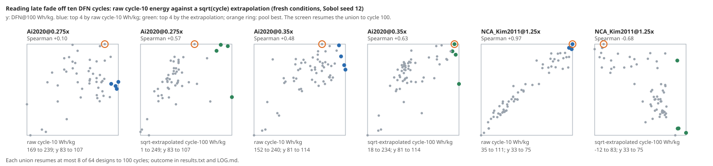

Previous headline, milestone 5m (2026-11-14): can a lithium-ion electrode design search stop full DFN battery runs early when capacity fade keeps reordering designs after cycle 10? Mostly: a successive-halving ladder over resumed runs was exact on 2 of 3 fresh pools and 2.7% short on the third, against 8.8% for the 10-cycle screen, at a quarter of the full cost.** Milestone 5l's screen (10 DFN cycles on every design, 100 on the top 3) had missed by 6 to 7% on `Ai2020` at its lowest currents. The ladder runs every design to cycle 10, then resumes the top 16 to 20, the top 8 to 50 and the top 3 to 100; each run is continued from where it stopped (PyBaMM's `starting_solution`), which on 23 checked designs reproduces an uninterrupted run bit for bit and costs 0.85 to 0.97 of its time. Pre-registered on three fresh pools ([`LOG.md`](LOG.md); 216 PyBaMM runs, `Ai2020`@0.3&times; and @0.4375&times;, `Ecker2015`@0.75&times;): the answer was the pool's DFN best on two and 2.7% short on `Ai2020`@0.3&times; (H82 mixed); wall time was 0.24 to 0.29 of all-DFN (H83 mixed, bar 0.25), because a run's first ten cycles cost 15 to 17% of it, not 10%; it beat the 10-cycle screen on both `Ai2020` pools (H84 supported). Why it can still miss: at 0.3&times; the best design ranks 28th of 53 at cycle 10, 23rd at cycle 20 and first only at cycle 50, because the designs that start best fade fastest. Any early cut has to keep it long enough to watch the curves cross, which on that cell means about half the run. Three conditions, one PyBaMM version, modelled fade.

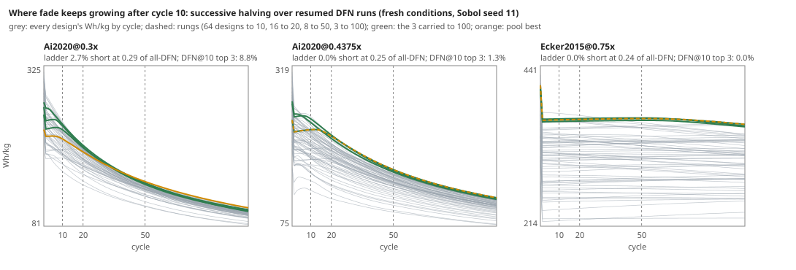

Previous headline, milestone 5l (2026-11-13): how many cycles of the full DFN battery model does a lithium-ion electrode design search need to rank designs by 100-cycle energy? Ten.** Milestone 5k split the score into thermodynamic energy &times; utilisation &times; retention and found that only retention still needed DFN. On three fresh (cell, current) conditions with 64 new designs each (384 PyBaMM runs), all four pre-registered tests held ([`LOG.md`](LOG.md)): each design's Wh/kg at cycle 10 ranks its Wh/kg at cycle 100 at Spearman 0.92 to 0.97; a screen that runs DFN for 10 cycles on every design and for 100 cycles on the top 3 returned the pool's DFN-best design on all three (`Ai2020`@0.625&times;, `NCA_Kim2011`@0.75&times;, `OKane2022`@1.75&times;) at 0.19 of the wall time of running DFN@100 on everything; and it never did worse than 5k's zero-simulation shortlist, which missed by up to 1.1% here. Extrapolating the first ten cycles' fade curve to cycle 100 ranks worse than the raw cycle-10 energy (Spearman &minus;0.56 to +0.55): ten cycles fix the order, not the curve. The known failure: on `Ai2020` at its lowest currents (0.25&times; and 0.375&times;, development data), where fade keeps growing after cycle 10, the screen missed by 6 to 7%. Three conditions, one PyBaMM version, modelled (not measured) fade.

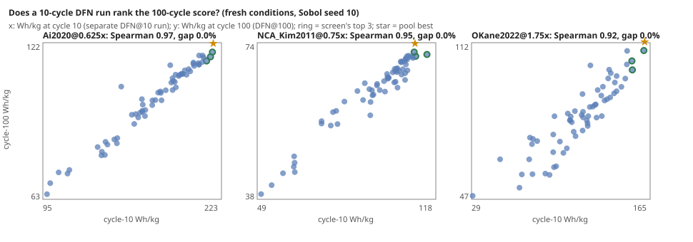

Previous headline, milestone 5k (2026-11-13): why does the best lithium-ion electrode design sit right at the electrolyte (salt) depletion edge? Because the design score splits into thermodynamic energy &times; utilisation &times; capacity retention, and the first two pull against each other.** On three fresh (cell, current) conditions and 64 new designs each, all four pre-registered tests held ([`LOG.md`](LOG.md)): among designs that do not starve their electrolyte, the cell's thermodynamic energy per kg (no simulation) orders the DFN model's first-cycle energy at Spearman 0.99 to 1.00; among designs that do, milestone 5i's closed-form salt number r_kt orders how much of that energy is delivered (0.60 to 0.88); and across a pool the two are anti-correlated (&minus;0.36 to &minus;0.82), because thicker, denser electrodes store more and starve sooner. So the best design is the highest-energy one before the salt runs out (r_kt +0.12 and +0.22 on Ecker2015 and Mohtat2020). Where capacity fade grows with energy (`Ai2020`, Spearman &minus;0.94 between energy and 100-cycle retention) fade is the first limit and the best moves away from the edge (r_kt +0.67, energy percentile 0.27). A shortlist built from the two closed-form numbers alone (the energy/salt Pareto front, no SPMe run) lands within 0.9%, 4.7% and 2.7% of the DFN best for 11 to 18 DFN runs out of 64; the SPMe-based procedures are exact but spend 15 to 40 DFN runs plus SPMe. For an electrode designer: treat r_kt of about 0 as a constraint, maximise energy up to it, and spend full-model runs on fade. Three conditions, one PyBaMM version, stack level.

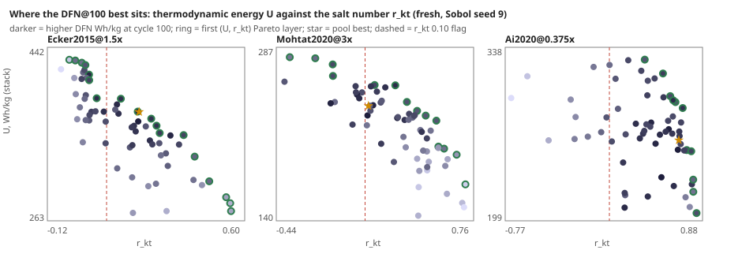

Previous headline, milestone 5j (2026-11-13): should a battery electrode design search skip the cheap SPMe model on designs a formula says will starve their electrolyte? It saves no time (0.90&times; and 1.12&times; the current procedure on two fresh cells), but sending every such design to the full DFN model is what finds the best one: the best design sat on the salt flag on 8 of 21 conditions, and on fresh `Chen2020` at 1.5&times; current the earlier procedure missed it by 4.5%.** Milestone 5i's closed-form flag (r_kt) costs 0.05 s per design. We pre-registered four tests ([`LOG.md`](LOG.md)) of a pre-screen that runs DFN, not SPMe, on every design with r_kt &le; 0.10 and keeps milestone 5e's rule and 5h's band stop for the rest, and ran 256 new PyBaMM runs (64 Sobol designs, `OKane2022` at 1.25&times; and `Chen2020` at 1.5&times; current, both chosen by r_kt alone). The pre-screen returned the DFN best on both (H70 supported); its wall time was within the predicted &plusmn;10 to 15% of the band procedure's (H71 mixed: 1.12 and 0.90; median 1.01 over the 19 committed conditions); the best design's r_kt was +0.03 and +0.08, inside the predicted range and below the flag (H72 supported); and the flag matched SPMe's own 100-cycle label on 128 of 128 designs (H73 supported). Not predicted: on `Chen2020`@1.5&times; the band procedure stopped verifying inside the flagged block, one design short of the best, which SPMe had scored 19% low; with no verified design above the flag its band had nothing to calibrate against. Discarding flagged designs would have missed the best by up to 17%, and a thermodynamic energy bound (never violated over 1395 designs) is too loose to prune any of 429 flagged designs. The reading: the salt flag is not a reason to discard or stop, it is where to spend DFN, because the energy optimum sits at the electrolyte's edge (best r_kt between &minus;0.06 and +0.58 on all 21 conditions).

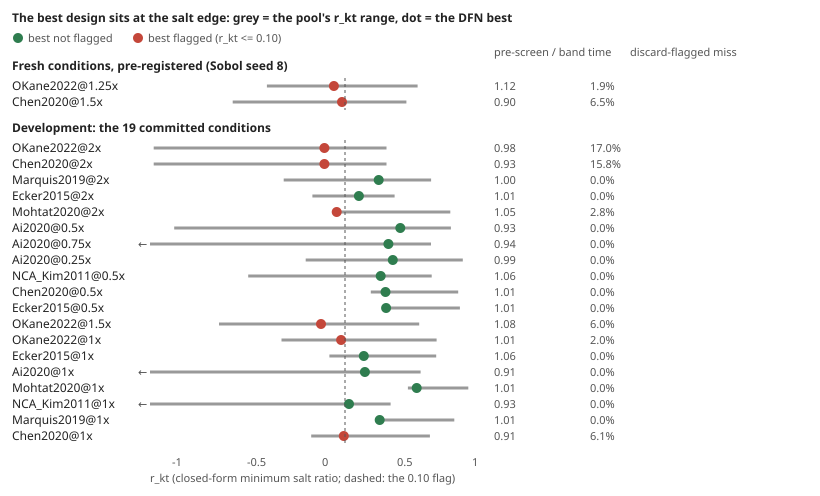

Previous headline, milestone 5i (2026-11-13): can you tell which battery electrode designs will empty their electrolyte under PyBaMM's SPMe model without running it? Yes: a closed-form steady state with concentration-dependent diffusivity gives SPMe's minimum salt ratio to within 0.0003 on 408 fresh runs, and flags none of them wrongly.** Since milestone 1 the trust test has been SPMe's own minimum salt ratio r_min (at or below 0.10, verify with DFN). Milestone 5i derives it from the parameter set and the design alone: the steady salt profile under SPMe's uniform reaction, with D_e(c) handled exactly through the Kirchhoff transform (`THEORY.md`, part 3). We pre-registered five tests on the constant-diffusivity form ([`LOG.md`](LOG.md)) and scored the 1,280 committed designs of 19 (cell, current) conditions, then ran a fresh sweep of 816 PyBaMM runs (four cells, 0.25x to 3x the areal current, 17 designs). The constant-D form ranks designs as SPMe does (Spearman 0.99, H64) and predicts the suspect label (AUC 0.997, H65) and SPMe's mis-scoring (AUC 0.951 against 0.957 for the simulated flag, H67), but it over-predicts depletion (shares off by more than 0.15 on 7 of 19, H66 mixed). With D_e(c), written after those verdicts and registered as H69 before the fresh labels were read, the rule misclassifies 0 of 408 fresh designs (mean error 0.0003) and 3 of 1,280 committed ones, and 5g's skip-SPMe gate makes the same call on all 19 conditions. It costs about 0.05 s per design. The limits: it reproduces SPMe's electrolyte, not the cell's. DFN's minimum differs by 0.03 on average (Spearman 0.91 to 0.98), and SPMe's score still has to be computed.

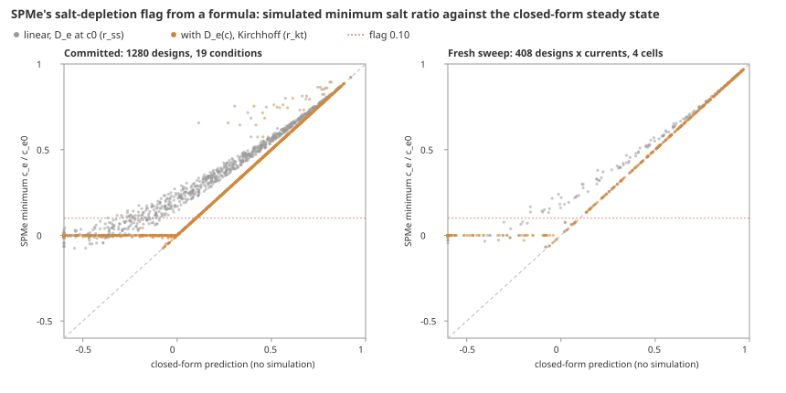

Previous headline, milestone 6a (2026-11-13): against measured lithium-ion discharges, how much does it matter whether you simulate with SPMe or the full DFN model? At most 1.5 points of capacity, against up to 4.3 points for the published parameter set; and once the cell's measured 10 K self-heating is modelled, DFN's apparent 2C advantage shrinks to 0.3 points.** We pre-registered three tests ([`LOG.md`](LOG.md)) and ran SPM, SPMe and DFN against the measured constant-current discharges PyBaMM ships for two commercial cells: the Kokam cell of Ecker et al. (2015) at 1C and 5C and the Enertech pouch of Ai et al. (2020) at 0.1C to 2C. SPMe was never closer to the measured capacity than DFN by more than 0.13 points (H61 supported). Where SPMe's own salt flag trusts it (r_min &ge; 0.5), SPMe and DFN agree within 0.06% while both miss the cell by 0.9 to 4.3% (H63 supported). SPMe's r_min does not order the SPMe&ndash;DFN gap across the two cells (Spearman &minus;0.14, H62 mixed): at r_min 0.42 on Ecker's 5C the models agree, at 0.44 on Ai's 2C they differ by 1.5 points. After the verdicts: the Ai cell's logged temperature rises 1.6, 4.0 and 10.4 K at 0.5C, 1C and 2C, which PyBaMM's lumped thermal model reproduces (1.6, 4.1, 10.4 K). With heating included the SPMe&ndash;DFN gap at 2C falls from 1.50 to 0.32 points, and DFN's 18.6 mV voltage fit, the best number in this programme and in `energy-cell-dfn`, turns out to be heating error cancelling a 4% capacity offset (46.3 mV with heating). Default mesh, two cells, discharge only; the salt-starved designs where SPMe fails outright are not reached by any measured curve, so the design-level check (H4) stays open. Details: [Milestone 6a](#milestone-6a-spm-spme-and-dfn-against-measured-discharges).

Previous headline, milestone 5h (2026-11-13): can a battery design search name the true best design when the cheap SPMe model scores sound designs too low? A gap-aware stop always did, at up to 1.07&times; the cost of running DFN on everything, but on fresh designs the simpler step it was built to replace never missed either.** Milestone 5g's answer step stopped 3.2% short of the DFN best on `Ai2020` at half current, where SPMe scores nearly every design about 24% low. The band stop keeps running DFN while any unchecked design's SPMe score, times the median DFN/SPMe ratio on the checked sound designs, could beat the checked best. We chose it on the 13 conditions already run, then pre-registered five tests ([`LOG.md`](LOG.md)) and ran 788 PyBaMM simulations on six (cell, current) conditions and 64 designs no earlier step used. The band stop returned the pool's DFN best on all six (H56 supported) at 0.33 to 1.07 of all-DFN wall time (H57 supported). But the old iterate step also returned the best on all six, including `Ai2020` at 0.75&times; current where SPMe under-scores by a median 24% (H58 refuted), so the fix is insurance whose need fresh data did not show: it cost 9 and 11 extra DFN runs on the two `Ai2020` pools. Across all 19 conditions, the iterate step misses on 1 (3.2%) and the band stop on none, for 0 to 13 extra DFN runs per 64-design pool. The screen half of the rule kept recall at or above 0.97, and `Ai2020`'s share of SPMe-suspect designs rose with current across four design draws (0.06, 0.31, 0.53, 0.72 at 0.25&times; to 1&times;).

Previous headline, milestone 5g: **when should a battery design search skip the reduced SPMe model and run the full DFN model on everything? It depends on the current as much as on the cell, and getting the call wrong costs at most 13%.** Run alongside milestone 5f (below), which tested a similar switch at the usual current. We pre-registered five tests ([`LOG.md`](LOG.md)) and ran 768 new PyBaMM simulations: 64 fresh designs on each of six (cell, current) conditions nobody had simulated, five cells at twice milestone 5b's current density (about 2C) and `Ai2020` at half. Doubling the current raised the share of designs where SPMe fails or depletes its salt from 25% to 81% on `Chen2020`, 6% to 70% on `Ecker2015` and 18% to 81% on `OKane2022`; halving it cut `Ai2020`'s from 72% to 31%. A gate that skips SPMe when 4 of the first 8 SPMe runs look suspect chose wrong on 2 of 6 conditions (refuted), because a broken SPMe run fails in under a second, so a pool full of failures makes SPMe cheap, not expensive; but the gated cost stayed within 1.13&times; of the better choice everywhere. The two-part rule found every mis-scored design at every condition. Its answer step, fixed after 5e, reached the DFN best on five conditions and missed by 3.2% on `Ai2020` at half current, where SPMe scores nearly every design about 24% low and the best one is never verified (refuted). After the verdicts, a gate that also weighs the SPMe-to-DFN time ratio (close to 5f's switch) chose right on 12 of 13 conditions. On `Ecker2015` and `Ai2020` the designs are 5f's own, so the current's effect is paired: every design whose status changed moved the predicted way, and 5f's answer step, perfect at the usual current, misses on the same `Ai2020` designs at half.

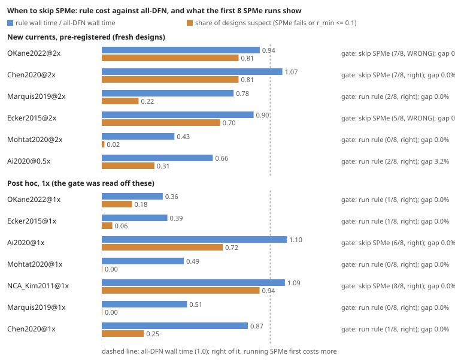

**Milestone 5f (2026-11-13): when screening lithium-ion electrode designs with PyBaMM's SPMe and checking with DFN, should you ever skip SPMe and run DFN on everything? Not worth deciding: the trust rule never cost more than 12% over all-DFN on 11 cell pools, and saved 49 to 64% on six of them. Reading the answer from verified designs returned the DFN-best design in all 120 trials.** We pre-registered five tests ([`LOG.md`](LOG.md)) and ran 515 new simulations: 64 fresh Sobol designs on each of `Mohtat2020`, `Ai2020`, `NCA_Kim2011` and `Ecker2015`. **The corrected answer step (keep verifying the leading design with DFN until the leader is one DFN has scored) picked the pool's DFN best in every one of 30 replayed trials on every cell** (H48 supported), fixing milestone 5e's 1.3% slip. **The re-solve step held on fresh data: all 3 early SPMe stops on `Mohtat2020` finish at rtol 1e-6 and score within 0.2% of DFN** (H49). The rule found every mis-scored design whenever it ran (H50). **The pilot switch failed its test** (H46 refuted): 8 SPMe runs plus 2 DFN runs were meant to say when DFN on everything is cheaper, but on `Ai2020`, the one cell where it is (by 11.6%), the switch fired in only 20% of trials, because a salt cut-off of 0.10 misses the 13 mis-scored designs whose minimum salt ratio sits between 0.10 and 0.32. The cost of that miss is small (median 1.12x the cheaper option; H47 mixed), and on cells where SPMe is reliable the pilot itself costs 2 to 8%. The practical procedure is the rule with the verified answer step, run every time.

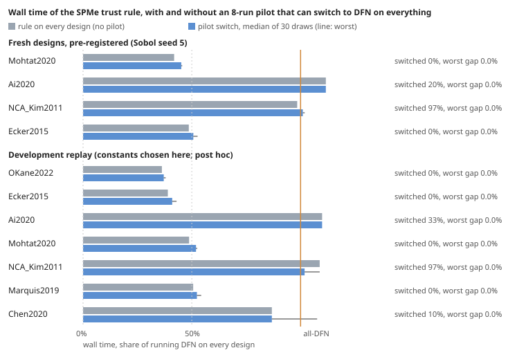

**Milestone 5e (2026-11-13): does a cheap test for when to trust PyBaMM's SPMe battery model hold on lithium-ion cells it was not built on? The screen does: it caught all 9 designs SPMe mis-scored on `Chen2020`, for 23% of the pool in full DFN runs. Its answer step needed a fix.** Milestones 5c and 5d built a two-part rule post hoc: re-solve SPMe runs that stop early at tight tolerance, then run the full DFN model on designs whose SPMe run failed and on the rest in ascending order of SPMe's minimum salt ratio, stopping after three sound designs in a row. We fixed the rule and four tests in advance ([`LOG.md`](LOG.md)) and ran 256 new simulations on two cells it had never seen, `Marquis2019` (Kokam SLPB78205130H pouch) and `Chen2020` (LG M50), with fresh designs. **On `Chen2020` it found all 9 mis-scored designs (3 SPMe failures, 6 salt-depleted) in 15 DFN runs** (H42, H45 supported), including the DFN-best design, which SPMe scores 23% low and ranks 16th of 64, so a top-k shortlist by SPMe would have missed it. `Marquis2019` has no mis-scored design and the rule stopped after 4 DFN runs. **The planned answer step, though, picked a design 1.3% below the best on `Marquis2019`** (H44 mixed): it compared the verified DFN-best (199.5 Wh/kg) with unverified SPMe scores, which run 1 to 6% high at the top of the space. Reading the answer from verified designs only gives the DFN best on both new cells at no extra cost, and on 4 of the 5 earlier cells (found after the verdicts). No run stopped early, so the re-solve step went untested (H43). Where nearly every design is mis-scored (`Ai2020`, `NCA_Kim2011`), the rule costs more than running DFN on all of them.

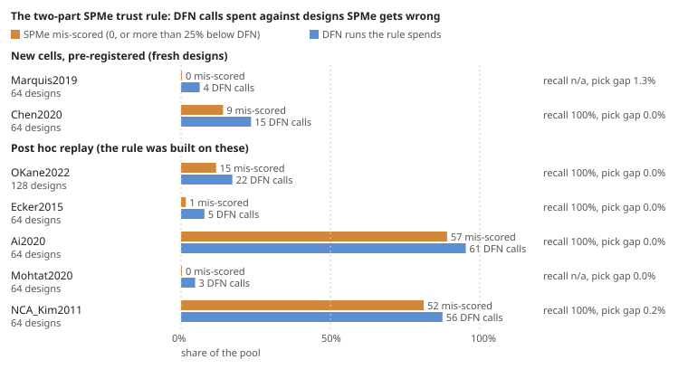

**Milestone 5d (2026-11-12): why does PyBaMM's SPMe battery model fail on some electrode designs, and can a solver setting fix it? An early stop is the solver's fault and tight tolerances fix it; a run that returns nothing is SPMe's own, and nothing fixes it.** Milestone 5c found SPMe mis-scores designs either by salt depletion or because its run fails. We pre-registered four tests ([`LOG.md`](LOG.md)) and re-solved every failed or stopped SPMe run on the committed benches (67 designs on three cells) under four solver and mesh variants, plus 24 sound runs as controls (455 runs). **All 6 `Mohtat2020` early stops reach 100 cycles at rtol 1e-6 and atol 1e-8 (IDAKLU or Casadi) and then score within 0.3% of DFN** (H38, H39 supported). Allowing the Newton solver more iterations rescues none, so the default error tolerance (rtol 1e-4) is what ends them. **None of the 61 runs that returned nothing (`NCA_Kim2011` 49, `OKane2022` 12) gets a usable score under any setting** (H40 supported). In 59 of them SPMe's linearised salt concentration goes below zero during the first discharge (median −8% of its initial value), the charge step that follows has no valid start, and PyBaMM discards the whole run. Every early stop keeps healthy salt (65 to 89%; H41 supported). For a design search, the rule becomes: re-solve a stopped SPMe run once at tight tolerance (about 2.4x its cost), and send runs that return nothing to DFN along with the salt-depleted ones. On `Mohtat2020`, whose other 58 designs already scored within 2.3% of DFN, the solver setting was the only source of mis-scores.

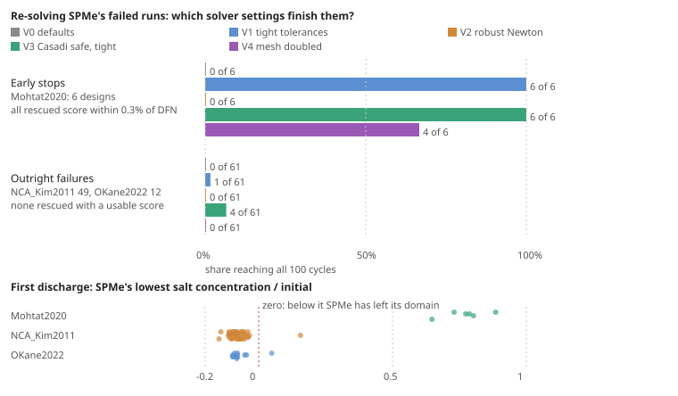

**Milestone 5c (2026-11-12): how many full DFN runs does it take to find the battery designs a reduced model (SPMe) mis-scores, on a cell you have not seen? No calibration needed: flag the SPMe runs that stop early, then verify from the most salt-depleted design up.** Milestone 5b showed the trust flag's ranking transfers across cells but its cut-off does not. We pre-registered five tests ([`LOG.md`](LOG.md)) comparing a cut-off calibrated from 8 random DFN runs against verifying designs in ascending order of SPMe's minimum salt ratio r_min until three sound ones in a row, and ran 256 new simulations on two more PyBaMM cells, `Mohtat2020` (graphite/NMC532 pouch) and `NCA_Kim2011` (graphite/NCA pouch). **On `Mohtat2020` both strategies failed (recall 0.00 and 0.17; H33, H34 and H37 refuted).** Its 6 mis-scored designs are not salt-depleted at all (r_min 0.65 to 0.89). They are SPMe runs whose solver stopped part-way (cycles 3 to 90), which PyBaMM returned as normal solutions, so they score 0. **SPMe mis-scores designs in two ways, and both show in the SPMe run itself.** Among SPMe runs that finish, every mis-scored design is salt-depleted and r_min ranks them at ROC AUC 0.995 or better on all four cells that have any. Flagging early stops as well (an exploratory rule, chosen after the verdicts), bottom-up verification finds every mis-scored design on all five cells, sending 16%, 95%, 6%, 14% and 88% of the pool to DFN against mis-scored shares of 13%, 89%, 2%, 9% and 81%. That is always fewer DFN runs than the 8-run calibration (23%, 98%, 19%, 27%, 92%), whose cut-off is also noisy (recall below 0.8 in 8% of draws on `OKane2022`).

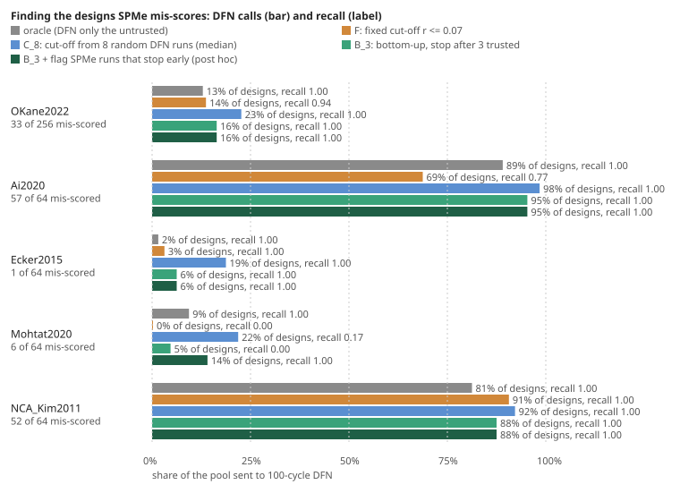

**Milestone 5b (2026-11-12): does a battery-model trust test tuned on one lithium-ion cell work on other cells? Its ranking does; its cut-off does not.** Everything before this step used one PyBaMM parameter set (`OKane2022`). We pre-registered four tests ([`LOG.md`](LOG.md)) and ran 384 new simulations on 64 designs for two more cells, `Ecker2015` (Kokam pouch) and `Ai2020` (Enertech LCO/graphite pouch), with the same design space and areal current density. **SPMe's own minimum salt ratio still ranks the designs it mis-scores almost perfectly (ROC AUC 0.995 on Ai2020, where 57 of 64 designs are mis-scored), but the cut-off picked on `OKane2022` (r <= 0.07) misclassifies 20.3% of Ai2020's designs, over the 20% bar** (H29 refuted). Ai2020's own best cut-off is 0.33, so the threshold must be set per cell. The surprise of milestones 3 and 5a, **that 10 cycles of SPMe rank designs better than 100, does not carry over: on both new cells the 100-cycle run ranks as well or better** (H31 refuted). What does carry over is the ordering of search methods (Spearman 0.73 and 0.70 against `OKane2022`, H32 supported). **Screening every candidate with a 2-cycle SPMe or DFN run, then verifying with 100-cycle DFN, beats Bayesian optimisation (GP-EI) on DFN on all three cells and stays within 1.3x of the fastest method on each**; the plain SPM screen, fine elsewhere, is slower than GP-EI on the salt-limited Ai2020 cell (its ranking Spearman is 0.32).

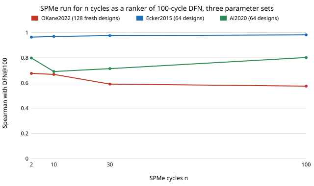

**Milestone 5a (2026-11-12): does a short SPMe run still beat Bayesian optimisation on DFN when the electrode designs are new? Yes.** Part 2b's 10-cycle SPMe screen and milestone 4b's cheap-start co-kriging were both picked after seeing the 128 designs they were scored on. We registered four tests ([`LOG.md`](LOG.md)), ran 384 new PyBaMM simulations on 128 fresh Sobol designs, and replayed all 15 search methods unchanged. **On pools of 64, screening every candidate with 10 cycles of SPMe and then verifying with 100-cycle DFN reaches a design within 1% of the DFN best in a median 123 s, against 220 s for GP-EI on DFN (p = 2e-6) and 205 s for the SPM@2 screen** (H25, supported). SPMe's 10-cycle ranking again tracks DFN's 100-cycle ranking better than SPMe's own 100-cycle ranking does (Spearman 0.67 against 0.58, difference CI 0.05 to 0.15; H26, supported). The ranking of the 15 methods carries over from the old designs to the new (Spearman 0.92; H28, supported). The cheap-start co-kriging search beats GP-EI at every pool size but is 1.4x and 1.7x slower than the best screen on pools of 16 and 32 (H27, refuted); it is the fastest method on pools of 96 (141 s). Across pool sizes 16 to 96, **a 2- or 10-cycle SPMe screen is never more than 1.4x slower than the fastest method, on both design sets** (found after the verdicts, so descriptive). One parameter set (`OKane2022`), one protocol; transfer to other cells is milestone 5b.

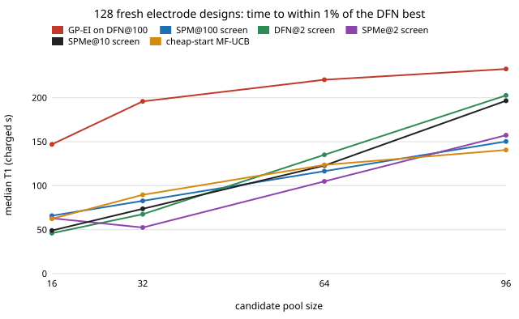

**Milestone 3 theory part 2b (2026-11-12): where does SPMe mis-score lithium-ion electrode designs, and does knowing it save full DFN runs? It tells you where; it does not plan or fix the search. A short SPMe run turned out to be the fastest screen.** In PyBaMM's SPMe the electrolyte term of the voltage grows like the log of the lowest salt concentration, and the whole electrode shares one reaction rate. So we predicted that SPMe's error after a scale-and-shift fit grows like -ln r, where r is SPMe's own minimum salt ratio ([`THEORY.md`](THEORY.md), part 2b). **That form is the best of those registered: it halves the cross-validated error of predicting 100-cycle DFN energy from 100-cycle SPMe (21.3 to 11.3 Wh/kg), ahead of the expansion's (1 - r)^2 (12.3) and milestone 1's flag (16.8)** (H21, supported). It is not enough to plan or repair a search. Fitted on 16-design pilots, the location model predicts SPMe's DFN cost within 2x on only 2 of 4 cycle counts (H22, refuted), and an online correction that refits DFN ~ SPMe + -ln r after each DFN call is slower than milestone 1's simple flag rule (528 against 418 s, H23, refuted). Two things we did not plan matter more. (1) **SPMe's 100-cycle screening cost rests on one design.** The DFN-best design is salt-depleted (r = 0.07), and SPMe ranks it 1st after 10 cycles but 41st after 100. Without it, SPMe@100 needs 2.1 DFN runs on pools of 64, not 14. (2) **A plain whole-pool screen with a 10-cycle SPMe run reaches a design within 1% of the DFN best in a median 123 s on pools of 64 and 172 s on 96. That beats GP-EI (220 s), every screen milestone 4 tested (153 to 253 s at 64), and milestone 4b's exploratory co-kriging (144 and 174 s)** (paired p <= 0.0001 against SPM@2, SPM@100, DFN@2 and GP-EI at 64). On pools of 16 and 32 a 2-cycle SPMe screen is fastest (38.5 and 52.5 s). These results were found after seeing the planned ones, on one parameter set and the same 128 designs, so they are exploratory until tested on fresh designs.

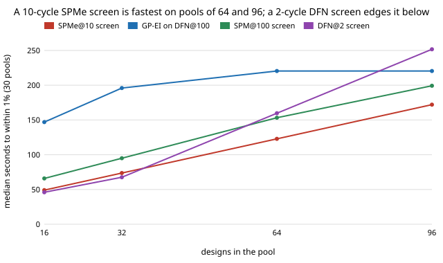

**Milestone 4b (2026-11-12): does multi-fidelity Bayesian optimisation (co-kriging) find the best battery electrode design faster than screening with a cheap model? Not as usually started.** We ran autoregressive co-kriging (Kennedy and O'Hagan) over a cheap rung (the plain SPM or a 2-cycle DFN run) and the 100-cycle DFN model, with two published rules for choosing which model to run next: augmented EI (Huang et al. 2006) and an MF-UCB rule after Kandasamy et al. (2016). Replayed on the cached benchmark with measured run times, **every planned variant is slower than plain GP-EI on DFN** (best: 205 s against 220 s on pools of 64, n.s.; 267 s against 220 s on pools of 96) **and far slower than screening the pool with a cheap model** (46 s at 16 designs, 153 s at 64). The cause is the start: five random 100-cycle DFN runs (122 s) before the cheap model has a say. **Started from ten 2-cycle DFN runs instead, the same search keeps pace with the best screen at every pool size (144 s at 64, 174 s at 96, against GP-EI's 220 s)**, where each single screen is best only at some sizes. That variant was tried after the planned result was in, so it is exploratory until a pre-registered test on fresh designs. Charging each design its own measured time (19 to 67 s a DFN run) leaves the ranking of methods unchanged (Spearman 0.90).

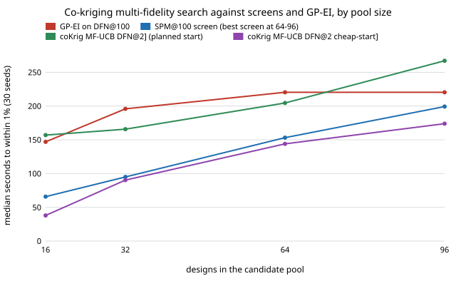

**Milestone 3 theory part 2a (2026-11-12): how many full DFN runs will a cheap screen cost you? A noise model answers for SPM and DFN screens, not for SPMe.** Treating a cheap battery model's error (after the best scale-and-shift fit) as independent noise gives an exact formula for the expected number of full DFN runs a screen-then-verify search needs ([`THEORY.md`](THEORY.md), part 2a). Used as a planner, it **calls whether screening the whole pool beats Bayesian optimisation (GP-EI) on DFN right on 14 of 16 (screen, pool size) cases**, where part 1's worst-case formula managed 8 of 16 (median T1 error 24%). But it cannot rank the screens with a single whole-space noise level (Spearman 0.51, refuted), because SPMe's large errors sit on particular designs: at 100 cycles on the DFN-best ones (14 DFN runs needed, 3 predicted from the top-of-space noise), at 10 cycles below them (1 needed, 10 predicted from the whole space). Where a reduced model errs matters more than how much.

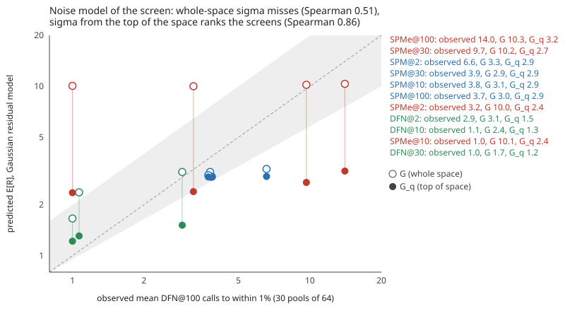

**Milestone 3 theory part 1 (2026-11-11): what kind of battery-model error actually costs you full simulations.** A screen-then-verify search uses only the cheap model's *order*, so any error that is a scale and shift of the full model's score is free. We prove ([`THEORY.md`](THEORY.md)) that the number of full DFN runs needed is bounded by the screen's **residual after the best affine fit** (kappa), and checked the bound on all 330 (screen, pool) cases of the cached benchmark with no violation. Across 11 cheap screens, **this residual ranks the DFN calls they need at Spearman 0.72, while the raw error ranks them at -0.07**. It explains milestone 2's surprise: SPM and SPMe have similar raw errors (7.1 and 9.5 Wh/kg), but SPM's residual is a quarter of SPMe's (11.0 against 42.8 Wh/kg), and **SPMe's residual tracks its own minimum salt concentration (Spearman -0.82)**: the SPMe correction under-scores salt-depleted designs. The worst-case cost formula built on the bound is refuted as a planning tool (8 of 16 screen-versus-GP-EI calls right).

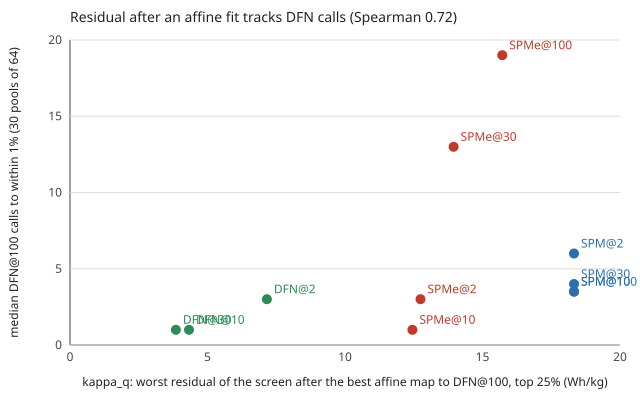

**milestone 4 search replay (2026-11-11): the cheapest screen wins, until the candidate pool grows.** Replaying 12 search methods on the cached benchmark (30 pools of 64 designs, each simulation charged its measured wall time), **screening every candidate with the plain SPM or a 2-cycle DFN run, then verifying in screen order with 100-cycle DFN, reaches a design within 1% of the best in a median 153 to 168 s, about 30% faster than Bayesian optimisation (GP-EI) on DFN (220 s)**. The 10-cycle DFN screen, the best ranker in milestone 2, is *slower* than GP-EI (253 s): its first pick is always right, but screening 64 designs at 3.6 s each costs more than GP-EI's nine DFN calls. Milestone 1's trust flag cuts SPMe screening from 700 to 418 s, yet SPMe stays the slowest screen. On pools of 96 GP-EI catches the screens up, so whole-pool screening suits small candidate sets only.

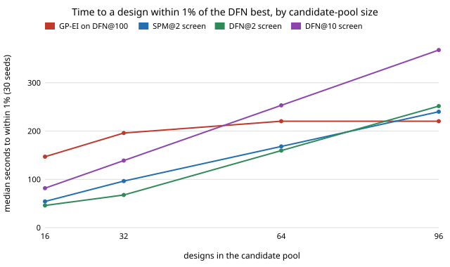

**Milestone 2 dense benchmark (2026-11-11): the 2a result holds out of sample, and SPM beats SPMe.** On 128 fresh space-filling (Sobol) electrode designs, each run for 100 cycles under SPM, SPMe and DFN (384 PyBaMM runs, every cycle kept), **a 10-cycle DFN run ranks the designs by their 100-cycle DFN energy with Spearman 0.96, against 0.64 for a full 100-cycle SPMe run, at the same cost (3.6 s against 3.7 s)**. Screening with 10-cycle DFN finds the DFN-best design; screening with SPMe misses it at any shortlist up to 20, because SPMe ranks it 41st. Not planned: the simplest model, SPM, ranks better than SPMe (0.96), even on the designs SPMe completes (0.98 against 0.77; on 2a's 49 designs SPM led too, 0.863 against 0.834), and 12% of the space (15 of 128) is mis-scored by SPMe by more than 25%. For electrode design under cycling, the cycle count is the fidelity axis worth cutting, and the SPMe correction hurts ranking.

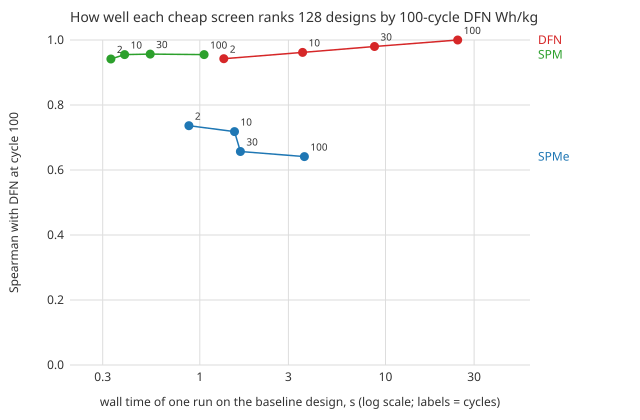

**Milestone 2a (2026-11-11): stop the expensive model early instead of reducing it.** On milestone 1's 49 designs, ranking by the full DFN model's score at **cycle 10** agrees with the 100-cycle DFN ranking at **Spearman 0.977**, against **0.834** for a full 100-cycle SPMe run (paired bootstrap difference 0.138, 95% 0.057 to 0.271), and costs the same wall time (median 4.0 s against 4.1 s). DFN-verifying the top 5 by 10-cycle DFN finds the best design; the top 5 by SPMe misses it by 2.1 Wh/kg. Even a 2-cycle DFN run (1.4 s, Spearman 0.915) beats every SPM and SPMe rung.

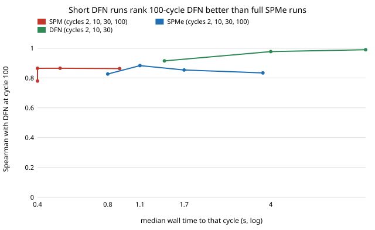

**Milestone 1 headline (2026-11-11).** On the 49 designs of [`energy-cell-dfn`](../energy-cell-dfn), SPMe's own minimum electrolyte salt concentration from a **2-cycle** run flags the designs whose 100-cycle SPMe score is more than 25% below DFN's with **ROC AUC 0.997** (95% bootstrap 0.980 to 1.000; 7 untrusted of 49). A flag at 10% of the initial salt concentration catches all 7 with one false flag. But the cost model the programme assumed is wrong: a 2-cycle run takes **SPMe 1.2 s and DFN 1.3 s**, and at 100 cycles **SPMe 3.9 s and DFN 27.9 s**. Cutting the cycle count saves 21x on DFN, swapping DFN for SPMe saves 7x, so the cheapest trustworthy screen may be a short DFN run rather than a reduced model.

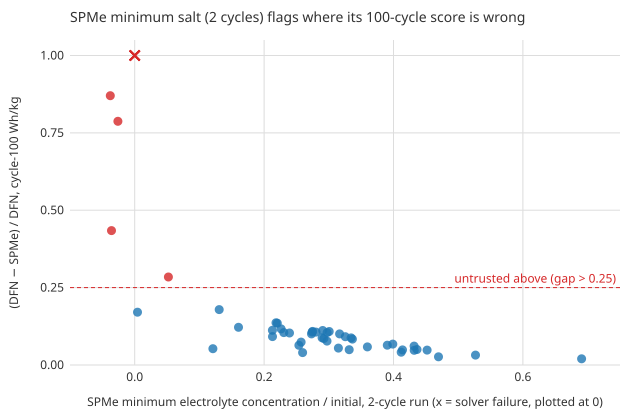

## Milestone 6a: SPM, SPMe and DFN against measured discharges
Plan and verdicts: [`LOG.md`](LOG.md), milestone 6a (H61 to H63, registered before the bench). Script: `experiments/measured/run.py`; numbers: [`experiments/measured/results.txt`](experiments/measured/results.txt). Measured data: pybamm-data v1.0.2 (BSD-3-Clause), fetched and hash-checked by `pybamm.DataLoader`; thinned copies of the curves are kept in `bench.jsonl` for the figure.

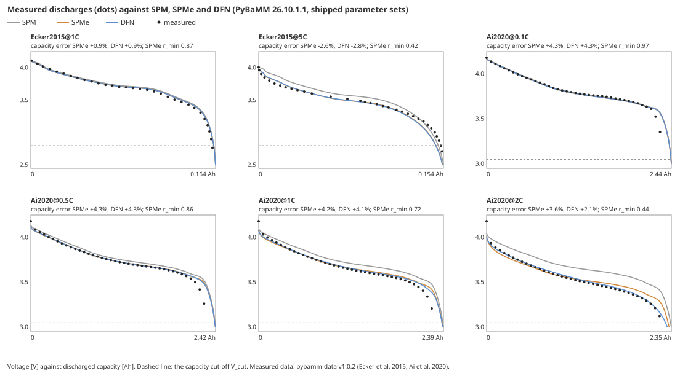

Capacity to a common cut-off (2.8 V Ecker2015, 3.05 V Ai2020), error against the measured cell, isothermal, PyBaMM default mesh:

| Condition | measured Ah | SPM | SPMe | DFN | SPMe r_min | &#124;SPMe&minus;DFN&#124; |
|---|---|---|---|---|---|---|
| Ecker2015 1C | 0.1610 | +0.95% | +0.88% | +0.88% | 0.87 | 0.00% |
| Ecker2015 5C | 0.1521 | &minus;1.37% | &minus;2.62% | &minus;2.75% | 0.42 | 0.13% |
| Ai2020 0.1C | 2.3323 | +4.28% | +4.26% | +4.26% | 0.97 | 0.00% |
| Ai2020 0.5C | 2.3077 | +4.42% | +4.26% | +4.26% | 0.86 | 0.00% |
| Ai2020 1C | 2.2788 | +4.65% | +4.20% | +4.14% | 0.72 | 0.06% |
| Ai2020 2C | 2.2258 | +4.99% | +3.60% | +2.10% | 0.44 | 1.50% |

Verdicts: H61 supported (SPMe never more than 0.13 points closer than DFN), H62 mixed (Spearman of r_min against SPMe's excess error &minus;0.14), H63 supported (on all four trusted conditions the reduction error is below DFN's parameter error). After the verdicts: Ai2020's 2C capacity retention against 0.1C is 0.9543 measured; isothermal SPMe &minus;0.60 and DFN &minus;1.98 points, lumped thermal SPMe &minus;0.17 and DFN &minus;0.47. The lumped model's peak temperature rise matches the cell's logged one within 0.1 K at three rates. Sources: Ecker et al. 2015, *J. Electrochem. Soc.* 162, A1836 (doi:10.1149/2.0551509jes) and A1849 (doi:10.1149/2.0541509jes); Ai et al. 2020, *J. Electrochem. Soc.* 167, 013512 (doi:10.1149/2.0122001JES); details from PyBaMM 26.10.1.1's `CITATIONS.bib` as cited in `energy-cell-dfn`. This reproduces `energy-cell-dfn`'s 2026-11-11 voltage check (same files, separate code, numbers within 0.1 mV) and settles the question it left open: the cell heated, so the isothermal comparison was the wrong one.

## Milestone 5h: a gap-aware stop for the answer step, on six new conditions
Plan and verdicts: [`LOG.md`](LOG.md), milestone 5h (H56 to H60, registered before the bench). Script: `experiments/band/run.py`; numbers: [`experiments/band/results.txt`](experiments/band/results.txt); development replay the stop was chosen on: [`experiments/band/dev.txt`](experiments/band/dev.txt).

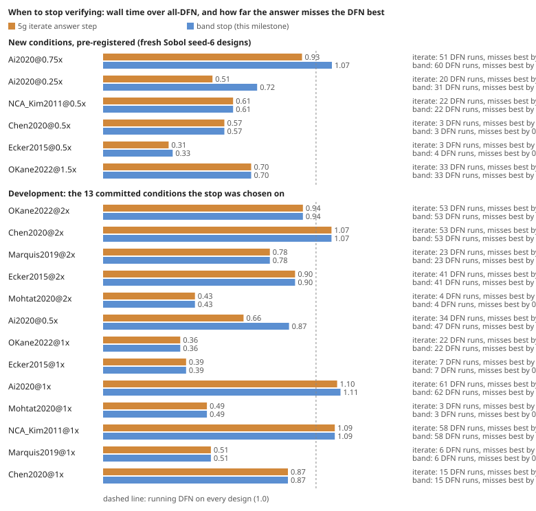

| Condition | designs | suspect share | mis-scored | median DFN/SPMe (sound) | iterate: DFN runs, gap | band: DFN runs, gap | band / all-DFN |
|---|---|---|---|---|---|---|---|
| Ai2020 0.75x | 64 | 0.53 | 48 | 1.315 | 51, 0.0% | 60, 0.0% | 1.07 |
| Ai2020 0.25x | 51 (13 DFN failed) | 0.06 | 17 | 1.050 | 20, 0.0% | 31, 0.0% | 0.72 |
| NCA_Kim2011 0.5x | 64 | 0.36 | 16 | 1.008 | 22, 0.0% | 22, 0.0% | 0.61 |
| Chen2020 0.5x | 64 | 0.00 | 0 | 1.016 | 3, 0.0% | 3, 0.0% | 0.57 |
| Ecker2015 0.5x | 64 | 0.00 | 0 | 1.000 | 3, 0.0% | 4, 0.0% | 0.33 |
| OKane2022 1.5x | 64 | 0.58 | 30 | 1.052 | 33, 0.0% | 33, 0.0% | 0.70 |

Verdicts: H56 supported (band answer is the DFN best on all six), H57 supported (at most 1.07&times; all-DFN), H58 refuted (the iterate step did not miss on fresh data, even with SPMe 24% low on Ai2020 0.75x), H59 supported (recall 1.00 on three, 0.97 on OKane2022 1.5x), H60 supported (Ai2020's suspect share orders with current). The band stop was chosen after seeing the 13 development conditions; only the six above are evidence about it. Wall times are each run's own under 3-way concurrency.

## Milestone 5g: a skip-SPMe gate and the iterate answer at new currents
Plan and verdicts: [`LOG.md`](LOG.md), milestone 5g (H51 to H55, registered before the bench). Script: `experiments/gate/run.py`; numbers: [`experiments/gate/results.txt`](experiments/gate/results.txt).

| Condition | suspect share (1x) | gate (of 8) | rule / all-DFN | gate right | answer gap |
|---|---|---|---|---|---|
| OKane2022 2x | 0.81 (0.18) | skip (7) | 0.94 | no | 0.0% |
| Chen2020 2x | 0.81 (0.25) | skip (7) | 1.07 | yes | 0.0% |
| Marquis2019 2x | 0.22 (0.00) | rule (2) | 0.78 | yes | 0.0% |
| Ecker2015 2x | 0.70 (0.06) | skip (5) | 0.90 | no | 0.0% |
| Mohtat2020 2x | 0.02 (0.00) | rule (0) | 0.43 | yes | 0.0% |
| Ai2020 0.5x | 0.31 (0.72) | rule (2) | 0.66 | yes | 3.2% |

Verdicts: H51 refuted (gate wrong on 2 of 6), H52 supported (gated cost at most 1.13&times; the cheaper branch), H53 supported (recall 1.00), H54 refuted (Ai2020 0.5x 3.2% short), H55 supported (current moves the suspect share in the predicted direction on all six). Wall times are each run's own under 4-way concurrency (10 Ai2020 DFN runs at 2-way after memory kills). Post hoc: a cost-aware gate (adds the SPMe/DFN time ratio from one DFN run) is right on 12 of 13 conditions; comparing SPMe with SPMe in the answer step fixes Ai2020 but verifies the whole pool on four conditions; an affine SPMe-to-DFN correction fitted on the verified designs is worse (up to 14.6%).

## Milestone 5d: SPMe's early stops and outright failures under five solver settings
Plan and hypotheses H38 to H41 were logged before the bench ([`LOG.md`](LOG.md)); one design (`NCA_Kim2011` 0) was diagnosed by hand before the plan and is disclosed there. Census: every SPMe run on the committed benches that returned no cycle (61) or fewer than 100 (6), plus 24 completed controls. Each ran SPMe for 100 cycles under five variants, with milestone 5b's mapping and protocol, plus a one-cycle diagnostic of the first discharge. Results: [`experiments/solver/results.txt`](experiments/solver/results.txt).

| reaches 100 cycles | V0 defaults (rtol 1e-4) | V1 rtol 1e-6, atol 1e-8 | V2 robust Newton | V3 Casadi safe, tight | V4 mesh x2 |
|---|---|---|---|---|---|
| early stops, `Mohtat2020` (6) | 0 | 6 | 0 | 6 | 4 |
| outright failures, `NCA_Kim2011` 49 + `OKane2022` 12 (61) | 0 | 1 | 0 | 4 | 0 |
| controls broken (24) | 0 | 0 | 0 | 0 | 0 |
| largest control score change | | 2.2% | 0.0% | 2.2% | 8.2% |

- Rescued stops score within 0.3% of DFN@100 (H38, H39 supported). The 4 failures that V3 completes still score 0 (three, no energy after cycle 1) or 57% below DFN (one), so none gets a usable score (H40 supported).
- First-discharge minimum salt ratio: below zero on 59 of 61 failures (median −0.08, low −0.15), with the charge step empty on 57; 0.65 to 0.89 on all 6 stops (H41 supported). Two failures keep positive salt and fail later; they are not diagnosed.
- After the verdicts: tight tolerances halve SPMe's median distance to DFN on `Mohtat2020`'s controls (1.01% to 0.50%) and leave `NCA_Kim2011` (1.0%) and `OKane2022` (5.4%) unchanged. DFN was not re-solved.
- V0 reproduces all 91 committed cycle counts. Code: [`experiments/solver/run.py`](experiments/solver/run.py); figure [`experiments/solver/figure.py`](experiments/solver/figure.py); tests `tests/test_solver.py`.

## Milestone 5c: setting the trust flag's cut-off on a new cell
Plan and hypotheses H33 to H37 were logged before the run ([`LOG.md`](LOG.md)), with one amendment after the feasibility probe and before any bench run: no candidate cell's baseline r_min fell in the planned 0.05 to 0.45, so the registered fallback chose `Mohtat2020`, and `NCA_Kim2011` was added as a second new set. 64 Sobol (seed 3) designs, SPMe and DFN for 100 cycles on each (256 runs), milestone 5b's mapping and areal current density. Strategies: F, the fixed cut-off r <= 0.07; C_k, a cut-off fitted to k random DFN runs (1000 draws); B_s, DFN in ascending r_min until s sound designs in a row. Costs are DFN@100 calls. Results: [`experiments/calibrate/results.txt`](experiments/calibrate/results.txt).

| | OKane2022 | Ai2020 | Ecker2015 | Mohtat2020 | NCA_Kim2011 |
|---|---|---|---|---|---|
| designs | 256 | 64 | 64 | 64 | 64 |
| mis-scored (share) | 33 (13%) | 57 (89%) | 1 (2%) | 6 (9%) | 52 (81%) |
| of which SPMe stopped short of 100 cycles | 12 | 0 | 0 | 6 | 49 |
| AUC of -r_min (all / runs that finish) | 0.997 / 0.995 | 0.995 / 0.995 | 1.000 / 1.000 | 0.486 / none mis-scored | 0.921 / 1.000 |
| F: recall, DFN share | 0.94, 14% | 0.77, 69% | 1.00, 3% | 0.00, 0% | 1.00, 91% |
| C_8: median recall, DFN share | 1.00, 23% | 1.00, 98% | 1.00, 19% | 0.17, 22% | 1.00, 92% |
| B_3: recall, DFN share | 1.00, 16% | 1.00, 95% | 1.00, 6% | 0.00, 5% | 1.00, 88% |
| B_3 + flag early stops (post hoc) | 1.00, 16% | 1.00, 95% | 1.00, 6% | 1.00, 14% | 1.00, 88% |

- Primary verdicts (new set `Mohtat2020`): H33 refuted, H34 refuted, H35 mixed, H36 supported only in letter (9.4% misclassified by flagging nothing), H37 refuted. With `NCA_Kim2011` as the new set all five are supported, but 49 of its 52 mis-scored designs are SPMe runs that failed outright, which the code scores r_min = 0.
- The early stops are solver failures: on `Mohtat2020` design 19, rerun by hand, IDA's corrector failed to converge and PyBaMM returned the finished cycles as a normal solution. Before the stop these runs track DFN's per-cycle energy within 3.7%.
- Code: [`experiments/calibrate/run.py`](experiments/calibrate/run.py); figure [`experiments/calibrate/figure.py`](experiments/calibrate/figure.py).

## Milestone 5b: transfer to Ecker2015 and Ai2020
Plan and hypotheses H29 to H32 were logged before the run ([`LOG.md`](LOG.md)). 64 Sobol (seed 2) designs, the same on both sets, SPM, SPMe and DFN for 100 cycles each (384 runs). The design mapping, protocol and mass rule are milestone 2's; per set, the current is scaled to `OKane2022`'s areal current density (48.7 A/m2), the voltage window is the set's own, and degradation parameters the set lacks are copied from `OKane2022` (Ecker2015: initial SEI on cracks; Ai2020: six lithium-plating parameters). Results: [`experiments/transfer/results.txt`](experiments/transfer/results.txt).

| | OKane2022 | Ecker2015 | Ai2020 |
|---|---|---|---|
| designs SPMe mis-scores (>25% below DFN) | 33 of 256 | 1 of 64 | 57 of 64 |
| misclassified by r_min <= 0.07 (H29, bar 20%) | 2.3% | 1.6% | **20.3%** |
| best cut-off for this set | 0.07 | 0.00 | 0.33 |
| ROC AUC of -r_min (H30) | 0.997 | 1.000 (1 positive) | 0.995 |
| Spearman with DFN@100: SPMe@10 / SPMe@100 (H31) | 0.67 / 0.58 | 0.969 / 0.982 | 0.691 / 0.802 |
| Spearman with DFN@100: SPM@100 | | 0.844 | 0.324 |
| median T1, pools of 32: GP-EI on DFN | 195.9 s | 105.7 s | 130.3 s |
| SPMe@2 / DFN@2 / SPMe@10 screens | 52.5 / 67.6 / 73.7 s | 68.7 / 61.4 / 70.0 s | 62.0 / 53.2 / 51.4 s |

- H29 refuted (Ai2020 20.3%), H30 supported on Ai2020 and inconclusive on Ecker2015 (one mis-scored design), H31 refuted on both, H32 supported on both (0.733, 0.700).
- Worst ratio to the fastest of 9 methods over the three sets (section G, after the verdicts): SPMe@2 screen 1.22, DFN@2 1.29, SPMe@10 1.40, cheap-start co-kriging 1.71, GP-EI 3.73, SPM@2 4.03.
- Code: [`experiments/transfer/run.py`](experiments/transfer/run.py); figure [`experiments/transfer/figure.py`](experiments/transfer/figure.py).

## Milestone 5a: the post-hoc winners on 128 fresh designs
Pre-registered in [`LOG.md`](LOG.md) (H25 to H28) before any fresh run. `experiments/fresh/run.py bench` runs SPM, SPMe and DFN for 100 cycles on 128 scrambled Sobol designs with seed 1 (milestone 2 used seed 0), with milestone 2's code path, bounds and `OKane2022` parameters. `report` replays 15 frozen methods (GP-EI, seven whole-pool screens, four co-kriging variants and their cheap-start versions, from `experiments/mfbo/run.py`) on 30 pools at each of 16, 32, 64 and 96 designs, on both design sets, charged milestone 2's baseline costs. The seed-0 replay reproduces milestone 4b's and part 2b's medians exactly.

| median T1 (s), fresh designs | N=16 | N=32 | N=64 | N=96 | worst ratio to fastest |
|---|---|---|---|---|---|
| GP-EI on DFN@100 | 147.0 | 195.9 | 220.4 | 232.7 | 3.73 |
| SPM@100 screen | 65.9 | 82.7 | 116.5 | 150.3 | 1.58 |
| DFN@2 screen | **46.0** | 67.6 | 135.1 | 202.7 | 1.44 |
| SPMe@2 screen | 63.0 | **52.5** | **104.9** | 157.4 | 1.37 |
| SPMe@10 screen | 49.1 | 73.7 | 122.9 | 196.6 | 1.40 |
| SPMe@100 screen | 107.5 | 227.3 | 736.3 | 1220.7 | 8.68 |
| cheap-start MF-UCB over DFN@2 | 62.4 | 89.6 | 123.6 | **140.6** | 1.71 |

Verdicts: H25 supported (SPMe@10 below GP-EI and SPM@2 at 64, p = 2.2e-6 and 0.0008), H26 supported (Spearman 0.668 against 0.575), H27 refuted (beats GP-EI at every size, but 1.36x and 1.71x the best screen at 16 and 32), H28 supported (0.924). Full table, Spearman per cell and the seed-0 column: [`experiments/fresh/results.txt`](experiments/fresh/results.txt).

## Milestone 3 (theory, part 2b): where SPMe errs, from its own salt depletion
Hypotheses H21 to H24 logged before the run (`LOG.md`); the argument is in [`THEORY.md`](THEORY.md), part 2b. One new PyBaMM pass: SPMe, 100 cycles, on the 128 benchmark designs, recording each cycle's minimum salt ratio. It reproduces the cached per-cycle energies exactly (largest relative difference 0) and the same 7 failures (`experiments/location/run.py bench`, about 5 minutes on 3 workers). Everything else replays the cache (`report`, about 2 minutes). 30 paired pools per size, costs as in milestone 4.

| Hypothesis | Pre-registered test | Result |
|---|---|---|
| H21 SPMe@100's residual follows -ln r | 5-fold CV RMSE: log < (1 - r)^2 and < flag, and <= 0.7 x no feature | **11.3 vs 12.3, 16.8; 0.53 x 21.3**: supported |
| H22 the location model (16-design pilots) plans SPMe's DFN calls | within 2x on >= 3 of 4 SPMe cells | **2 of 4** (2.64, 9.07, 1.04, 0.71 x observed): refuted |
| H23 online -ln r correction over SPMe@100 beats the flag rule | lower median T1, p < 0.05 | **528.1 vs 417.8 s** (p = 0.0001, slower): refuted |
| H24 online correction over SPMe@2 at most the SPM@2 screen | median T1 <= 168.2 s | **129.4 s**: supported, but the correction does nothing there (every feature, and none, gives 129.4 s; the target is found within the 4 screen-order warm-up calls) |

| Plain whole-pool screen (post hoc) | median T1, s, pool 16 | 32 | 64 | 96 |
|---|---|---|---|---|
| SPMe@2 (0.87 s a design) | 38.5 | 52.5 | 129.4 | 230.9 |
| SPMe@10 (1.54 s a design) | 49.1 | 73.7 | 122.9 | 172.1 |
| SPMe@30 | 75.4 | 89.7 | 424.2 | 648.6 |
| milestone 4: GP-EI on DFN@100 | 147.0 | 195.9 | 220.4 | 220.4 |
| milestone 4: best other screen | 46.0 (DFN@2) | 67.6 (DFN@2) | 153.2 (SPM@100) | 199.3 (SPM@100) |

Also from `experiments/location/results.txt`: the minimum salt ratio is set in the first discharge (its median and 10th percentile are the same over 2, 10, 30 and 100 cycles), so a 2-cycle run gives the same trust signal as a 100-cycle one. The SPMe score drifts from DFN as the cell cycles, so the location argument says where SPMe errs, not why the error grows with cycling. With the single DFN-best design removed, mean DFN calls on pools of 64 are SPMe@10 1.10, SPMe@2 1.13, DFN@2 1.13, SPMe@100 2.07, SPM@100 3.90 and SPM@2 4.67. So the short-SPMe screens' advantage does not hinge on that one design.

## Milestone 4b: co-kriging multi-fidelity BO against screens and GP-EI
Hypotheses H18 to H20 logged before the run (`LOG.md`), with one logged plan change (the hyperparameter grid widened after a 2-seed smoke test put rho on its edge); no new PyBaMM runs (`experiments/mfbo/run.py`, about 15 minutes; `--report` rebuilds `results.txt` from `summary.json`). 30 paired seeds per pool size; T1 = charged seconds until a design within 1% of the pool's best 100-cycle DFN score has been run at DFN@100. Co-kriging, augmented EI (Huang, Allen, Notz and Miller 2006, *Struct. Multidisc. Optim.* 32:369, doi:10.1007/s00158-005-0587-0) and the MF-UCB fidelity rule (after Kandasamy, Dasarathy, Oliva, Schneider and Poczos 2016, arXiv:1603.06288) are our own numpy implementations, not the authors' code.

| Hypothesis | Pre-registered test | Result |
|---|---|---|
| H18 co-kriging + augmented EI over SPM@2 beats GP-EI on pools of 64 | lower median T1, p < 0.05 | **240.3 vs 220.4 s**: refuted |
| H19 the best planned variant keeps both leads | at 96 <= GP-EI; at 16 <= 1.5 x best screen | **1.21 x GP-EI, 3.4 x screen**: refuted |
| H20 per-design costs keep the method order | Spearman >= 0.8 | **0.90**: supported |

| Method (cost A) | median T1, s, pool 16 | 32 | 64 | 96 |
|---|---|---|---|---|
| GP-EI on DFN@100 | 147.0 | 195.9 | 220.4 | 220.4 |
| best whole-pool screen | 46.0 (DFN@2) | 67.6 (DFN@2) | 153.2 (SPM@100) | 199.3 (SPM@100) |
| co-kriging MF-UCB over DFN@2, planned start (5 random DFN@100) | 157.1 | 165.8 | 204.6 | 267.1 |
| same, cheap start (10 DFN@2, then DFN@100 on the best 2), exploratory | 38.0 | 90.3 | 144.0 | 173.9 |

All 12 methods, their intervals, DFN and cheap-rung call counts, per-design-cost results and the head-to-head against the best screen are in `experiments/mfbo/results.txt`. The cheap-start variant ties the best screen at each size (wins 18 / 13 / 19 / 18 of 30; p 0.19 and 0.40 at 16 and 32, 0.047 at 64, 0.052 at 96) and beats GP-EI at each (p <= 0.0004).

## Milestone 3 (theory, part 2a): an average-case formula and planner
Hypotheses H15 to H17 logged before the run (`LOG.md`); proposition and proof in [`THEORY.md`](THEORY.md), part 2a; no new PyBaMM runs (`experiments/average/run.py`, about a minute).

| Hypothesis | Pre-registered test | Result |
|---|---|---|
| H15 Gaussian residual (whole-space sigma) predicts mean DFN calls | Spearman >= 0.8 and within 2x on >= 8 of 11 | **0.51, 7 of 11**: refuted (top-of-space sigma, an extra: 0.86, 7 of 11) |
| H16 the formula plans screen vs GP-EI | >= 13 of 16 calls right | **14 of 16**: supported (worst-case corollary: 8) |
| H17 a design-independent residual under-predicts SPMe@100 by 2x | ratio <= 0.5 | **0.74**: refuted |

| Screen | sigma whole / top, Wh/kg | observed mean R | predicted (whole sigma) | predicted (top sigma) |
|---|---|---|---|---|
| SPM@2 | 7.4 / 6.8 | 6.6 | 3.3 | 2.9 |
| SPM@100 | 6.9 / 6.7 | 3.7 | 3.0 | 2.9 |
| SPMe@10 | 20.4 / 5.6 | 1.0 | 10.1 | 2.4 |
| SPMe@100 | 21.0 / 7.2 | 14.0 | 10.3 | 3.2 |
| DFN@2 | 7.1 / 3.4 | 2.9 | 3.1 | 1.5 |
| DFN@10 | 5.6 / 2.6 | 1.1 | 2.4 | 1.3 |

All 11 cells and the 16 planning calls are in `experiments/average/results.txt`. The predictions use the same 128 designs as the observations, so this is a consistency check, not a blind forecast.

## Milestone 3 (theory, part 1): the affine-residual bound
Hypotheses C1 and H11 to H14 logged before the run (`LOG.md`); theorem and proof in [`THEORY.md`](THEORY.md); no new PyBaMM runs (`experiments/theory/run.py`, about 2 s).

| Hypothesis | Pre-registered test | Result |
|---|---|---|
| C1 the bound holds | no violation on 11 cells x 30 pools | **0 violations** of 330 |
| H11 residual, not raw error, predicts DFN calls | Spearman(kappa_q, median R) >= 0.7 and >= raw + 0.2 | **0.72** vs raw -0.07: supported |
| H12 SPM's residual at most half SPMe's | kappa_all ratio <= 0.5 | **11.0 vs 42.8 Wh/kg (0.26)**: supported |
| H13 SPMe's residual is salt depletion | abs Spearman with r_min exceeds SPM's by 0.2 | **-0.82 vs +0.26**: supported |
| H14 worst-case cost formula predicts screen vs GP-EI | >= 13 of 16 right | **8 of 16**: refuted |

| Screen | kappa_q, Wh/kg | median R (DFN calls) | top-1 regret on 128, Wh/kg |
|---|---|---|---|
| SPM@2 | 18.3 | 6 | 9.9 |
| SPM@100 | 18.3 | 3.5 | 15.2 |
| SPMe@10 | 12.5 | 1 | 0 |
| SPMe@100 | 15.7 (not a valid bound: best design outside top 25%) | 19 | 9.3 |
| DFN@2 | 7.2 | 3 | 1.6 |
| DFN@10 | 4.3 | 1 | 0 |
| DFN@30 | 3.9 | 1 | 0 |

All 11 cells are in `experiments/theory/results.txt`. The bound is worst-case, and one large residual widens the band for every design, so its cost corollary calls SPM screens losers even where they win; part 2a's average-case formula (above) replaces it for planning.

## Milestone 4: search comparison on the cached benchmark
Hypotheses H7 to H10 logged before the run (`LOG.md`). No new PyBaMM runs: each seed draws a pool of 64 of the 128 Sobol designs, and every method is replayed on the committed per-cycle scores, each evaluation charged the median fresh-run wall time of its (model, cycles) cell on the baseline design (DFN@100 24.5 s, DFN@10 3.6 s, DFN@2 1.35 s, SPM@100 1.05 s, SPM@2 0.33 s, SPMe@100 3.7 s). T1 is the charged time until a design within 1% of the pool's best 100-cycle DFN score has been run at 100-cycle DFN. 30 seeds, paired.

| Method | Median T1, s (95% CI) | DFN@100 calls | p vs GP-EI |
|---|---|---|---|
| Random order, DFN@100 | 612 (392–857) | 25 | 0.0001 |
| GP-EI, DFN@100 | 220 (196–257) | 9 | |
| **Screen SPM@100, verify in order** | **153 (141–166)** | 3.5 | 3e-5 |
| Screen DFN@2 | 160 (135–160) | 3 | 0.0006 |
| Screen SPM@2 | 168 (144–193) | 6 | 0.01 |
| Successive halving DFN 2-10-30-100, resumed runs | 185 | 1 | 0.006 |
| GP-EI with the SPM@2 score as an input | 193 (168–217) | 7 | 0.12 |
| Successive halving, fresh runs | 247 | 1 | 0.07 |
| Screen DFN@10 | 253 | 1 | 0.04 (slower) |
| Screen SPMe@100 with the trust flag | 418 (332–430) | 7.5 | 4e-6 (slower) |
| Screen SPMe@100 | 700 (393–761) | 19 | 4e-6 (slower) |

| Hypothesis | Pre-registered test | Result |
|---|---|---|
| H7 DFN@10 screen needs a third of GP-EI's time | ratio ≤ 1/3; refuted if regret > 2% at GP-EI/3 | **1.15**, regret 100% at 73.5 s (still screening): refuted |
| H8 halving does not beat the DFN@10 screen | refuted if halving lower at p < 0.05 | 247 vs 253 s, lower on every pool: refuted (a 2.6% saving) |
| H9 SPM@2 screen beats DFN@10 screen | lower supports; higher at p < 0.05 refutes | **168 vs 253 s**, p = 0.0003: supported |
| H10 the trust flag does not slow SPMe | refuted if slower at p < 0.05 | **418 vs 700 s**, p = 8e-5: supported (it helps) |

- **Pool size decides (not planned).** Median T1 at 16 / 32 / 64 / 96 designs: GP-EI 147 / 196 / 220 / 220 s; SPM@2 screen 54 / 96 / 168 / 240 s; DFN@2 screen 46 / 68 / 160 / 252 s; SPM@100 screen 66 / 95 / 153 / 199 s. Screening pays per candidate and GP-EI roughly per DFN call, so the screens' lead shrinks with the pool and is gone by 96 for all but SPM@100. In a continuous design space a search needs a model of the cheap rung rather than a whole-pool screen; a BOCA-style baseline is the next test.
- **The multi-fidelity GP does not help here.** Adding the screen score as a GP input matches the DFN@10 screen (its start is already within 1%) and is slower than the plain SPM@2 screen, because expected improvement abandons the screen's order.

## Milestone 2: dense paired benchmark (128 Sobol designs)
Hypotheses logged before the run (`LOG.md`; this entry's H1 to H3 are its own, not milestone 1's). It ran in parallel with milestone 2a (below) and asks the same question out of sample: 2a used the 49 stratified designs, this a fresh unbiased sample. 128 designs from a scrambled Sobol sequence over the `energy-cell` bounds (seed 0), not chosen by any search. One 100-cycle run per design and model, one fresh process each; the score at cycle *n* is cycle *n*'s discharge Wh/kg from that run (an *n*-cycle run gives identical cycles: checked on the baseline, difference 0). The baseline reproduces `energy-cell-dfn` exactly (SPMe 109.14, DFN 116.26 Wh/kg). Target: DFN at cycle 100. DFN completed all 128 designs, SPM all 128, SPMe 121.

| Screen | Spearman with DFN@100 (95% CI) | Top-10 overlap | Regret, top-10 verified | Cost, s |
|---|---|---|---|---|
| SPM@2 | 0.941 (0.893–0.971) | 5 | 1.01% | 0.3 |
| SPM@100 | 0.955 (0.912–0.980) | 5 | 0% | 1.1 |
| SPMe@2 | 0.736 (0.581–0.873) | 6 | 0% | 0.9 |
| SPMe@100 | 0.641 (0.480–0.789) | 4 | 1.98% | 3.7 |
| DFN@2 | 0.942 (0.896–0.969) | 7 | 0% | 1.3 |
| **DFN@10** | **0.962 (0.932–0.977)** | 8 | 0% | 3.6 |
| DFN@30 | 0.980 (0.963–0.988) | 9 | 0% | 8.7 |
| DFN@100 | 1 | 10 | 0% | 24.5 |

All twelve cells are in `experiments/cycles/results.txt`. Costs are wall time on the baseline design, median of 3, idle machine.

| Hypothesis | Pre-registered test | Result |
|---|---|---|
| H1 DFN@10 ranks at least as well as SPMe@100 | difference ≥ 0 supports, < −0.05 refutes | **+0.32** (paired bootstrap +0.18 to +0.48): supported |
| H2 DFN@10 costs no more than SPMe@100 | ratio ≤ 1 supports, > 1.5 refutes | **0.98**: supported (narrowly) |
| H3 DFN@10 screen + top-10 verify within 1% of the best | regret ≤ 1% supports, > 2% refutes | **0%** (SPMe@100 screen: 1.98%): supported |

- **SPM beats SPMe (not planned).** Over the 121 designs SPMe completed, Spearman with DFN@100 is 0.984 for SPM and 0.769 for SPMe, so SPMe's poor ranking is not only its 7 solver failures. SPM over-scores by a median +7.1 Wh/kg, SPMe under-scores by −8.7, and SPM's error is the more uniform. SPM is still not a safe pick for the single best design: it scores the DFN best at 182.7 against 162.3 and its top-1 regret is 9.4%; from a top-5 shortlist the regret is 0.
- **SPMe gets worse with cycling.** Its agreement falls from 0.736 at 2 cycles to 0.641 at 100, while DFN's short runs converge on the 100-cycle ranking (0.942, 0.962, 0.980 at 2, 10, 30 cycles).
- **Milestone 1's flag out of sample (not planned).** On this unbiased sample, 15 of 128 designs (12%) are untrusted under SPMe (score 0 or more than 25% below DFN). SPMe's minimum salt concentration over its 100-cycle run flags them with AUC 0.994, and `r_min ≤ 0.1` catches all 15 with 8 false flags. Milestone 1's test used the 2-cycle minimum, so this replicates the signal rather than the exact test.
- **The DFN-best design** (124 µm positive, porosities 0.37 and 0.25, N/P 1.28 relative) scores 121.0 under SPMe, 41st of 128: an SPMe-guided search prunes it.

## Milestone 1: a trust flag from the cheap model's own solution
Hypotheses and the "untrusted" label were logged before the run (`LOG.md`).
- **Data.** The 49 designs in `energy-cell-dfn/experiments/selected.json` (baseline, each `energy-cell` search run's best, 36 spread over the SPMe ranking, 3 SPMe failures) and their committed 100-cycle SPMe and DFN scores (`dfn.jsonl`, not re-run). New: each design run under SPMe for 2 cycles of the `energy-cell` protocol (5 A discharge to 2.5 V, 5 A charge to 4.2 V, solvent-diffusion-limited SEI, irreversible plating), recording the minimum electrolyte concentration over space and time divided by the initial 1000 mol/m³ (`r_min`). A solver failure counts as `r_min = 0`.
- **Label.** Untrusted: SPMe scored 0, or `(DFN − SPMe) / DFN > 0.25` at cycle 100.

| Hypothesis | Pre-registered test | Result |
|---|---|---|
| H1 `r_min` classifies untrusted designs | AUC ≥ 0.90 supports, < 0.80 refutes | **0.997** (0.980–1.000); 0.994 over the 46 SPMe solved: supported |
| H2 `r_min` tracks the gap | Spearman ≤ −0.5 supports, > −0.3 refutes | **−0.833**: supported |
| H3 a 2-cycle SPMe run is cheap next to DFN | SPMe/DFN < 0.10 supports, > 0.25 refutes | **0.88** (1.2 s vs 1.3 s): refuted |

- **Thresholds.** `r_min ≤ 0`: 6 of 7 caught, 0 false flags. `≤ 0.10`: 7 of 7, 1 false flag (a design with a 17% gap). `≤ 0.30`: 7 of 7, 23 false flags. Three designs SPMe solves have a *negative* salt concentration (−0.026 to −0.038), which the reduced model allows and the full one cannot.
- **Cost.** Baseline design, fresh process per run, set-up included: 2 cycles SPM 0.3 s, SPMe 1.2 s, DFN 1.3 s (median of 3); 100 cycles SPM 1.0 s, SPMe 3.9 s, DFN 27.9 s (one run each, added after the plan). DFN's cost is in the cycling, not the set-up.
- **Screen-then-verify replay** (on the committed scores, so not a search): DFN on the top 10 by SPMe finds the DFN best of the 49 (163.0 Wh/kg); the top 1 to 5 find 160.9 (1.3% short). Adding the 8 flagged designs finds nothing better, since the designs SPMe mis-scores are not the optimum here; the flag matters because a search that believes SPMe prunes a region DFN cycles normally (`energy-cell-dfn`).

## Milestone 2a: cycle count as the fidelity axis
Hypotheses logged before the run (`LOG.md`). Each design was run once per model in a fresh process (SPM and SPMe for 100 cycles, DFN for 30), recording each cycle's discharge energy and the wall time at the end of each cycle (PyBaMM `on_cycle_end` callback, set-up included), so one DFN run gives the cycle 2, 10 and 30 rungs and their cost. Score at cycle n is the `energy-cell` score with `cycles = n`. The reference is the committed 100-cycle DFN score.

| Rung | Spearman with DFN@100 | median s | top-5 regret (Wh/kg) |
|---|---|---|---|
| SPM @ 10 / 100 | 0.865 / 0.863 | 0.4 / 0.9 | 0.0 / 0.0 |
| SPMe @ 10 / 100 | 0.883 / 0.834 | 1.1 / 3.7 | 0.0 / 2.1 |
| DFN @ 2 | 0.915 | 1.4 | 2.5 |
| **DFN @ 10** | **0.977** | **4.0** | **0.0** |
| DFN @ 30 | 0.990 | 10.2 | 0.0 |

(full table, k = 1 to 10, in `experiments/horizon/results.txt`; SPM's top-1 pick is 42 Wh/kg short.)

| Hypothesis | Pre-registered test | Result |
|---|---|---|
| H4 DFN@10 ranks DFN@100 well | Spearman ≥ 0.90 supports, < 0.834 refutes | **0.977**: supported |
| H5 DFN@10 costs no more than SPMe@100 | median ratio ≤ 1 supports, > 1.5 refutes | **0.98** (1.07 cycle-end to cycle-end): equal cost |
| H6 DFN@10 screens as well | top-5 regret ≤ SPMe@100's 2.1 | **0.0**: supported |

- **Why the reduced model loses.** SPMe's agreement peaks at cycle 10 and falls with horizon: its degradation (SEI, plating) path drifts from DFN's. DFN keeps 58 to 74% of its cycle-10 energy by cycle 100, so the early ranking holds through heavy fade.
- **The designs SPMe mis-scores.** Mean rank error on the 7 milestone-1 untrusted designs: 4.6 places under 10-cycle DFN, 16.3 under 100-cycle SPMe.
- **Negative.** Extrapolating DFN's fade linearly from cycles 2 and 10 to 100 ranks at Spearman 0.01; use the raw early score.
- **Reproduction.** SPMe 100-cycle re-runs match the committed scores exactly; a DFN 100-cycle re-run of the baseline matches its committed 116.256 Wh/kg.

## Limitations
- One parameter set, one protocol, one design cell; 49 designs chosen to spread over the SPMe ranking, so the AUC is on a stratified sample with only 7 positives (the bootstrap interval reflects that, not the design-space-wide rate).
- Three of the seven positives are solver failures, which any cheap screen would notice; over the four SPMe solved, the AUC is still 0.994.
- Wall times are one machine (4 cores), one design for the cost table, one run each at 100 cycles. DFN's memory use (4 to 13 GB per 100-cycle run in `energy-cell-dfn`) is not measured here.
- Milestone 2a reuses the same 49-design stratified sample and one machine's serial timings (4 cores, `OMP_NUM_THREADS=1`); the Spearman intervals are over these designs, not the design space. Whether 10 cycles suffice under faster-fading protocols or other parameter sets is untested.
- Milestone 2's costs come from the baseline design only; DFN runs on thick, dense designs took up to 67 s in the benchmark (three at a time, so not used for cost), so the DFN@10 against SPMe@100 parity (ratio 0.98) may not hold everywhere. One Sobol sample of 128, one seed.
- Milestone 4 is a replay over pools drawn from one set of 128 designs, so seeds share designs and its Wilcoxon p-values overstate independence; every evaluation of a cell is charged the baseline design's time, though thick designs ran up to 67 s under DFN; BOCA and co-kriging proper are not run (co-kriging: milestone 4b).
- Milestone 4b shares milestone 4's replay limits (one set of 128 designs, overlapping pools); its co-kriging uses a coarse hyperparameter grid refit every 5 observations, isotropic kernels and our own implementations of the two fidelity rules; the cheap-start variant was chosen after the planned result and its settings (10 cheap runs, 2 verified) were not varied, so its tie with the best screen is exploratory; per-design costs scale the baseline by each design's 100-cycle benchmark time, run three at a time.
- Milestone 3 part 2b shares the replay limits (one set of 128 designs, overlapping pools, baseline-design costs). H21's form was suggested by part 1's correlation. The plain short-SPMe screens (section E) and the single-design diagnosis were found after the planned results, on the same designs, so they are exploratory. The SPMe@10 screen's lead depends on SPMe's ranking at cycle 10 matching DFN's at cycle 100 on this parameter set and protocol, which nothing here shows to transfer.
- Milestone 5a tests fresh designs, not fresh physics: same parameter set, protocol, bounds and cost table, and the same pool rule, so its pools overlap and its p-values overstate independence. Its section C (worst ratio to the fastest method) was computed after the verdicts.
- Milestone 5b's cells are design-space variants of `Ecker2015` and `Ai2020` (5% inactive rule, `OKane2022`'s current density and missing degradation parameters), not the published cells; Ecker2015's 290 to 337 Wh/kg sits above its real cell for that reason. 64 designs per set, pools of 32 out of 64 overlap heavily, and Ecker2015 has one mis-scored design, so its AUC says little. Both are graphite cells.
- Milestone 5c's label counts an SPMe run that stops early as mis-scored (score 0), as every milestone has; milestone 5d shows the early stops are numerical (tight tolerances finish them) and the outright failures structural (SPMe's salt goes negative). The rule that flags them was chosen after the verdicts. `Mohtat2020` and `NCA_Kim2011` are design-space variants like 5b's (5% inactive rule, `OKane2022`'s current density and copied plating or SEI keys); 64 designs each; `NCA_Kim2011`'s support for H33 to H37 rests mostly on SPMe failing outright on 49 designs.
- Milestone 5d tries four solver and mesh settings in one PyBaMM version (26.10.1.1), not an exhaustive search; a different integrator or a positivity-preserving SPMe might finish runs these cannot. Its "structural" reading rests on the first discharge's sign of c_e, not on a proof that no solver could continue. The controls are 24 designs, and DFN was not re-solved at tight tolerance, so how much of the measured SPMe-DFN gap on each cell is tolerance is open.
- Milestone 5f's switch constants (pilot of 8, r* = 0.10) were chosen on a post hoc replay of the seven committed cells; three of its four test cells were seen in 5b and 5c on other designs, so it tests fresh designs more than fresh cells. Wall time is summed per-run seconds on one 4-core machine, so the 10% margins depend on this machine's SPMe-to-DFN time ratio (0.14 to 0.57 across cells).
- Milestone 5e tests two new cells, and only one (`Chen2020`) has any mis-scored design, so H42 rests on 9 designs; no run stopped early, so the re-solve step is untested on fresh data. `Ramadass2004` was excluded by the plan because its baseline SPMe run fails outright, which is itself the rule's failure case. The fixed answer step (best verified design) was chosen after the verdicts.
- Milestone 6a uses PyBaMM's default mesh (the 5C case moves by 15 mV on a 4x mesh, per `energy-cell-dfn`), two cells whose parameter sets were built on them, constant-current discharge only, and a measured temperature that is likely a surface reading against the model's volume average; its rate-capability and thermal findings are post hoc.
- Milestone 5j has two fresh conditions on graphite cells already seen at other currents, 64 designs each; the band procedure's miss is one event; wall-time ratios depend on this machine's SPMe-to-DFN time ratio (0.14 to 0.55 per run). The thermodynamic bound check is post hoc.
- Neither model is validated on the `OKane2022` designs; `energy-cell-dfn` checked both against measured curves of two other cells.

## Next steps
After the 7zd paper step (Table 3's eighth column, recipe step 4): the corrected forecast is gated on drift size or out-of-fold error, not plating share; over eight set-conditions the drift gate saves 14.7 cycles per design against triage (&minus;27.7 to &minus;1.8), resting on one engineered cell. Next: a direction-aware drift gate (sign agreement of the per-design drift) tested on the published sets, bisecting the SEI takeover resistivity, and sourcing measured SEI resistivities. After milestone 7zd: a resistivity ladder (200 to 20,000 &Omega;&nbsp;m) leaves 7zc's result unchanged, with the corrected rule at 5 of 5 folds and 10.0 DFN cycles per design on every rung and the drift gate right where the plating gate is wrong; the impedance takeover lies between 2e4 and 2e5 &Omega;&nbsp;m. Next: the recipe switched to the drift gate; bisect the takeover and source measured SEI resistivities. After milestone 7zc: with SEI film resistance off, a plating-free cell drifts (median m 0.365) and the corrected forecast saves 40 DFN cycles per design against a uniform run length at 5 of 5 folds; the plating-share gate is off there and the drift gate on, so drift decides. Next: the recipe and abstract switched to the drift gate with Table 3's eighth column; a resistivity ladder between 0 and 2e5 &Omega;&nbsp;m. After milestone 7zb: an SEI-only cell cannot reach the committed sets' fade (peak 0.96% of nLi, cycles 2 to 20) because film resistance chokes the charge, so plating and drift size are still not separated. Next: the SEI ladder with film resistance scaled down, or a reaction-limited SEI model; `discussion.md` 5.1 in line with the abstract. After the 7za paper step (Table 3's seventh column, the abstract): against a uniform run length every corrected rule's seven-set interval excludes zero; against triage alone none with an honest margin does. Next: an SEI-only drift ladder (needs PyBaMM), and `discussion.md` 5.1 brought in line with the abstract. After milestone 7za: the corrected forecast saves 29.4 DFN cycles per design and repairs coverage (4 of 5 folds against triage's 2) on the new `Marquis2019` plating cell, so all three tuned plating cells now agree; the seven-set interval against triage is &minus;25.0 to +0.1. Next: the abstract rewritten around Tables 1 to 3 and this out-of-sample check, Table 3 with a seventh column, and an SEI-only drift cell. After milestone 7z: `Marquis2019` by 7r's ladder (f = 30) is a seventh set-condition; the seven-set interval is &minus;7.55 to &minus;1.43 at probe-chosen rates (&minus;6.86 to +2.48 with 7r's cells at 30), and the rule meets 2 of 5 folds on the new cell. Next: 7v's corrected forecast on `Marquis2019`, then the abstract. After paper Table 3 (7w to 7y in one regenerated table): the gate question is closed for the current pools, and breadth limits the main claim. Next: a seventh parameter set by 7r's ladder on a PyBaMM cell no step has used, then the abstract rewritten around Tables 1 to 3.

After milestone 7u: the early plating bend is 7c's O3 on these cells, and 7c's correction already removes 64 to 71% of the f = 30 ten-cycle error. Next: the corrected forecast inside the threshold rule on the f = 30 cells, against a uniform run length. After milestone 7t: the forecast error at the faster plating rate is plating's self-throttle bending the R rate (T 0.24 to 0.30 at f = 30; &rho;(T, m) +0.83 to +0.88; across sets &minus;0.81); no look up to 50 cycles recovers the f = 10 accuracy. Next: an early throttle observable as the bend of a curved ten-cycle forecast, scored leave-one-pool-out against 7c's correction. After milestone 7s: the six-set interval is not robust to the plating multiplier (f = 30: &minus;6.19 to +3.75; the tuned cells favour the uniform rule by 5.5 cycles). Next: why the ten-cycle forecast error grows with the plating rate, and whether the look length must scale with fade. After milestone 7r: the six-set interval excludes zero (&minus;6.94 to &minus;0.57), two sets with a tenfold plating rate. Next: why both rules' nested margins miss on `Mohtat2020` pools 2 and 3; the f = 30 cells as a robustness check of the interval; then the six-set result and its caveat in `paper/results.md` and the abstract. After milestone 7q: `Ramadass2004` is excluded for a measured defect (poles of its stretched cathode fit inside the cycling range; no table repair brings the forecast to the committed sets' accuracy). Next: breadth from a pre-registered sweep of SEI and plating rate constants on `Mohtat2020` and `Ecker2015` until they fade like the committed sets. After milestone 7p: a fifth set is not available from PyBaMM's stock cells under this protocol (three barely fade with the copied degradation parameters; `Ramadass2004`'s OCP fits break the forecast law). Next: write the four-set breadth limit and its measured reason into `paper/discussion.md`; then either a pre-registered sweep of SEI and plating rate constants on `Mohtat2020` and `Ecker2015`, or the forecast law with OCP tables clipped to each cell's stoichiometry window, rerun on the 45 committed `Ramadass2004` designs.

After milestone 7o: the runner's scorer and its policy now match (state-read observables throughout), with no decision or headline number changed. Next: a fifth and sixth parameter set benched through `experiments/state7o/triage.py`, for the across-chemistry interval.

After milestone 7n: the runner's score read costs 0.04 cycles and the saving is 17% per design on a held-out pool, within 1% of the cycle model; only the fixed cost of about five cycles per design remains. Next: a fifth and sixth parameter set benched through the runner, and the policy refit on state-read observables.

After milestone 7m: the triage runner exists, reproduces the analysis exactly and saves 14% of wall time per design on a held-out pool (10% of total compute). Reading the score costs about one cycle; cut it (a lean output-variable list, or the plating read from the state vector), then add a fifth and sixth parameter set for the across-chemistry interval.

After milestone 7l: continuing a DFN run in place on one `Simulation` is free and gives the same state, so the 17% wall-time saving stands for a runner shaped that way. Build that runner as the paper's artefact (per design: chunked solve, the frozen 7f threshold on the cycle-10 drift score, stop or extend), test it end to end, then add a fifth and sixth parameter set.

After the results section (7i): the out-of-batch triage advantage over a uniform run length is consistent fold by fold (sign test p = 0.031) but its interval over the four parameter sets spans zero; more parameter sets (each with its own plating parameters) would settle it more than more pools would. Then the discussion section and one figure per table from `paper/tables.json`.

After milestone 7f: with a nested leave-one-pool-out margin the triage rule meets 9 to 10 of 12 held-out pools at 20% fewer DFN cycles than all-50. Score the threshold and fraction rules on a fresh fourth pool (new DFN runs to cycle 99, 8 designs per set) with no reuse, refit 7c's drift correction without the held-out pool, and write the paper's results section, 5zk to 7f.

After milestone 7h: the triage saving replicated on a second fresh batch (9 of 12 frozen policies met at 21% fewer DFN cycles) and the absolute drift threshold meets 19 of 20 leave-one-pool-out folds at 13% saved against 4% for a uniform run length. Write the paper's results section (5zk to 7h); a sixth pool only if the paper needs more than four sets.

After milestone 7g: on 32 never-simulated designs the frozen rules meet 9 of 12 at 17 to 19% fewer DFN cycles. Write the paper's results section (5zk to 7g); test a rule that fixes the extension at 50 cycles and tunes only who is flagged; replace the absolute threshold with a quantile of the training drift score to remove the scale drift seen on two sets.

After milestone 7e: the triage policy (flag by the drift score, extend to 50 cycles) beats every uniform run length in hindsight but misses the target on 8 of 12 held-out design pools, so set its margin out of batch: choose a flag threshold on SC (or an f above the in-sample one) by leave-one-pool-out, score it by held-out target misses and cycles together, and check it on a fresh fourth pool before any search uses it. Then the paper's results section, 5zk to 7e.

After milestone 5zz: the node-gain profile thread (5zv to 5zz) is closed as negative outside `NCA_Kim2011`. Build the paper's error budget on all 104 x-resolved designs (5zk's 40, 5zy's and 5zz's 32 each), splitting the ten-cycle forecast error into lever, exponent and law terms, to name what limits the forecast on `Ai2020`, `Chen2020` and `OKane2022`.

After milestone 5zl: the plating-weighted OCP lever sets the exponent on the same designs, so forecast it: test whether the plating-weighted rise over cycles 2 to 10, or the open-circuit balance with a through-thickness stoichiometry offset, predicts its cycle-99 ratio to the law's lever; and find why `Ai2020` stays a third high (two of its eight designs carry most of it).

After milestone 5zk: the plating is spread through the electrode, but reading the lever where it sits moves the sets the same way 5zj's separator-node terms did, so compare the law's own lever dU&eta;(Ln) against the plating-weighted measured OCP rise per cycle on 5z's designs (both recorded; no new simulation) to find which set's OCP curve the uniform-stoichiometry window mis-reads; check the plating profile on a doubled mesh.

After milestone 5zj: the separator node's terms do not set the plating exponent (they halve `Ai2020`'s overshoot and worsen the other sets), so split the plating current's cycle-2-to-99 change through the electrode thickness, integrated over x and the charge, on 5z's re-run designs, and read the lever where the plating is. `Ai2020` is a plating cell on a consistent scale (5p, 5za, 5zj).

After milestone 5zi: the lever ratio is the mechanism on `OKane2022` and `NCA_Kim2011` but not on `Ai2020`, where the separator-surface OCP rises three times as fast as the law reads and the forecast still needs the physical exponent. Decompose the plating overpotential at the separator node (surface OCP, intercalation overpotential, electrolyte potential) on re-run `Ai2020` and `Chen2020` designs, as 5z did on LG M50, to find which term offsets the OCP rise there. The ratio cannot be read in ten cycles on LG M50, so a forecast route has to predict it from the balance.

After milestone 5zh: a ten-run calibration gets the typical gain but its tail comes from &kappa;*'s spread within a set, so test the mechanism 5zf named (is &kappa;*/(&alpha;F/RT) the ratio of the separator-surface potential rise to the open-circuit rise, readable from ten cycles?), which would replace the calibration scatter with a per-design measurement; and check a ten-run calibration on a fresh pre-registered bench.

After milestone 5zf: a per-design &kappa; from ten cycles is a dead end on LG M50 (its lever barely moves), so calibrate one &kappa; per parameter set on that set's earlier 100-cycle runs (the seen LG M50 pools give 30 to 57 V&minus;1) and test it on fresh designs at new currents; and test whether the steeper lever LG M50 needs equals the ratio of the separator-surface potential rise to the open-circuit lever rise, which would make it a measurable quantity rather than a fitted one.
After milestone 5ze: the overpotential is measured right (a split or its true drift does not help), so estimate the plating law's kinetic exponent &kappa; per design from the slowdown of the per-cycle plating over cycles 2 to 10 against the &eta;-window potential rise, instead of OKane2022's value on every set, and check it on the 512 committed designs before a fresh bench.
After milestone 5zc: forecast the separator-surface OCP rise from the first ten cycles (5za's offset under-reads it), checking the forecast against the 128 recorded `u_end` curves of 5zc's bench before pre-registering it; then run every set at two currents, since &eta; drifts with current on the controls.
After milestone 5zb: replace the open-circuit capacity in the kinetic law with each design's loaded charge capacity from its first ten cycles (on LG M50 it shrinks to 0.61 of cycle 2 where the open-circuit balance says 0.72), and combine it with 5za's surface offset. Pre-register that on all four sets at two currents each, since the over-prediction grows with current on `Ai2020` and `NCA_Kim2011`.
After milestone 5za: fix the ten-cycle law's shape from the plating kinetics instead of fitting a power law through ten cycles (a feedback-free rate from cycles 1 to 2, with the separator-surface feedback carrying all the deceleration), and test it on all four sets at once; take the surface offset's drift with charge time into the feedback so the LG M50 rise is not under-read (19 against 26 mV).
After milestone 5z: read the plating feedback at the separator-side particle surface at end of charge rather than in the open-circuit window, predict that shift from the first ten cycles and rerun 5y's predictor with it, pre-registered on fresh LG M50 pools; `Ai2020`'s unbooked loss is resolved (5za: the parallel-electrode count, 5p). After milestone 5y: size and order need different predictors: the power law on R gets the loss size (2 to 10% on fresh pools) while a uniform error ranks better on `Ai2020`, so test a combined list (the size forecast for fade, the order from cycle-10 energy plus the map) on pools where fade reorders designs after cycle 10 (`Ai2020` below 0.4&times;, where 5n's union still misses); find the LG M50 sets' self-limiting term (SEI, the positive electrode); split SEI from plating in the lost lithium so the feedback acts only on plating.
After milestone 5x: the plating exponential explains `NCA_Kim2011`'s correction with no fit, so fit the ten-cycle law to R with the feedback present from cycle 1 (a joint fit) to stop the double count on `Ai2020`, and test the result on fresh pools; find the LG M50 sets' self-limiting term (the positive electrode's top-of-charge shift, or SEI) and say whether it too is parameter-free; the screen test on fade-limited `Ai2020` pools below 0.4&times; is still open.
After milestone 5w: the ranking carries across cells with one constant from 8 designs; the slope does not (0.34 to 0.37 on `Chen2020` and `OKane2022`, 0.58 on `Ai2020`, 0.71 to 0.90 on `NCA_Kim2011`). Derive S from the plating law (the loss rate falling with the negative electrode's lost capacity), with those three values as its test; and test the screen on pools where the best design is not in the raw cycle-10 top 4 (fade-limited `Ai2020` currents below 0.4&times;, where 5n's union still misses).
After milestone 5v: the corrected map is the programme's first ten-cycle fade list to beat the energy fit out of sample, on one set. Test it on fresh `NCA_Kim2011`, `Chen2020` and `OKane2022` pools with constants self-calibrated on 8 designs each (the frozen `Ai2020` constants are not expected to carry: dev slope 0.81 on `NCA_Kim2011`); derive the slope from a self-limiting plating law (the loss rate falling with the negative electrode's lost capacity) instead of fitting it; run the corrected map inside a continuous search rather than a Sobol pool, where it would cut the DFN budget from 100 cycles per design to 10 plus about 6 resumed designs per batch.
After milestone 5u: the map is right (Spearman 0.95 to 0.97 on fresh pools when fed the true loss) and the pool's law is right on the median, so the remaining error is the per-design ten-cycle fit. Fit one curvature per pool (the median curve's) with a per-design scale, or read a later rung (cycle 20) only for the designs the raw and energy-fit lists leave out, and judge it by the Spearman of predicted against true cycle-99 lithium first; add `Chen2020` and `OKane2022` fresh pools with the rate term.
After milestone 5t: choose the loss law per pool from the ten-cycle curve itself (5s's cycle 2 to 10 exponent is 0.23 to 0.30 on `NCA_Kim2011` and 0.84 to 0.96 on the graphite pools, where the &radic;n law already ranks at 0.61 to 0.94), add the rate term 5r and 5t both point to on the NMC811 sets (`Chen2020`, `OKane2022`, fade under-predicted by half or more), and test the result on fresh `Ai2020` pools, with neither truth nor law development seen, as a third list beside 5n's union rather than a replacement.
After milestone 5s: the balance map holds at 100 cycles where the cell runs near open circuit, so the open problem is the lithium-loss law. Fit a self-limiting plating law (loss rate falling as the negative electrode empties at the end of charge, PyBaMM's own exp(&minus;&alpha;F&Delta;&phi;/RT) with the OCP rise 5q used on SPMe) to the ten-cycle DFN curve, or read the curve at a later rung (cycle 20 or 30, where the exponent has started to fall), and re-test it as the union's fade list on fresh `Ai2020` pools; add a rate term for `OKane2022`, where the map under-predicts by about 0.12 even with DFN's own loss.
After milestone 5r: make the map a predictor. Feed it a lithium-loss rate that costs less than the DFN runs (DFN@10's lithium curve extrapolated as a power law, since 5p found plating loss grows as n0.2 to 0.9, against 5n's &radic;cycle fit on energy) and test it as the union screen's fade list on the committed 100-cycle pools; add a rate term (the window narrowed by the design's cycle-2 shortfall from open circuit, fitted per design, not per pool) for designs below E2 / E_ocv of about 0.5, where the map over-predicts.
After milestone 5q: map lost lithium to lost capacity per design (PyBaMM's electrode-SOH solver at the design's balance, checked against 5p's committed runs, where energy lost per unit of lithium lost ranges from about 0.9 to 2.1 within one pool) and combine it with DFN@2's plating rate (DFN runs where SPMe fails, at about 1 s for two cycles); price that against 5o's floor plus union on low-current `Ai2020`; rerun one fresh pool per cell with each set's own plating parameters where the literature gives them; file the PyBaMM report (owner step).
After milestone 5p: a zero- or near-zero-simulation plating predictor (the negative electrode's surface overpotential against Li/Li+ at the end of a CC charge, from 5i's closed-form salt profile or one SPMe charge) tested as a pool cut on low-current `Ai2020`, where fade decides; rerun one fresh pool per cell with each set's own plating parameters where the literature gives them, since 5b copied OKane2022's to six of seven sets; say in the paper that the programme's fade is plating; file the PyBaMM report (owner step).
After milestone 5n: run fewer than all designs to cycle 10 (5k's zero-simulation (U, r_kt) front as the first cut, since ten DFN cycles on every design already cost 0.15 to 0.17 of all-DFN); explain why `NCA_Kim2011`'s fade is anti-sqrt over 100 cycles (plating or cracking against SEI) and test a fade form chosen per cell from its first ten cycles; add early model states (SEI thickness, lost lithium inventory at cycle 10) as predictors; run the union screen inside a continuous search rather than a Sobol pool; diagnose the first-cycle IDA failures that drop 5 to 13 of 64 `Ai2020` designs below 0.4&times;. After milestone 5m: predict late fade from early quantities (the cycle-10 to 20 fade rate, SEI thickness and lost lithium inventory at cycle 10) and test it on `Ai2020` at 0.25&times; to 0.4&times;, where the 100-cycle order is set between cycles 20 and 50; run the ladder (with resumed runs) inside a continuous search rather than a Sobol pool; price the ladder against 5k's zero-simulation (U, r_kt) front as its first rung; diagnose the first-cycle IDA failures that drop 11 to 13 of 64 `Ai2020` designs below 0.3&times;.
After milestone 5l: re-test the screen on `Ai2020` at 0.25&times; to 0.4&times;, where fade keeps growing after cycle 10 (an adaptive K: extend to 20 or 50 cycles while the top-3 order is still changing); put DFN@10 on the first two (U, r_kt) layers inside a continuous search instead of a Sobol pool; price resuming a run from cycle 10 instead of restarting it; check the cycle-10 ordering against measured cycle-life data on cells that publish both early and late capacity.
After milestone 5k: predict retention, the one factor that still needs DFN (a fade proxy from SEI and cracking parameters against design, or a short DFN run's fade rate), and test the front with it on Ai2020 and NCA_Kim2011, where energy above the flag does not decide; replace the Sobol pool with a continuous search that maximises U subject to r_kt above a margin and spends DFN on the front only; check U's ordering on a cell with large solid-diffusion or ohmic losses (NCA_Kim2011@0.5x, utilisation 0.80, was the one development exception).
After milestone 5j: adopt the no-tuning rule (DFN on every r_kt-flagged design, the 5e rule and band stop above the flag) as the paper's procedure and run it inside the search replay; test it on a pool of 300 designs on cells where the best sits on the flag (`OKane2022` and `Chen2020` at 1.25&times; to 2&times;) to say how often the band's in-block stop misses; and explain why the energy optimum sits at r_kt near 0 to 0.4 (thicker, denser electrodes gain energy until the electrolyte limits them), which would make r_kt a design-space constraint for the search itself, not only a trust flag.
After milestone 5i: the trust flag is now a formula, so use it as the pool's pre-screen inside the search replay (verify by r_kt before any SPMe run) and price that; extend the closed form to the DFN side, where the reaction shifts away from the depleted collector (a two-scale correction, or the DFN steady state with Butler-Volmer linearised), to predict DFN's own minimum, which the formula misses by 0.03 on average; add t+(c) and the thermal option; map the electrolyte-limited current I_ss over the design space as a design rule.
After milestone 6a: the measured curves bound SPMe's error only down to r_min 0.3; the next measured check needs a thick-electrode or high-rate cell that starves its electrolyte (published rate tests on thick electrodes, sourced and dated), and the design searches should be rerun with the lumped thermal option to see whether heating moves which designs SPMe mis-scores.
After milestone 5h: the band stop and the iterate step now differ only on one of 19 conditions; a larger pool (300 designs) on the cells where SPMe under-scores (Ai2020 between 0.5x and 1x) would say how often the 3% miss happens and price the insurance; run both answer steps inside the search replay; pre-register the cost-aware gate; and diagnose the 13 DFN first-cycle solver failures on Ai2020 at 0.25x. After milestone 5g: pre-register the cost-aware gate (suspect share plus the SPMe/DFN time ratio from one DFN run) on new conditions; find an answer step robust to SPMe bias in both directions, for example keep verifying while an unverified design's SPMe score is within the SPMe-DFN gap seen on the verified sound designs of the best; sweep current density as a continuous axis to find where each cell crosses from SPMe-trustworthy to SPMe-broken, and check whether a dimensionless salt-depletion number (Sand time against discharge time) predicts the crossing without simulation. After milestone 5f: put the rule with the verified answer step inside the search replay (does it change time to the DFN best against GP-EI and the short screens?); a 300-design pool where the run-of-3 stop and the 25% label can be swept; milestone 6, the measured-cell check (H4). A switch is only worth revisiting if a cell is found where the rule loses by much more than 12%. After milestone 5e: pre-register the corrected answer step (best verified design) with the rule inside the search replay, on a cell with early stops; decide from the SPMe run alone when to skip SPMe and run DFN on everything (Ai2020 and NCA_Kim2011 lose wall time to the rule); bring `Ramadass2004` in as a cell where SPMe fails at the baseline design. After milestone 5d: pre-register the revised rule (re-solve early stops at rtol 1e-6, send outright failures and low-r_min designs to DFN bottom-up until three sound designs) on a sixth cell and inside the search replay (does it change time to the DFN best?); re-solve DFN at tight tolerance to see how much of the measured SPMe-DFN gap is tolerance on each cell; diagnose the two failures that keep positive salt (`OKane2022` design 16, `NCA_Kim2011` design 2); test whether clipping SPMe's salt concentration at a small positive floor turns the structural failures into usable, flagged scores. After milestone 5b: why SPMe's 10-cycle ranking beats its 100-cycle one on `OKane2022` only (its SiOx negative and fitted degradation are the candidates); milestone 6, the measured-cell check (H4). The 5b bench ran at 3 workers within memory. Milestone 3 part 2b: pre-register the short-SPMe screens (SPMe@2 below about 48 designs, SPMe@10 above) against DFN@2, SPM@100 and the cheap-start co-kriging, and test them on fresh Sobol designs and on milestone 5's other parameter sets. The question that would make this a result is why SPMe's ranking at 10 cycles matches DFN's at 100 while SPMe's own ranking at 100 does not. The salt-depletion location explains where the drift lands; what drives the drift (SPMe's degradation path on depleted designs) is open. Milestone 4b: pre-register the cheap-start co-kriging search (and a sweep of its two settings) and test it on fresh designs, ideally milestone 5's other parameter sets (`Ecker2015`, `Ai2020`, `Chen2020`), where no number has been seen; a continuous design space (not a pool) and BOCA's continuous fidelity remain. Earlier: milestone 4 left a continuous-space comparison: GP-EI or BOCA over SPM@2 or DFN@2 as the cheap rung against whole-pool screening, with per-design costs (each design's own timing) instead of the baseline's (4b ran the per-design costs in the pool replay).
The dense benchmark (`experiments/cycles/bench.jsonl`, every cycle of SPM, SPMe and DFN on 128 Sobol designs) is the cache milestone 4's search comparison replays: cycle count and model as a two-axis fidelity space, with short DFN and SPM as cheap rungs, against GP-EI on DFN, Hyperband and BOCA-style baselines. Milestone 3's theory now has two questions: why early DFN rankings converge, and why the SPMe correction ranks designs worse than SPM under cycling. Grow the benchmark past 128 designs to pin down the 12% untrusted rate, then transfer to other parameter sets (`PROPOSAL.md`, Milestones).

## Reproduce
From this directory, with numpy and pybamm (PyBaMM 26.10.1.1 here):
Milestone 7u: `python experiments/bend7u/run.py report` (stdlib, about a minute on 4 cores; reads plating7r and plating7s rows and bench files and reruns 7p's per-design code). Milestone 7t: `python experiments/bend7t/run.py report` (stdlib, about 5 s; reads fresh7h, plating7r and plating7s rows and bench files). Milestone 7s: `WORKERS=3 OMP_NUM_THREADS=1 python experiments/plating7s/run.py bench` (112 runs to cycle 100 at f = 30, about 8 minutes on 4 cores), `rows` (about a minute), `report` (stdlib, seconds; reuses 7r's code and probe). Milestone 7r: `WORKERS=3 OMP_NUM_THREADS=1 python experiments/plating7r/run.py probe` (32 twenty-cycle runs, about 2 minutes), `control` (8 runs at f = 1 against 7p's probe), `choose`, `bench` (112 runs to cycle 100, about 12 minutes on 4 cores), `rows` (about a minute), `report` (stdlib, seconds). Milestone 7q: `python experiments/poles7q/run.py scan`, `rows` (about 5 s on 4 cores; `REPAIR=bridge` for the post hoc variant), `report` (stdlib, seconds). Milestone 7p: `python experiments/sets7p/run.py tables` (pybamm, no simulation, seconds), `WORKERS=3 OMP_NUM_THREADS=1 python experiments/sets7p/run.py probe` (32 twenty-cycle runs, about 2 minutes), `choose`, `bench` (56 runs to cycle 100, about 10 minutes on 4 cores), `rows` (about a minute), `report` (stdlib, seconds).
Milestone 7o: `WORKERS=3 OMP_NUM_THREADS=1 python experiments/state7o/run.py bench` (pybamm, 200 ten-cycle looks, about 10 minutes on 4 cores), `report` and `policy` (stdlib, seconds). The current tool: `python experiments/state7o/triage.py --cond Chen2020@1.5x --x '[...]'` (policy `deploy_state`).
Milestone 7n: `WORKERS=3 OMP_NUM_THREADS=1 python experiments/lean7n/run.py bench` (pybamm, 128 processes, about 13 minutes on 4 cores), `report` (stdlib). The current tool: `python experiments/lean7n/triage.py --cond Chen2020@1.5x --x '[...]' --policy deploy`.
Milestone 7m: `python experiments/runner7m/run.py policy` (stdlib, seconds; writes `policy.json`), `WORKERS=3 OMP_NUM_THREADS=1 python experiments/runner7m/run.py bench` (pybamm, 128 processes, about 13 minutes on 4 cores), `report` (stdlib). To triage one design of your own: `python experiments/runner7m/triage.py --cond Chen2020@1.5x --x '[...]' --policy deploy` (prints the decision, score and lithium-loss series as JSON).
Milestone 7h: `WORKERS=3 python experiments/fresh7h/run.py bench` (pybamm, 64 runs to cycle 100, about 9 minutes on 4 cores; re-run with `WORKERS=1` to retry memory kills), `rows` (stdlib, about a minute), `report` (stdlib, seconds), `python experiments/fresh7h/figure.py`.
`python experiments/trust/run.py probe` (about 1 minute), `cost`, `cost100` (about 40 s), `report`, then `python experiments/trust/figure.py` (stdlib only). Milestone 2a: `python experiments/horizon/run.py sweep` (147 runs, about 17 minutes serial here), `check` (about 1 minute), `report`, then `python experiments/horizon/figure.py`. Tests: `pytest tests` (read the committed files; the milestone 3 part 2a and 4b tests need numpy and scipy).
Milestone 5zj: `WORKERS=3 python experiments/ledger/run.py bench` (32 ten-cycle DFN runs, about 2 minutes on 4 cores, plus 2 three-cycle refined runs with `WORKERS=1`), `python experiments/ledger/run.py report` and `terms` (stdlib, seconds).
Milestone 5zi: `WORKERS=4 python experiments/lever/run.py rows` (stdlib, the 768 committed designs, about 75 s on 4 cores), `python experiments/lever/run.py report` (stdlib, seconds), `python experiments/lever/figure.py`.
Milestone 5zh: `WORKERS=4 python experiments/fewruns/run.py rows` (stdlib, the 768 committed designs, about a minute on 4 cores), `python experiments/fewruns/run.py report` (stdlib, seconds), `python experiments/fewruns/figure.py`.
Milestone 5zz: `WORKERS=3 python experiments/rangeline/run.py bench` (pybamm, 32 runs to cycle 100, about 6 minutes on 4 cores), `rows` (stdlib, about a minute), `report`, `python experiments/rangeline/figure.py`.
Milestone 5zl: `python experiments/wlever/run.py rows`, `report`, `posthoc` (stdlib, about 15 s, on 5zk's committed `bench.jsonl`), `python experiments/wlever/figure.py`.
Milestone 5zm: `python experiments/horizon10/run.py rows`, `report`, `posthoc` (stdlib, about 20 s, on the same `bench.jsonl`), `python experiments/horizon10/figure.py`.
Milestone 5zp: `python experiments/rate/run.py rows`, `report` (stdlib, about 26 s, on the same `bench.jsonl`), `python experiments/rate/figure.py`.

Milestone 5zx: `python experiments/nodematch/run.py rows`, `report` (stdlib, about 40 s on 4 cores, reads 5zw's `rows.json` and `bench.jsonl`), `python experiments/nodematch/figure.py`.
Milestone 5zw: `python experiments/nodetransfer/run.py rows`, `report` (stdlib, about 35 s on 4 cores, on the same `bench.jsonl`), `python experiments/nodetransfer/figure.py`.
Milestone 5zv: `python experiments/nodegain/run.py rows`, `report` (stdlib, about 40 s, on the same `bench.jsonl`), `python experiments/nodegain/figure.py`.
Milestone 5zu: `python experiments/budget/run.py rows`, `report` (stdlib, about 35 s, on the same `bench.jsonl`), `python experiments/budget/figure.py`.
Milestone 5zt: `python experiments/etadrift/run.py rows`, `report` (stdlib, about 80 s, on the same `bench.jsonl`), `python experiments/etadrift/figure.py`.
Milestone 5zs: `python experiments/saturate/run.py rows`, `report` (stdlib, about 19 s, on the same `bench.jsonl`), `python experiments/saturate/figure.py`.
Milestone 5zr: `python experiments/window/run.py rows`, `report`, `posthoc` (stdlib, about 18 s, on the same `bench.jsonl`), `python experiments/window/figure.py`.
Milestone 5zq: `python experiments/drift/run.py rows`, `report` (stdlib, about 13 s, on the same `bench.jsonl`), `python experiments/drift/figure.py`.
Milestone 5zo: `python experiments/oracle/run.py rows`, `report`, `posthoc` (stdlib, about 20 s, on the same `bench.jsonl`), `python experiments/oracle/figure.py`.

Milestone 5zk: `WORKERS=3 python experiments/depth/run.py bench` (pybamm, 40 runs to cycle 100, about 6 minutes on 4 cores; re-run with `WORKERS=1` to retry memory kills), `report` (stdlib, seconds), `python experiments/depth/figure.py`.
Milestone 5zf: `WORKERS=4 python experiments/kappa/run.py dev` (stdlib, the 512 committed designs, about 6 minutes on 4 cores), `tables` (pybamm, seconds), `WORKERS=3 python experiments/kappa/run.py bench` (128 runs, about 33 minutes on 4 cores; re-run with `WORKERS=1` to retry memory kills), `WORKERS=4 python experiments/kappa/run.py report` (stdlib, about 2 minutes), `python experiments/kappa/figure.py`.
Milestone 5ze: `python experiments/asym/run.py dev` (stdlib, the 384 seen designs, about 25 minutes), `tables` (pybamm, seconds), `WORKERS=3 python experiments/asym/run.py bench` (128 runs, about 25 minutes on 4 cores; re-run with `WORKERS=1` to retry memory kills), `report` (stdlib, about 5 minutes), `python experiments/asym/figure.py`.
Milestone 5zc: `WORKERS=3 python experiments/loaded/run.py dev` (pybamm, 5zb's 128 designs to cycle 10, about 3 minutes), `devreport` (stdlib, about a minute), `tables` (pybamm, seconds), `WORKERS=3 python experiments/loaded/run.py bench` (128 runs, about 17 minutes on 4 cores, resumable), `report` and `posthoc` (stdlib, about a minute), then `python experiments/loaded/figure.py`.
Milestone 5zb: `python experiments/kinetic/run.py dev` (stdlib, the 13 committed pools, about 10 minutes), `tables` (pybamm, seconds), `WORKERS=3 python experiments/kinetic/run.py bench` (128 runs, about 16 minutes on 4 cores, resumable; retry a memory kill with `WORKERS=1`), `report` (stdlib, about a minute), then `python experiments/kinetic/figure.py`.
Milestone 5za: `python experiments/surface/run.py dev` (pybamm, 39 ten-cycle runs, about a minute), `tables` (seconds), `WORKERS=3 python experiments/surface/run.py bench` (128 runs, about 25 minutes on 4 cores, resumable; `Ai2020` runs need about 5 GB each, so retry memory kills with `WORKERS=1`), `report` (stdlib, seconds), then `python experiments/surface/figure.py`.
Milestone 5z: `WORKERS=3 python experiments/mechanism/run.py bench` (pybamm, 40 runs, about 4 minutes on 4 cores, resumable; run 2 workers if memory is short), then `report` (stdlib, seconds).

Milestone 5y: `python experiments/rlaw/run.py dev` (stdlib, about 45 s, the seen-pool table), `tables` (pybamm, seconds), `WORKERS=2 python experiments/rlaw/run.py bench` (192 runs, about 55 minutes on 4 cores, resumable), `report` (stdlib, about 10 s), then `python experiments/rlaw/figure.py`.

Milestone 5x: `python experiments/derived/run.py report` (stdlib, about 20 s; reads the 5u, 5v and 5w benches), then `python experiments/derived/figure.py`.
Milestone 5v: `python experiments/calmap/run.py dev` (the plan's dev numbers from 5u's pools, stdlib), `tables` (pybamm parameter values only, seconds), `WORKERS=2 python experiments/calmap/run.py bench` (192 hundred-cycle DFN runs, about 54 minutes on 4 cores, resumable), `report` (stdlib), then `python experiments/calmap/figure.py`.
Milestone 5u: `python experiments/freshlaw/run.py tables` (pybamm parameter values only, seconds), `WORKERS=2 python experiments/freshlaw/run.py bench` (256 hundred-cycle DFN runs, about 90 minutes on 4 cores, resumable; three workers ran out of 15 GB), `report` (stdlib), then `python experiments/freshlaw/figure.py`.
Milestone 5t: `python experiments/losslaw/run.py` (stdlib, about 2 s; reads 5s's committed files), then `python experiments/losslaw/figure.py`.
Milestone 5s: `python experiments/mapscreen/run.py tables` (pybamm parameter values only, seconds), `WORKERS=4 python experiments/mapscreen/run.py bench` (1,108 ten-cycle DFN runs, about 28 minutes on 4 cores, resumable), `WORKERS=3 python experiments/mapscreen/run.py diag` (32 hundred-cycle DFN runs, post hoc; four workers ran out of memory on 5), `report` (stdlib), then `python experiments/mapscreen/figure.py`.
Milestone 5r: `python experiments/balance/run.py tables` (no simulation, seconds), `WORKERS=3 python experiments/balance/run.py bench` (128 DFN runs, about 13 minutes on 4 cores, resumable), `report` (stdlib), then `python experiments/balance/figure.py`.
Milestone 5q: `WORKERS=4 python experiments/plating/run.py predict` (2,324 two-cycle SPMe runs, about 35 minutes on 4 cores, resumable), `dev` (stdlib, seconds), then `python experiments/plating/figure.py`.
Milestone 5n: `python experiments/latefade/run.py dev` (stdlib, seconds), `probe`, `WORKERS=3 python experiments/latefade/run.py bench` (192 DFN runs, about 45 minutes on 4 cores, resumable), `report`, then `python experiments/latefade/figure.py`.
Milestone 5m: `python experiments/halving/run.py dev` (stdlib, seconds), `probe`, `WORKERS=3 python experiments/halving/run.py bench` (216 DFN runs, about 45 minutes on 4 cores, resumable; re-run killed runs with `WORKERS=1`), `report`, `python experiments/halving/posthoc.py`, then `python experiments/halving/figure.py`.
Milestone 5l: `python experiments/fade/run.py dev` (pybamm for U and r_kt, about 1 minute), `probe`, `WORKERS=3 python experiments/fade/run.py bench` (384 DFN runs, about 28 minutes on 4 cores, resumable), `report`, then `python experiments/fade/figure.py`.
Milestone 5j: `python experiments/prescreen/run.py dev` (development replay, seconds), `choose` (r_kt only, under a minute), `probe`, `WORKERS=3 python experiments/prescreen/run.py bench` (256 runs, about 22 minutes on 4 cores, resumable), `report`, `bound` (post hoc, about 6 minutes), then `python experiments/prescreen/figure.py`.
Milestone 5i: `python experiments/sand/run.py committed` (pybamm for parameter values only, about 1 minute), `WORKERS=3 python experiments/sand/run.py bench` (816 two-cycle runs, about 50 minutes on 4 cores, resumable), `report`, then `python experiments/sand/figure.py`.
Milestone 5h: `python experiments/band/run.py dev` (stdlib, seconds), `probe` (about 2 minutes), `WORKERS=3 python experiments/band/run.py bench` (788 runs, about 55 minutes on 4 cores, resumable), `report`, then `python experiments/band/figure.py`.
Milestone 5g: `python experiments/gate/run.py probe` (about 2 minutes), `WORKERS=4 python experiments/gate/run.py bench` (768 runs, about 45 minutes on 4 cores, resumable; use `WORKERS=2` for Ai2020 at 0.5x if memory is short), `report` (stdlib, seconds), then `python experiments/gate/figure.py`.
Milestone 5f: `python experiments/switch/run.py dev` (stdlib, seconds), `WORKERS=3 python experiments/switch/run.py bench` (515 runs, about 45 minutes on 4 cores, resumable), `report` (stdlib), then `python experiments/switch/figure.py`.
Milestone 5e: `python experiments/rule/run.py probe` (about 1 minute), `bench` (256 runs, about 35 minutes on 4 cores, resumable), `report` (stdlib plus the committed benches), then `python experiments/rule/figure.py`.
Milestone 2: `python experiments/cycles/run.py prefix`, `cost` (about 3 minutes), `bench` (384 runs, about 45 minutes on 4 cores, resumable), `report`, then `python experiments/cycles/figure.py`.
Milestone 4: `python experiments/search/run.py` (numpy and scipy, about 15 s; replays the committed benchmark), then `python experiments/search/figure.py`.
Milestone 3 part 2b: `python experiments/location/run.py bench` (pybamm; 128 SPMe runs, about 5 minutes with `WORKERS=3`, resumable), `report` (numpy and scipy, about 2 minutes), then `python experiments/location/figure.py`.
Milestone 5d: `python experiments/solver/run.py census` (seconds), `WORKERS=3 python experiments/solver/run.py diag` (67 one-cycle runs, about 3 minutes), `WORKERS=3 python experiments/solver/run.py bench` (455 SPMe runs, about 35 minutes, resumable), `report` (stdlib), then `python experiments/solver/figure.py`.
Milestone 5c: `python experiments/calibrate/run.py probe` (pybamm, about 1 minute), `WORKERS=3 python experiments/calibrate/run.py bench` (256 runs, about 20 minutes, resumable), `report` (stdlib, seconds), then `python experiments/calibrate/figure.py`.
Milestone 5b: `python experiments/transfer/run.py probe`, `WORKERS=3 python experiments/transfer/run.py bench` (pybamm; 384 runs, about 35 minutes, resumable), `cost` (about 5 minutes), `report` (numpy and scipy, under a minute with `OMP_NUM_THREADS=1`), then `python experiments/transfer/figure.py`.
Milestone 5a: `WORKERS=2 python experiments/fresh/run.py bench` (pybamm; 384 runs, about 40 minutes, resumable), `report` (numpy and scipy, about 10 minutes with `OMP_NUM_THREADS=1`), then `python experiments/fresh/figure.py`.
Milestone 4b: `python experiments/mfbo/run.py` (numpy and scipy, about 15 minutes single-threaded with `OMP_NUM_THREADS=1`; `--report` rebuilds `results.txt` from `summary.json` in seconds), then `python experiments/mfbo/figure.py`.

## Builds on
`research/energy-cell` (design space, protocol, parameters and code, imported unchanged) and `research/energy-cell-dfn` (designs and committed scores); PyBaMM (Sulzer et al. 2021, doi:10.5334/jors.309); SPMe (Marquis et al. 2019, doi:10.1149/2.0341915jes); DFN (Doyle, Fuller and Newman 1993, doi:10.1149/1.2221597); `OKane2022` (O'Kane et al. 2022, doi:10.1039/D2CP00417H) on Chen et al. 2020 (doi:10.1149/1945-7111/ab9050). Milestone 5b adds the `Ecker2015` (Ecker et al. 2015, doi:10.1149/2.0551509jes and doi:10.1149/2.0541509jes) and `Ai2020` (Ai et al. 2020, doi:10.1149/2.0122001JES) parameter sets as packaged in PyBaMM; these three DOIs are copied from PyBaMM 26.10.1.1's `CITATIONS.bib`, and doi.org refused the lookup from this session (2026-11-12), so they are not yet resolved by `cite_check.py`. Milestone 4b adds Kennedy and O'Hagan 2000 (doi:10.1093/biomet/87.1.1), Huang et al. 2006 (doi:10.1007/s00158-005-0587-0) and Kandasamy et al. 2016 (arXiv:1603.06288), each resolved with `cite_check.py` on 2026-11-12. These were checked against PyBaMM's `CITATIONS.bib` and resolve with `cite_check.py` (2026-11-11, `cite_check.json`). Milestone 5c adds the `Mohtat2020` (Mohtat et al. 2020, doi:10.1149/1945-7111/aba5d1) and `NCA_Kim2011` (Kim et al. 2011, doi:10.1149/1.3597614) parameter sets as packaged in PyBaMM; both DOIs are copied from PyBaMM 26.10.1.1's `CITATIONS.bib`, and doi.org refused the lookup from this session (2026-11-12, proxy 403), so `cite_check.py` has not resolved them. Milestone 5d adds the SUNDIALS IDA integrator behind PyBaMM's IDAKLU solver (Hindmarsh et al. 2005, doi:10.1145/1089014.1089020) and CasADi (Andersson et al. 2019, doi:10.1007/s12532-018-0139-4); both DOIs match PyBaMM 26.10.1.1's `CITATIONS.bib`, and doi.org refused the lookup from this session (2026-11-12, proxy 403). Milestone 5m's ladder is successive halving (Jamieson and Talwalkar 2016, arXiv:1502.07943; within Hyperband, Li et al. 2018, arXiv:1603.06560) with cycle count as the resource and resumed PyBaMM solutions, so no rung repeats an earlier one; arxiv.org refused both lookups from this session (2026-11-14, proxy 403), so `cite_check.py` has not resolved them, and the ids are the ones `research/verified-dse` cites for the same papers. No group in `prompt.md` covers battery design, and none is claimed.
