# cell-fidelity: when can a lithium-ion cell design search trust a reduced battery model (SPMe) instead of the full DFN model?

Research programme, track 16 (energy), opened 2026-11-11. Proposal: [`PROPOSAL.md`](PROPOSAL.md); log: [`LOG.md`](LOG.md). Produced with AI assistance (Claude). Results are modelled in PyBaMM on `OKane2022`, with transfer checks on `Ecker2015` and `Ai2020` (milestone 5b) `Mohtat2020` and `NCA_Kim2011` (milestones 5c and 5d), and `Marquis2019` and `Chen2020` (milestone 5e), fresh designs on four of those (milestone 5f), stack level, not a tested cell.

**Live page:** https://marisstella.app/research/cell-fidelity/

**Question.** Electrode design searches (thickness, porosity, N/P ratio) are cheap with a reduced electrochemical model (SPM, SPMe) and expensive with the full porous-electrode model (DFN). Which designs does the reduced model mis-score, can that be told from the reduced model's own output before any DFN call, and how much DFN budget does a search save by using that?

**Latest headline, milestone 5g (2026-11-13): when should a battery design search skip the reduced SPMe model and run the full DFN model on everything? It depends on the current as much as on the cell, and getting the call wrong costs at most 13%.** Run alongside milestone 5f (below), which tested a similar switch at the usual current. We pre-registered five tests ([`LOG.md`](LOG.md)) and ran 768 new PyBaMM simulations: 64 fresh designs on each of six (cell, current) conditions nobody had simulated, five cells at twice milestone 5b's current density (about 2C) and `Ai2020` at half. Doubling the current raised the share of designs where SPMe fails or depletes its salt from 25% to 81% on `Chen2020`, 6% to 70% on `Ecker2015` and 18% to 81% on `OKane2022`; halving it cut `Ai2020`'s from 72% to 31%. A gate that skips SPMe when 4 of the first 8 SPMe runs look suspect chose wrong on 2 of 6 conditions (refuted), because a broken SPMe run fails in under a second, so a pool full of failures makes SPMe cheap, not expensive; but the gated cost stayed within 1.13&times; of the better choice everywhere. The two-part rule found every mis-scored design at every condition. Its answer step, fixed after 5e, reached the DFN best on five conditions and missed by 3.2% on `Ai2020` at half current, where SPMe scores nearly every design about 24% low and the best one is never verified (refuted). After the verdicts, a gate that also weighs the SPMe-to-DFN time ratio (close to 5f's switch) chose right on 12 of 13 conditions. On `Ecker2015` and `Ai2020` the designs are 5f's own, so the current's effect is paired: every design whose status changed moved the predicted way, and 5f's answer step, perfect at the usual current, misses on the same `Ai2020` designs at half.

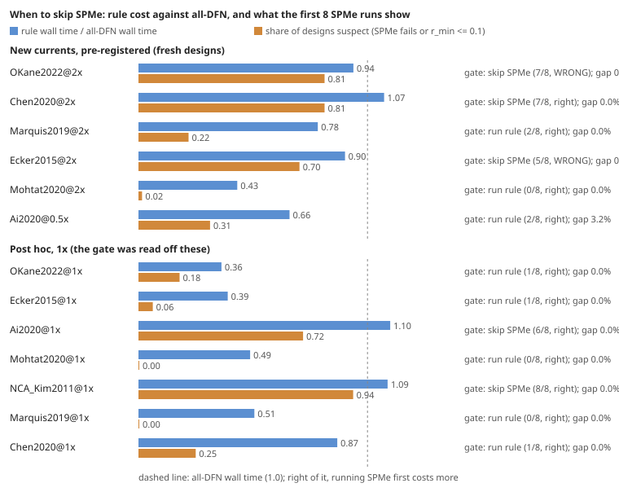

**Milestone 5f (2026-11-13): when screening lithium-ion electrode designs with PyBaMM's SPMe and checking with DFN, should you ever skip SPMe and run DFN on everything? Not worth deciding: the trust rule never cost more than 12% over all-DFN on 11 cell pools, and saved 49 to 64% on six of them. Reading the answer from verified designs returned the DFN-best design in all 120 trials.** We pre-registered five tests ([`LOG.md`](LOG.md)) and ran 515 new simulations: 64 fresh Sobol designs on each of `Mohtat2020`, `Ai2020`, `NCA_Kim2011` and `Ecker2015`. **The corrected answer step (keep verifying the leading design with DFN until the leader is one DFN has scored) picked the pool's DFN best in every one of 30 replayed trials on every cell** (H48 supported), fixing milestone 5e's 1.3% slip. **The re-solve step held on fresh data: all 3 early SPMe stops on `Mohtat2020` finish at rtol 1e-6 and score within 0.2% of DFN** (H49). The rule found every mis-scored design whenever it ran (H50). **The pilot switch failed its test** (H46 refuted): 8 SPMe runs plus 2 DFN runs were meant to say when DFN on everything is cheaper, but on `Ai2020`, the one cell where it is (by 11.6%), the switch fired in only 20% of trials, because a salt cut-off of 0.10 misses the 13 mis-scored designs whose minimum salt ratio sits between 0.10 and 0.32. The cost of that miss is small (median 1.12x the cheaper option; H47 mixed), and on cells where SPMe is reliable the pilot itself costs 2 to 8%. The practical procedure is the rule with the verified answer step, run every time.

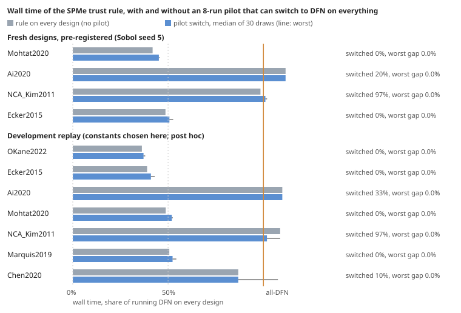

**Milestone 5e (2026-11-13): does a cheap test for when to trust PyBaMM's SPMe battery model hold on lithium-ion cells it was not built on? The screen does: it caught all 9 designs SPMe mis-scored on `Chen2020`, for 23% of the pool in full DFN runs. Its answer step needed a fix.** Milestones 5c and 5d built a two-part rule post hoc: re-solve SPMe runs that stop early at tight tolerance, then run the full DFN model on designs whose SPMe run failed and on the rest in ascending order of SPMe's minimum salt ratio, stopping after three sound designs in a row. We fixed the rule and four tests in advance ([`LOG.md`](LOG.md)) and ran 256 new simulations on two cells it had never seen, `Marquis2019` (Kokam SLPB78205130H pouch) and `Chen2020` (LG M50), with fresh designs. **On `Chen2020` it found all 9 mis-scored designs (3 SPMe failures, 6 salt-depleted) in 15 DFN runs** (H42, H45 supported), including the DFN-best design, which SPMe scores 23% low and ranks 16th of 64, so a top-k shortlist by SPMe would have missed it. `Marquis2019` has no mis-scored design and the rule stopped after 4 DFN runs. **The planned answer step, though, picked a design 1.3% below the best on `Marquis2019`** (H44 mixed): it compared the verified DFN-best (199.5 Wh/kg) with unverified SPMe scores, which run 1 to 6% high at the top of the space. Reading the answer from verified designs only gives the DFN best on both new cells at no extra cost, and on 4 of the 5 earlier cells (found after the verdicts). No run stopped early, so the re-solve step went untested (H43). Where nearly every design is mis-scored (`Ai2020`, `NCA_Kim2011`), the rule costs more than running DFN on all of them.

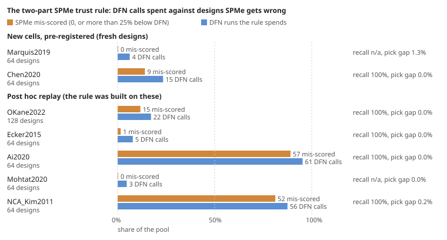

**Milestone 5d (2026-11-12): why does PyBaMM's SPMe battery model fail on some electrode designs, and can a solver setting fix it? An early stop is the solver's fault and tight tolerances fix it; a run that returns nothing is SPMe's own, and nothing fixes it.** Milestone 5c found SPMe mis-scores designs either by salt depletion or because its run fails. We pre-registered four tests ([`LOG.md`](LOG.md)) and re-solved every failed or stopped SPMe run on the committed benches (67 designs on three cells) under four solver and mesh variants, plus 24 sound runs as controls (455 runs). **All 6 `Mohtat2020` early stops reach 100 cycles at rtol 1e-6 and atol 1e-8 (IDAKLU or Casadi) and then score within 0.3% of DFN** (H38, H39 supported). Allowing the Newton solver more iterations rescues none, so the default error tolerance (rtol 1e-4) is what ends them. **None of the 61 runs that returned nothing (`NCA_Kim2011` 49, `OKane2022` 12) gets a usable score under any setting** (H40 supported). In 59 of them SPMe's linearised salt concentration goes below zero during the first discharge (median −8% of its initial value), the charge step that follows has no valid start, and PyBaMM discards the whole run. Every early stop keeps healthy salt (65 to 89%; H41 supported). For a design search, the rule becomes: re-solve a stopped SPMe run once at tight tolerance (about 2.4x its cost), and send runs that return nothing to DFN along with the salt-depleted ones. On `Mohtat2020`, whose other 58 designs already scored within 2.3% of DFN, the solver setting was the only source of mis-scores.

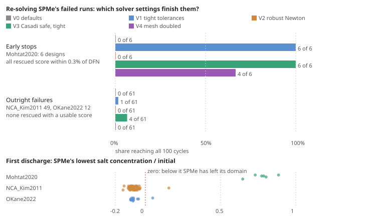

**Milestone 5c (2026-11-12): how many full DFN runs does it take to find the battery designs a reduced model (SPMe) mis-scores, on a cell you have not seen? No calibration needed: flag the SPMe runs that stop early, then verify from the most salt-depleted design up.** Milestone 5b showed the trust flag's ranking transfers across cells but its cut-off does not. We pre-registered five tests ([`LOG.md`](LOG.md)) comparing a cut-off calibrated from 8 random DFN runs against verifying designs in ascending order of SPMe's minimum salt ratio r_min until three sound ones in a row, and ran 256 new simulations on two more PyBaMM cells, `Mohtat2020` (graphite/NMC532 pouch) and `NCA_Kim2011` (graphite/NCA pouch). **On `Mohtat2020` both strategies failed (recall 0.00 and 0.17; H33, H34 and H37 refuted).** Its 6 mis-scored designs are not salt-depleted at all (r_min 0.65 to 0.89). They are SPMe runs whose solver stopped part-way (cycles 3 to 90), which PyBaMM returned as normal solutions, so they score 0. **SPMe mis-scores designs in two ways, and both show in the SPMe run itself.** Among SPMe runs that finish, every mis-scored design is salt-depleted and r_min ranks them at ROC AUC 0.995 or better on all four cells that have any. Flagging early stops as well (an exploratory rule, chosen after the verdicts), bottom-up verification finds every mis-scored design on all five cells, sending 16%, 95%, 6%, 14% and 88% of the pool to DFN against mis-scored shares of 13%, 89%, 2%, 9% and 81%. That is always fewer DFN runs than the 8-run calibration (23%, 98%, 19%, 27%, 92%), whose cut-off is also noisy (recall below 0.8 in 8% of draws on `OKane2022`).

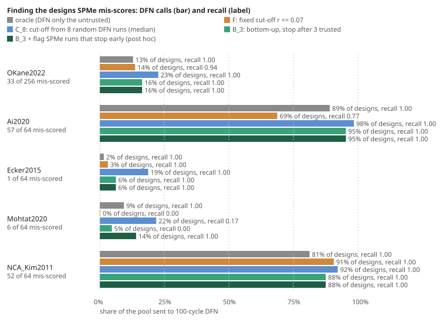

**Milestone 5b (2026-11-12): does a battery-model trust test tuned on one lithium-ion cell work on other cells? Its ranking does; its cut-off does not.** Everything before this step used one PyBaMM parameter set (`OKane2022`). We pre-registered four tests ([`LOG.md`](LOG.md)) and ran 384 new simulations on 64 designs for two more cells, `Ecker2015` (Kokam pouch) and `Ai2020` (Enertech LCO/graphite pouch), with the same design space and areal current density. **SPMe's own minimum salt ratio still ranks the designs it mis-scores almost perfectly (ROC AUC 0.995 on Ai2020, where 57 of 64 designs are mis-scored), but the cut-off picked on `OKane2022` (r <= 0.07) misclassifies 20.3% of Ai2020's designs, over the 20% bar** (H29 refuted). Ai2020's own best cut-off is 0.33, so the threshold must be set per cell. The surprise of milestones 3 and 5a, **that 10 cycles of SPMe rank designs better than 100, does not carry over: on both new cells the 100-cycle run ranks as well or better** (H31 refuted). What does carry over is the ordering of search methods (Spearman 0.73 and 0.70 against `OKane2022`, H32 supported). **Screening every candidate with a 2-cycle SPMe or DFN run, then verifying with 100-cycle DFN, beats Bayesian optimisation (GP-EI) on DFN on all three cells and stays within 1.3x of the fastest method on each**; the plain SPM screen, fine elsewhere, is slower than GP-EI on the salt-limited Ai2020 cell (its ranking Spearman is 0.32).

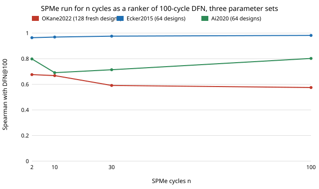

**Milestone 5a (2026-11-12): does a short SPMe run still beat Bayesian optimisation on DFN when the electrode designs are new? Yes.** Part 2b's 10-cycle SPMe screen and milestone 4b's cheap-start co-kriging were both picked after seeing the 128 designs they were scored on. We registered four tests ([`LOG.md`](LOG.md)), ran 384 new PyBaMM simulations on 128 fresh Sobol designs, and replayed all 15 search methods unchanged. **On pools of 64, screening every candidate with 10 cycles of SPMe and then verifying with 100-cycle DFN reaches a design within 1% of the DFN best in a median 123 s, against 220 s for GP-EI on DFN (p = 2e-6) and 205 s for the SPM@2 screen** (H25, supported). SPMe's 10-cycle ranking again tracks DFN's 100-cycle ranking better than SPMe's own 100-cycle ranking does (Spearman 0.67 against 0.58, difference CI 0.05 to 0.15; H26, supported). The ranking of the 15 methods carries over from the old designs to the new (Spearman 0.92; H28, supported). The cheap-start co-kriging search beats GP-EI at every pool size but is 1.4x and 1.7x slower than the best screen on pools of 16 and 32 (H27, refuted); it is the fastest method on pools of 96 (141 s). Across pool sizes 16 to 96, **a 2- or 10-cycle SPMe screen is never more than 1.4x slower than the fastest method, on both design sets** (found after the verdicts, so descriptive). One parameter set (`OKane2022`), one protocol; transfer to other cells is milestone 5b.

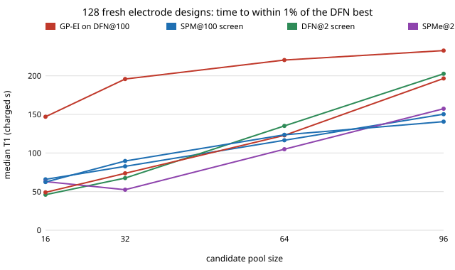

**Milestone 3 theory part 2b (2026-11-12): where does SPMe mis-score lithium-ion electrode designs, and does knowing it save full DFN runs? It tells you where; it does not plan or fix the search. A short SPMe run turned out to be the fastest screen.** In PyBaMM's SPMe the electrolyte term of the voltage grows like the log of the lowest salt concentration, and the whole electrode shares one reaction rate. So we predicted that SPMe's error after a scale-and-shift fit grows like -ln r, where r is SPMe's own minimum salt ratio ([`THEORY.md`](THEORY.md), part 2b). **That form is the best of those registered: it halves the cross-validated error of predicting 100-cycle DFN energy from 100-cycle SPMe (21.3 to 11.3 Wh/kg), ahead of the expansion's (1 - r)^2 (12.3) and milestone 1's flag (16.8)** (H21, supported). It is not enough to plan or repair a search. Fitted on 16-design pilots, the location model predicts SPMe's DFN cost within 2x on only 2 of 4 cycle counts (H22, refuted), and an online correction that refits DFN ~ SPMe + -ln r after each DFN call is slower than milestone 1's simple flag rule (528 against 418 s, H23, refuted). Two things we did not plan matter more. (1) **SPMe's 100-cycle screening cost rests on one design.** The DFN-best design is salt-depleted (r = 0.07), and SPMe ranks it 1st after 10 cycles but 41st after 100. Without it, SPMe@100 needs 2.1 DFN runs on pools of 64, not 14. (2) **A plain whole-pool screen with a 10-cycle SPMe run reaches a design within 1% of the DFN best in a median 123 s on pools of 64 and 172 s on 96. That beats GP-EI (220 s), every screen milestone 4 tested (153 to 253 s at 64), and milestone 4b's exploratory co-kriging (144 and 174 s)** (paired p <= 0.0001 against SPM@2, SPM@100, DFN@2 and GP-EI at 64). On pools of 16 and 32 a 2-cycle SPMe screen is fastest (38.5 and 52.5 s). These results were found after seeing the planned ones, on one parameter set and the same 128 designs, so they are exploratory until tested on fresh designs.

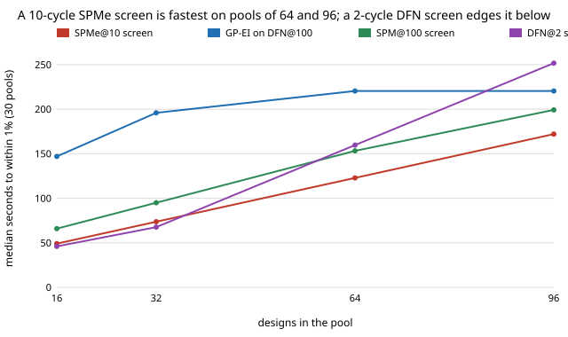

**Milestone 4b (2026-11-12): does multi-fidelity Bayesian optimisation (co-kriging) find the best battery electrode design faster than screening with a cheap model? Not as usually started.** We ran autoregressive co-kriging (Kennedy and O'Hagan) over a cheap rung (the plain SPM or a 2-cycle DFN run) and the 100-cycle DFN model, with two published rules for choosing which model to run next: augmented EI (Huang et al. 2006) and an MF-UCB rule after Kandasamy et al. (2016). Replayed on the cached benchmark with measured run times, **every planned variant is slower than plain GP-EI on DFN** (best: 205 s against 220 s on pools of 64, n.s.; 267 s against 220 s on pools of 96) **and far slower than screening the pool with a cheap model** (46 s at 16 designs, 153 s at 64). The cause is the start: five random 100-cycle DFN runs (122 s) before the cheap model has a say. **Started from ten 2-cycle DFN runs instead, the same search keeps pace with the best screen at every pool size (144 s at 64, 174 s at 96, against GP-EI's 220 s)**, where each single screen is best only at some sizes. That variant was tried after the planned result was in, so it is exploratory until a pre-registered test on fresh designs. Charging each design its own measured time (19 to 67 s a DFN run) leaves the ranking of methods unchanged (Spearman 0.90).

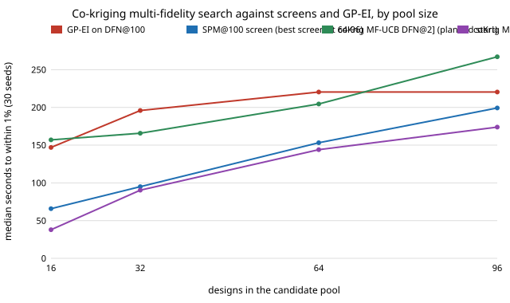

**Milestone 3 theory part 2a (2026-11-12): how many full DFN runs will a cheap screen cost you? A noise model answers for SPM and DFN screens, not for SPMe.** Treating a cheap battery model's error (after the best scale-and-shift fit) as independent noise gives an exact formula for the expected number of full DFN runs a screen-then-verify search needs ([`THEORY.md`](THEORY.md), part 2a). Used as a planner, it **calls whether screening the whole pool beats Bayesian optimisation (GP-EI) on DFN right on 14 of 16 (screen, pool size) cases**, where part 1's worst-case formula managed 8 of 16 (median T1 error 24%). But it cannot rank the screens with a single whole-space noise level (Spearman 0.51, refuted), because SPMe's large errors sit on particular designs: at 100 cycles on the DFN-best ones (14 DFN runs needed, 3 predicted from the top-of-space noise), at 10 cycles below them (1 needed, 10 predicted from the whole space). Where a reduced model errs matters more than how much.

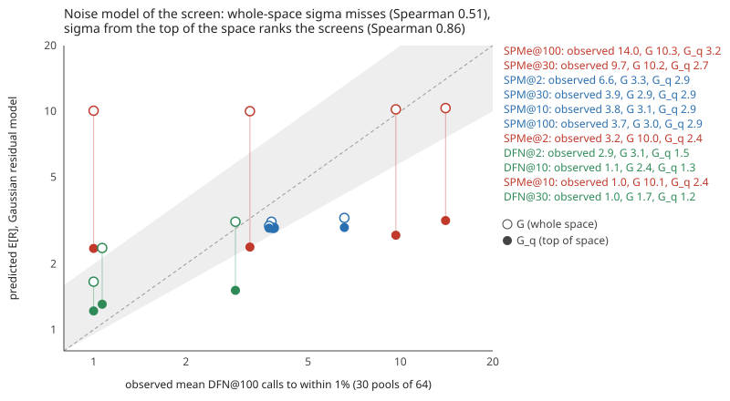

**Milestone 3 theory part 1 (2026-11-11): what kind of battery-model error actually costs you full simulations.** A screen-then-verify search uses only the cheap model's *order*, so any error that is a scale and shift of the full model's score is free. We prove ([`THEORY.md`](THEORY.md)) that the number of full DFN runs needed is bounded by the screen's **residual after the best affine fit** (kappa), and checked the bound on all 330 (screen, pool) cases of the cached benchmark with no violation. Across 11 cheap screens, **this residual ranks the DFN calls they need at Spearman 0.72, while the raw error ranks them at -0.07**. It explains milestone 2's surprise: SPM and SPMe have similar raw errors (7.1 and 9.5 Wh/kg), but SPM's residual is a quarter of SPMe's (11.0 against 42.8 Wh/kg), and **SPMe's residual tracks its own minimum salt concentration (Spearman -0.82)**: the SPMe correction under-scores salt-depleted designs. The worst-case cost formula built on the bound is refuted as a planning tool (8 of 16 screen-versus-GP-EI calls right).

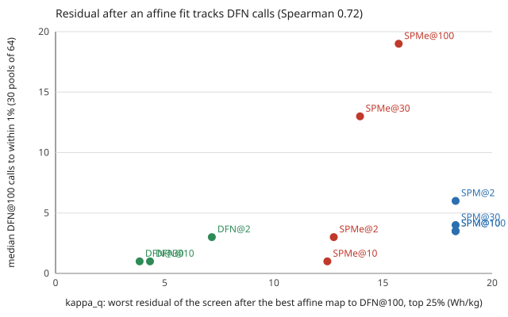

**milestone 4 search replay (2026-11-11): the cheapest screen wins, until the candidate pool grows.** Replaying 12 search methods on the cached benchmark (30 pools of 64 designs, each simulation charged its measured wall time), **screening every candidate with the plain SPM or a 2-cycle DFN run, then verifying in screen order with 100-cycle DFN, reaches a design within 1% of the best in a median 153 to 168 s, about 30% faster than Bayesian optimisation (GP-EI) on DFN (220 s)**. The 10-cycle DFN screen, the best ranker in milestone 2, is *slower* than GP-EI (253 s): its first pick is always right, but screening 64 designs at 3.6 s each costs more than GP-EI's nine DFN calls. Milestone 1's trust flag cuts SPMe screening from 700 to 418 s, yet SPMe stays the slowest screen. On pools of 96 GP-EI catches the screens up, so whole-pool screening suits small candidate sets only.

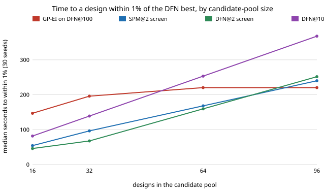

**Milestone 2 dense benchmark (2026-11-11): the 2a result holds out of sample, and SPM beats SPMe.** On 128 fresh space-filling (Sobol) electrode designs, each run for 100 cycles under SPM, SPMe and DFN (384 PyBaMM runs, every cycle kept), **a 10-cycle DFN run ranks the designs by their 100-cycle DFN energy with Spearman 0.96, against 0.64 for a full 100-cycle SPMe run, at the same cost (3.6 s against 3.7 s)**. Screening with 10-cycle DFN finds the DFN-best design; screening with SPMe misses it at any shortlist up to 20, because SPMe ranks it 41st. Not planned: the simplest model, SPM, ranks better than SPMe (0.96), even on the designs SPMe completes (0.98 against 0.77; on 2a's 49 designs SPM led too, 0.863 against 0.834), and 12% of the space (15 of 128) is mis-scored by SPMe by more than 25%. For electrode design under cycling, the cycle count is the fidelity axis worth cutting, and the SPMe correction hurts ranking.

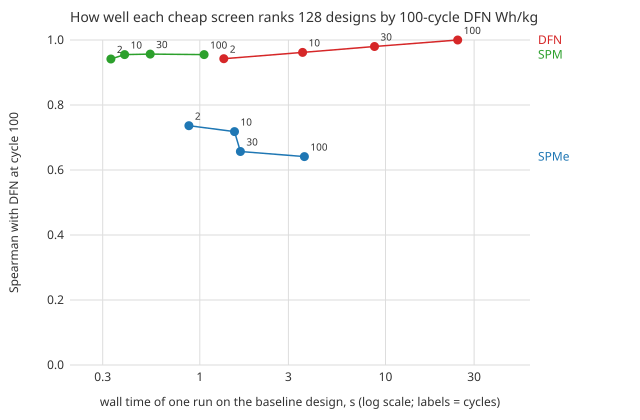

**Milestone 2a (2026-11-11): stop the expensive model early instead of reducing it.** On milestone 1's 49 designs, ranking by the full DFN model's score at **cycle 10** agrees with the 100-cycle DFN ranking at **Spearman 0.977**, against **0.834** for a full 100-cycle SPMe run (paired bootstrap difference 0.138, 95% 0.057 to 0.271), and costs the same wall time (median 4.0 s against 4.1 s). DFN-verifying the top 5 by 10-cycle DFN finds the best design; the top 5 by SPMe misses it by 2.1 Wh/kg. Even a 2-cycle DFN run (1.4 s, Spearman 0.915) beats every SPM and SPMe rung.

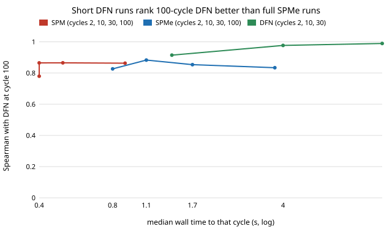

**Milestone 1 headline (2026-11-11).** On the 49 designs of [`energy-cell-dfn`](../energy-cell-dfn), SPMe's own minimum electrolyte salt concentration from a **2-cycle** run flags the designs whose 100-cycle SPMe score is more than 25% below DFN's with **ROC AUC 0.997** (95% bootstrap 0.980 to 1.000; 7 untrusted of 49). A flag at 10% of the initial salt concentration catches all 7 with one false flag. But the cost model the programme assumed is wrong: a 2-cycle run takes **SPMe 1.2 s and DFN 1.3 s**, and at 100 cycles **SPMe 3.9 s and DFN 27.9 s**. Cutting the cycle count saves 21x on DFN, swapping DFN for SPMe saves 7x, so the cheapest trustworthy screen may be a short DFN run rather than a reduced model.

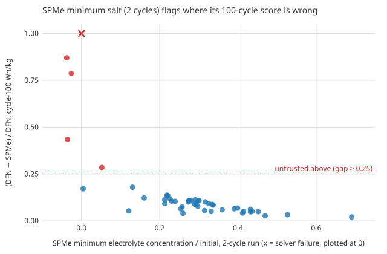

## Milestone 5g: a skip-SPMe gate and the iterate answer at new currents
Plan and verdicts: [`LOG.md`](LOG.md), milestone 5g (H51 to H55, registered before the bench). Script: `experiments/gate/run.py`; numbers: [`experiments/gate/results.txt`](experiments/gate/results.txt).

| Condition | suspect share (1x) | gate (of 8) | rule / all-DFN | gate right | answer gap |
|---|---|---|---|---|---|
| OKane2022 2x | 0.81 (0.18) | skip (7) | 0.94 | no | 0.0% |
| Chen2020 2x | 0.81 (0.25) | skip (7) | 1.07 | yes | 0.0% |
| Marquis2019 2x | 0.22 (0.00) | rule (2) | 0.78 | yes | 0.0% |
| Ecker2015 2x | 0.70 (0.06) | skip (5) | 0.90 | no | 0.0% |
| Mohtat2020 2x | 0.02 (0.00) | rule (0) | 0.43 | yes | 0.0% |
| Ai2020 0.5x | 0.31 (0.72) | rule (2) | 0.66 | yes | 3.2% |

Verdicts: H51 refuted (gate wrong on 2 of 6), H52 supported (gated cost at most 1.13&times; the cheaper branch), H53 supported (recall 1.00), H54 refuted (Ai2020 0.5x 3.2% short), H55 supported (current moves the suspect share in the predicted direction on all six). Wall times are each run's own under 4-way concurrency (10 Ai2020 DFN runs at 2-way after memory kills). Post hoc: a cost-aware gate (adds the SPMe/DFN time ratio from one DFN run) is right on 12 of 13 conditions; comparing SPMe with SPMe in the answer step fixes Ai2020 but verifies the whole pool on four conditions; an affine SPMe-to-DFN correction fitted on the verified designs is worse (up to 14.6%).

## Milestone 5d: SPMe's early stops and outright failures under five solver settings
Plan and hypotheses H38 to H41 were logged before the bench ([`LOG.md`](LOG.md)); one design (`NCA_Kim2011` 0) was diagnosed by hand before the plan and is disclosed there. Census: every SPMe run on the committed benches that returned no cycle (61) or fewer than 100 (6), plus 24 completed controls. Each ran SPMe for 100 cycles under five variants, with milestone 5b's mapping and protocol, plus a one-cycle diagnostic of the first discharge. Results: [`experiments/solver/results.txt`](experiments/solver/results.txt).

| reaches 100 cycles | V0 defaults (rtol 1e-4) | V1 rtol 1e-6, atol 1e-8 | V2 robust Newton | V3 Casadi safe, tight | V4 mesh x2 |
|---|---|---|---|---|---|
| early stops, `Mohtat2020` (6) | 0 | 6 | 0 | 6 | 4 |
| outright failures, `NCA_Kim2011` 49 + `OKane2022` 12 (61) | 0 | 1 | 0 | 4 | 0 |
| controls broken (24) | 0 | 0 | 0 | 0 | 0 |
| largest control score change | | 2.2% | 0.0% | 2.2% | 8.2% |

- Rescued stops score within 0.3% of DFN@100 (H38, H39 supported). The 4 failures that V3 completes still score 0 (three, no energy after cycle 1) or 57% below DFN (one), so none gets a usable score (H40 supported).
- First-discharge minimum salt ratio: below zero on 59 of 61 failures (median −0.08, low −0.15), with the charge step empty on 57; 0.65 to 0.89 on all 6 stops (H41 supported). Two failures keep positive salt and fail later; they are not diagnosed.
- After the verdicts: tight tolerances halve SPMe's median distance to DFN on `Mohtat2020`'s controls (1.01% to 0.50%) and leave `NCA_Kim2011` (1.0%) and `OKane2022` (5.4%) unchanged. DFN was not re-solved.
- V0 reproduces all 91 committed cycle counts. Code: [`experiments/solver/run.py`](experiments/solver/run.py); figure [`experiments/solver/figure.py`](experiments/solver/figure.py); tests `tests/test_solver.py`.

## Milestone 5c: setting the trust flag's cut-off on a new cell
Plan and hypotheses H33 to H37 were logged before the run ([`LOG.md`](LOG.md)), with one amendment after the feasibility probe and before any bench run: no candidate cell's baseline r_min fell in the planned 0.05 to 0.45, so the registered fallback chose `Mohtat2020`, and `NCA_Kim2011` was added as a second new set. 64 Sobol (seed 3) designs, SPMe and DFN for 100 cycles on each (256 runs), milestone 5b's mapping and areal current density. Strategies: F, the fixed cut-off r <= 0.07; C_k, a cut-off fitted to k random DFN runs (1000 draws); B_s, DFN in ascending r_min until s sound designs in a row. Costs are DFN@100 calls. Results: [`experiments/calibrate/results.txt`](experiments/calibrate/results.txt).

| | OKane2022 | Ai2020 | Ecker2015 | Mohtat2020 | NCA_Kim2011 |
|---|---|---|---|---|---|
| designs | 256 | 64 | 64 | 64 | 64 |
| mis-scored (share) | 33 (13%) | 57 (89%) | 1 (2%) | 6 (9%) | 52 (81%) |
| of which SPMe stopped short of 100 cycles | 12 | 0 | 0 | 6 | 49 |
| AUC of -r_min (all / runs that finish) | 0.997 / 0.995 | 0.995 / 0.995 | 1.000 / 1.000 | 0.486 / none mis-scored | 0.921 / 1.000 |
| F: recall, DFN share | 0.94, 14% | 0.77, 69% | 1.00, 3% | 0.00, 0% | 1.00, 91% |
| C_8: median recall, DFN share | 1.00, 23% | 1.00, 98% | 1.00, 19% | 0.17, 22% | 1.00, 92% |
| B_3: recall, DFN share | 1.00, 16% | 1.00, 95% | 1.00, 6% | 0.00, 5% | 1.00, 88% |
| B_3 + flag early stops (post hoc) | 1.00, 16% | 1.00, 95% | 1.00, 6% | 1.00, 14% | 1.00, 88% |

- Primary verdicts (new set `Mohtat2020`): H33 refuted, H34 refuted, H35 mixed, H36 supported only in letter (9.4% misclassified by flagging nothing), H37 refuted. With `NCA_Kim2011` as the new set all five are supported, but 49 of its 52 mis-scored designs are SPMe runs that failed outright, which the code scores r_min = 0.
- The early stops are solver failures: on `Mohtat2020` design 19, rerun by hand, IDA's corrector failed to converge and PyBaMM returned the finished cycles as a normal solution. Before the stop these runs track DFN's per-cycle energy within 3.7%.
- Code: [`experiments/calibrate/run.py`](experiments/calibrate/run.py); figure [`experiments/calibrate/figure.py`](experiments/calibrate/figure.py).

## Milestone 5b: transfer to Ecker2015 and Ai2020
Plan and hypotheses H29 to H32 were logged before the run ([`LOG.md`](LOG.md)). 64 Sobol (seed 2) designs, the same on both sets, SPM, SPMe and DFN for 100 cycles each (384 runs). The design mapping, protocol and mass rule are milestone 2's; per set, the current is scaled to `OKane2022`'s areal current density (48.7 A/m2), the voltage window is the set's own, and degradation parameters the set lacks are copied from `OKane2022` (Ecker2015: initial SEI on cracks; Ai2020: six lithium-plating parameters). Results: [`experiments/transfer/results.txt`](experiments/transfer/results.txt).

| | OKane2022 | Ecker2015 | Ai2020 |
|---|---|---|---|
| designs SPMe mis-scores (>25% below DFN) | 33 of 256 | 1 of 64 | 57 of 64 |
| misclassified by r_min <= 0.07 (H29, bar 20%) | 2.3% | 1.6% | **20.3%** |
| best cut-off for this set | 0.07 | 0.00 | 0.33 |
| ROC AUC of -r_min (H30) | 0.997 | 1.000 (1 positive) | 0.995 |
| Spearman with DFN@100: SPMe@10 / SPMe@100 (H31) | 0.67 / 0.58 | 0.969 / 0.982 | 0.691 / 0.802 |
| Spearman with DFN@100: SPM@100 | | 0.844 | 0.324 |
| median T1, pools of 32: GP-EI on DFN | 195.9 s | 105.7 s | 130.3 s |
| SPMe@2 / DFN@2 / SPMe@10 screens | 52.5 / 67.6 / 73.7 s | 68.7 / 61.4 / 70.0 s | 62.0 / 53.2 / 51.4 s |

- H29 refuted (Ai2020 20.3%), H30 supported on Ai2020 and inconclusive on Ecker2015 (one mis-scored design), H31 refuted on both, H32 supported on both (0.733, 0.700).
- Worst ratio to the fastest of 9 methods over the three sets (section G, after the verdicts): SPMe@2 screen 1.22, DFN@2 1.29, SPMe@10 1.40, cheap-start co-kriging 1.71, GP-EI 3.73, SPM@2 4.03.
- Code: [`experiments/transfer/run.py`](experiments/transfer/run.py); figure [`experiments/transfer/figure.py`](experiments/transfer/figure.py).

## Milestone 5a: the post-hoc winners on 128 fresh designs
Pre-registered in [`LOG.md`](LOG.md) (H25 to H28) before any fresh run. `experiments/fresh/run.py bench` runs SPM, SPMe and DFN for 100 cycles on 128 scrambled Sobol designs with seed 1 (milestone 2 used seed 0), with milestone 2's code path, bounds and `OKane2022` parameters. `report` replays 15 frozen methods (GP-EI, seven whole-pool screens, four co-kriging variants and their cheap-start versions, from `experiments/mfbo/run.py`) on 30 pools at each of 16, 32, 64 and 96 designs, on both design sets, charged milestone 2's baseline costs. The seed-0 replay reproduces milestone 4b's and part 2b's medians exactly.

| median T1 (s), fresh designs | N=16 | N=32 | N=64 | N=96 | worst ratio to fastest |
|---|---|---|---|---|---|
| GP-EI on DFN@100 | 147.0 | 195.9 | 220.4 | 232.7 | 3.73 |
| SPM@100 screen | 65.9 | 82.7 | 116.5 | 150.3 | 1.58 |
| DFN@2 screen | **46.0** | 67.6 | 135.1 | 202.7 | 1.44 |
| SPMe@2 screen | 63.0 | **52.5** | **104.9** | 157.4 | 1.37 |
| SPMe@10 screen | 49.1 | 73.7 | 122.9 | 196.6 | 1.40 |
| SPMe@100 screen | 107.5 | 227.3 | 736.3 | 1220.7 | 8.68 |
| cheap-start MF-UCB over DFN@2 | 62.4 | 89.6 | 123.6 | **140.6** | 1.71 |

Verdicts: H25 supported (SPMe@10 below GP-EI and SPM@2 at 64, p = 2.2e-6 and 0.0008), H26 supported (Spearman 0.668 against 0.575), H27 refuted (beats GP-EI at every size, but 1.36x and 1.71x the best screen at 16 and 32), H28 supported (0.924). Full table, Spearman per cell and the seed-0 column: [`experiments/fresh/results.txt`](experiments/fresh/results.txt).

## Milestone 3 (theory, part 2b): where SPMe errs, from its own salt depletion
Hypotheses H21 to H24 logged before the run (`LOG.md`); the argument is in [`THEORY.md`](THEORY.md), part 2b. One new PyBaMM pass: SPMe, 100 cycles, on the 128 benchmark designs, recording each cycle's minimum salt ratio. It reproduces the cached per-cycle energies exactly (largest relative difference 0) and the same 7 failures (`experiments/location/run.py bench`, about 5 minutes on 3 workers). Everything else replays the cache (`report`, about 2 minutes). 30 paired pools per size, costs as in milestone 4.

| Hypothesis | Pre-registered test | Result |
|---|---|---|
| H21 SPMe@100's residual follows -ln r | 5-fold CV RMSE: log < (1 - r)^2 and < flag, and <= 0.7 x no feature | **11.3 vs 12.3, 16.8; 0.53 x 21.3**: supported |
| H22 the location model (16-design pilots) plans SPMe's DFN calls | within 2x on >= 3 of 4 SPMe cells | **2 of 4** (2.64, 9.07, 1.04, 0.71 x observed): refuted |
| H23 online -ln r correction over SPMe@100 beats the flag rule | lower median T1, p < 0.05 | **528.1 vs 417.8 s** (p = 0.0001, slower): refuted |
| H24 online correction over SPMe@2 at most the SPM@2 screen | median T1 <= 168.2 s | **129.4 s**: supported, but the correction does nothing there (every feature, and none, gives 129.4 s; the target is found within the 4 screen-order warm-up calls) |

| Plain whole-pool screen (post hoc) | median T1, s, pool 16 | 32 | 64 | 96 |
|---|---|---|---|---|
| SPMe@2 (0.87 s a design) | 38.5 | 52.5 | 129.4 | 230.9 |
| SPMe@10 (1.54 s a design) | 49.1 | 73.7 | 122.9 | 172.1 |
| SPMe@30 | 75.4 | 89.7 | 424.2 | 648.6 |
| milestone 4: GP-EI on DFN@100 | 147.0 | 195.9 | 220.4 | 220.4 |
| milestone 4: best other screen | 46.0 (DFN@2) | 67.6 (DFN@2) | 153.2 (SPM@100) | 199.3 (SPM@100) |

Also from `experiments/location/results.txt`: the minimum salt ratio is set in the first discharge (its median and 10th percentile are the same over 2, 10, 30 and 100 cycles), so a 2-cycle run gives the same trust signal as a 100-cycle one. The SPMe score drifts from DFN as the cell cycles, so the location argument says where SPMe errs, not why the error grows with cycling. With the single DFN-best design removed, mean DFN calls on pools of 64 are SPMe@10 1.10, SPMe@2 1.13, DFN@2 1.13, SPMe@100 2.07, SPM@100 3.90 and SPM@2 4.67. So the short-SPMe screens' advantage does not hinge on that one design.

## Milestone 4b: co-kriging multi-fidelity BO against screens and GP-EI
Hypotheses H18 to H20 logged before the run (`LOG.md`), with one logged plan change (the hyperparameter grid widened after a 2-seed smoke test put rho on its edge); no new PyBaMM runs (`experiments/mfbo/run.py`, about 15 minutes; `--report` rebuilds `results.txt` from `summary.json`). 30 paired seeds per pool size; T1 = charged seconds until a design within 1% of the pool's best 100-cycle DFN score has been run at DFN@100. Co-kriging, augmented EI (Huang, Allen, Notz and Miller 2006, *Struct. Multidisc. Optim.* 32:369, doi:10.1007/s00158-005-0587-0) and the MF-UCB fidelity rule (after Kandasamy, Dasarathy, Oliva, Schneider and Poczos 2016, arXiv:1603.06288) are our own numpy implementations, not the authors' code.

| Hypothesis | Pre-registered test | Result |
|---|---|---|
| H18 co-kriging + augmented EI over SPM@2 beats GP-EI on pools of 64 | lower median T1, p < 0.05 | **240.3 vs 220.4 s**: refuted |
| H19 the best planned variant keeps both leads | at 96 <= GP-EI; at 16 <= 1.5 x best screen | **1.21 x GP-EI, 3.4 x screen**: refuted |
| H20 per-design costs keep the method order | Spearman >= 0.8 | **0.90**: supported |

| Method (cost A) | median T1, s, pool 16 | 32 | 64 | 96 |
|---|---|---|---|---|
| GP-EI on DFN@100 | 147.0 | 195.9 | 220.4 | 220.4 |
| best whole-pool screen | 46.0 (DFN@2) | 67.6 (DFN@2) | 153.2 (SPM@100) | 199.3 (SPM@100) |
| co-kriging MF-UCB over DFN@2, planned start (5 random DFN@100) | 157.1 | 165.8 | 204.6 | 267.1 |
| same, cheap start (10 DFN@2, then DFN@100 on the best 2), exploratory | 38.0 | 90.3 | 144.0 | 173.9 |

All 12 methods, their intervals, DFN and cheap-rung call counts, per-design-cost results and the head-to-head against the best screen are in `experiments/mfbo/results.txt`. The cheap-start variant ties the best screen at each size (wins 18 / 13 / 19 / 18 of 30; p 0.19 and 0.40 at 16 and 32, 0.047 at 64, 0.052 at 96) and beats GP-EI at each (p <= 0.0004).

## Milestone 3 (theory, part 2a): an average-case formula and planner
Hypotheses H15 to H17 logged before the run (`LOG.md`); proposition and proof in [`THEORY.md`](THEORY.md), part 2a; no new PyBaMM runs (`experiments/average/run.py`, about a minute).

| Hypothesis | Pre-registered test | Result |
|---|---|---|
| H15 Gaussian residual (whole-space sigma) predicts mean DFN calls | Spearman >= 0.8 and within 2x on >= 8 of 11 | **0.51, 7 of 11**: refuted (top-of-space sigma, an extra: 0.86, 7 of 11) |
| H16 the formula plans screen vs GP-EI | >= 13 of 16 calls right | **14 of 16**: supported (worst-case corollary: 8) |
| H17 a design-independent residual under-predicts SPMe@100 by 2x | ratio <= 0.5 | **0.74**: refuted |

| Screen | sigma whole / top, Wh/kg | observed mean R | predicted (whole sigma) | predicted (top sigma) |
|---|---|---|---|---|
| SPM@2 | 7.4 / 6.8 | 6.6 | 3.3 | 2.9 |
| SPM@100 | 6.9 / 6.7 | 3.7 | 3.0 | 2.9 |
| SPMe@10 | 20.4 / 5.6 | 1.0 | 10.1 | 2.4 |
| SPMe@100 | 21.0 / 7.2 | 14.0 | 10.3 | 3.2 |
| DFN@2 | 7.1 / 3.4 | 2.9 | 3.1 | 1.5 |
| DFN@10 | 5.6 / 2.6 | 1.1 | 2.4 | 1.3 |

All 11 cells and the 16 planning calls are in `experiments/average/results.txt`. The predictions use the same 128 designs as the observations, so this is a consistency check, not a blind forecast.

## Milestone 3 (theory, part 1): the affine-residual bound
Hypotheses C1 and H11 to H14 logged before the run (`LOG.md`); theorem and proof in [`THEORY.md`](THEORY.md); no new PyBaMM runs (`experiments/theory/run.py`, about 2 s).

| Hypothesis | Pre-registered test | Result |
|---|---|---|
| C1 the bound holds | no violation on 11 cells x 30 pools | **0 violations** of 330 |
| H11 residual, not raw error, predicts DFN calls | Spearman(kappa_q, median R) >= 0.7 and >= raw + 0.2 | **0.72** vs raw -0.07: supported |
| H12 SPM's residual at most half SPMe's | kappa_all ratio <= 0.5 | **11.0 vs 42.8 Wh/kg (0.26)**: supported |
| H13 SPMe's residual is salt depletion | abs Spearman with r_min exceeds SPM's by 0.2 | **-0.82 vs +0.26**: supported |
| H14 worst-case cost formula predicts screen vs GP-EI | >= 13 of 16 right | **8 of 16**: refuted |

| Screen | kappa_q, Wh/kg | median R (DFN calls) | top-1 regret on 128, Wh/kg |
|---|---|---|---|
| SPM@2 | 18.3 | 6 | 9.9 |
| SPM@100 | 18.3 | 3.5 | 15.2 |
| SPMe@10 | 12.5 | 1 | 0 |
| SPMe@100 | 15.7 (not a valid bound: best design outside top 25%) | 19 | 9.3 |
| DFN@2 | 7.2 | 3 | 1.6 |
| DFN@10 | 4.3 | 1 | 0 |
| DFN@30 | 3.9 | 1 | 0 |

All 11 cells are in `experiments/theory/results.txt`. The bound is worst-case, and one large residual widens the band for every design, so its cost corollary calls SPM screens losers even where they win; part 2a's average-case formula (above) replaces it for planning.

## Milestone 4: search comparison on the cached benchmark
Hypotheses H7 to H10 logged before the run (`LOG.md`). No new PyBaMM runs: each seed draws a pool of 64 of the 128 Sobol designs, and every method is replayed on the committed per-cycle scores, each evaluation charged the median fresh-run wall time of its (model, cycles) cell on the baseline design (DFN@100 24.5 s, DFN@10 3.6 s, DFN@2 1.35 s, SPM@100 1.05 s, SPM@2 0.33 s, SPMe@100 3.7 s). T1 is the charged time until a design within 1% of the pool's best 100-cycle DFN score has been run at 100-cycle DFN. 30 seeds, paired.

| Method | Median T1, s (95% CI) | DFN@100 calls | p vs GP-EI |
|---|---|---|---|
| Random order, DFN@100 | 612 (392–857) | 25 | 0.0001 |
| GP-EI, DFN@100 | 220 (196–257) | 9 | |
| **Screen SPM@100, verify in order** | **153 (141–166)** | 3.5 | 3e-5 |
| Screen DFN@2 | 160 (135–160) | 3 | 0.0006 |
| Screen SPM@2 | 168 (144–193) | 6 | 0.01 |
| Successive halving DFN 2-10-30-100, resumed runs | 185 | 1 | 0.006 |
| GP-EI with the SPM@2 score as an input | 193 (168–217) | 7 | 0.12 |
| Successive halving, fresh runs | 247 | 1 | 0.07 |
| Screen DFN@10 | 253 | 1 | 0.04 (slower) |
| Screen SPMe@100 with the trust flag | 418 (332–430) | 7.5 | 4e-6 (slower) |
| Screen SPMe@100 | 700 (393–761) | 19 | 4e-6 (slower) |

| Hypothesis | Pre-registered test | Result |
|---|---|---|
| H7 DFN@10 screen needs a third of GP-EI's time | ratio ≤ 1/3; refuted if regret > 2% at GP-EI/3 | **1.15**, regret 100% at 73.5 s (still screening): refuted |
| H8 halving does not beat the DFN@10 screen | refuted if halving lower at p < 0.05 | 247 vs 253 s, lower on every pool: refuted (a 2.6% saving) |
| H9 SPM@2 screen beats DFN@10 screen | lower supports; higher at p < 0.05 refutes | **168 vs 253 s**, p = 0.0003: supported |
| H10 the trust flag does not slow SPMe | refuted if slower at p < 0.05 | **418 vs 700 s**, p = 8e-5: supported (it helps) |

- **Pool size decides (not planned).** Median T1 at 16 / 32 / 64 / 96 designs: GP-EI 147 / 196 / 220 / 220 s; SPM@2 screen 54 / 96 / 168 / 240 s; DFN@2 screen 46 / 68 / 160 / 252 s; SPM@100 screen 66 / 95 / 153 / 199 s. Screening pays per candidate and GP-EI roughly per DFN call, so the screens' lead shrinks with the pool and is gone by 96 for all but SPM@100. In a continuous design space a search needs a model of the cheap rung rather than a whole-pool screen; a BOCA-style baseline is the next test.
- **The multi-fidelity GP does not help here.** Adding the screen score as a GP input matches the DFN@10 screen (its start is already within 1%) and is slower than the plain SPM@2 screen, because expected improvement abandons the screen's order.

## Milestone 2: dense paired benchmark (128 Sobol designs)
Hypotheses logged before the run (`LOG.md`; this entry's H1 to H3 are its own, not milestone 1's). It ran in parallel with milestone 2a (below) and asks the same question out of sample: 2a used the 49 stratified designs, this a fresh unbiased sample. 128 designs from a scrambled Sobol sequence over the `energy-cell` bounds (seed 0), not chosen by any search. One 100-cycle run per design and model, one fresh process each; the score at cycle *n* is cycle *n*'s discharge Wh/kg from that run (an *n*-cycle run gives identical cycles: checked on the baseline, difference 0). The baseline reproduces `energy-cell-dfn` exactly (SPMe 109.14, DFN 116.26 Wh/kg). Target: DFN at cycle 100. DFN completed all 128 designs, SPM all 128, SPMe 121.

| Screen | Spearman with DFN@100 (95% CI) | Top-10 overlap | Regret, top-10 verified | Cost, s |
|---|---|---|---|---|
| SPM@2 | 0.941 (0.893–0.971) | 5 | 1.01% | 0.3 |
| SPM@100 | 0.955 (0.912–0.980) | 5 | 0% | 1.1 |
| SPMe@2 | 0.736 (0.581–0.873) | 6 | 0% | 0.9 |
| SPMe@100 | 0.641 (0.480–0.789) | 4 | 1.98% | 3.7 |
| DFN@2 | 0.942 (0.896–0.969) | 7 | 0% | 1.3 |
| **DFN@10** | **0.962 (0.932–0.977)** | 8 | 0% | 3.6 |
| DFN@30 | 0.980 (0.963–0.988) | 9 | 0% | 8.7 |
| DFN@100 | 1 | 10 | 0% | 24.5 |

All twelve cells are in `experiments/cycles/results.txt`. Costs are wall time on the baseline design, median of 3, idle machine.

| Hypothesis | Pre-registered test | Result |
|---|---|---|
| H1 DFN@10 ranks at least as well as SPMe@100 | difference ≥ 0 supports, < −0.05 refutes | **+0.32** (paired bootstrap +0.18 to +0.48): supported |
| H2 DFN@10 costs no more than SPMe@100 | ratio ≤ 1 supports, > 1.5 refutes | **0.98**: supported (narrowly) |
| H3 DFN@10 screen + top-10 verify within 1% of the best | regret ≤ 1% supports, > 2% refutes | **0%** (SPMe@100 screen: 1.98%): supported |

- **SPM beats SPMe (not planned).** Over the 121 designs SPMe completed, Spearman with DFN@100 is 0.984 for SPM and 0.769 for SPMe, so SPMe's poor ranking is not only its 7 solver failures. SPM over-scores by a median +7.1 Wh/kg, SPMe under-scores by −8.7, and SPM's error is the more uniform. SPM is still not a safe pick for the single best design: it scores the DFN best at 182.7 against 162.3 and its top-1 regret is 9.4%; from a top-5 shortlist the regret is 0.
- **SPMe gets worse with cycling.** Its agreement falls from 0.736 at 2 cycles to 0.641 at 100, while DFN's short runs converge on the 100-cycle ranking (0.942, 0.962, 0.980 at 2, 10, 30 cycles).
- **Milestone 1's flag out of sample (not planned).** On this unbiased sample, 15 of 128 designs (12%) are untrusted under SPMe (score 0 or more than 25% below DFN). SPMe's minimum salt concentration over its 100-cycle run flags them with AUC 0.994, and `r_min ≤ 0.1` catches all 15 with 8 false flags. Milestone 1's test used the 2-cycle minimum, so this replicates the signal rather than the exact test.
- **The DFN-best design** (124 µm positive, porosities 0.37 and 0.25, N/P 1.28 relative) scores 121.0 under SPMe, 41st of 128: an SPMe-guided search prunes it.

## Milestone 1: a trust flag from the cheap model's own solution
Hypotheses and the "untrusted" label were logged before the run (`LOG.md`).
- **Data.** The 49 designs in `energy-cell-dfn/experiments/selected.json` (baseline, each `energy-cell` search run's best, 36 spread over the SPMe ranking, 3 SPMe failures) and their committed 100-cycle SPMe and DFN scores (`dfn.jsonl`, not re-run). New: each design run under SPMe for 2 cycles of the `energy-cell` protocol (5 A discharge to 2.5 V, 5 A charge to 4.2 V, solvent-diffusion-limited SEI, irreversible plating), recording the minimum electrolyte concentration over space and time divided by the initial 1000 mol/m³ (`r_min`). A solver failure counts as `r_min = 0`.
- **Label.** Untrusted: SPMe scored 0, or `(DFN − SPMe) / DFN > 0.25` at cycle 100.

| Hypothesis | Pre-registered test | Result |
|---|---|---|
| H1 `r_min` classifies untrusted designs | AUC ≥ 0.90 supports, < 0.80 refutes | **0.997** (0.980–1.000); 0.994 over the 46 SPMe solved: supported |
| H2 `r_min` tracks the gap | Spearman ≤ −0.5 supports, > −0.3 refutes | **−0.833**: supported |
| H3 a 2-cycle SPMe run is cheap next to DFN | SPMe/DFN < 0.10 supports, > 0.25 refutes | **0.88** (1.2 s vs 1.3 s): refuted |

- **Thresholds.** `r_min ≤ 0`: 6 of 7 caught, 0 false flags. `≤ 0.10`: 7 of 7, 1 false flag (a design with a 17% gap). `≤ 0.30`: 7 of 7, 23 false flags. Three designs SPMe solves have a *negative* salt concentration (−0.026 to −0.038), which the reduced model allows and the full one cannot.
- **Cost.** Baseline design, fresh process per run, set-up included: 2 cycles SPM 0.3 s, SPMe 1.2 s, DFN 1.3 s (median of 3); 100 cycles SPM 1.0 s, SPMe 3.9 s, DFN 27.9 s (one run each, added after the plan). DFN's cost is in the cycling, not the set-up.
- **Screen-then-verify replay** (on the committed scores, so not a search): DFN on the top 10 by SPMe finds the DFN best of the 49 (163.0 Wh/kg); the top 1 to 5 find 160.9 (1.3% short). Adding the 8 flagged designs finds nothing better, since the designs SPMe mis-scores are not the optimum here; the flag matters because a search that believes SPMe prunes a region DFN cycles normally (`energy-cell-dfn`).

## Milestone 2a: cycle count as the fidelity axis
Hypotheses logged before the run (`LOG.md`). Each design was run once per model in a fresh process (SPM and SPMe for 100 cycles, DFN for 30), recording each cycle's discharge energy and the wall time at the end of each cycle (PyBaMM `on_cycle_end` callback, set-up included), so one DFN run gives the cycle 2, 10 and 30 rungs and their cost. Score at cycle n is the `energy-cell` score with `cycles = n`. The reference is the committed 100-cycle DFN score.

| Rung | Spearman with DFN@100 | median s | top-5 regret (Wh/kg) |
|---|---|---|---|
| SPM @ 10 / 100 | 0.865 / 0.863 | 0.4 / 0.9 | 0.0 / 0.0 |
| SPMe @ 10 / 100 | 0.883 / 0.834 | 1.1 / 3.7 | 0.0 / 2.1 |
| DFN @ 2 | 0.915 | 1.4 | 2.5 |
| **DFN @ 10** | **0.977** | **4.0** | **0.0** |
| DFN @ 30 | 0.990 | 10.2 | 0.0 |

(full table, k = 1 to 10, in `experiments/horizon/results.txt`; SPM's top-1 pick is 42 Wh/kg short.)

| Hypothesis | Pre-registered test | Result |
|---|---|---|
| H4 DFN@10 ranks DFN@100 well | Spearman ≥ 0.90 supports, < 0.834 refutes | **0.977**: supported |
| H5 DFN@10 costs no more than SPMe@100 | median ratio ≤ 1 supports, > 1.5 refutes | **0.98** (1.07 cycle-end to cycle-end): equal cost |
| H6 DFN@10 screens as well | top-5 regret ≤ SPMe@100's 2.1 | **0.0**: supported |

- **Why the reduced model loses.** SPMe's agreement peaks at cycle 10 and falls with horizon: its degradation (SEI, plating) path drifts from DFN's. DFN keeps 58 to 74% of its cycle-10 energy by cycle 100, so the early ranking holds through heavy fade.
- **The designs SPMe mis-scores.** Mean rank error on the 7 milestone-1 untrusted designs: 4.6 places under 10-cycle DFN, 16.3 under 100-cycle SPMe.
- **Negative.** Extrapolating DFN's fade linearly from cycles 2 and 10 to 100 ranks at Spearman 0.01; use the raw early score.
- **Reproduction.** SPMe 100-cycle re-runs match the committed scores exactly; a DFN 100-cycle re-run of the baseline matches its committed 116.256 Wh/kg.

## Limitations
- One parameter set, one protocol, one design cell; 49 designs chosen to spread over the SPMe ranking, so the AUC is on a stratified sample with only 7 positives (the bootstrap interval reflects that, not the design-space-wide rate).
- Three of the seven positives are solver failures, which any cheap screen would notice; over the four SPMe solved, the AUC is still 0.994.
- Wall times are one machine (4 cores), one design for the cost table, one run each at 100 cycles. DFN's memory use (4 to 13 GB per 100-cycle run in `energy-cell-dfn`) is not measured here.
- Milestone 2a reuses the same 49-design stratified sample and one machine's serial timings (4 cores, `OMP_NUM_THREADS=1`); the Spearman intervals are over these designs, not the design space. Whether 10 cycles suffice under faster-fading protocols or other parameter sets is untested.
- Milestone 2's costs come from the baseline design only; DFN runs on thick, dense designs took up to 67 s in the benchmark (three at a time, so not used for cost), so the DFN@10 against SPMe@100 parity (ratio 0.98) may not hold everywhere. One Sobol sample of 128, one seed.
- Milestone 4 is a replay over pools drawn from one set of 128 designs, so seeds share designs and its Wilcoxon p-values overstate independence; every evaluation of a cell is charged the baseline design's time, though thick designs ran up to 67 s under DFN; BOCA and co-kriging proper are not run (co-kriging: milestone 4b).
- Milestone 4b shares milestone 4's replay limits (one set of 128 designs, overlapping pools); its co-kriging uses a coarse hyperparameter grid refit every 5 observations, isotropic kernels and our own implementations of the two fidelity rules; the cheap-start variant was chosen after the planned result and its settings (10 cheap runs, 2 verified) were not varied, so its tie with the best screen is exploratory; per-design costs scale the baseline by each design's 100-cycle benchmark time, run three at a time.
- Milestone 3 part 2b shares the replay limits (one set of 128 designs, overlapping pools, baseline-design costs). H21's form was suggested by part 1's correlation. The plain short-SPMe screens (section E) and the single-design diagnosis were found after the planned results, on the same designs, so they are exploratory. The SPMe@10 screen's lead depends on SPMe's ranking at cycle 10 matching DFN's at cycle 100 on this parameter set and protocol, which nothing here shows to transfer.
- Milestone 5a tests fresh designs, not fresh physics: same parameter set, protocol, bounds and cost table, and the same pool rule, so its pools overlap and its p-values overstate independence. Its section C (worst ratio to the fastest method) was computed after the verdicts.
- Milestone 5b's cells are design-space variants of `Ecker2015` and `Ai2020` (5% inactive rule, `OKane2022`'s current density and missing degradation parameters), not the published cells; Ecker2015's 290 to 337 Wh/kg sits above its real cell for that reason. 64 designs per set, pools of 32 out of 64 overlap heavily, and Ecker2015 has one mis-scored design, so its AUC says little. Both are graphite cells.
- Milestone 5c's label counts an SPMe run that stops early as mis-scored (score 0), as every milestone has; milestone 5d shows the early stops are numerical (tight tolerances finish them) and the outright failures structural (SPMe's salt goes negative). The rule that flags them was chosen after the verdicts. `Mohtat2020` and `NCA_Kim2011` are design-space variants like 5b's (5% inactive rule, `OKane2022`'s current density and copied plating or SEI keys); 64 designs each; `NCA_Kim2011`'s support for H33 to H37 rests mostly on SPMe failing outright on 49 designs.
- Milestone 5d tries four solver and mesh settings in one PyBaMM version (26.10.1.1), not an exhaustive search; a different integrator or a positivity-preserving SPMe might finish runs these cannot. Its "structural" reading rests on the first discharge's sign of c_e, not on a proof that no solver could continue. The controls are 24 designs, and DFN was not re-solved at tight tolerance, so how much of the measured SPMe-DFN gap on each cell is tolerance is open.
- Milestone 5f's switch constants (pilot of 8, r* = 0.10) were chosen on a post hoc replay of the seven committed cells; three of its four test cells were seen in 5b and 5c on other designs, so it tests fresh designs more than fresh cells. Wall time is summed per-run seconds on one 4-core machine, so the 10% margins depend on this machine's SPMe-to-DFN time ratio (0.14 to 0.57 across cells).
- Milestone 5e tests two new cells, and only one (`Chen2020`) has any mis-scored design, so H42 rests on 9 designs; no run stopped early, so the re-solve step is untested on fresh data. `Ramadass2004` was excluded by the plan because its baseline SPMe run fails outright, which is itself the rule's failure case. The fixed answer step (best verified design) was chosen after the verdicts.
- Neither model is validated on the `OKane2022` designs; `energy-cell-dfn` checked both against measured curves of two other cells.

## Next steps
After milestone 5g: pre-register the cost-aware gate (suspect share plus the SPMe/DFN time ratio from one DFN run) on new conditions; find an answer step robust to SPMe bias in both directions, for example keep verifying while an unverified design's SPMe score is within the SPMe-DFN gap seen on the verified sound designs of the best; sweep current density as a continuous axis to find where each cell crosses from SPMe-trustworthy to SPMe-broken, and check whether a dimensionless salt-depletion number (Sand time against discharge time) predicts the crossing without simulation. After milestone 5f: put the rule with the verified answer step inside the search replay (does it change time to the DFN best against GP-EI and the short screens?); a 300-design pool where the run-of-3 stop and the 25% label can be swept; milestone 6, the measured-cell check (H4). A switch is only worth revisiting if a cell is found where the rule loses by much more than 12%. After milestone 5e: pre-register the corrected answer step (best verified design) with the rule inside the search replay, on a cell with early stops; decide from the SPMe run alone when to skip SPMe and run DFN on everything (Ai2020 and NCA_Kim2011 lose wall time to the rule); bring `Ramadass2004` in as a cell where SPMe fails at the baseline design. After milestone 5d: pre-register the revised rule (re-solve early stops at rtol 1e-6, send outright failures and low-r_min designs to DFN bottom-up until three sound designs) on a sixth cell and inside the search replay (does it change time to the DFN best?); re-solve DFN at tight tolerance to see how much of the measured SPMe-DFN gap is tolerance on each cell; diagnose the two failures that keep positive salt (`OKane2022` design 16, `NCA_Kim2011` design 2); test whether clipping SPMe's salt concentration at a small positive floor turns the structural failures into usable, flagged scores. After milestone 5b: why SPMe's 10-cycle ranking beats its 100-cycle one on `OKane2022` only (its SiOx negative and fitted degradation are the candidates); milestone 6, the measured-cell check (H4). The 5b bench ran at 3 workers within memory. Milestone 3 part 2b: pre-register the short-SPMe screens (SPMe@2 below about 48 designs, SPMe@10 above) against DFN@2, SPM@100 and the cheap-start co-kriging, and test them on fresh Sobol designs and on milestone 5's other parameter sets. The question that would make this a result is why SPMe's ranking at 10 cycles matches DFN's at 100 while SPMe's own ranking at 100 does not. The salt-depletion location explains where the drift lands; what drives the drift (SPMe's degradation path on depleted designs) is open. Milestone 4b: pre-register the cheap-start co-kriging search (and a sweep of its two settings) and test it on fresh designs, ideally milestone 5's other parameter sets (`Ecker2015`, `Ai2020`, `Chen2020`), where no number has been seen; a continuous design space (not a pool) and BOCA's continuous fidelity remain. Earlier: milestone 4 left a continuous-space comparison: GP-EI or BOCA over SPM@2 or DFN@2 as the cheap rung against whole-pool screening, with per-design costs (each design's own timing) instead of the baseline's (4b ran the per-design costs in the pool replay).
The dense benchmark (`experiments/cycles/bench.jsonl`, every cycle of SPM, SPMe and DFN on 128 Sobol designs) is the cache milestone 4's search comparison replays: cycle count and model as a two-axis fidelity space, with short DFN and SPM as cheap rungs, against GP-EI on DFN, Hyperband and BOCA-style baselines. Milestone 3's theory now has two questions: why early DFN rankings converge, and why the SPMe correction ranks designs worse than SPM under cycling. Grow the benchmark past 128 designs to pin down the 12% untrusted rate, then transfer to other parameter sets (`PROPOSAL.md`, Milestones).

## Reproduce
From this directory, with numpy and pybamm (PyBaMM 26.10.1.1 here):
`python experiments/trust/run.py probe` (about 1 minute), `cost`, `cost100` (about 40 s), `report`, then `python experiments/trust/figure.py` (stdlib only). Milestone 2a: `python experiments/horizon/run.py sweep` (147 runs, about 17 minutes serial here), `check` (about 1 minute), `report`, then `python experiments/horizon/figure.py`. Tests: `pytest tests` (read the committed files; the milestone 3 part 2a and 4b tests need numpy and scipy).
Milestone 5g: `python experiments/gate/run.py probe` (about 2 minutes), `WORKERS=4 python experiments/gate/run.py bench` (768 runs, about 45 minutes on 4 cores, resumable; use `WORKERS=2` for Ai2020 at 0.5x if memory is short), `report` (stdlib, seconds), then `python experiments/gate/figure.py`.
Milestone 5f: `python experiments/switch/run.py dev` (stdlib, seconds), `WORKERS=3 python experiments/switch/run.py bench` (515 runs, about 45 minutes on 4 cores, resumable), `report` (stdlib), then `python experiments/switch/figure.py`.
Milestone 5e: `python experiments/rule/run.py probe` (about 1 minute), `bench` (256 runs, about 35 minutes on 4 cores, resumable), `report` (stdlib plus the committed benches), then `python experiments/rule/figure.py`.
Milestone 2: `python experiments/cycles/run.py prefix`, `cost` (about 3 minutes), `bench` (384 runs, about 45 minutes on 4 cores, resumable), `report`, then `python experiments/cycles/figure.py`.
Milestone 4: `python experiments/search/run.py` (numpy and scipy, about 15 s; replays the committed benchmark), then `python experiments/search/figure.py`.
Milestone 3 part 2b: `python experiments/location/run.py bench` (pybamm; 128 SPMe runs, about 5 minutes with `WORKERS=3`, resumable), `report` (numpy and scipy, about 2 minutes), then `python experiments/location/figure.py`.
Milestone 5d: `python experiments/solver/run.py census` (seconds), `WORKERS=3 python experiments/solver/run.py diag` (67 one-cycle runs, about 3 minutes), `WORKERS=3 python experiments/solver/run.py bench` (455 SPMe runs, about 35 minutes, resumable), `report` (stdlib), then `python experiments/solver/figure.py`.
Milestone 5c: `python experiments/calibrate/run.py probe` (pybamm, about 1 minute), `WORKERS=3 python experiments/calibrate/run.py bench` (256 runs, about 20 minutes, resumable), `report` (stdlib, seconds), then `python experiments/calibrate/figure.py`.
Milestone 5b: `python experiments/transfer/run.py probe`, `WORKERS=3 python experiments/transfer/run.py bench` (pybamm; 384 runs, about 35 minutes, resumable), `cost` (about 5 minutes), `report` (numpy and scipy, under a minute with `OMP_NUM_THREADS=1`), then `python experiments/transfer/figure.py`.
Milestone 5a: `WORKERS=2 python experiments/fresh/run.py bench` (pybamm; 384 runs, about 40 minutes, resumable), `report` (numpy and scipy, about 10 minutes with `OMP_NUM_THREADS=1`), then `python experiments/fresh/figure.py`.
Milestone 4b: `python experiments/mfbo/run.py` (numpy and scipy, about 15 minutes single-threaded with `OMP_NUM_THREADS=1`; `--report` rebuilds `results.txt` from `summary.json` in seconds), then `python experiments/mfbo/figure.py`.

## Builds on
`research/energy-cell` (design space, protocol, parameters and code, imported unchanged) and `research/energy-cell-dfn` (designs and committed scores); PyBaMM (Sulzer et al. 2021, doi:10.5334/jors.309); SPMe (Marquis et al. 2019, doi:10.1149/2.0341915jes); DFN (Doyle, Fuller and Newman 1993, doi:10.1149/1.2221597); `OKane2022` (O'Kane et al. 2022, doi:10.1039/D2CP00417H) on Chen et al. 2020 (doi:10.1149/1945-7111/ab9050). Milestone 5b adds the `Ecker2015` (Ecker et al. 2015, doi:10.1149/2.0551509jes and doi:10.1149/2.0541509jes) and `Ai2020` (Ai et al. 2020, doi:10.1149/2.0122001JES) parameter sets as packaged in PyBaMM; these three DOIs are copied from PyBaMM 26.10.1.1's `CITATIONS.bib`, and doi.org refused the lookup from this session (2026-11-12), so they are not yet resolved by `cite_check.py`. Milestone 4b adds Kennedy and O'Hagan 2000 (doi:10.1093/biomet/87.1.1), Huang et al. 2006 (doi:10.1007/s00158-005-0587-0) and Kandasamy et al. 2016 (arXiv:1603.06288), each resolved with `cite_check.py` on 2026-11-12. These were checked against PyBaMM's `CITATIONS.bib` and resolve with `cite_check.py` (2026-11-11, `cite_check.json`). Milestone 5c adds the `Mohtat2020` (Mohtat et al. 2020, doi:10.1149/1945-7111/aba5d1) and `NCA_Kim2011` (Kim et al. 2011, doi:10.1149/1.3597614) parameter sets as packaged in PyBaMM; both DOIs are copied from PyBaMM 26.10.1.1's `CITATIONS.bib`, and doi.org refused the lookup from this session (2026-11-12, proxy 403), so `cite_check.py` has not resolved them. Milestone 5d adds the SUNDIALS IDA integrator behind PyBaMM's IDAKLU solver (Hindmarsh et al. 2005, doi:10.1145/1089014.1089020) and CasADi (Andersson et al. 2019, doi:10.1007/s12532-018-0139-4); both DOIs match PyBaMM 26.10.1.1's `CITATIONS.bib`, and doi.org refused the lookup from this session (2026-11-12, proxy 403). No group in `prompt.md` covers battery design, and none is claimed.
