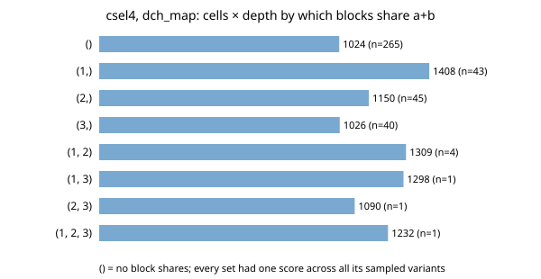

# chip-abc-orderblocks: do a carry-select adder's blocks share `a + b` independently when every chain has its own operand order? (yes: the set of sharing blocks predicts the netlist in 400 of 400 random variants; the cost is not additive; stylised, one adder, Yosys 0.33)

Track 3 (LLM chip-design loops, `PROJECTS.md`). `chip-abc-orderpass` found that `opt_merge` shares `a + b` between a block's const-0 and const-1 chains only when both are written with `a` and `b` first, but it only ran *uniform* orders (all const-0 chains alike, all const-1 chains alike), so it could not say whether blocks act independently. That was its first open next step; this project runs it. Produced with AI assistance (Claude). Preliminary and small: one adder, one tool version, a generic-gate library.

**Live page:** https://duncan-haywood.github.io/monorepo-projects/research/chip-abc-orderblocks/

**Builds on.** `chip-abc-orderpass`, `chip-abc-order`, `chip-abc-sweep` (same author, MIT): the `csel4` generator, miter equivalence check, ABC scripts and `add16` reference are copied from them. Yosys and its integrated ABC (Brayton and Mishchenko, CAV 2010, LNCS 6174:24-40, <https://doi.org/10.1007/978-3-642-14295-6_5>, as cited in `chip-abc-sweep`; not re-read here). No connection to the CU Boulder groups in `prompt.md` is claimed.

## Method
- `csel4` has 7 `a[i] + b[i] + const` chains: `r0` and `x1..x3` (const 0), `y1..y3` (const 1). `orders.csel4_mixed` writes each chain in its own operand order (6 choices each, 6^7 = 279,936 combinations).
- **Prediction, fixed before running:** block `i` (1 to 3) shares when `x_i` and `y_i` both start with `{a, b}` in either order; the adder count after `opt -nodffe -nosdff` should be `10 - (shared blocks)`, and the score should depend only on which blocks share.
- **Sample:** 400 random combinations (seed 1). Each is proved equivalent to `add16.v` (Yosys miter, `sat -prove`), counted after `opt`, and scored as cells x depth (`ltp -noff`) after `abc -g` with `yosys_default`, `dch_map` and `resyn2_map`.

## Reproduce
```bash
sudo apt-get update && sudo apt-get install -y yosys iverilog   # Yosys 0.33 here
cd research/chip-abc-orderblocks
python3 -m unittest discover -s tests
python3 experiments/run.py      # rewrites experiments/results.txt (about 7 min)
python3 experiments/figure.py
```

## Results (from `experiments/results.txt`)
- **The rule predicts the adder count exactly:** 0 mismatches in 400 variants. 0 of 400 were not proved equivalent.
- **The set of sharing blocks fixes the score.** The 400 variants fall in all 8 possible sets (265 share nothing; 43 / 45 / 40 share only block 1 / 2 / 3; 4, 1, 1, 1 share {1,2}, {1,3}, {2,3}, {1,2,3}). Within each set there is exactly one score per script, although the other chains (including `r0` and the non-sharing orders) vary freely. Order beyond the sharing rule does not matter here.
- **The cost is not additive across blocks.** Under `dch_map` (cells x depth) no sharing gives 1024; sharing only block 1 gives 1408 (1.38x), only block 2 1150 (1.12x), only block 3 1026 (1.00x); all three 1232 (1.20x, as in `chip-abc-orderpass`). Sharing {1,2} gives 1309, which lies between the two single-block scores (1408, 1150) rather than adding to them. Under `resyn2_map` the same ordering: 1300 baseline, 1750 / 1573 / 1220 for single blocks, 1665 for all three. Under `yosys_default` sharing helps a little (2268 down to 2262 per block, 2090 for all three). Which block shares matters, not only how many.
- The sets with two blocks sharing have n = 1 to 4, so their scores are single observations of a deterministic flow, not estimates.



## Limitations
- One adder, one Yosys/ABC version (0.33), generic-gate cells x depth, no place and route. 400 of 279,936 combinations: the "one score per set" claim is tested on a sample, not exhaustively (the sample did cover every set, though rare ones only 1 to 4 times).
- Why block 1 hurts more than block 3 (position in the carry chain? the width of the mux fan-in?) is not investigated.
- No LLM is involved; nothing here benchmarks one.

## Next steps
Exhaustively enumerate the 8 sharing sets with canonical chain orders to remove the sampling caveat; explain the block-position dependence; check the `mul6` design and the SKY130 flow of `chip-pnr`; add "share `a + b` in block 3 only" as a free baseline to `chip-ppa-loop`'s proposer comparison.

## Outside dependencies
Yosys and Icarus Verilog (apt). No LLM API, OpenROAD or PDK. Generators and flow wrapper copied from `chip-abc-orderpass` (MIT); the rest is original.
