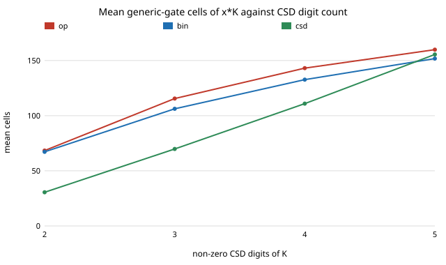

# chip-constmul: does writing a fixed-weight multiplier as shift-and-add (canonical signed digit) beat Yosys's `x * K`?

New question for the LLM chip-design-loop track (`PROJECTS.md`, track 3), asked because the recent `chip-*` chain had narrowed to variants of one result. Quantised accelerators (`chip-accel`, `accel-*`) multiply by weights known at synthesis time, so a multiplier by a constant is the commonest arithmetic block in them. This measures how much a hand-structured form saves over the plain operator, for every 8-bit constant. No LLM is used. Produced with AI assistance (Claude). Preliminary: one tool version, generic gates, one input width.

**Live page:** https://duncan-haywood.github.io/monorepo-projects/research/chip-constmul/

**Builds on.** `chip-abc-sweep` in this repository (same author, MIT): its `score` and `equivalent` wrappers are imported unchanged. Prior art on the technique: canonical signed digit (CSD) recoding is classical (Reitwiesner 1960, "Binary arithmetic", *Advances in Computers*); the open question here is only how much a current open synthesis flow already recovers on its own. Tools: Yosys and its integrated ABC (<https://yosyshq.net/yosys/>). Nothing from the CU Boulder groups in `prompt.md`; no connection to them is claimed.

## Method
- For each K in 1..255, an 8-bit unsigned input x and a (8 + bitlength K)-bit product, three Verilog forms (`src/chip_constmul/gens.py`):
  `op` is `x * K`; `bin` adds `x << i` for each set bit of K; `csd` adds or subtracts `x << i` for each non-zero canonical signed digit (no two adjacent non-zero digits, never more digits than binary).
- Score: `synth -flatten -noabc; abc -g AND,NAND,OR,NOR,XOR,XNOR,ANDNOT,ORNOT,MUX` (Yosys 0.33), cells = gate count (not um&sup2;), depth = Yosys `ltp -noff`.
- **Every `bin` and `csd` module is proved equal to the `op` module** for all 256 inputs by a Yosys miter (`all_equivalent` column, 255 of 255).

## Reproduce
```bash
sudo apt-get install -y yosys iverilog
python3 experiments/run.py        # writes results.txt (about 2 min)
python3 experiments/analyse.py    # prints the tables below
python3 experiments/figure.py     # writes cells_by_digits.svg
python3 -m unittest discover -s tests   # 6 tests
```

## Results (all from `experiments/results.txt`)
| form | mean cells | mean depth |
|---|---|---|
| `x * K` (op) | 112.9 | 19.6 |
| binary shift-add (bin) | 105.1 | 20.2 |
| CSD shift-add/sub (csd) | 75.7 | 20.0 |

- **Yosys's operator behaves like binary shift-add, not CSD.** Across the 255 constants, operator cells correlate with the number of set bits of K at Pearson 0.972, and with the CSD digit count at only 0.648. CSD has fewer cells than the operator for 230 constants, ties for 11 and is worse for 14. Total cells fall 33.0% against the operator.
- **The gain is concentrated where CSD has far fewer digits than binary.** K = 255 (binary 8 digits, CSD 2): 222 cells for the operator, 30 for CSD. By CSD digit count, mean cells (op / bin / csd): 2 digits (49 constants) 68.4 / 67.2 / 30.5; 3 digits (110) 115.5 / 106.3 / 69.8; 4 digits (80) 143.1 / 132.7 / 110.9; 5 digits (8) 159.9 / 151.8 / 155.5. At five digits the three forms are about even.
- **CSD is not always best.** It has more cells than the operator for 14 constants (largest: K = 211, 153 vs 175 cells) and than binary shift-add for 41. Picking the cheaper of bin and csd per K gives 74.3 mean cells.
- **Depth is not traded away on average** (20.0 vs 19.6 for the operator), but CSD gets slightly deeper as digits rise (5 digits: 28.4 vs 23.6 for the operator).
- Powers of two (8 constants) are wiring in every form: 0 cells.



## Limitations
Generic gates are not library cells and the cell count ignores wire load. One Yosys version, one ABC script (the default); a different script (`chip-abc-sweep` showed scripts move results by tens of percent) might close part of the gap for the operator form. One input width (8 bits) and unsigned operands only. Each form multiplies one constant; sharing sub-expressions across the constants of a whole weight row (multiple-constant multiplication) is not tried. The comparison is area against depth in generic gates, not timing, power or place and route.

## Next steps
Multiple-constant multiplication over a whole weight vector, where shared sub-sums can cut cells further; the same comparison with a SKY130 liberty file (`chip-pnr`'s flow); signed weights from the quantised models in `accel-kws`.

## Outside dependencies
Yosys and Icarus Verilog (apt). No LLM API, OpenROAD or PDK. Python standard library only.
