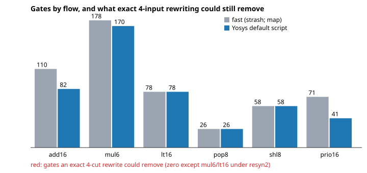

# chip-cutheadroom: how many gates could an exact 4-input rewriter still remove from Yosys/ABC netlists? (none in 28 of 30 runs; the flow's real gains are not local)

Track 3 (LLM chip-design loops, `PROJECTS.md`). Why it seemed worth doing: `chip-exact4` showed that Yosys/ABC lands about 1.2 gates above the proven minimum on *isolated* 4-input functions, which suggests a proposer that rewrites small cones with exact optima should find easy wins in real netlists. This asks how many wins there are in the netlists the flow actually produces. Produced with AI assistance (Claude). Preliminary and small: six stylised blocks.

**Live page:** https://duncan-haywood.github.io/oss-monorepo/research/chip-cutheadroom/



**Builds on.** `chip-exact4` (same author, MIT): its SAT-proven exact costs for all 222 NPN classes of 4-input functions (`experiments/exact_costs.json`) and `exact.py` are copied unchanged. The idea of 4-input cut rewriting with precomputed optimal structures is ABC's `rewrite` (Mishchenko, Chatterjee and Brayton, "DAG-aware AIG rewriting", DAC 2006, not re-read here); Yosys and ABC as in `chip-abc-sweep`. No connection to the CU Boulder groups in `prompt.md` is claimed.

## Headline
- **Exact 4-input rewriting finds essentially nothing to remove.** Over 6 blocks and 5 ABC flows (30 netlists, 2,483 gates summed over the runs), the disjoint headroom is 0 gates in 28 runs and 1 gate in the other two (`mul6` and `lt16` after the `resyn2` script, 0.6% and 1.2%).
- **The flow's real gains are not local.** The default Yosys script produces 82 gates for `add16` against 110 for the plain `strash; map` flow (-25%), and 41 against 71 for `prio16` (-42%), yet the 4-cut headroom of the 110- and 71-gate netlists is also 0. Whatever closes that gap uses cuts wider than 4, sharing or duplication, or restructuring, not a better circuit for a small exclusive cone.
- **A "rewrite a small cone with its exact optimum" proposer would be wasted on these netlists.** Between 4 and 52 gates per netlist (e.g. 10 of 82 in `add16` default) root a cone of 3 or more exclusive gates, and every one is already exactly minimal.

## Method
- Blocks (`src/chip_cutheadroom/designs.py`), written behaviourally: 16-bit `+`, 6x6 `*`, 16-bit `<`, 8-bit popcount, 8-bit left shifter, 16-way priority encoder.
- Flows: Yosys `synth -noabc` then `abc -g` with the 2-input gate set (no MUX), with `-fast`, `strash; map`, the Yosys default script, `strash; dch; map` and one `resyn2` pass then `map`. Inverters are free, as in `chip-exact4`.
- Analysis (`netlist.py`, `analyse`). The netlist from `write_json` is a DAG. For every gate and every cut of at most 4 leaves, the cone is the logic between the gate and the leaves; its MFFC is the part whose every fanout stays inside it (primary outputs excluded). The cone's function is a 16-bit truth table; its NPN class gives the exact minimum from `chip-exact4`. Replacing the MFFC by a minimal circuit over the leaves removes `|MFFC gates| - exact cost` gates when positive. Each gate keeps its best cut; a greedy pass takes the largest savings whose MFFCs do not overlap, which gives a sum that one rewriting pass could in principle realise.
- Checks (`tests/`, 7 tests): the class table is complete; a hand-built 5-gate redundant XOR is found (4 removable); an already minimal netlist and a shared node yield none or the right count; a parsed `add16` netlist adds correctly on 40 random vectors; random netlists never report negative or total removal.

## Reproduce
```
apt-get install -y yosys
python3 experiments/run.py && python3 experiments/figure.py   # about 1 minute; stdlib only
python3 -m unittest discover -s tests
```

## Results (all from `experiments/results.txt`; Yosys 0.33)
| block | fast gates | default gates | gates removable (any flow) |
|---|---|---|---|
| add16 | 110 | 82 | 0 |
| mul6 | 178 | 170 | 0 (1 after `resyn2`) |
| lt16 | 78 | 78 | 0 (1 after `resyn2`) |
| pop8 | 26 | 26 | 0 |
| shl8 | 58 | 58 | 0 |
| prio16 | 71 | 41 | 0 |

## Limitations
- **The headroom is a sound floor for the stated move, not a bound on all rewriting.** It counts only exclusive logic (no duplication, no wider cuts, no change to shared nodes), which is exactly what a local replacement can do. Techniques with larger cuts, don't-cares or restructuring can still win, and this result says the default flow's wins come from them.
- Removable counts rest on the existence of minimal circuits (SAT-proven costs); I did not construct the replacement circuits or re-verify the edited netlists.
- Six small, stylised blocks from one Yosys/ABC build. The savings are in gate count, not SKY130 area or delay.
- Only 4-input cuts: exact costs for 5 inputs are not available here.
- No LLM is used. This tests whether one class of rewrite proposal has anything to find.

## Next steps
Cuts of 5 and 6 inputs with sampled SAT costs; allow duplication of shared logic; measure which ABC step produces the `fast` to `default` gap (it is not local); run the same census on `chip-ppa-loop`'s adders and multipliers with the proposer comparison.

## Outside dependencies
Yosys and ABC (apt). No LLM API, OpenROAD or PDK. Exact costs and `exact.py` are copied from `chip-exact4` (MIT).
