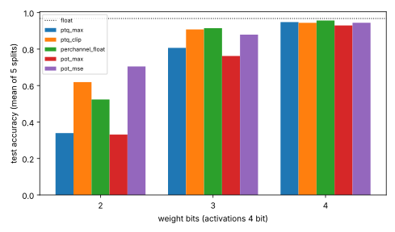

# chip-digits-pot: can per-channel power-of-two scales make a per-neuron quantiser an integer-exact MAC lane on real digits?

`chip-digits-qat` found that giving each neuron its own weight scale helps at 3 to 4 bits (91.5% at W3A4) but rescaled accumulators in float, so it was not a lane, and listed "per-channel power-of-two scales (a shift per neuron)" as the next step. This builds that integer lane and measures it. Track 3 (`PROJECTS.md`). Produced with AI assistance (Claude). No LLM is in this loop.

**Live page:** https://duncan-haywood.github.io/monorepo-projects/research/chip-digits-pot/

**Headline.** The per-channel rescale becomes shifts: at most 4 distinct net shifts in layer 1 and 2 in layer 2 (two and one mux2 stages per channel). The lane stays integer-exact, but rounding scales to powers of two costs accuracy where float per-channel scales were best: at W3A4 the MSE-chosen exponents give 87.9% against 91.5% for float scales and 90.8% for per-tensor clipping. At W2A4 they are the best of all methods tried of the methods in the table (70.5%, against 61.9% for clipping). At W4A4 they reach 94.4% (float 96.8%).

**Builds on.** `research/chip-digits` (data, float model, integer lane) and `research/chip-digits-qat` (clipping and float per-channel reference, reused unchanged). No CU Boulder group is claimed.

## Method
- Output channel j of each layer has scale 2^e_j. Layer 1: accumulators are shifted left by e_j minus the smallest e to a common unit, then all take one common right shift p (99.9th percentile of the training activations, as in the lane) and clip to A bits. Layer 2: logit c is the accumulator shifted left by e_c minus the smallest layer-2 exponent, so the argmax compares like with like. Biases are integers in each channel's own unit.
- `pot_max`: smallest exponent that does not clip the column maximum. `pot_mse`: the exponent in [that, that minus 3] minimising the column's squared weight error (so it can clip).
- Same data, splits (seeds 0 to 4) and float model as the earlier projects (1500 epochs, mean test accuracy 96.78%).
- Tests: the integer forward equals a float64 recomputation with explicit power-of-two scales (exact); forcing one exponent for all channels gives a per-tensor lane with zero extra shifts; `pot_max` never clips and `pot_mse` is never worse in weight error; W4A5 is within 5 points of float.

## Reproduce
```bash
PY=$(python3 platform/ci/pyenv.py pytest numpy scikit-learn matplotlib)
PYTHONPATH=src $PY -m pytest -q tests      # 4 tests, a few seconds
$PY experiments/run.py && $PY experiments/figure.py   # under a minute
```

## Results (mean of 5 splits, `experiments/results.txt`)
| W, A | max (baseline) | clip | per-channel (float scale, not a lane) | pot_max | pot_mse |
|---|---|---|---|---|---|
| 2, 4 | 33.9% | 61.9% | 52.4% | 33.1% | 70.5% |
| 3, 3 | 78.9% | 90.9% | 90.4% | 73.9% | 85.2% |
| 3, 4 | 80.7% | 90.8% | 91.5% | 76.2% | 87.9% |
| 4, 4 | 94.8% | 94.4% | 95.7% | 93.0% | 94.4% |
| 4, 5 | 95.6% | 94.5% | 95.7% | 93.9% | 94.9% |

(More rows, and minima over splits, are in `results.txt`.)



Choosing the exponent matters more than having one per channel: `pot_max` (never clip, round the scale up) is slightly or clearly worse than the single per-tensor max scale at every width tried (33.1% against 33.9% at W2A4, 76.2% against 80.7% at W3A4), because rounding up wastes up to one bit of a 3-bit code. `pot_mse` recovers that by allowing clipping. Compared with float per-channel scales, powers of two cost about 3.5 points at W3A4 and about 1.2 at W4A4, but beat float scales at W2, where clipping matters more than scale precision. For a W3A4 lane the better integer choice is still the per-tensor clip scale of `chip-digits-qat` (90.8%, no shifters); the per-neuron shift lane is the pick only at 2-bit weights.

Shifter cost, the maximum over the five splits at A=4 (`results.txt`): layer-1 net shifts take 3 or 4 distinct values (two mux2 stages), layer-2 shifts take 2 (one stage). This is a count of stages, not a synthesised area.

## Limitations
- One small network and dataset; five splits, minimum accuracies in `results.txt` show spreads of several points at W≤3, so differences under about 1 point are noise.
- No quantisation-aware training with power-of-two scales, which may recover some of the gap to float scales.
- Hardware cost is counted as shifter stages only, not synthesised (no Yosys in this run); the lane gate counts of `chip-digits` are not rerun.
- Exponent search window is four values; post-training choices use the training split only.

## Next steps
QAT with power-of-two per-channel scales; synthesise the shifter lane with Yosys and count cells against the per-tensor lane; learned clipping (LSQ); a larger dataset.

## Outside dependencies
NumPy, scikit-learn's bundled dataset, `chip-digits` and `chip-digits-qat` source. No LLM API, PDK or proprietary tool.
