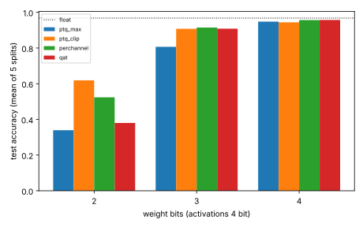

# chip-digits-qat: does clipping, per-channel scaling or quantisation-aware training move the 3-bit cliff of an MLP lane on real digits?

`chip-digits` found that a 64-16-10 MLP on scikit-learn digits holds 96.3% at 5-bit weights but falls to 81% at 3 bits with max-scaled post-training quantisation, and listed "quantisation-aware training or per-channel scales" as the next step. This runs it. Track 3 (`PROJECTS.md`). Produced with AI assistance (Claude). No LLM is in this loop.

**Live page:** https://duncan-haywood.github.io/monorepo-projects/research/chip-digits-qat/

**Headline.** At 3-bit weights and 4-bit activations, accuracy is 80.7% with the baseline, **90.8% with MSE-optimal clipping** (same lane hardware, integer-exact), 91.5% with per-channel scales and 90.9% with QAT (float 96.8%). At W4A4, per-channel and QAT reach 95.7%, within 1.1 points of float. At 2-bit weights only clipping gets past 60%; QAT is worse than the baseline at A=3 (28.5%) here.

**Builds on.** `research/chip-digits` (model, data, integer-exact specification, lane gate counts). Quantisation-aware training with a straight-through estimator: Jacob et al., CVPR 2018, <https://doi.org/10.1109/CVPR.2018.00286>; Bengio et al., 2013, arXiv:1308.3432 (cited, not reproduced). No CU Boulder group is claimed.

## Method
- Same data, splits (seeds 0 to 4) and float model as `chip-digits` (1500 epochs; mean test accuracy 96.78%). `ptq_max` reuses `chip_digits.model.quantise`; a test checks that the generalised quantiser with max scaling reproduces it bit for bit.
- `ptq_clip`: per-tensor weight scale from a grid of 81 clip ratios (0.2 to 1.0 of max) minimising weight squared error. Only the scale changes, so weights are still W-bit integers and the lane is unchanged.
- `perchannel`: one max scale per output channel, accumulators rescaled in float. This is **not** an integer-exact lane: each channel needs its own multiplier or shift, which is not built or costed here.
- `qat`: fine-tune the float model for 300 full-batch epochs (lr 0.2) with W-bit weights and A-bit activations (hidden step from the 99.9th percentile, power-of-two shift as in the lane) in the forward pass and straight-through gradients; then quantise with the max scale, integer-exact.

## Reproduce
```bash
PY=$(python3 platform/ci/pyenv.py pytest numpy scikit-learn matplotlib)
PYTHONPATH=src $PY -m pytest -q tests      # 4 tests, a few seconds
$PY experiments/run.py && $PY experiments/figure.py   # about 25 s
```

## Results (mean of 5 splits, `experiments/results.txt`)
| W, A | max (baseline) | clip | per-channel | QAT |
|---|---|---|---|---|
| 2, 4 | 33.9% | 61.9% | 52.4% | 38.0% |
| 3, 3 | 78.9% | 90.9% | 90.4% | 86.0% |
| 3, 4 | 80.7% | 90.8% | 91.5% | 90.9% |
| 3, 5 | 81.3% | 90.8% | 91.6% | 90.5% |
| 4, 3 | 90.9% | 91.9% | 95.0% | 92.8% |
| 4, 4 | 94.8% | 94.4% | 95.7% | 95.7% |
| 4, 5 | 95.6% | 94.5% | 95.7% | 96.2% |



Clipping is the cheapest fix and the only one that helps at 2 bits, but at 4 bits with 4 or more activation bits it is slightly worse than max scaling (94.4 vs 94.8, 94.5 vs 95.6): with 15 levels, clipping the tails costs more than the finer step gains. For a lane at W3A4, clipping turns a 159-cell lane that was unusable into one at 90.8%; W4A4 with QAT is the cheapest within about 1.1 points of float.

## Limitations
- One small network and dataset; five splits. Minimum accuracies in `results.txt` show spreads of several points at W≤3, so differences under about 1 point are noise (the W3A4 clip, per-channel and QAT figures are not distinguishable).
- QAT hyperparameters (epochs, lr, no scale learning, no clip in training) were not tuned; the 2-bit QAT failure may be a training-recipe result, not a limit of QAT.
- Per-channel hardware cost is not measured. Lane gate counts are not rerun: they are those of `chip-digits` because the lane is unchanged for the per-tensor methods.
- Post-training choices (clip grid, shift) use the training split only.

## Next steps
Learned clipping or scale (LSQ) in the QAT loop; per-channel power-of-two scales (a shift per neuron) to make that lane integer-exact and count its cells; repeat on a larger dataset.

## Outside dependencies
NumPy, scikit-learn's bundled dataset, `chip-digits` source. No LLM API, PDK or proprietary tool.
