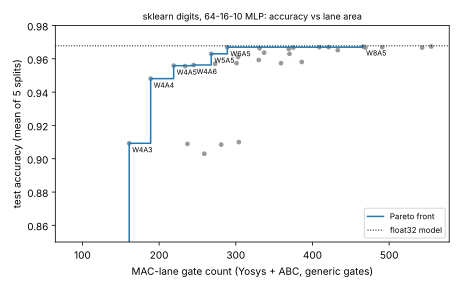

# chip-digits: how few bits can a MAC lane use to classify real handwritten digits?

Free of the toy data of `chip-accel`: the same question (quantised-MLP accelerator, bit width against gate count) asked of a real dataset, the scikit-learn digits images, with accuracy measured on held-out images rather than agreement with a float model on synthetic clusters. Track 3 (`PROJECTS.md`), a new question rather than another variant of the `chip-abc-*` ordering chain. Produced with AI assistance (Claude). No LLM is in this loop.

**Live page:** https://duncan-haywood.github.io/monorepo-projects/research/chip-digits/

**Headline.** On a 64-16-10 ReLU MLP, 5-bit weights and 5-bit activations lose 0.5 points of test accuracy against float (96.3% vs 96.8%, mean of 5 splits) in a lane of 268 generic gates; 4 and 4 bits lose 2.0 points (94.8%) in 189 gates; at 3-bit weights accuracy drops to 79 to 82% and at 2 bits to about a third. Wider than 6 bits buys nothing: W8A8 is 96.7% in 543 gates.

**Builds on.** Nothing from the CU Boulder groups in `prompt.md`; no connection is claimed. Data: the UCI "Optical Recognition of Handwritten Digits" test set as bundled with scikit-learn (`load_digits`, 1797 images of 8x8, values 0 to 16; Alpaydin and Kaynak, UCI ML Repository, 1998). Post-training symmetric quantisation is textbook (Jacob et al., CVPR 2018, <https://doi.org/10.1109/CVPR.2018.00286>; cited, not reproduced). Tools: Yosys 0.33 + ABC, Icarus Verilog 12, NumPy, scikit-learn 1.9.1. The Verilog lane is original.

## Method
- `src/chip_digits/model.py`: stratified 70/30 split (seeds 0 to 4); 64-16-10 ReLU MLP trained by full-batch gradient descent in NumPy (1500 epochs, lr 0.5, L2 1e-4). Float test accuracy 96.8% mean (96.5 to 97.6).
- Quantisation (post-training, no fine-tuning): inputs and hidden activations unsigned A-bit, weights signed W-bit with a per-tensor max scale, biases as integer accumulator values, one power-of-two right shift on the hidden layer chosen from the training set's 99.9th percentile. `int_forward` is the integer-exact specification.
- `src/chip_digits/flow.py`: one MAC lane (`acc += a * w`, accumulator W+A+6 bits wide so a 64-term dot product cannot overflow). For each of the 49 (W, A) pairs the lane runs 64 real layer-1 dot products (4 test images x 16 hidden neurons) in Icarus and must equal NumPy's; then `synth -flatten; abc -g AND,NAND,OR,NOR,XOR,XNOR,ANDNOT,ORNOT,MUX` gives the cell count (flip-flops included).
- The lane is what the accelerator replicates; a full engine also needs the weight memory, `(64*16 + 16*10) * W` bits, and 1184 MAC cycles divided by the lane count. Those are arithmetic, not measured here.

## Reproduce
```bash
apt-get install -y yosys iverilog
PY=$(python3 platform/ci/pyenv.py pytest numpy scikit-learn matplotlib)
PYTHONPATH=src $PY -m unittest discover -s tests      # 6 tests, a few seconds
$PY experiments/run.py && $PY experiments/figure.py   # about 30 s
```

## Results (all from `experiments/results.txt`)
| W (weight bits) | A=3 | A=4 | A=5 | A=8 | lane cells at A=4 / 5 |
|---|---|---|---|---|---|
| 2 | 32.8% | 33.9% | 33.3% | 33.3% | 115 / 129 |
| 3 | 78.9% | 80.7% | 81.3% | 81.7% | 159 / 183 |
| 4 | 90.9% | 94.8% | 95.6% | 95.7% | 189 / 219 |
| 5 | 90.9% | 95.6% | 96.3% | 96.3% | 234 / 268 |
| 6 | 90.3% | 95.9% | 96.7% | 96.7% | 330 / 289 |
| 8 | 91.0% | 95.8% | 96.7% | 96.7% | 386 / 466 |

Cheapest lane within 1 point of float: W5A5 (268 cells, 96.3%). Within 2 points: W4A4 (189 cells, 94.8%). Pareto front and the plot: `experiments/accuracy_vs_cells.svg`. Split-to-split spread is large at low width (W3A3 ranges 60% to 88%), so differences under about a point between neighbouring high-width cells are noise.



## Limitations
- One small network and dataset (8x8 digits); 5 splits, not a confidence interval. The ranking of widths may differ on larger problems.
- Plain post-training quantisation with a max-scaled symmetric grid: a 2-bit weight has levels -2 to 1, so the collapse at W2/W3 is a property of this scheme; quantisation-aware training or per-channel scales would likely move it. That was not tried.
- Gate counts from generic ABC mapping, not square microns; no SKY130 library was available offline. Lane cells are not monotonic in width (W6A4 has 330 cells, W6A5 289) because ABC's result is not monotone; read them as +/- 10%.
- One lane rather than a full accelerator; no clock, power, memory or layout. Simulated results say nothing about a physical device.

## Next steps
Quantisation-aware training or per-channel scales to see how far the W3 cliff moves; map the lane to SKY130 with the `chip-pnr` flow; add the weight-memory term to the cost and find the knee for a full engine.

## Outside dependencies
Yosys and Icarus Verilog (apt), scikit-learn's bundled dataset. No LLM API, PDK or proprietary tool.
