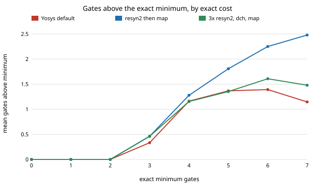

# chip-exact4: how many gates above the proven minimum does Yosys/ABC use for 4-input logic?

Why it seemed worth doing: every other `chip-*` and `eda-*` project scores a design by the gate count ABC returns, and compares ABC scripts only with each other. None of them knows how far *any* script is from the best possible circuit. For 4-input functions that optimum can be computed exactly, so this project measures the distance. Produced with AI assistance (Claude). Preliminary and small: one Yosys version (0.33), 4-input single-output functions only, a generic 2-input gate set, a sample of 884 of the 65,536 functions.

**Live page:** https://duncan-haywood.github.io/monorepo-projects/research/chip-exact4/



## Headline
- **Yosys's default flow reaches the exact minimum gate count on only 34% of 4-input functions.** It averages 1.19 gates above the optimum (max 4) on a sample of 884 functions covering all 222 NPN classes. Functions of up to 2 gates are always optimal; from 3 gates up it is 0.3 to 1.4 gates above.
- **Picking the best of all seven scripts per function** only gets to 38% optimal (mean gap 1.01; 545 of 884 functions still above the minimum, worst 4 gates above). Script choice matters less than the gap that every script leaves.
- **Heavier scripts did not help.** `resyn2` then `map` is worse than the default (mean gap 1.72); `dc2` and `dch` match it (1.21, 1.22). `-fast` equals `strash; map` on this data (mean gap 4.91, 4% optimal).
- **The result depends on which equivalent form you synthesise.** Negating inputs or the output, or permuting inputs (an NPN transform) leaves the true cost unchanged. Under the default flow the gate count varied among sampled members in 27 of 222 classes; under `resyn2_map` in 96 of 222.

## Method
- **Functions.** A 4-input function is a 16-bit truth table. The 65,536 functions fall into 222 NPN classes (permute inputs, negate inputs, negate output); `exact.npn_classes` computes them (tested: 222 classes, sizes sum to 65,536).
- **Exact minimum** (`src/chip_exact4/exact.py`). The fewest 2-input gates, any of the 16 gate types so inverters are free, in a circuit computing the function or its complement (as in Knuth, *TAOCP* vol. 4A, section 7.1.2). It is decided by SAT (CaDiCaL via `python-sat`): r gate nodes, each choosing two earlier signals and a normal gate type, one truth-table row per variable, for r = 0, 1, 2, ... until satisfiable. Cost is a class invariant, so 222 SAT searches cover every function (about 3 minutes). Checks: the number of functions at each cost, 10, 60, 456, 2474, 10624, 24184, 25008, 2720 for 0 to 7 gates, matches the table I recall from Knuth but I could not open the book here, so treat that match as unverified; independently, the SAT answer equals a brute-force enumeration of all circuits of up to 2 gates on a sample of functions, and known costs hold (AND 1, 4-input XOR 3, 4-input AND 3, 3-input majority 4).
- **ABC side** (`src/chip_exact4/abc.py`). Each function becomes `assign y = 16'h....[x]` and goes through `synth -flatten -noabc; abc -g AND,NAND,OR,NOR,XOR,XNOR,ANDNOT,ORNOT [script]`. Gate count excludes inverters (the exact count gives them away). Seven variants: Yosys default script, `-fast`, `strash; map`, `dc2`, `dch`, one `resyn2` pass, and three `resyn2` passes with `dch`. The sample is each class's representative plus up to three random members (seed 1), 884 functions. The run asserts that ABC never beats the exact minimum.
- Means are over the sample and weight every class equally (about four functions each), not by class size (class sizes run from 2 to 768).

## Reproduce
```
python3 -m venv v && v/bin/pip install python-sat matplotlib pytest && apt-get install -y yosys
v/bin/python experiments/run.py      # ~7 min on 4 cores; writes results.txt, abc_counts.json (exact_costs.json is cached)
v/bin/python experiments/figure.py
v/bin/python -m pytest tests         # tests skip without python-sat / yosys
```

## Results (all from `experiments/results.txt`; Yosys 0.33)
| variant | mean gap | exactly optimal | max gap |
|---|---|---|---|
| default | 1.19 | 33.9% | 4 |
| dc2 | 1.21 | 33.5% | 4 |
| dch | 1.22 | 33.9% | 6 |
| 3x resyn2 + dch | 1.28 | 33.0% | 6 |
| resyn2 | 1.72 | 27.0% | 7 |
| `-fast` (= strash; map) | 4.91 | 3.8% | 10 |

Gap by exact cost for the default flow: 0 gates at cost 0 to 2, 0.33 at 3, 1.16 at 4, 1.37 at 5, 1.39 at 6, 1.15 at 7.

## Limitations
- One Yosys/ABC build and fixed script strings; the gap is a property of those scripts, not of ABC as a whole. Other scripts (`&deepsyn`, `&if` with exact `lutexact`-style mapping) or a newer version may close it.
- The cost model is a gate count with free inverters and equal gate weights. A cell library weights XOR and NAND differently; area and delay may rank scripts differently. The gap is in the measure the other `chip-*` projects use, nothing more.
- 4 inputs only, one output. Real blocks are larger, where an exact optimum is out of reach, so this result is a floor on how suboptimal ABC can be, not an estimate for big designs.
- A sample of 884 of 65,536 functions; the standard errors are not computed and per-cost rows have 6 to 300 functions.
- Mean gap is not weighted by class size. The "default" count has 27 varying classes out of 222 on only four members each, so that is a lower bound on the NPN dependence.
- `-fast` and `strash; map` gave identical counts on every function; I did not check whether the two are the same script inside Yosys 0.33.

## Next steps
Class-size-weighted means over all 65,536 functions; 5-input functions (exact costs for 616,126 classes are known only partially, so SAT would be sampled); a liberty-mapped (SKY130) cost model; whether `dch`/`&deepsyn` style scripts close the gap; feeding the exact optimum back as the target for a proposer in the `chip-ppa-loop` setting.

## Outside dependencies
Yosys and ABC (apt), `python-sat` (pip) for the SAT solver. No LLM API. No lab's work is built on; it uses the standard exact-synthesis idea (Kojevnikov, Kulikov and Yaroslavtsev 2009; Knuth, *TAOCP* 4A, 7.1.2), which I have not reproduced beyond the checks above.
