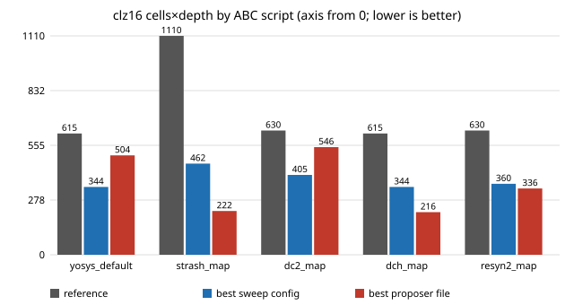

# chip-logic-script: does the clz16 rewrite-versus-sweep verdict survive five ABC scripts? (generic gates, stylised)

Follow-up to `chip-ppa-logic` in the LLM chip-design-loop track (`PROJECTS.md`, track 3). That project scored popcount, leading-zero count (clz16) and |a-b| under Yosys's default ABC script only, found a no-model sweep beat the session-written rewrites on clz16 (sweep `tree_8` at cells x depth 344 against 495), and listed re-scoring under other ABC scripts as its first next step. This does it: all 34 equivalent candidates of the three blocks under the five scripts of `chip-ppa-script`, with every mapped netlist proved equivalent. Produced with AI assistance (Claude). Preliminary and small: three tiny blocks, one tool version, generic gates (no technology), no LLM in the loop; the "proposer" files were written by the session agent.

**Headline.** On clz16 the verdict flips with the script. Under the default script the sweep wins (344, `tree_8`). Under `strash_map`, `dch_map` and `resyn2_map` a session-written file (`c2_nibble_combine`) wins, at 222, 216 and 336 against the sweep's 462, 344 and 360. The default-script winner is the overall winner under only 2 of 5 scripts for clz16 and 3 of 5 for |a-b|; popcount's winner holds under all 5.

**Live page:** https://duncan-haywood.github.io/monorepo-projects/research/chip-logic-script/

**Builds on.** `research/chip-ppa-logic` (designs, proposer files and sweep generators copied, MIT, same author) and `research/chip-ppa-script` (script set and flow, copied, MIT). The generate-check-score loop idea is from VerilogEval (Liu et al., ICCAD 2023), RTLLM (Lu et al., ASP-DAC 2024) and Chip-Chat (Blocklove et al., MLCAD 2023), as cited and checked in `chip-ppa-loop`; the papers were not read here and nothing from them is reproduced. It builds on none of the CU Boulder groups in `prompt.md` and claims no connection to them.

## Method
- Designs, proposer files and sweep configs are those of `chip-ppa-logic`: popcount 16, clz16, |a-b| 8; one seeded-fault file per design is rejected by the equivalence gate (Yosys miter, `sat -prove trigger 0`, with `memory_map` as in `chip-ppa-logic`).
- Five ABC scripts: Yosys default, `strash; map`, `strash; dc2; map`, `strash; dch; map`, and a resyn2-style sequence (written from memory of the usual alias, as in `chip-abc-sweep`). Each runs after `synth -noabc` with the generic library `AND,NAND,OR,NOR,XOR,XNOR,ANDNOT,ORNOT,MUX`.
- Score: cells x depth (cells from `stat`, depth from `ltp -noff`, a topological count, not timing). After scoring, the *mapped netlist* is proved equivalent to the reference too.
- Unlike `chip-ppa-logic` there is no equal-budget random-subset comparison: every equivalent candidate is scored under every script (exhaustive over this small space), so "best sweep config" and "best proposer file" are bests over all sweep configs and over the four proposer files that pass the gate.

## Reproduce
```bash
sudo apt-get install -y yosys iverilog     # Yosys 0.33 used here
python3 experiments/run.py                 # about 40 s; writes experiments/results.txt
python3 experiments/figure.py              # needs only the standard library
python3 -m unittest discover -s tests      # 6 tests, a few seconds
```

## Results (all from `experiments/results.txt`)
Best cells x depth over each group (lower is better); the full per-candidate table, with cells/depth, is in `results.txt`.

| design / script | default | strash_map | dc2_map | dch_map | resyn2_map |
|---|---|---|---|---|---|
| clz16 reference | 615 | 1110 | 630 | 615 | 630 |
| clz16 best sweep | 344 (`tree_8`) | 462 (`tree_4`) | 405 (`tree_8`) | 344 (`tree_8`) | 360 (`tree_8`) |
| clz16 best proposer | 504 (`c2`) | 222 (`c2`) | 546 (`c2`) | 216 (`c2`) | 336 (`c2`) |
| absd8 reference | 1071 | 990 | 1105 | 891 | 912 |
| absd8 best sweep | 1071 (`cmp_mux`) | 975 (`sub_xor`) | 1105 (`cmp_mux`) | 780 (`sub_neg`) | 912 (`cmp_mux`) |
| absd8 best proposer | 1116 (`d0`) | 975 (`d2`) | 1134 (`d0`) | 780 (`d0`) | 980 (`d0`) |

- **clz16: the winner depends on the script.** The sweep wins under the default and `dc2_map`; the nibble-combine rewrite wins by a wide margin under `strash_map` (222 against the sweep's 462) and `dch_map` (216 against 344), and narrowly under `resyn2_map` (336 against 360). The overall best, 216 (36 cells, depth 6, `c2_nibble_combine` under `dch_map`), is 0.35 of the reference's default score. `chip-ppa-logic`'s statement that the sweep beats the rewrites on clz16 holds for the default script only.
- **The same file moves a lot.** `c2` scores between 216 (`dch_map`) and 546 (`dc2_map`), a 2.5x spread from the script alone; the reference moves 615 to 1110 (1.8x). That is as large as the gap between the structures.
- **|a-b|: rewriting and scripting interact.** The reference's best script is `dch_map` (891); `sub_neg` under `dch_map` reaches 780 (0.88 of that, 0.73 of the default-script reference). Under default, `dc2_map` and `resyn2_map` the reference (`cmp_mux`) is already optimal. The proposer file `d0_sub_negate` and the sweep config `sub_neg` score identically.
- **Popcount: no change.** Under all five scripts the best is the carry-save form (or, under default, any of ten tied candidates); the reference is best under its own default script (896) and the gain from the csa rewrite is 0.89, 0.97, 0.97 and 0.91 under the other four scripts.
- **Equivalence of the mapped netlists:** 0 of 170 (candidate, script) netlists failed the proof (60 + 55 + 55 pairs).



## Limitations
- Three tiny combinational blocks, one tool version (Yosys 0.33), one generic-gate library: cells x depth is a gate count times a topological depth, not area or delay, and the ranking could change with a real library (`chip-ppa-sky130mac` found it can).
- The proposer files were written by the session agent, one attempt each and in the earlier project, not sampled from a model; the proposer files' win under three scripts says a good hand-written structure can beat the sweep when the script suits it, not that an LLM would find it. The sweep space is small (6 configs for clz16) and does not contain the nibble-combine form, so "sweep" here means that particular generator.
- Not a statistical test: all numbers are deterministic single runs. The resyn2-style script is written from memory and may differ from the real alias.
- Candidates are the earlier project's; no new rewrite was proposed here, so the result is about re-scoring, not search.

## Next steps
Add the nibble-combine structure to the clz16 sweep generator and check whether the sweep then matches it; re-score on SKY130 cells with the liberty flow of `chip-pnr`; an API-gated proposer with many samples per design (stubbed in tests).

## Owner steps
None needed (simulation only).

## Outside dependencies
Yosys (with its bundled ABC) and Icarus Verilog (apt). No LLM API, OpenROAD or PDK. All code, designs and proposals are original or copied from `chip-ppa-logic` and `chip-ppa-script` (same author) and are MIT-licensed.
