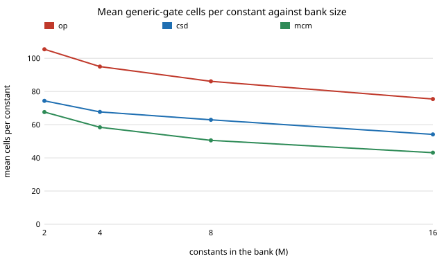

# chip-mcm: does sharing sub-sums across a bank of fixed-weight multipliers cut gates beyond per-constant shift-and-add?

New question for the LLM chip-design-loop track (`PROJECTS.md`, track 3), the "Next steps" item of `chip-constmul`. A quantised neuron layer multiplies one activation by many weights known at synthesis time, so one input fans out to a bank of constant multipliers, and the digit patterns of those constants overlap. This measures how many generic-gate cells a greedy shared-sub-sum (multiple-constant multiplication, MCM) form saves over writing each product alone. No LLM is used. Produced with AI assistance (Claude). Preliminary: random constants (not trained weights), one tool version, generic gates, one input width.

**Live page:** https://duncan-haywood.github.io/monorepo-projects/research/chip-mcm/

**Builds on.** `chip-constmul` and `chip-abc-sweep` in this repository (same author, MIT): the CSD recoding is the one validated there, and the `score` and `equivalent` wrappers are imported unchanged. Prior art on the technique: Hartley (1996), "Subexpression sharing in filters using canonic signed digit multipliers", *IEEE Trans. Circuits and Systems II* 43(10); Voronenko and Püschel (2007), "Multiplierless multiple constant multiplication", *ACM Trans. Algorithms* 3(2). The open question here is only how much the simplest greedy version saves in a current open flow. Nothing from the CU Boulder groups in `prompt.md`; no connection to them is claimed.

## Method
- A bank is M constants drawn at random without replacement from 1..255 (seeded; M = 2, 4, 8, 16; 40 banks each, 160 in all). One 8-bit unsigned input `x` feeds M outputs `y_j = x * K_j`, each (8 + bitlength K_j) bits.
- Three Verilog forms (`src/chip_mcm/gens.py`): `op` is `x * K_j` per output; `csd` writes each product as its own canonical-signed-digit sum; `mcm` runs greedy common-subexpression elimination on the CSD digits: any pair of digits with the same shift gap and sign product is the pattern `x ± (x << gap)`, the most frequent pattern (needed at least twice in the bank) becomes one shared wire, and this repeats until none occurs twice. Patterns are built from `x` only, not from other patterns.
- Score: `synth -flatten -noabc; abc -g AND,NAND,OR,NOR,XOR,XNOR,ANDNOT,ORNOT,MUX` (Yosys 0.33), cells = gate count (not µm²), depth = Yosys `ltp -noff`.
- **Every `csd` and `mcm` module is proved equal to the `op` module** for all 256 inputs by a Yosys miter (160 of 160).

## Reproduce
```bash
sudo apt-get install -y yosys iverilog
python3 experiments/run.py        # writes results.txt (about 4 min)
python3 experiments/analyse.py    # prints the table below
python3 experiments/figure.py     # writes cells_by_bank.svg
python3 -m unittest discover -s tests   # 6 tests
```

## Results (all from `experiments/results.txt`; means over 40 banks per M)
| M | op cells | csd cells | mcm cells | mcm vs csd | mcm vs op | depth op / csd / mcm | adders csd / mcm | banks mcm < / > csd |
|---|---|---|---|---|---|---|---|---|
| 2 | 211 | 149 | 135 | −9.1% | −35.9% | 23.0 / 24.3 / 23.9 | 4.3 / 3.8 | 17 / 0 |
| 4 | 380 | 271 | 234 | −13.6% | −38.5% | 24.9 / 25.9 / 24.7 | 8.3 / 6.3 | 33 / 2 |
| 8 | 689 | 504 | 404 | −19.7% | −41.3% | 26.6 / 29.3 / 26.8 | 16.9 / 11.1 | 40 / 0 |
| 16 | 1207 | 866 | 690 | −20.3% | −42.8% | 26.5 / 33.2 / 28.2 | 33.5 / 19.5 | 40 / 0 |

- **Sharing helps more as the bank grows, and the saving is on top of CSD's.** Against per-constant CSD the shared form uses 9% fewer cells at M = 2 and about 20% fewer at M = 8 and 16; against the plain operator, 36% to 43% fewer. It has fewer cells than `csd` in 130 of 160 banks and more in 2 (worst: 53, 96, 115, 181, +28 cells); the rest tie, mostly M = 2 banks with nothing to share.
- **The source-level adder count predicts the cell saving.** Adders removed (counted in the Verilog source) correlate with cells saved against `csd` at Pearson 0.875 over the 160 banks, at roughly 15 cells per adder removed. Greedy sharing is then a useful proxy objective for a proposer, without running synthesis.
- **Depth is not free.** Per-constant CSD gets deeper as the bank grows (24.3 at M = 2 to 33.2 at M = 16, against 23.0 to 26.5 for the operator), and sharing recovers most of that (mcm 23.9 to 28.2),. It stays slightly deeper than the operator at M = 16 (28.2 vs 26.5).
- The `op` form is written per output, so its gap to `mcm` here mixes the CSD gain from `chip-constmul` with the sharing gain; the `mcm vs csd` column isolates the latter.



## Limitations
- Random constants, uniform on 1..255. Trained, quantised weights are clustered and signed, and may share more or less; this is the first thing to test with the `accel-kws` weights.
- One greedy heuristic, patterns of `x` only (no pattern-of-patterns, no optimal-adder-graph search such as Voronenko and Püschel's). It is a floor on what sharing can save, not a ceiling.
- Unsigned inputs and constants, 8-bit input only, one Yosys version and one ABC script (`chip-abc-sweep` showed scripts move results by tens of percent).
- Generic gates are not library cells and the count ignores wire load; area against depth is not timing, power or place and route (`chip-pnr` covers the fidelity question).
- 40 banks per size, a fixed seed, no confidence intervals.

## Next steps
The same comparison on the signed quantised weights of an `accel-kws` layer; pattern-of-pattern sharing or an exact adder-graph search against the greedy form; a SKY130 liberty file in place of generic gates (`chip-pnr`'s flow).

## Outside dependencies
Yosys and Icarus Verilog (apt). No LLM API, OpenROAD or PDK. Python standard library only.
