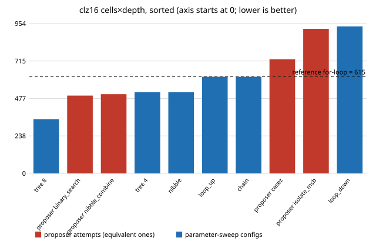

# chip-ppa-logic: does an equivalence-gated rewrite loop beat a parameter sweep on popcount, leading-zero count and |a-b|? (mixed, stylised, gate counts)

Follow-up to `chip-ppa-loop` in the LLM chip-design-loop track (`PROJECTS.md`, track 3). That project found ABC erased most of the written structure of an adder and a multiplier, and listed "designs with room to improve" as a next step. This one tries three small combinational blocks where the written structure does matter: a 16-bit population count, a 16-bit count-leading-zeros and an 8-bit absolute difference. Same loop: each rewrite is *proved* equivalent to a reference with Yosys before it is scored, and a no-model parameter sweep gets the same evaluation budget. Produced with AI assistance (Claude). Preliminary and small: three designs, one tool version, one generic-gate synthesis script.

**Live page:** https://duncan-haywood.github.io/monorepo-projects/research/chip-ppa-logic/

**Builds on.** `research/chip-ppa-loop` (flow, sweep and experiment code copied, MIT, same author, then changed as below) and the generate-check-score loop idea of VerilogEval (Liu et al., ICCAD 2023, <https://doi.org/10.1109/ICCAD57390.2023.10323812>), RTLLM (Lu et al., ASP-DAC 2024, <https://doi.org/10.1109/ASP-DAC58780.2024.10473904>) and Chip-Chat (Blocklove et al., MLCAD 2023); citations as checked in `chip-ppa-loop`, the papers were not read here. **Not a reproduction of any of them**; no published benchmark data is used. It builds on none of the CU Boulder groups in `prompt.md` and claims no connection to them.

## Method
- References: `designs/pop16.v` (for-loop sum of the 16 input bits), `designs/clz16.v` (for-loop, last set bit wins; 16 for a zero input), `designs/absd8.v` (`(a > b) ? a - b : b - a`).
- Score: `synth -flatten; abc -g AND,NAND,OR,NOR,XOR,XNOR,ANDNOT,ORNOT,MUX`, cells from `stat`, depth from `ltp -noff` (as `chip-ppa-loop`). Figure of merit: cells x depth, lower is better. These are gate counts, not square microns, and depth is a topological cell count, not timing.
- Gate: a Yosys miter plus `sat -verify -prove trigger 0`, covering all 2^16 inputs of each design. **Changed from `chip-ppa-loop`:** `memory_map` runs before `flatten`. Without it a constant `case` table is inferred as a ROM, `sat` cannot import it, and the gate *rejects a correct design*. My first nibble-table popcount (`p1_nibble_case.v`) was wrongly rejected this way; simulation of all 65,536 inputs in Icarus showed it correct, which is how the gate bug was found. A test pins the fix.
- Proposer: five files per design in `proposals/<design>/`, written by the Claude session that wrote this project, committed as written. Not an API call and not a reproducible LLM benchmark. One attempt per design is a *seeded* fault (`p3_wrong_bug`, `c3_bug_noZero`, `d3_bug_ones_comp`) that exercises the gate; it spends one of the five attempts.
- Baseline: `src/chip_ppa_logic/sweep.py` generates Verilog from a few knobs (7, 6 and 6 configs). At the proposer's budget of 5 it draws that many configs at random, 200 seeds. The reference counts as the starting point for both sides. No model is involved.

## Reproduce
```bash
sudo apt-get install -y yosys iverilog     # Ubuntu 24.04 packages; Yosys 0.33 here
cd research/chip-ppa-logic
python3 -m unittest discover -s tests
python3 experiments/run.py                 # rewrites experiments/results.txt
python3 experiments/figure.py              # rewrites experiments/clz16.svg from results.txt
```

## Results (from `experiments/results.txt`, Yosys 0.33)
| design | reference cells / depth / product | proposer best (5 attempts) | sweep, exhaustive best | sweep, random 5 of the space |
|---|---|---|---|---|
| pop16 | 64 / 14 / 896 | 882 (63 cells) = 0.98x | 882 | mean best 886.6; never beat the proposer, tied in 134/200 |
| clz16 | 41 / 15 / 615 | 495 (45 cells, depth 11) = 0.80x | **344** (`tree 8`: 43 cells, depth 8) = 0.56x | mean best 371.5; **beat the proposer in 168/200**, never tied |
| absd8 | 66 / 17 / 1122 | 969 (57 cells) = 0.86x | 969 | mean best 995.0; never beat the proposer, tied in 166/200 |

- **clz16 is the one design where structure matters, and the sweep won.** A priority tree over two 8-bit halves, each leaf resolved by a short mux chain, reaches depth 8; the best proposer file (a binary search of 8/4/2/1 halves) reaches depth 11. The author of the proposals did not think of the sweep's shape, so this is a result about this author's attempts and not about models.
- **pop16: no real gain.** `+` chains, pair trees and 3:2 compressors all give 64 cells and depth 14 after ABC; the only winner is one cell fewer (the hand-wired compressor). A constant lookup table is clearly worse (89 cells).
- **absd8:** subtract once then negate (`sub_neg`, 57 cells) beats compare-then-subtract (66) at equal depth 17. The sweep contains that structure, so the tie says nothing about a model. The XOR-and-add-borrow form is smaller than the reference but deeper (23); `a - b` and `b - a` computed in parallel is bigger (73).
- The gate rejected all three seeded faults and (after the fix) accepted every other file; all 19 sweep configs were proved equivalent (also asserted in the tests).



## Limitations
- **Fifteen proposer attempts by the author of the sweep, three designs.** No statistic about LLMs follows. The sweep space is small (6 or 7 configs) and was written by the same author after seeing what the proposals looked like; neither side is independent.
- Depth is topological, area is a generic-gate count, nothing here is post-layout (see `chip-pnr` and `chip-ppa-sky130mac` for that fidelity gap), and a different ABC script could reorder the structures (see `chip-abc-sweep`).
- Combinational blocks only; one Yosys version.

## Next steps
Re-score the clz16 shapes under the five ABC scripts of `chip-abc-sweep` and on SKY130 to see whether depth 8 survives; an API-gated proposer with many samples per design (stubbed in tests); sequential blocks (FIFO) with a `-seq` miter.

## Owner steps
None needed (simulation only).

## Outside dependencies
Yosys and Icarus Verilog (apt). No LLM API, OpenROAD or PDK. All designs and proposals are original and MIT-licensed.
