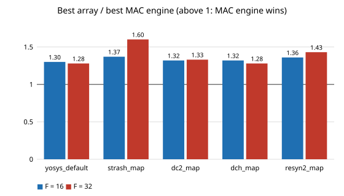

# chip-systolic-abcrobust: does the MAC engine beat a systolic array on a tiny quantised MLP under every ABC script, not just Yosys's default? (yes, 1.28x to 1.60x; negative for arrays, stylised)

Follow-up to `chip-systolic-p32` in the LLM chip-design-loop track (`PROJECTS.md`, track 3). That project reported the best MAC-lane engine beating the best output-stationary systolic array by 1.30x (F = 16) and 1.28x (F = 32) in cells times cycles per vector, under one Yosys/ABC script, and warned that the P = 32 versus P = 16 gap "is within what a different abc script could change". This project re-scores the same 20 designs under five ABC scripts to see which parts of the conclusion depend on the script. Produced with AI assistance (Claude). Preliminary and small: one toy network family, one seed, Yosys 0.33, generic-gate counts, no LLM in the loop.

**Live page:** https://duncan-haywood.github.io/monorepo-projects/research/chip-systolic-abcrobust/

**Builds on.** Nothing from the CU Boulder groups in `prompt.md`; no connection is claimed. The dataflow is the textbook systolic idea of H. T. Kung, "Why systolic architectures?", *IEEE Computer* 15(1):37-46, 1982, <https://doi.org/10.1109/MC.1982.1653825> (as cited in `chip-systolic-batch`; not read in full here). The generators, model and cycle formulas are copied unchanged (MIT, same author) from `research/chip-systolic-p32`; `flow.py` gains a script argument, using the five ABC scripts of `research/chip-abc-sweep` (the `resyn2` sequence there is written from memory of the usual alias, so it is one plausible resyn2-style script, not a verified copy). ABC: Brayton and Mishchenko, CAV 2010, LNCS 6174:24-40.

## Method
- Same F-16-4 network (4-bit weights), F = 16 and 32, six arrays (R x C = 1x4, 1x8, 1x16, 2x8, 2x16, 4x8) and four MAC engines (P = 4, 8, 16, 32), as in `chip-systolic-p32`.
- Each design's RTL is simulated in Icarus Verilog on 32 vectors against the integer NumPy reference and the cycle formula before it is scored.
- Scores: Yosys generic-gate cells (flip-flops included) under `yosys_default` (reproduces `chip-systolic-p32`'s numbers exactly), `strash_map`, `dc2_map`, `dch_map` and `resyn2_map`. Metric: cells x cycles per vector.

## Reproduce
```
apt-get install yosys iverilog; pip install numpy pytest
PYTHONPATH=src python experiments/run.py      # about 25 min on 4 cores; rewrites experiments/results.txt
python experiments/figure.py                  # redraws experiments/ratio_by_script.svg
PYTHONPATH=src python -m pytest tests
```

## Results (from `experiments/results.txt`)
All 100 simulated-and-scored design/script pairs matched the NumPy reference and the cycle formulas. `yosys_default` reproduces `chip-systolic-p32`'s cell counts.

Best array / best MAC engine, cells x cycles per vector (above 1: MAC engine wins):

| script | F = 16 | F = 32 |
|---|---|---|
| yosys_default | 1.30 | 1.28 |
| strash_map | 1.37 | 1.60 |
| dc2_map | 1.32 | 1.33 |
| dch_map | 1.32 | 1.28 |
| resyn2_map | 1.36 | 1.43 |

- **The ranking is script-robust.** The MAC engine wins at both F under all five scripts, by 28% to 60%. The size of the lead moves by up to 0.32 (F = 32: 1.28 to 1.60), so quote it as "at least 1.28x here", not as one number.
- **The winners are stable at F = 16.** The best array is 1x4 and the best MAC engine P = 8 under every script. At F = 32 the best MAC engine is P = 32 under every script; the best array is 2x8 under four scripts and 1x8 under `strash_map`.
- **P = 32 versus P = 16.** P = 32 is smaller in cells x cycles than P = 16 under all ten F x script cells, by 0.7% to 7.5% (ratios 0.925 to 0.993). So under these five scripts the small `chip-systolic-p32` gap does not flip sign. That does not contradict `chip-macp32cells`, which found a sign flip under a different set of flows (including a restricted-gate library) and across model seeds; it only shows these five scripts all agree on one seed.



## Limitations
- One network family, seed and Yosys version; H = 16 only; weights baked in as ROM functions.
- All five scripts share the same `synth -noabc` front end and the same generic gate set; differences between mappers are not explored beyond them.
- Gate counts only: no clock period, power, memory or layout (see `chip-pnr`). Depth is recorded in `results.txt` but not used in the metric. Nothing here describes a fabricated chip.
- This shows the ranking survives these scripts, not that no systolic design wins.

## Next steps
Weight-stationary dataflow and a RAM-based weight store, scored under the same five scripts; SKY130-mapped areas instead of generic gates.

## Owner steps
None needed (simulation only).

## Outside dependencies
Yosys and Icarus Verilog (apt), NumPy (pip). No LLM API, OpenROAD or PDK. All code is original or copied from `chip-systolic-p32` and is MIT-licensed.
