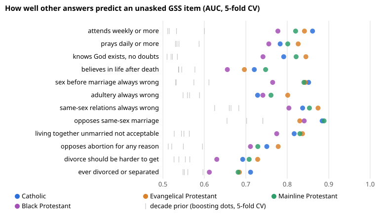

# Can a Catholic's other survey answers predict the beliefs on marriage, sexuality and devotion they were never asked?

**Headline (milestone 1, US General Social Survey 1972–2024):** yes, mostly. Given a Christian respondent's other answers, a model predicts an item they were never asked far better than the share for their decade: a median +0.21 AUC across 49 tradition × item cells.

Among Catholics, the AUC for each item is:

| Item | AUC |
|---|---:|
| Weekly Mass attendance | 0.86 |
| "Sex before marriage always wrong" | 0.85 |
| Same-sex relations always wrong | 0.84 |
| Opposes same-sex marriage | 0.88 |
| Cohabitation not acceptable | 0.82 |
| Opposes abortion for any reason | 0.75 |
| Adultery always wrong | 0.73 |
| Divorce should be harder to get | 0.69 |
| Has ever divorced | 0.71 |

The associations travel between groups, but the levels do not:

- A model learned on third-generation Catholics ranks foreign-born Catholics almost as well as a model that saw them (within 0.03 AUC on 12 of 13 items). But it misses their share by more than 5 points on 5 items, for example certainty about God by 11 points.
- A Catholic-trained model ranks Evangelical, Mainline and Black Protestants within about 0.01 AUC of their own models. But it under-predicts Evangelical sexual conservatism by up to 17 points.

- **Unseen survey years (milestone 3, part):** holding out a whole year, a model that cannot see the year gets that year's Catholic share within 2.8 points (median) but is no better than interpolating the neighbouring years' observed shares (mean error 3.9 vs 3.4 points), and is far off for fast-moving items such as same-sex marriage (17 points). See `LOG.md`, 2026-11-08.
- **Standard multiple imputation (MICE, milestone 3, part):** chained equations with Rubin's rules do worse on an unseen year (4.7 points mean error) than a single logistic model (4.1) or interpolation (3.4), and their 95% intervals cover the true year share in 83% of item-years overall but only 20–40% on the fast-moving same-sex items. See [`experiments/m3_mice/results/summary.md`](experiments/m3_mice/results/summary.md) and `LOG.md`, 2026-11-10.
- **Bayesian mixture imputation (DPMPM, milestone 3, part):** the Dirichlet-process latent-class mixture of Si and Reiter (2013), the other principled baseline, misses a held-out Catholic year by 4.8 points on average, within 0.15 points of MICE (4.7) and worse than interpolation (3.4); its Rubin intervals cover 82% of item-years and none of the five same-sex-marriage years (off by 20 points). Two imputers built on opposite assumptions failing the same way says the barrier is missing period information, not the model class. See [`experiments/m3_mixture/results/summary.md`](experiments/m3_mixture/results/summary.md) and `LOG.md`, 2026-11-11.
- **Period-aware mixture (milestone 3, part):** giving the same Si–Reiter mixture one more variable, the survey decade, cuts its error on a held-out Catholic year from 4.8 to 3.55 points (paired difference −1.26, 95% interval −1.58 to −0.94) and same-sex marriage from 20 to 11.5 points, and lifts Rubin coverage from 82% to 92%. It lands on the decade-mean baseline (3.54), still short of interpolation (3.4); averaged with interpolation it gives the lowest point error so far (3.15). Five-year bins do no better (3.59). The barrier was the missing period, as the mixture entry argued. See [`experiments/m3_period_mixture/results/summary.md`](experiments/m3_period_mixture/results/summary.md) and `LOG.md`, 2026-11-12.
- **Honest intervals for an unseen year (milestone 3, part):** a leave-one-item-out conformal interval whose width grows with sampling noise and with how fast the neighbouring asked years were moving covers 95% of held-out Catholic item-years and at least 83% on every item (MICE's Rubin intervals: 83% overall, 20% on same-sex marriage), and is narrower in the typical year (±7.6 vs ±9.4 points for a fixed width). Averaging interpolation with the shifted boosted model cuts the point error to 3.2 points. See [`experiments/m3_drift_intervals/results/summary.md`](experiments/m3_drift_intervals/results/summary.md) and `LOG.md`, 2026-11-11.
- **Why transferred models miss a subgroup's level (milestone 6, part):** across 241 item × group cells (immigrant generations, Hispanic Catholics, four traditions, later decades), a transferred model misses the target group's share by 5.6 points on average. Splitting the error exactly, covariate shift (fixable without any target answers by importance weighting) is a median 0.8 points; concept shift, the group answering *this* item differently at the same profile, is 3.5. Borrowing the shift from the items the group *was* asked does not fix it (−0.35 points, 95% interval −0.74 to +0.01; the pre-registered refutation rule was met): sexual-morality items share a shift, but abortion, divorce law and adultery run against it. So a rotated item needs a small calibration subsample in each group. See [`experiments/m6_shift_bound/results/summary.md`](experiments/m6_shift_bound/results/summary.md) and `LOG.md`, 2026-11-12.
- **How big a calibration subsample a rotated item needs (milestone 6, part):** with n respondents of a group asked the item, adding their mean residual to the transferred model's average (a difference, or prediction-powered, estimator) needs 17% fewer respondents than their plain mean for the same precision (median variance ratio 0.83, 95% interval 0.80 to 0.85, over 241 cells), from 33% for same-sex marriage to 4% for ever divorced. Below a break-even n* = var(y − f) / bias² (median 91 respondents) the transferred model alone is better; the formula matches the simulated crossover within a factor 2 in 99% of cells. A ±3-point share still takes roughly 700 to 1,400 asked respondents per group. Power tuning (PPI++) and logit recalibration add nothing. See [`experiments/m6_calibration/results/summary.md`](experiments/m6_calibration/results/summary.md) and `LOG.md`, 2026-11-12.

Gradient boosting adds almost nothing over logistic regression (median +0.003 AUC).

Research programme, AI-assisted (Claude), on the owner's request: [`PROPOSAL.md`](PROPOSAL.md), [`LOG.md`](LOG.md) (hypotheses written before each run, then outcomes), full tables in [`experiments/m1_imputation/results/summary.md`](experiments/m1_imputation/results/summary.md).

**Live page:** https://marisstella.app/research/christian-belief-models/



## What it asks

The programme asks how well survey models predict an individual's unanswered religious items:

- Catholic teaching adherence on marriage and sexuality
- devotional practice
- marriage outcomes

It also asks whether the associations a model learns hold across Catholic, Protestant and Orthodox subcultures, across decades, for immigrants and their children, and (milestone 4) across countries.

The GSS asks most of these items on only some ballots. So most "missing" answers were missing by design, which makes this a fair test of imputation. Each target is coded as the answer consistent with the Catechism of the Catholic Church (paragraph per item in [`src/gss.py`](src/gss.py)), or as a practice level. That code describes agreement with a stated teaching, not a judgement of anyone's faith.

## Scope

The programme uses anonymised public survey microdata only. "Prediction" means filling a survey respondent's unasked item and measuring how wrong that is. It is not a tool for inferring a named person's religion or beliefs (religious belief is special-category data under GDPR Art. 9), and it is not built for screening or targeting.

## Reproduce

```sh
sh data/download.sh                  # NORC GSS 1972–2024 R3a, checksums in data/SHA256SUMS (~600 MB, not committed)
python3 experiments/m1_imputation/run.py        # ~30 min; writes experiments/m1_imputation/results/*.csv
python3 experiments/m1_imputation/summarise.py  # summary.md and the figure, from the committed CSVs
python3 experiments/m3_mice/run.py             # ~25 min on 4 cores; MICE on held-out years, results/mice.csv
python3 experiments/m3_mice/summarise.py       # results/summary.md against the earlier variants
python3 experiments/m3_drift_intervals/run.py  # seconds; conformal intervals from the committed CSVs, no download
python3 experiments/m3_mixture/run.py          # ~55 min on 4 cores; DPMPM mixture (src/dpmpm.py), results/mixture.csv
python3 experiments/m3_mixture/summarise.py    # results/summary.md against MICE, interpolation and the conformal intervals
python3 experiments/m3_period_mixture/run.py --period decade   # ~65 min on 4 cores; the mixture plus survey decade
python3 experiments/m3_period_mixture/run.py --period half     # five-year bins
python3 experiments/m3_period_mixture/summarise.py             # results/summary.md against the year-free mixture
python3 experiments/m6_shift_bound/run.py --jobs 4         # ~9 min on 4 cores (OMP_NUM_THREADS=1); transfer-error decomposition, results/cells.csv
python3 experiments/m6_shift_bound/summarise.py            # results/summary.md
python3 experiments/m6_calibration/run.py --jobs 4         # ~4 min on 4 cores; calibration-subsample simulation, results/cells.csv and sims.csv
python3 experiments/m6_calibration/summarise.py            # results/summary.md and rmse_by_n.svg
python3 -m pytest test_recode.py test_mice.py test_drift_intervals.py test_mixture.py test_period_mixture.py test_shift_bound.py
```

Needs `pandas`, `numpy` and `scikit-learn`. Set `GSS_DTA` to point at an existing `gss7224_r3a.dta`.

## Limits so far

- One fold seed.
- Intervals come from a respondent bootstrap, not the GSS's design-based (PSU and strata) variance.
- Attendance is self-reported, and self-reports run high (Hadaway et al. 1993).
- Shares are not yet checked against NORC's own tables.
- The GSS has 27–205 Orthodox respondents per item, too few to model.
- Global and immigrant-origin data (EVS/WVS, ISSP, Pew) need archive registration, which is an owner step.

The sibling programme [`research/catholic-demography`](https://github.com/Duncan-Haywood/oss-monorepo/pull/12893) estimates Catholic subgroup *levels*. [`research/marriage-divorce-evidence`](../marriage-divorce-evidence) models divorce with religion as a predictor.

Covariate-shift weights: Sugiyama, Suzuki and Kanamori (2012), *Density Ratio Estimation in Machine Learning*, Cambridge University Press, doi:10.1017/CBO9781139035613.

Mixture model: Dunson and Xing (2009), *JASA*, doi:10.1198/jasa.2009.tm08439; Si and Reiter (2013), *J. Educ. Behav. Stat.*, doi:10.3102/1076998613480394; blocked Gibbs sampler of Ishwaran and James (2001), *JASA*, doi:10.1198/016214501750332758.

Calibration subsamples: Särndal, Swensson and Wretman (1992), *Model Assisted Survey Sampling*, Springer, doi:10.1007/978-1-4612-4378-6 (difference estimator); Angelopoulos, Bates, Fannjiang, Jordan and Zrnic (2023), "Prediction-powered inference", *Science*, doi:10.1126/science.adi6000; Angelopoulos, Duchi and Zrnic (2023), "PPI++: Efficient Prediction-Powered Inference", arXiv:2311.01453.

GSS citation: Davern, Bautista, Freese, Herd and Morgan, *General Social Survey 1972–2024* [machine-readable data file], NORC at the University of Chicago, gss.norc.org.
