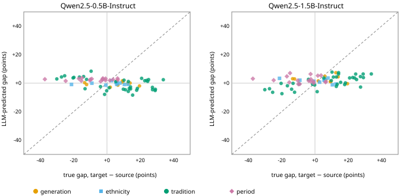
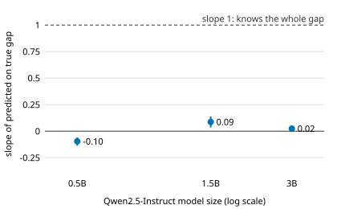
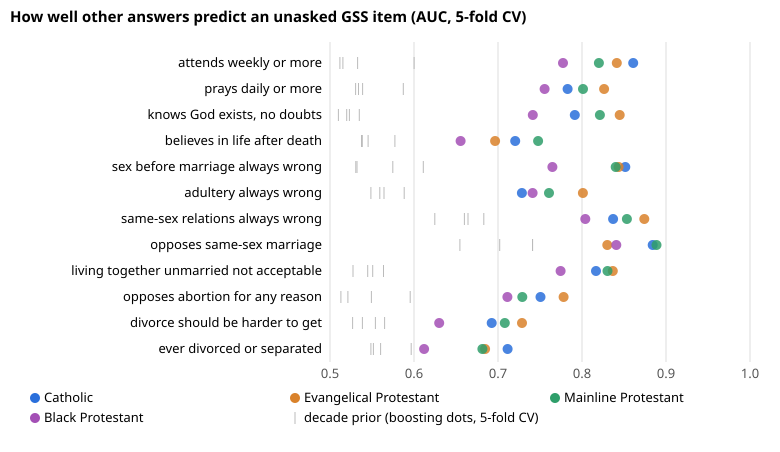

# Can a Catholic's other survey answers predict the beliefs on marriage, sexuality and devotion they were never asked?

**Headline (milestone 1, US General Social Survey 1972–2024):** yes, mostly. Given a Christian respondent's other answers, a model predicts an item they were never asked far better than the share for their decade: a median +0.21 AUC across 49 tradition × item cells.

Among Catholics, the AUC for each item is:

| Item | AUC |
|---|---:|
| Weekly Mass attendance | 0.86 |
| "Sex before marriage always wrong" | 0.85 |
| Same-sex relations always wrong | 0.84 |
| Opposes same-sex marriage | 0.88 |
| Cohabitation not acceptable | 0.82 |
| Opposes abortion for any reason | 0.75 |
| Adultery always wrong | 0.73 |
| Divorce should be harder to get | 0.69 |
| Has ever divorced | 0.71 |

The associations travel between groups, but the levels do not:

- A model learned on third-generation Catholics ranks foreign-born Catholics almost as well as a model that saw them (within 0.03 AUC on 12 of 13 items). But it misses their share by more than 5 points on 5 items, for example certainty about God by 11 points.
- A Catholic-trained model ranks Evangelical, Mainline and Black Protestants within about 0.01 AUC of their own models. But it under-predicts Evangelical sexual conservatism by up to 17 points.

- **Unseen survey years (milestone 3, part):** holding out a whole year, a model that cannot see the year gets that year's Catholic share within 2.8 points (median) but is no better than interpolating the neighbouring years' observed shares (mean error 3.9 vs 3.4 points), and is far off for fast-moving items such as same-sex marriage (17 points). See `LOG.md`, 2026-11-08.
- **Standard multiple imputation (MICE, milestone 3, part):** chained equations with Rubin's rules do worse on an unseen year (4.7 points mean error) than a single logistic model (4.1) or interpolation (3.4), and their 95% intervals cover the true year share in 83% of item-years overall but only 20–40% on the fast-moving same-sex items. See [`experiments/m3_mice/results/summary.md`](experiments/m3_mice/results/summary.md) and `LOG.md`, 2026-11-10.
- **Bayesian mixture imputation (DPMPM, milestone 3, part):** the Dirichlet-process latent-class mixture of Si and Reiter (2013), the other principled baseline, misses a held-out Catholic year by 4.8 points on average, within 0.15 points of MICE (4.7) and worse than interpolation (3.4); its Rubin intervals cover 82% of item-years and none of the five same-sex-marriage years (off by 20 points). Two imputers built on opposite assumptions failing the same way says the barrier is missing period information, not the model class. See [`experiments/m3_mixture/results/summary.md`](experiments/m3_mixture/results/summary.md) and `LOG.md`, 2026-11-11.
- **Period-aware mixture (milestone 3, part):** giving the same Si–Reiter mixture one more variable, the survey decade, cuts its error on a held-out Catholic year from 4.8 to 3.55 points (paired difference −1.26, 95% interval −1.58 to −0.94) and same-sex marriage from 20 to 11.5 points, and lifts Rubin coverage from 82% to 92%. It lands on the decade-mean baseline (3.54), still short of interpolation (3.4); averaged with interpolation it gives the lowest point error so far (3.15). Five-year bins do no better (3.59). The barrier was the missing period, as the mixture entry argued. See [`experiments/m3_period_mixture/results/summary.md`](experiments/m3_period_mixture/results/summary.md) and `LOG.md`, 2026-11-12.
- **Honest intervals for an unseen year (milestone 3, part):** a leave-one-item-out conformal interval whose width grows with sampling noise and with how fast the neighbouring asked years were moving covers 95% of held-out Catholic item-years and at least 83% on every item (MICE's Rubin intervals: 83% overall, 20% on same-sex marriage), and is narrower in the typical year (±7.6 vs ±9.4 points for a fixed width). Averaging interpolation with the shifted boosted model cuts the point error to 3.2 points. See [`experiments/m3_drift_intervals/results/summary.md`](experiments/m3_drift_intervals/results/summary.md) and `LOG.md`, 2026-11-11.
- **Why transferred models miss a subgroup's level (milestone 6, part):** across 241 item × group cells (immigrant generations, Hispanic Catholics, four traditions, later decades), a transferred model misses the target group's share by 5.6 points on average. Splitting the error exactly, covariate shift (fixable without any target answers by importance weighting) is a median 0.8 points; concept shift, the group answering *this* item differently at the same profile, is 3.5. Borrowing the shift from the items the group *was* asked does not fix it (−0.35 points, 95% interval −0.74 to +0.01; the pre-registered refutation rule was met): sexual-morality items share a shift, but abortion, divorce law and adultery run against it. So a rotated item needs a small calibration subsample in each group. See [`experiments/m6_shift_bound/results/summary.md`](experiments/m6_shift_bound/results/summary.md) and `LOG.md`, 2026-11-12.
- **How big a calibration subsample a rotated item needs (milestone 6, part):** with n respondents of a group asked the item, adding their mean residual to the transferred model's average (a difference, or prediction-powered, estimator) needs 17% fewer respondents than their plain mean for the same precision (median variance ratio 0.83, 95% interval 0.80 to 0.85, over 241 cells), from 33% for same-sex marriage to 4% for ever divorced. Below a break-even n* = var(y − f) / bias² (median 91 respondents) the transferred model alone is better; the formula matches the simulated crossover within a factor 2 in 99% of cells. A ±3-point share still takes roughly 700 to 1,400 asked respondents per group. Power tuning (PPI++) and logit recalibration add nothing. See [`experiments/m6_calibration/results/summary.md`](experiments/m6_calibration/results/summary.md) and `LOG.md`, 2026-11-12.
- **Does the calibration result survive the GSS's clustered design? (milestone 6, part):** yes, with one correction. With the survey's own strata and PSUs, design effects on a subgroup's share are small, a median 1.06 (1.02 for the model's residual), because a group pooled over decades has about two respondents per PSU; the model's saving is slightly larger under the design (variance ratio 0.81 against 0.83). What the simple-random analysis missed is the survey's own sampling error, which no calibration subsample removes: against the population share, the difference estimator's saving falls from 17% to 14% at 400 respondents, and subsample-only intervals are 4 to 9% too narrow (up to 19% for small groups). An ultimate-cluster variance computed from the model's predictions on every respondent plus the subsample's answers is within 1 to 7% of the truth. See [`experiments/m6_design_variance/results/summary.md`](experiments/m6_design_variance/results/summary.md) and `LOG.md`, 2026-11-16.
- **Do the shrinkage gains and their intervals survive the GSS design? (milestone 6, part):** the gains do; the intervals need one more term. Scored against the population share with the survey's strata and PSUs, shrinking toward the transferred model still halves the family loss at 50 respondents per group (median ratio 0.471 against 0.472 under the sample share), and the by-kind prior rule keeps 0.649 of the zero prior's error (0.648). But the robust empirical Bayes interval built from the subsample alone covers the population share only 93.0 to 93.6% of the time at 200 to 400 respondents (92.5% for 2016&ndash;24 groups). Adding the full sample's design variance restores 94.1 to 96.8% for 1 to 3% more width. One pre-registered refutation rule was met because the prediction used the wrong statistic; `LOG.md` says so. See [`experiments/m6_design_shrinkage/results/summary.md`](experiments/m6_design_shrinkage/results/summary.md) and `LOG.md`, 2026-11-17.
- **Splitting a calibration budget across subgroups (milestone 6, part):** across 73 families of 2 to 4 subgroups (traditions, generations, decades) sharing an item, how the respondents are split hardly matters (Neyman allocation changes the error by under 1%; water-filling on a pilot's bias estimates is 2 to 3% worse), but how far each group's estimate trusts the transferred model does. Shrinking the group's residual correction with a Fay–Herriot weight whose bias variance comes from items already fielded halves the group-average squared error at 50 respondents per group (6.8 to 4.7 points RMSE, about what the plain difference estimator reaches with 100) and still cuts it by 11% at 400, and it helps the worst group too. Estimating that variance from the 3 or 4 groups themselves fails. See [`experiments/m6_allocation/results/summary.md`](experiments/m6_allocation/results/summary.md) and `LOG.md`, 2026-11-13.
- **Honest intervals for a shrunk subgroup share (milestone 6, part):** for the same shrinkage estimator, the robust empirical Bayes interval of Armstrong, Kolesár and Plagborg-Møller (2022, doi:10.3982/ECTA18597; arXiv:2004.03448) covers the true subgroup share 96.8% of the time on average at 50 respondents per group (94.1 to 95.1% at 100 to 400) while being 17% narrower than the difference estimator's interval (11.4 against 13.6 points half-width). The textbook posterior interval is 29% narrower but averages 93.8% and drops to 90.6% for later-decade groups; a plug-in conditional-MSE interval does worst (89.1%, a quarter of groups below 80%). No interval protects the 12 of 227 groups whose transferred-model bias is more than twice the typical one (45 to 64% coverage). Coverage is computed exactly under a normal approximation that matches the simulated errors (within 10% for 95% of rows once the simulation's finite-population factor is included); no microdata this session. See [`experiments/m6_intervals/results/summary.md`](experiments/m6_intervals/results/summary.md) and `LOG.md`, 2026-11-14.
- **Which subgroup is biased? Borrow the other groups' miss (milestone 6, part):** when an item is rotated off one subgroup and the others keep it, shrinking that subgroup's calibration correction toward the other groups' transferred-model miss on the same item, rather than toward zero, cuts the 2016&ndash;24 groups' mean squared error to 0.26 of the zero-prior estimator's at 50 respondents per group (item-cluster bootstrap 0.10&ndash;0.74; known-bias oracle 0.27), and to 0.54 with the dominant same-sex-marriage item dropped. It does not carry over: for immigrant generations the other generations' miss points the wrong way (1.5&times; the error) and for traditions a pair-plus-item fit helps only within noise (0.91, 0.74&ndash;1.11). Across all 227 groups the best prior is 0.73 of the zero prior's error (0.46&ndash;1.05). Robust empirical Bayes intervals around it keep 94.8 to 98.4% average coverage and cover the 12 worst-missed groups 93% of the time (64% before). Re-choosing the prior from leave-out error on the other items does worse than a rule fixed by kind (next bullet). See [`experiments/m6_prior/results/summary.md`](experiments/m6_prior/results/summary.md) and `LOG.md`, 2026-11-15.
- **Fix the prior by kind of group; don't re-choose it (milestone 6, part):** a leave-one-item-out test picked, for each kind of group, the prior with the smallest error on the other 12 items. It agreed with the by-kind rule in 37 of 39 kind-folds: the other groups' miss for 2016&ndash;24 groups in 13 of 13, a zero prior for immigrant generations in 12 of 13, the additive fit for traditions in 12 of 13. It still keeps only part of the gain: 0.83 of the zero prior's mean squared error at 50 respondents per group (item-cluster bootstrap 0.74&ndash;0.95), against 0.65 for the fixed rule. The two folds that left the rule (same-sex marriage for traditions, ever divorced for generations) cover 7% of groups and cost 4.6 and 3.1 times the zero prior's error, enough to erase most of the gain. So a designer should fix the rule by kind ahead of time. The 0.65 is in-sample, and only a second survey can confirm it. See [`experiments/m6_kindsel/results/summary.md`](experiments/m6_kindsel/results/summary.md) and `LOG.md`, 2026-11-16.
- **Does the rule hold on items it never saw? (milestone 6, part):** fixed in advance and scored on 7 fresh GSS items (euthanasia, assisted suicide, the death penalty, marijuana, pornography law, teen sex, teen birth control) that were never among the 13 it was read from, the by-kind prior rule cuts the subgroups' mean squared error to 0.85 of the zero prior's at 50 respondents per group (item-cluster bootstrap 0.76&ndash;0.92; 0.87 on 6 abortion sub-items), about half its in-sample gain (0.65), with robust intervals at 95 to 98.5% coverage. Almost all of it is the period part: for 2016&ndash;24 groups the other traditions' miss gives 0.38 of the zero prior's error. For traditions and generations the best prior flips between item sets (rank-2 completion wins on the fresh items, 0.79 and 0.77, but lost on the old ones), so zero remains the safe default there. See [`experiments/m6_fresh_items/results/summary.md`](experiments/m6_fresh_items/results/summary.md) and `LOG.md`, 2026-11-16.

- **Can a local language model stand in for the survey? (milestone 5):** no, not at 1.5 billion parameters. Given only a respondent's background as text (age, sex, schooling, politics, tradition, year; no answers), the open-weights Qwen2.5-1.5B-Instruct (Qwen Team 2024, arXiv:2412.15115), run on a CPU, ranks respondents on an unasked item at a median AUC of 0.57, against 0.78 for a model transferred from another group. Zero-shot, it misses a group's share by a median 33 points, and it gives no calibration saving. It does know which way groups differ (Spearman 0.35 between its predicted and the true gap), but it predicts gaps about a tenth of their true size (slope 0.09). Adding its gap to the source share beats the source share alone by 0.8 points and loses to the transferred model by 4.7. The 0.5B model is at chance. See [`experiments/m5_local_llm/results/summary.md`](experiments/m5_local_llm/results/summary.md) and `LOG.md`, 2026-11-17.



- **Does a bigger local model know the gap? (milestone 5, scale point):** not at 3 billion parameters. Qwen2.5-3B-Instruct (Qwen Research Licence; research use only, weights not redistributed), on the same 3,478 respondents and 74 cells, orders the groups' gaps better than the 1.5B model (Spearman 0.56 against 0.35) but answers "No" to almost everything: 87% of its probabilities sit below 0.01 or above 0.99, it misses a group's share by a median 61 points zero-shot, and its predicted gap on the probability scale has a slope of 0.02 (0.5B &minus;0.10, 1.5B 0.09). On the logit scale, an exploratory analysis done after the pre-registered one, its gap has a slope of 1.30 (0.75 to 1.86), carried by the tradition pairs, but the logit-shift estimate is still no better than carrying the source share and 6.4 points behind the transferred model. See [`experiments/m5_local_llm/results/scale_summary.md`](experiments/m5_local_llm/results/scale_summary.md) and `LOG.md`, 2026-11-19.



Gradient boosting adds almost nothing over logistic regression (median +0.003 AUC).

**Paper draft (milestone 6):** [`paper/draft.md`](paper/draft.md), a methods paper for *Sociological Methods & Research* on rotating an item off a subgroup's ballot: why a transferred model misses the level, how big a calibration subsample to keep, shrinkage with robust empirical Bayes intervals, and the by-kind prior rule with its fresh-item test. Every number is tied to a results file by `paper/check_numbers.py` (82 checks), and the pre-registration table (107 predictions over milestones 1 to 6: 59 held, 22 partly, 26 refuted) is recounted from `LOG.md` by `paper/prereg_count.py --check`; citations in [`paper/references.bib`](paper/references.bib). Six print-size figures (vector PDF and SVG, journal column widths) are in [`paper/figures/`](paper/figures/), drawn from the committed CSVs by `paper/figures.py`, which first recomputes the numbers each figure shows and stops if one differs from the text; for example [the n* check](paper/figures/fig2_nstar.svg) and [the prior comparison](paper/figures/fig5_priors.svg).

Research programme, AI-assisted (Claude), on the owner's request: [`PROPOSAL.md`](PROPOSAL.md), [`LOG.md`](LOG.md) (hypotheses written before each run, then outcomes), full tables in [`experiments/m1_imputation/results/summary.md`](experiments/m1_imputation/results/summary.md).

**Live page:** https://marisstella.app/research/christian-belief-models/



## What it asks

The programme asks how well survey models predict an individual's unanswered religious items:

- Catholic teaching adherence on marriage and sexuality
- devotional practice
- marriage outcomes

It also asks whether the associations a model learns hold across Catholic, Protestant and Orthodox subcultures, across decades, for immigrants and their children, and (milestone 4) across countries.

The GSS asks most of these items on only some ballots. So most "missing" answers were missing by design, which makes this a fair test of imputation. Each target is coded as the answer consistent with the Catechism of the Catholic Church (paragraph per item in [`src/gss.py`](src/gss.py)), or as a practice level. That code describes agreement with a stated teaching, not a judgement of anyone's faith.

## Scope

The programme uses anonymised public survey microdata only. "Prediction" means filling a survey respondent's unasked item and measuring how wrong that is. It is not a tool for inferring a named person's religion or beliefs (religious belief is special-category data under GDPR Art. 9), and it is not built for screening or targeting.

## Reproduce

```sh
sh data/download.sh                  # NORC GSS 1972–2024 R3a, checksums in data/SHA256SUMS (~600 MB, not committed)
python3 experiments/m1_imputation/run.py        # ~30 min; writes experiments/m1_imputation/results/*.csv
python3 experiments/m1_imputation/summarise.py  # summary.md and the figure, from the committed CSVs
python3 experiments/m3_mice/run.py             # ~25 min on 4 cores; MICE on held-out years, results/mice.csv
python3 experiments/m3_mice/summarise.py       # results/summary.md against the earlier variants
python3 experiments/m3_drift_intervals/run.py  # seconds; conformal intervals from the committed CSVs, no download
python3 experiments/m3_mixture/run.py          # ~55 min on 4 cores; DPMPM mixture (src/dpmpm.py), results/mixture.csv
python3 experiments/m3_mixture/summarise.py    # results/summary.md against MICE, interpolation and the conformal intervals
python3 experiments/m3_period_mixture/run.py --period decade   # ~65 min on 4 cores; the mixture plus survey decade
python3 experiments/m3_period_mixture/run.py --period half     # five-year bins
# milestone 5 (needs torch and transformers; downloads the Apache-2.0 Qwen2.5 weights, ~4 GB)
python3 experiments/m5_local_llm/score.py --model Qwen/Qwen2.5-0.5B-Instruct   # ~27 min on 4 CPU cores
python3 experiments/m5_local_llm/score.py --model Qwen/Qwen2.5-1.5B-Instruct   # ~66 min
python3 experiments/m5_local_llm/analyse.py    # ~3 min; results/cells.csv, summary.md
python3 experiments/m5_local_llm/figure.py     # results/gap_scatter.svg
python3 experiments/m5_local_llm/check.py --model Qwen/Qwen2.5-1.5B-Instruct   # cache path and bf16 vs fp32
python3 experiments/m5_local_llm/score.py --model Qwen/Qwen2.5-3B-Instruct     # ~109 min; Qwen Research Licence
python3 experiments/m5_local_llm/scale.py      # 10 s; results/scale_summary.md, scale_cells.csv, scale_slope.svg
python3 experiments/m3_period_mixture/summarise.py             # results/summary.md against the year-free mixture
python3 experiments/m6_shift_bound/run.py --jobs 4         # ~9 min on 4 cores (OMP_NUM_THREADS=1); transfer-error decomposition, results/cells.csv
python3 experiments/m6_shift_bound/summarise.py            # results/summary.md
python3 experiments/m6_calibration/run.py --jobs 4         # ~4 min on 4 cores; calibration-subsample simulation, results/cells.csv and sims.csv
python3 experiments/m6_calibration/summarise.py            # results/summary.md and rmse_by_n.svg
OMP_NUM_THREADS=1 python3 experiments/m6_design_variance/run.py --jobs 4   # ~3 min on 4 cores; strata/PSU variances, results/cells.csv and sims.csv
python3 experiments/m6_design_variance/summarise.py        # results/summary.md and total_ratio_by_n.svg
OMP_NUM_THREADS=1 python3 experiments/m6_design_shrinkage/run.py --jobs 4  # ~2 min; Sections 6-8 against the population share (--score-only reuses results/cells.csv)
OMP_NUM_THREADS=1 python3 experiments/m6_allocation/run.py --jobs 4   # ~1 min on 4 cores; budget split across subgroups, results/families.csv
python3 experiments/m6_allocation/summarise.py             # results/summary.md and loss_by_budget.svg
python3 experiments/m6_kindsel/run.py                     # ~40 s on 4 cores; per-kind prior choice without the rotated item, from committed CSVs
python3 -m pytest test_recode.py test_mice.py test_drift_intervals.py test_mixture.py test_period_mixture.py test_shift_bound.py test_calibration.py test_design_variance.py test_design_shrinkage.py test_allocation.py test_prior.py test_kindsel.py test_paper_numbers.py test_figures.py
python3 paper/check_numbers.py                  # stdlib; every number in paper/draft.md against the results files
python3 paper/prereg_count.py --check           # stdlib; Section 11's pre-registration table against LOG.md
python3 paper/figures.py                        # the paper's six figures from the committed CSVs (numpy, pandas, matplotlib)
```

Needs `pandas`, `numpy` and `scikit-learn`. Set `GSS_DTA` to point at an existing `gss7224_r3a.dta`.

## Limits so far

- One fold seed.
- Milestone 1 to 3 intervals come from a respondent bootstrap, not the GSS's design-based (PSU and strata) variance; the calibration section (`m6_design_variance`, design effects about 1.06 for subgroups pooled over decades) and the shrinkage, interval and prior sections (`m6_design_shrinkage`) now have one.
- Attendance is self-reported, and self-reports run high (Hadaway et al. 1993).
- Shares are not yet checked against NORC's own tables.
- The GSS has 27–205 Orthodox respondents per item, too few to model.
- Global and immigrant-origin data (EVS/WVS, ISSP, Pew) need archive registration, which is an owner step.

The sibling programme [`research/catholic-demography`](https://github.com/Duncan-Haywood/oss-monorepo/pull/12893) estimates Catholic subgroup *levels*. [`research/marriage-divorce-evidence`](../marriage-divorce-evidence) models divorce with religion as a predictor.

Covariate-shift weights: Sugiyama, Suzuki and Kanamori (2012), *Density Ratio Estimation in Machine Learning*, Cambridge University Press, doi:10.1017/CBO9781139035613.

Mixture model: Dunson and Xing (2009), *JASA*, doi:10.1198/jasa.2009.tm08439; Si and Reiter (2013), *J. Educ. Behav. Stat.*, doi:10.3102/1076998613480394; blocked Gibbs sampler of Ishwaran and James (2001), *JASA*, doi:10.1198/016214501750332758.

Calibration subsamples: Särndal, Swensson and Wretman (1992), *Model Assisted Survey Sampling*, Springer, doi:10.1007/978-1-4612-4378-6 (difference estimator); Angelopoulos, Bates, Fannjiang, Jordan and Zrnic (2023), "Prediction-powered inference", *Science*, doi:10.1126/science.adi6000; Angelopoulos, Duchi and Zrnic (2023), "PPI++: Efficient Prediction-Powered Inference", arXiv:2311.01453. Design-based variance: Wolter (2007), *Introduction to Variance Estimation*, 2nd ed., Springer, doi:10.1007/978-0-387-35099-8 (ultimate-cluster estimator).

Budget allocation and shrinkage: Neyman (1934), "On the Two Different Aspects of the Representative Method", *J. R. Stat. Soc.*, doi:10.2307/2342192; Fay and Herriot (1979), "Estimates of Income for Small Places", *JASA*, doi:10.1080/01621459.1979.10482505.

GSS citation: Davern, Bautista, Freese, Herd and Morgan, *General Social Survey 1972–2024* [machine-readable data file], NORC at the University of Chicago, gss.norc.org.
