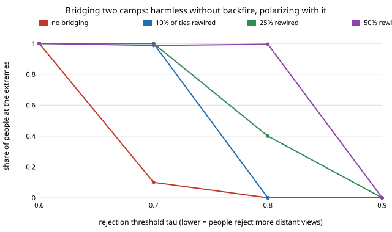
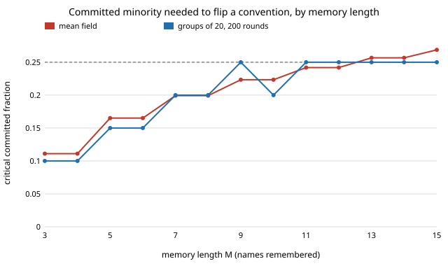

# civ-levers: which interventions bring a polarized society back together?

Can contact between two opposed camps depolarize a society, or does it make things worse?
Which interventions merge two camps in an opinion-dynamics simulation, and do they survive
a change in the assumption nobody has measured: whether people move *away* from views they
reject? **Rewiring ties across camps (bridging contact) never helps under bounded confidence
and is the only lever that backfires: with a rejection threshold of 0.7, rewiring 10% of
ties sends everyone to the extremes, from 10% with no intervention. Interventions that put a
voice *within reach* of both camps do far better: across 25 settings of tolerance and backfire,
a ladder of committed voices merges the camps in 24, a moderate broadcast or committed
moderates in 19, a one-off nudge in 14, raising everyone's tolerance in 8, and bridging in 2
(while driving more people to the extremes in 10).** The ladder only works if it is spaced for
the *least* tolerant people: built for a tolerance of 0.3 when the real one is 0.2, it merges
none of 10 societies. Produced with AI assistance (Claude). First project of research track 24
(`civ`, `PROJECTS.md`). Every result is about simulated people following a stated rule, not
about real societies.

**Live page:** https://marisstella.app/research/civ-levers/

**Play with it:** the [depolarization simulator](app/index.html) runs the same model in the
browser (`app/model.js`, checked against the Python model by `app/tests/model.test.mjs`).

## Why this question

Polarization research proposes many fixes: contact between groups (Allport 1954; a
meta-analysis of 515 studies found contact reduces prejudice, Pettigrew and Tropp 2006),
exposure to the other side's views, moderate media, perspective-taking. The experimental
evidence on *exposure* disagrees: Bail et al. (2018) found that following a bot that retweeted
the other party made Republicans more conservative, while Guess and Coppock (2020), across
three large survey experiments, found little backlash to counter-attitudinal information.
Opinion-dynamics models encode exactly this disagreement as one parameter: whether, and how far
away, a view starts to push people back. So the useful question is not "what does the model say"
but "which recommendation holds whatever that parameter is".

## Model

1,000 people in two camps of 500. Camp A's opinions start uniform on 0.2 ± 0.15, camp B's on
0.8 ± 0.15 (opinions live on [0, 1]). Each person has about 10 ties, 95% of them inside their
own camp. Each round, everyone meets one random contact and compares opinions, with difference d:

| Rule | Condition | Move | Source |
|---|---|---|---|
| Assimilation | \|d\| < ε (latitude of acceptance) | 0.3 · d toward the contact | Deffuant et al. 2000 |
| Repulsion (backfire) | \|d\| > τ (latitude of rejection) | 0.3 · d away, clipped to [0, 1] | Jager and Amblard 2005, after Sherif and Hovland 1961 |
| Nothing | otherwise | none | |

τ = ∞ is plain bounded confidence. 400 rounds, 10 random societies per setting.

| Parameter | Values | Why |
|---|---|---|
| tolerance ε | 0.2, 0.25, 0.3, 0.35, 0.4 | not measured for real attitudes: swept |
| rejection τ | none, 0.9, 0.8, 0.7, 0.6 | the contested parameter: swept |
| step μ | 0.3 | inside the 0.1–0.5 range Deffuant et al. explore; not swept here |
| cross-camp ties | 5% | a stylised strong homophily; not calibrated to a real network |

**Levers**, each with one dose:

- **bridge**: rewire a share (10%, 25%, 50%) of within-camp ties to the other camp (contact).
- **broadcast**: each round, with probability 5%, 10% or 20%, a person hears a fixed source at
  0.5 instead of a contact (moderate media).
- **moderates**: 5%, 10% or 20% of people become committed moderates at 0.5 who never move.
- **ladder**: the same share of committed voices, spread evenly over positions at most 0.8 ε
  apart between the camp centres 0.2 and 0.8 (stepping stones).
- **nudge**: 10%, 20% or 40% of people are moved to 0.5 once and are free to drift back.
- **tolerance**: everyone's ε is raised by 0.05, 0.1 or 0.2 (perspective-taking training).

Outcomes: the **gap** between the camps' mean opinions (0.6 at the start; 0 = merged; 1 =
opposite extremes), the share of people at the **extremes** (within 0.05 of 0 or 1), and
"**merged**" = at least 9 of 10 societies end with a gap under 0.1.

## Checks against published and analytic results (`tests/test_model.py`)

- Deffuant et al. (2000): from uniform opinions, about floor(1/(2ε)) major clusters. The model
  gives 3 at ε = 0.15, 2 at 0.2 and 1 at 0.5.
- Hegselmann and Krause (2002): consensus from a uniform start once ε passes about 0.2–0.25
  (Lorenz 2007). On a 500-point grid: 2 clusters at ε = 0.2, consensus at 0.25.
- DeGroot limit (ε ≥ 1, no repulsion): a connected network reaches consensus; with one
  committed opinion, everyone ends at it.
- Jager and Amblard (2005): a narrow non-commitment zone (ε 0.2, τ 0.4) splits everyone to the poles.

## Results (`experiments/results.txt`, `python3 experiments/run.py`, about 70 s on 4 cores)

**1. Bridging is harmless without backfire and polarizing with it** (ε = 0.3, share at the extremes):

| τ | no bridging | 10% rewired | 25% | 50% |
|---|---|---|---|---|
| 0.9 | 0.00 | 0.00 | 0.00 | 0.00 |
| 0.8 | 0.00 | 0.00 | 0.40 | 0.99 |
| 0.7 | 0.10 | 1.00 | 1.00 | 0.99 |
| 0.6 | 1.00 | 1.00 | 1.00 | 1.00 |

Without repulsion, the other camp sits 0.6 away, outside anyone's ε, so cross-camp ties carry no
influence at all: no dose of bridging merges the camps unless ε is 0.4. With repulsion,
every cross-camp tie pushes both ends apart, and the more ties, the faster the split.



**2. Levers that sit within reach work across settings.** At each lever's largest dose, over
all 25 (ε, τ) settings:

| Lever (largest dose) | merged | more people at the extremes |
|---|---|---|
| ladder (20% of people) | 24 | 0 |
| broadcast (heard 20% of rounds) | 19 | 0 |
| moderates (20%) | 19 | 1 |
| nudge (40%) | 14 | 0 |
| tolerance (+0.2) | 8 | 0 |
| bridge (50% of ties) | 2 | 10 |

At τ = 0.6 the society splits to the extremes on its own, so no lever can make it worse.
The least dose that merges: a moderate broadcast or committed moderates need only 5% when
ε ≥ 0.3, and 20% at ε = 0.25; nothing tried at the centre works at ε = 0.2, because the
centre is 0.3 from each camp. Raising tolerance helps only once ε + Δ is at least 0.55,
because each camp contracts to its centre (0.2 and 0.8, 0.6 apart) faster than its edges reach the other camp.
A one-off nudge needs 40% of people, since the moderates it creates are pulled back.

**3. A ladder must be spaced for the least tolerant** (dose 10%, merged of 10, τ = none / 0.7):

| true ε | spaced for 0.2 | spaced for 0.3 | spaced for 0.4 |
|---|---|---|---|
| 0.2 | 10 / 10 | 0 / 0 | 0 / 0 |
| 0.25 | 10 / 10 | 10 / 10 | 4 / 3 |
| 0.3 and up | 10 / 10 | 10 / 10 | 10 / 10 |

Under-estimating tolerance costs nothing here; over-estimating it breaks the chain.

## Follow-up: contact that widens tolerance (`experiments/contact/`, `src/civ_levers/contact.py`)

Each agent gets its own tolerance that cross-camp contact edits (a stand-in for Pettigrew and
Tropp 2006; the gain and loss rates are not measured and are swept, 0.005 to 0.05 per meeting).
Plan and hypotheses were logged first (`LOG.md`); 10 societies per cell, full table in
`experiments/contact/results.txt`.

- **Widening only after an accepted meeting does nothing.** Camps start 0.6 apart, so no
  cross-camp meeting is ever within reach and tolerance never grows: 0 of 10 merged in all 135
  cells, mean tolerance unchanged. The rule is circular.
- **Widening on any meeting that is not repelled does merge the camps, with no backfire.** At
  gain 0.05 per meeting, bridging 25% of ties merges 10 of 10 societies at starting tolerance
  0.2, 0.25 and 0.3; at 10% of ties it merges 3, 5 and 7 of 10. At gain 0.01 only 50% bridging
  at tolerance 0.3 merges (10 of 10); at 0.2 and 0.25 it merges 3 and 7.
- **Backfire still wins.** With rejection threshold 0.7 and a loss of 0.02 per repelled
  meeting, no cell merges at any gain (0 of 36 exposure cells with tau 0.7); at tau 0.8 mostly gain 0.05
  merges, with a few cells at gain 0.02.
- **Identity.** 20% committed moderates dismissed with probability q (read as the other camp's):
  at tolerance 0.3, 10 of 10 merge at every q up to 0.75; at 0.2 the 0.5 voice is out of reach
  at any q (0 of 10). The identity filter matters less than reach.

So the bridging verdict flips only if contact itself widens tolerance fast (about 0.05 per
meeting here) and nobody rejects; with backfire at 0.7 it does not flip. The gain rates and the
mere-exposure rule are assumptions, not measured.

## Follow-up: where to seed a complex contagion (`experiments/cascades/`, `src/civ_levers/cascades.py`)

Question: when a behaviour needs reinforcement (adopt after at least T neighbours have; Centola
and Macy 2007), which seeds start a cascade on a clustered, a rewired and a random network?
Watts–Strogatz graphs (n 1000, k 8, rewiring p from 0 to 1), 20 graphs per cell, four rules
(random people, highest-degree people, a clustered patch, spread-out seeds). Hypotheses were
logged before the run (`LOG.md`); `python3 experiments/cascades/run.py` reproduces
`results.txt`.

- A simple contagion (T = 1) from one seed reaches everyone at every p; rewiring changes speed only.
- At T = 2 a clustered patch of 5 reaches everyone for p <= 0.1 and 0.85 (+-0.16) at p = 0.3;
  at p = 1 no 5-seed rule passes 1%. The smallest budget reaching 90% is 2 to 3 for a patch at
  p <= 0.1, 8 at p = 0.3, 40 at p = 1; random seeds need 12 to 20, hubs 8 to 20.
- Spread-out seeds never start a T = 2 cascade: each seed alone has no one to reinforce it.
- T = 3 is harder: a patch needs 3 to 5 seeds at p <= 0.03 and nothing up to 40 once p >= 0.1.
- Against our own guess, hubs beat random seeds at T = 2 once rewiring makes degrees uneven.

This agrees in direction with Centola and Macy (2007); it is not a reproduction of their
figures; Centola et al. (2018)'s 25% tipping point is checked in the next section.
T, k and the graph family are chosen, not measured; the finding is about simulated people.

## Follow-up: how big must a committed minority be to flip a convention? (`experiments/convention/`, `src/civ_levers/convention.py`)

Centola et al. (2018) found that a convention held by groups of 20 people flipped only once a
committed minority reached about 25% of the group. Is 25% a constant, and does it matter where
the committed people sit? In a memory-M naming game (each person says the name most frequent
among the last M they heard; committed people always say the new one), **the critical mass is
set by memory: 11% at M = 3, 24% at M = 11, 26% at M = 13, 32% at M = 31 and 42% at M = 201
(mean field), so 25% corresponds to people weighing about the last 11 to 13 names they heard.**
Simulated groups of 20 track the mean field within 0.03 for M from 3 to 15, but a 50-round
horizon instead of 200 adds about one person (0.30 at M = 11 to 15). **Placement reverses the
complex-contagion advice above: on a ring lattice (n 1000, k 8, M 12) a clustered patch of
committed people never flips the rest, even at half the population, while randomly placed ones
do from 10%**, under half the mean-field figure; rewiring narrows the gap (random 0.175 against
patch 0.225 at p = 1) but the patch never wins. A contagion's adopters stay, so a patch
reinforces its own edge; under a majority rule the edge still hears the old name from the other
side and never sees more than half its contacts committed.
`python3 experiments/convention/run.py` reproduces `results.txt` in about 30 s.



- Check: the Xie et al. (2011) binary agreement game's mean-field critical fraction, re-derived
  from its interaction cases and integrated here, is 0.0979, the published value; simulated on
  1,000 people it holds the old word at 8% committed and flips at 10%.
- Limits: people hear one random neighbour per round rather than playing in pairs as in the
  experiment; M is not measured for anyone and is swept; the paper's own model settings could
  not be read from this session, so this checks the model class, not their figure; one lattice
  size and one M on networks, 10 graphs per cell, no intervals there.

## Follow-up: Axelrod's culture model with a broadcast (`experiments/culture/`, `src/civ_levers/culture.py`)

Question: does one voice that everyone hears (a common broadcast) homogenise a society of
interacting cultures, or fragment it? Axelrod (1997) on a lattice (F features, q traits), plus a
global media culture met with probability B per step (Shibanai, Yasuno and Ishiguro 2001).
20 runs per cell; hypotheses were logged before the run (`LOG.md`);
`python3 experiments/culture/run.py` reproduces `results.txt` (about 6 minutes on 4 cores).

- A broadcast **fragments** rather than homogenises. F = 5, q = 10, 20 x 20: the largest culture
  covers 99% of the lattice without media and 26% at B = 0.3 (2 regions against 76). At q = 5 it
  stays one culture until B = 0.03 and splits into 29 regions at B = 0.3. At q = 40 (already
  fragmented, S = 0.03) it changes nothing.
- Why: a site sharing no feature with the media never interacts with it, so such sites freeze.
  Only 50% hold the media culture at q = 10, B = 0.3, and 27% at q = 20.
- The order–disorder transition shows up (largest region falls with q; gradual for F = 2, sharp for
  F >= 3), but the F = 10 drop is at q of about 30 to 50 on 12 and 24 sized lattices, not
  Castellano, Marsili and Vespignani's (2000) q_c of about 300, which used lattices to L = 150. I
  did not run those sizes, so this is **not a reproduction** of their number.
- Axelrod's base case (F 5, q 10, 10 x 10): 4.55 +- 0.36 regions (300 runs) against his 3.2.
  Higher; his sample and counting rule may differ. Not matched.

- **Size scaling (compiled core, `experiments/culture/scaling.py`, `src/civ_levers/axelrod.c`).**
  A C port of the same rule (it matches the Python model on the base case and the F = 3
  transition: `tests/test_axelrod_c.py`) runs lattices to L = 80. The transition is sharp and
  moves up slowly with size. F = 10, S = 0.5 crossing: q = 43 (L = 20), 50 (L = 40), 55 (L = 80);
  F = 3: q = 8.9, 11.1, 13.2 (L = 16, 32, 64). 8 runs per cell, so intervals are narrow only
  where the cells are steep (`scaling_results.txt`). This is **still not Castellano, Marsili and
  Vespignani's q_c of about 300** for F = 10: at q = 80 to 400 every lattice is fragmented
  (S under 0.03) at all three sizes. The growth with L is too slow to reach 300 by L = 150 if
  it is logarithmic, and I did not run L = 150 or check their definition of q_c, their lattice
  boundary or the exact q grid, so I report a disagreement with a number I read in the paper,
  not a refutation. The earlier "q about 30 to 50 on small lattices" is the finite-size end of
  this curve.
  **Resolved (2026-11-05): the 300 is a Poisson mean.** Castellano et al. draw traits from a
  Poisson distribution with mean q, not uniformly on 1..q. Two Poisson(q) draws agree with
  probability about 1/(2 sqrt(pi q)), so Poisson q = 300 behaves like a uniform alphabet of about
  61. With Poisson traits (`axelrod.c ... poisson`, F = 10, 40 runs per cell,
  `experiments/culture/poisson_results.txt`) the S = 0.5 crossing is q = 135 (L = 20), 180
  (L = 40), 230 (L = 80), rising toward their 300; the collision-rate mapping predicted 147,
  199, 240 (within 10%). The uniform-trait runs above were a different parameterisation, not a
  bug. L = 150 was not run.

- **Broadcast on an ordered society at larger lattices (2026-11-09, `experiments/culture/media.py`,
  `media_results.txt`, `axelrod.c ... <mode> B`).** The Python run above started broadcasts at
  q where the society was already one culture only for small L. With the C core, q at 60 to 70% of
  the B = 0 transition (so no media gives one culture, S 0.79 to 0.99), L = 20 and 40, uniform F = 3
  and F = 10 and Poisson F = 10, 24 runs per cell: **a weak broadcast homogenises and a strong
  one fragments, with a threshold that falls as the lattice grows.** F = 10 uniform, L = 40, q = 30:
  at B = 0.01 the largest region is 0.98 and 98% of sites hold the media culture exactly; at
  B = 0.03, 0.92; at B = 0.1, 0.60 (234 regions); at B = 0.3, 0.10. The B where S crosses 0.5
  is about 0.2 at L = 20 and 0.11 at L = 40 (F = 10 uniform), about 0.09 and 0.04 (Poisson F = 10),
  and about 0.02 and 0.01 (F = 3, from a lower start at L = 20): it falls with L in all three, so
  I would not extrapolate a fixed B_c to a country-sized lattice; only two sizes were run. F = 3 at L = 40
  shows no homogenising stage: S is 0.94 without media and 0.87 at B = 0.003. This
  refines the earlier "fragments rather than homogenises" reading, which came from q where the
  society was already disordered (q = 20, 40) or from B above this threshold. Not run: noise
  (Klemm et al. 2003), more than one media culture, L > 40, a fixed media seed per cell (one seed
  base, 24 runs; each run draws its own media culture).

F, q, B and the single global media culture are chosen, not measured; the finding is about
simulated agents. Next: L = 150 and more runs per cell, noise (Klemm et al. 2003), and
contacting the paper's setup (periodic boundaries, q grid) to explain the factor of five.

## Follow-up: public goods with peer punishment (`experiments/commons/`, `src/civ_levers/commons.py`)

Milestone 5. Groups play the public-goods game (return 1.6/n per token, endowment 20) with free riders and conditional cooperators; a punishment stage costs 1 token to remove 3. 10 rounds, 240 people, 30 seeds (`results.txt`).

- Without punishment contributions decay from 7.5 to 1.9 of 20.
- Punishment with no behavioural response changes nothing and costs payoff (21.1 to 19.8): the effect is entirely the assumed response of the punished.
- With the response swept, round-10 contributions are 5.4, 10.2 and 12.2 (react 0.5, 1, 2). In stranger groups of 40, contributions reach 16.1 but net payoff falls to 2.9 against 21.0 with no punishment, since the all-to-all fining rule makes enforcement cost grow with group size.
- Not yet compared numerically with Fehr and Gächter (2000); the response, type shares and punisher share are assumptions. See `LOG.md`.
- **Pooled institution** (`experiments/commons/pooled.py`, `pooled_results.txt`): one fine per member below the group mean, cost split across the group. At n = 40 payoff stays at 20.7 to 25.5 against peer punishment's −0.9 to 8.2 (no punishment 21.0). But it sustains contributions only when the punished respond strongly: round-10 contribution 2.3, 3.5, 12.6 at react 0.5, 1, 2 (peer: 15.3 to 17.0). Net payoff beats no punishment only at react 2 (25.5). Model assumptions, not a forecast.

## What this does and does not say

- It is a model of opinion *positions*, not of prejudice or affect. Contact in Pettigrew and
  Tropp's meta-analysis reduces prejudice; the model's "bridge" only exposes people to the
  other side's opinion. Contact that also widens tolerance would be a combined lever (tested
  separately here as `tolerance`), and is the obvious next experiment.
- ε, τ and the network are not calibrated to any real population; they are swept. The
  conclusions that survive the sweep are the ones stated in bold above.
- Committed voices and broadcasts here have no cost, no credibility and no camp identity. A
  "moderate" that each camp sees as the other side's would behave like bridging.
- Opinions are one-dimensional; real polarization bundles issues and identity.

## Run it

```
python3 -m pytest -q tests                  # 12 model checks
python3 experiments/run.py                  # the sweep -> experiments/results.txt
python3 experiments/figure.py               # experiments/bridging_backfire.svg
node --test app/tests/model.test.mjs        # browser port against the Python model
```

Needs Python 3.9+ with numpy (and pytest); the app has no dependencies.

## References

- Allport, G. W. (1954). *The Nature of Prejudice*. Addison-Wesley.
- Axelrod, R. (1997). The dissemination of culture: a model with local convergence and global polarization. *Journal of Conflict Resolution* 41(2):203–226.
- Castellano, C., Marsili, M. and Vespignani, A. (2000). Nonequilibrium phase transition in a model for social influence. *Physical Review Letters* 85(16):3536–3539.
- Shibanai, Y., Yasuno, S. and Ishiguro, I. (2001). Effects of global information feedback on diversity: extensions to Axelrod's adaptive culture model. *Journal of Conflict Resolution* 45(1):80–96.
- Bail, C. A. et al. (2018). Exposure to opposing views on social media can increase political
  polarization. *PNAS* 115(37):9216–9221.
- Centola, D., Becker, J., Brackbill, D. and Baronchelli, A. (2018). Experimental evidence for
  tipping points in social convention. *Science* 360(6393), 1116–1119. doi:10.1126/science.aas8827
- Xie, J., Sreenivasan, S., Korniss, G., Zhang, W., Lim, C. and Szymanski, B. K. (2011). Social
  consensus through the influence of committed minorities. *Physical Review E* 84, 011130.
  arXiv:1102.3931 (doi:10.1103/PhysRevE.84.011130). Both 2018 and 2011 entries were checked by web
  search on 2026-11-11; `cite_check.py` could not reach doi.org or arXiv from that session.
- Centola, D. and Macy, M. (2007). Complex contagions and the weakness of long ties.
  *American Journal of Sociology* 113(3):702–734.
- Deffuant, G., Neau, D., Amblard, F. and Weisbuch, G. (2000). Mixing beliefs among interacting
  agents. *Advances in Complex Systems* 3:87–98.
- Granovetter, M. (1978). Threshold models of collective behavior. *American Journal of
  Sociology* 83(6):1420–1443.
- Guess, A. and Coppock, A. (2020). Does counter-attitudinal information cause backlash? Results
  from three large survey experiments. *British Journal of Political Science* 50(4):1497–1515.
- Hegselmann, R. and Krause, U. (2002). Opinion dynamics and bounded confidence: models,
  analysis and simulation. *JASSS* 5(3).
- Jager, W. and Amblard, F. (2005). Uniformity, bipolarization and pluriformity captured as
  generic stylized behavior with an agent-based simulation model of attitude change.
  *Computational and Mathematical Organization Theory* 10(4):295–303.
- Lorenz, J. (2007). Continuous opinion dynamics under bounded confidence: a survey.
  *International Journal of Modern Physics C* 18(12):1819–1838.
- Pettigrew, T. F. and Tropp, L. R. (2006). A meta-analytic test of intergroup contact theory.
  *Journal of Personality and Social Psychology* 90(5):751–783.
- Watts, D. J. and Strogatz, S. H. (1998). Collective dynamics of 'small-world' networks.
  *Nature* 393:440–442.
- Sherif, M. and Hovland, C. I. (1961). *Social Judgment*. Yale University Press.

## Follow-up: a toy structural-demographic civilization (`experiments/history/`, `src/civ_levers/history.py`)

Milestone 7 of track 24 (Turchin 2003; Turchin and Nefedov 2009). A fixed-land economy (Cobb-Douglas output, labour share 0.5) with peasants, elites and a state; elites multiply when their income beats their aspiration, and political stress (elite numbers, low wages, weak state) triggers instability that kills peasants and elites. Seven unmeasured parameters were swept over 864 cells, with three levers (doubled tax, elite cap, welfare transfer).

**Result, a negative one:** no cell produces secular cycles (0 of 864; none with any lever; largest population swing 0.23% of the mean). The model settles at its Malthusian equilibrium, or in 3 cells stays in permanent unrest. The levers only change how deep the early fall goes (mean minimum population 0.757 with none, 0.850 with doubled tax, 0.917 with welfare). So this closure is too damped to say which policy levers flatten cycles; the missing ingredients (lagged elite recruitment, state collapse resetting stress) are the next step, and the acceptance check stays the published 150 to 400 year period. All inputs are swept, not measured, and the results are about the model only. See `LOG.md` (2026-10-30) and `experiments/history/results.txt`.


**Second run (lags, `experiments/history/lag_results.txt`):** adding a generational delay to elite recruitment (`lag`) and a delay to political stress (`plag`) gives oscillations with a period in the 150 to 400 year band in up to 23 of 54 cells (lag 200 years), none at lag 50 or below. But the largest population swing in any of 1350 cells is 8.9% of the mean (most under 3%) with no unrest, so the period check passes and the amplitude check fails: delay alone does not make secular cycles. Next is a collapse reset. See `LOG.md` (2026-10-31).

**Third run (collapse reset, `experiments/history/collapse_results.txt`):** a state collapse that fires when instability reaches a threshold (elites lose 50%, peasants 20%, fiscal strength to a tenth) lifts the largest population swing to 0.42 of the mean (from 0.09). In 55 of 576 cells the period is 150 to 400 years with swing >= 0.10, but 29 of those are chained collapses at the 50-year refractory floor; 16 cells, all with a 200-year elite lag, have collapses 150 to 400 years apart. Elite cap and welfare do not change collapse counts (mean 31.2, 31.2, 31.0), so the policy question stays open. Reset sizes are chosen, not measured. See `LOG.md` (2026-11-08).

**Fourth run (levers, paired cell by cell, `experiments/history/levers_results.txt`): which policy levers prevent collapse in a toy civilization?** The third run's "no lever changes anything" was an artefact of a pooled number. Comparing each of the 330 collapsing cells with itself under each lever (sign test over cells), **the tax share is the lever that matters**: raising it from 0.3 to 0.45 cuts collapses in 207 cells (by two or more in 184) and ends them in 66 (sign test p = 1e-62); lowering it to 0.2 adds collapses in every one of the 179 cells it changes and starts them in 70 of 246 quiet cells. An **elite cap** helps only where it binds, which is rarely: a cap at 0.06 (E* = 0.05) cuts collapses in 15 cells, at 0.04 in 89 (dose-monotone; 13 of the 15 at a 200-year elite lag). A **welfare transfer** of 0.4 of rent cuts them in 148 cells but mostly by one, and raises mean population by 110%. The pooled mean barely moves under any lever (31.2 collapses with none, 29.9 at tax 0.45) because it averages only over cells that still collapse.

Why: averaged over the run, the only one of the three stress terms above its neutral value in collapsing cells is the weak state (mean log(1/S) +0.49; elites at log(E/E*) -1.30 and wages at log(s0/w) -0.63 sit below), and collapsing cells are mostly those with a costly state (131 of 144 cells at g = 16, 30 of 144 at g = 2). So in this closure collapse is fiscal, not elite overproduction, which is not Turchin's emphasis: the model needs an elite term strong enough to compete before it can test his reading. Pre-registered (`LOG.md`, 2026-11-12): H1 (elite cap cuts collapses in most cells) refuted; H2 half held (welfare does not cut collapses by two or more in most cells, but peasants' income sits at 1.9 times subsistence, not near it, so the Malthusian-absorption mechanism I proposed is wrong: collapses keep population below carrying capacity); H3 (cap dose-monotone) held; H4 (levers start collapses in quiet cells) held only for the lower tax. The model is deterministic (one run per cell), every parameter is swept, and the levers are the model's, not real policies.

**Fifth run (is "collapse is fiscal" built into the model?, `experiments/history/offset_results.txt`, `run_offset.py`, 16 s plus 20 s on 4 cores): mostly yes, and the fourth run's reading was wrong.** Three findings, the first two pre-registered (`LOG.md`, 2026-11-12):

1. **The tax lever and the state cost are one knob.** The elite aspiration is e0 = (1 &minus; tau) R* / E*, so tau cancels from elite income over aspiration, and fiscal strength relaxes to tau R / (g E). The model therefore depends on tax share and state cost only through tau / g: runs at (tau 0.45, g 24) and (tau 0.3, g 16) agree to 7e-15 with identical collapse years (`tests/test_history.py`). Raising the tax from 0.3 to 0.45 is exactly cutting the state's cost by a third. Political stress decomposes as log PSI = log(E/E*) + log(s0/w) + log(S*/S) + log(g / (10 tau)): three deviations from equilibrium plus a constant offset that moves the midpoint of the instability curve.
2. **The offset, not a fiscal dynamic, precedes collapse.** Averaged over the 25 years before each collapse, the offset is the largest of the four terms in 313 of 330 collapsing cells (H2 held; 316 with a 100-year window). All three dynamic terms are *below* equilibrium on average (elite &minus;0.95, wage &minus;0.58, fiscal &minus;0.48); the least negative is fiscal in 218 cells (H3 held) and wage in 112, elite in none. At the neutral offset (g 3, tau 0.3; 432 cells) 155 cells still collapse and the elite term is again never the largest (H4 refuted); an elite cap of 0.06 cuts collapses in 35 cells against 51 for welfare 0.2 (H5 refuted), though tighter caps (0.04: 72 cuts, 66 stopped) rival welfare 0.4 (80 cuts, 37 stopped).
3. **Not pre-registered: the collapse reset feeds itself.** A collapse resets the lagged stress to PSI = 1, where instability is 0.5, at or above every threshold swept. At a 200-year stress lag 82% of the gaps between collapses sit on the 50-year refractory floor. Resetting the memory to calm (0) instead ends floor-chaining at lags of 100 and 200 years and drops collapsing cells from 330 to 258 (neutral grid: 155 to 94); in those 94 neutral cells the weak state is the only term above equilibrium before collapse (+0.08) and is the largest dynamic term in 93. Keeping the memory (no reset) gives 309 and 125.

So the fourth run's "collapse is fiscal, the tax share is the lever" restates one parameter ratio, and no variant here lets elite overproduction (Turchin's mechanism) drive a collapse: a collapse halves the elites by assumption and instability kills them, so elites are below E* whenever a collapse could fire. Testing his reading needs an elite term that can overshoot, which is the next step. The model is deterministic; the reset rule, window lengths and neutral point are choices; nothing here is about a real state.

## Calibrating the tolerance on a real panel (milestone 6, first run: a negative result) (`experiments/calibrate/`)

**Can a real panel survey tell us how tolerant people are of other views (the bounded-confidence ε)?** Not with this design. Using the General Social Survey 2016-2020 panel (the same people re-asked on 40 attitude items, 42,687 respondent pairs over 70 item and wave-pair tables), a mean-field Deffuant map with a finite ε beats a plain pull toward the mean in 3 of 70 tables at the 5% level, which is the false-positive rate (3.5 expected); no tail bin moves away from the population mean (0 of 134 with z at or below -2), so there is no sign of backfire either. A simulation of the same design says why: if ε were 0.3 of the scale, it would be detected 14% of the time (27% at 0.4, 43% at 0.5). Respondents shrink about half-way toward the mean in 2 to 4 years (median pull 0.50), but regression to the mean and answer noise give the same curve.

- Data: NORC's GSS 2016-2020 panel, release 1 (public download). The cumulative GSS file has no respondent linkage and cannot be used. Only per-item cross-tables are committed (`crosstabs.json`); `extract.py` rebuilds them.
- Model: E[x1 | x0] = x0 + κ Σ p_j (x_j − x0) 1{|x_j − x0| ≤ ε}, p the wave-1 distribution, answers rescaled to [0, 1]; ε at or above 1 is the unbounded pull. No interaction partners are observed, so this is a mean-field reading, not an estimate of a person-to-person ε.
- Results: `experiments/calibrate/results.txt` (per table ε̂ with a 400-draw bootstrap interval; 84% of tables pick the unbounded model) and `power.txt` (power at true ε of 0.2, 0.3, 0.4, 0.5, 0.7).
- Consequence for the rest of the programme: ε stays a swept parameter. Rerunning milestones 1 and 2 at a "fitted" ε would have claimed a precision the data does not have. A design that could identify ε needs who talked to whom (a contact diary or a network panel), or an experiment that assigns exposure.
- Limits: ordinal items treated as equally spaced; 2016-2020 survivors only; sampling error is modelled in the power study, measurement error is not (it would lower power further); US attitudes 2016-2020 only. `python3 experiments/calibrate/fit.py` (10 s), `power.py` (3 s), `pytest tests/test_calibrate.py`.

## Likert agents and a pluggable policy (milestone 8, stub only)

`src/civ_levers/llmsociety.py` runs the same societies and levers with opinions on a 7-point scale and a policy that returns -1, 0 or +1 per meeting. The default policy is a deterministic stub; set `CIV_LLM_POLICY=module:callable` to use a real model (not called anywhere in this repository). Result (`experiments/llmsociety/results.txt`): rounding to 7 levels alone breaks the ladder (0 of 10 merged), and decision noise of 0.2 merges all societies with no lever, so a model run must be read against its own no-lever baseline. See `LOG.md`, 2026-11-02.
