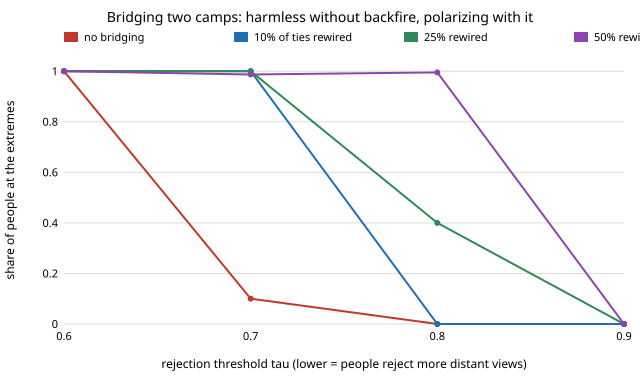

# civ-levers: which interventions bring a polarized society back together?

Can contact between two opposed camps depolarize a society, or does it make things worse?
Which interventions merge two camps in an opinion-dynamics simulation, and do they survive
a change in the assumption nobody has measured: whether people move *away* from views they
reject? **Rewiring ties across camps (bridging contact) never helps under bounded confidence
and is the only lever that backfires: with a rejection threshold of 0.7, rewiring 10% of
ties sends everyone to the extremes, from 10% with no intervention. Interventions that put a
voice *within reach* of both camps do far better: across 25 settings of tolerance and backfire,
a ladder of committed voices merges the camps in 24, a moderate broadcast or committed
moderates in 19, a one-off nudge in 14, raising everyone's tolerance in 8, and bridging in 2
(while driving more people to the extremes in 10).** The ladder only works if it is spaced for
the *least* tolerant people: built for a tolerance of 0.3 when the real one is 0.2, it merges
none of 10 societies. Produced with AI assistance (Claude). First project of research track 24
(`civ`, `PROJECTS.md`). Every result is about simulated people following a stated rule, not
about real societies.

**Live page:** https://duncan-haywood.github.io/oss-monorepo/research/civ-levers/

**Play with it:** the [depolarization simulator](app/index.html) runs the same model in the
browser (`app/model.js`, checked against the Python model by `app/tests/model.test.mjs`).

## Why this question

Polarization research proposes many fixes: contact between groups (Allport 1954; a
meta-analysis of 515 studies found contact reduces prejudice, Pettigrew and Tropp 2006),
exposure to the other side's views, moderate media, perspective-taking. The experimental
evidence on *exposure* disagrees: Bail et al. (2018) found that following a bot that retweeted
the other party made Republicans more conservative, while Guess and Coppock (2020), across
three large survey experiments, found little backlash to counter-attitudinal information.
Opinion-dynamics models encode exactly this disagreement as one parameter: whether, and how far
away, a view starts to push people back. So the useful question is not "what does the model say"
but "which recommendation holds whatever that parameter is".

## Model

1,000 people in two camps of 500. Camp A's opinions start uniform on 0.2 ± 0.15, camp B's on
0.8 ± 0.15 (opinions live on [0, 1]). Each person has about 10 ties, 95% of them inside their
own camp. Each round, everyone meets one random contact and compares opinions, with difference d:

| Rule | Condition | Move | Source |
|---|---|---|---|
| Assimilation | \|d\| < ε (latitude of acceptance) | 0.3 · d toward the contact | Deffuant et al. 2000 |
| Repulsion (backfire) | \|d\| > τ (latitude of rejection) | 0.3 · d away, clipped to [0, 1] | Jager and Amblard 2005, after Sherif and Hovland 1961 |
| Nothing | otherwise | none | |

τ = ∞ is plain bounded confidence. 400 rounds, 10 random societies per setting.

| Parameter | Values | Why |
|---|---|---|
| tolerance ε | 0.2, 0.25, 0.3, 0.35, 0.4 | not measured for real attitudes: swept |
| rejection τ | none, 0.9, 0.8, 0.7, 0.6 | the contested parameter: swept |
| step μ | 0.3 | inside the 0.1–0.5 range Deffuant et al. explore; not swept here |
| cross-camp ties | 5% | a stylised strong homophily; not calibrated to a real network |

**Levers**, each with one dose:

- **bridge**: rewire a share (10%, 25%, 50%) of within-camp ties to the other camp (contact).
- **broadcast**: each round, with probability 5%, 10% or 20%, a person hears a fixed source at
  0.5 instead of a contact (moderate media).
- **moderates**: 5%, 10% or 20% of people become committed moderates at 0.5 who never move.
- **ladder**: the same share of committed voices, spread evenly over positions at most 0.8 ε
  apart between the camp centres 0.2 and 0.8 (stepping stones).
- **nudge**: 10%, 20% or 40% of people are moved to 0.5 once and are free to drift back.
- **tolerance**: everyone's ε is raised by 0.05, 0.1 or 0.2 (perspective-taking training).

Outcomes: the **gap** between the camps' mean opinions (0.6 at the start; 0 = merged; 1 =
opposite extremes), the share of people at the **extremes** (within 0.05 of 0 or 1), and
"**merged**" = at least 9 of 10 societies end with a gap under 0.1.

## Checks against published and analytic results (`tests/test_model.py`)

- Deffuant et al. (2000): from uniform opinions, about floor(1/(2ε)) major clusters. The model
  gives 3 at ε = 0.15, 2 at 0.2 and 1 at 0.5.
- Hegselmann and Krause (2002): consensus from a uniform start once ε passes about 0.2–0.25
  (Lorenz 2007). On a 500-point grid: 2 clusters at ε = 0.2, consensus at 0.25.
- DeGroot limit (ε ≥ 1, no repulsion): a connected network reaches consensus; with one
  committed opinion, everyone ends at it.
- Jager and Amblard (2005): a narrow non-commitment zone (ε 0.2, τ 0.4) splits everyone to the poles.

## Results (`experiments/results.txt`, `python3 experiments/run.py`, about 70 s on 4 cores)

**1. Bridging is harmless without backfire and polarizing with it** (ε = 0.3, share at the extremes):

| τ | no bridging | 10% rewired | 25% | 50% |
|---|---|---|---|---|
| 0.9 | 0.00 | 0.00 | 0.00 | 0.00 |
| 0.8 | 0.00 | 0.00 | 0.40 | 0.99 |
| 0.7 | 0.10 | 1.00 | 1.00 | 0.99 |
| 0.6 | 1.00 | 1.00 | 1.00 | 1.00 |

Without repulsion, the other camp sits 0.6 away, outside anyone's ε, so cross-camp ties carry no
influence at all: no dose of bridging merges the camps unless ε is 0.4. With repulsion,
every cross-camp tie pushes both ends apart, and the more ties, the faster the split.



**2. Levers that sit within reach work across settings.** At each lever's largest dose, over
all 25 (ε, τ) settings:

| Lever (largest dose) | merged | more people at the extremes |
|---|---|---|
| ladder (20% of people) | 24 | 0 |
| broadcast (heard 20% of rounds) | 19 | 0 |
| moderates (20%) | 19 | 1 |
| nudge (40%) | 14 | 0 |
| tolerance (+0.2) | 8 | 0 |
| bridge (50% of ties) | 2 | 10 |

At τ = 0.6 the society splits to the extremes on its own, so no lever can make it worse.
The least dose that merges: a moderate broadcast or committed moderates need only 5% when
ε ≥ 0.3, and 20% at ε = 0.25; nothing tried at the centre works at ε = 0.2, because the
centre is 0.3 from each camp. Raising tolerance helps only once ε + Δ is at least 0.55,
because each camp contracts to its centre (0.2 and 0.8, 0.6 apart) faster than its edges reach the other camp.
A one-off nudge needs 40% of people, since the moderates it creates are pulled back.

**3. A ladder must be spaced for the least tolerant** (dose 10%, merged of 10, τ = none / 0.7):

| true ε | spaced for 0.2 | spaced for 0.3 | spaced for 0.4 |
|---|---|---|---|
| 0.2 | 10 / 10 | 0 / 0 | 0 / 0 |
| 0.25 | 10 / 10 | 10 / 10 | 4 / 3 |
| 0.3 and up | 10 / 10 | 10 / 10 | 10 / 10 |

Under-estimating tolerance costs nothing here; over-estimating it breaks the chain.

## Follow-up: contact that widens tolerance (`experiments/contact/`, `src/civ_levers/contact.py`)

Each agent gets its own tolerance that cross-camp contact edits (a stand-in for Pettigrew and
Tropp 2006; the gain and loss rates are not measured and are swept, 0.005 to 0.05 per meeting).
Plan and hypotheses were logged first (`LOG.md`); 10 societies per cell, full table in
`experiments/contact/results.txt`.

- **Widening only after an accepted meeting does nothing.** Camps start 0.6 apart, so no
  cross-camp meeting is ever within reach and tolerance never grows: 0 of 10 merged in all 135
  cells, mean tolerance unchanged. The rule is circular.
- **Widening on any meeting that is not repelled does merge the camps, with no backfire.** At
  gain 0.05 per meeting, bridging 25% of ties merges 10 of 10 societies at starting tolerance
  0.2, 0.25 and 0.3; at 10% of ties it merges 3, 5 and 7 of 10. At gain 0.01 only 50% bridging
  at tolerance 0.3 merges (10 of 10); at 0.2 and 0.25 it merges 3 and 7.
- **Backfire still wins.** With rejection threshold 0.7 and a loss of 0.02 per repelled
  meeting, no cell merges at any gain (0 of 36 exposure cells with tau 0.7); at tau 0.8 mostly gain 0.05
  merges, with a few cells at gain 0.02.
- **Identity.** 20% committed moderates dismissed with probability q (read as the other camp's):
  at tolerance 0.3, 10 of 10 merge at every q up to 0.75; at 0.2 the 0.5 voice is out of reach
  at any q (0 of 10). The identity filter matters less than reach.

So the bridging verdict flips only if contact itself widens tolerance fast (about 0.05 per
meeting here) and nobody rejects; with backfire at 0.7 it does not flip. The gain rates and the
mere-exposure rule are assumptions, not measured.

## Follow-up: where to seed a complex contagion (`experiments/cascades/`, `src/civ_levers/cascades.py`)

Question: when a behaviour needs reinforcement (adopt after at least T neighbours have; Centola
and Macy 2007), which seeds start a cascade on a clustered, a rewired and a random network?
Watts–Strogatz graphs (n 1000, k 8, rewiring p from 0 to 1), 20 graphs per cell, four rules
(random people, highest-degree people, a clustered patch, spread-out seeds). Hypotheses were
logged before the run (`LOG.md`); `python3 experiments/cascades/run.py` reproduces
`results.txt`.

- A simple contagion (T = 1) from one seed reaches everyone at every p; rewiring changes speed only.
- At T = 2 a clustered patch of 5 reaches everyone for p <= 0.1 and 0.85 (+-0.16) at p = 0.3;
  at p = 1 no 5-seed rule passes 1%. The smallest budget reaching 90% is 2 to 3 for a patch at
  p <= 0.1, 8 at p = 0.3, 40 at p = 1; random seeds need 12 to 20, hubs 8 to 20.
- Spread-out seeds never start a T = 2 cascade: each seed alone has no one to reinforce it.
- T = 3 is harder: a patch needs 3 to 5 seeds at p <= 0.03 and nothing up to 40 once p >= 0.1.
- Against our own guess, hubs beat random seeds at T = 2 once rewiring makes degrees uneven.

This agrees in direction with Centola and Macy (2007); it is not a reproduction of their
figures, and Centola et al. (2018)'s 25% tipping point (a naming game) is not checked.
T, k and the graph family are chosen, not measured; the finding is about simulated people.

## Follow-up: Axelrod's culture model with a broadcast (`experiments/culture/`, `src/civ_levers/culture.py`)

Question: does one voice that everyone hears (a common broadcast) homogenise a society of
interacting cultures, or fragment it? Axelrod (1997) on a lattice (F features, q traits), plus a
global media culture met with probability B per step (Shibanai, Yasuno and Ishiguro 2001).
20 runs per cell; hypotheses were logged before the run (`LOG.md`);
`python3 experiments/culture/run.py` reproduces `results.txt` (about 6 minutes on 4 cores).

- A broadcast **fragments** rather than homogenises. F = 5, q = 10, 20 x 20: the largest culture
  covers 99% of the lattice without media and 26% at B = 0.3 (2 regions against 76). At q = 5 it
  stays one culture until B = 0.03 and splits into 29 regions at B = 0.3. At q = 40 (already
  fragmented, S = 0.03) it changes nothing.
- Why: a site sharing no feature with the media never interacts with it, so such sites freeze.
  Only 50% hold the media culture at q = 10, B = 0.3, and 27% at q = 20.
- The order–disorder transition shows up (largest region falls with q; gradual for F = 2, sharp for
  F >= 3), but the F = 10 drop is at q of about 30 to 50 on 12 and 24 sized lattices, not
  Castellano, Marsili and Vespignani's (2000) q_c of about 300, which used lattices to L = 150. I
  did not run those sizes, so this is **not a reproduction** of their number.
- Axelrod's base case (F 5, q 10, 10 x 10): 4.55 +- 0.36 regions (300 runs) against his 3.2.
  Higher; his sample and counting rule may differ. Not matched.

F, q, B and the single global media culture are chosen, not measured; the finding is about
simulated agents. Next: noise, and the L = 50 to 150 runs (a compiled core would be needed).

## What this does and does not say

- It is a model of opinion *positions*, not of prejudice or affect. Contact in Pettigrew and
  Tropp's meta-analysis reduces prejudice; the model's "bridge" only exposes people to the
  other side's opinion. Contact that also widens tolerance would be a combined lever (tested
  separately here as `tolerance`), and is the obvious next experiment.
- ε, τ and the network are not calibrated to any real population; they are swept. The
  conclusions that survive the sweep are the ones stated in bold above.
- Committed voices and broadcasts here have no cost, no credibility and no camp identity. A
  "moderate" that each camp sees as the other side's would behave like bridging.
- Opinions are one-dimensional; real polarization bundles issues and identity.

## Run it

```
python3 -m pytest -q tests                  # 12 model checks
python3 experiments/run.py                  # the sweep -> experiments/results.txt
python3 experiments/figure.py               # experiments/bridging_backfire.svg
node --test app/tests/model.test.mjs        # browser port against the Python model
```

Needs Python 3.9+ with numpy (and pytest); the app has no dependencies.

## References

- Allport, G. W. (1954). *The Nature of Prejudice*. Addison-Wesley.
- Axelrod, R. (1997). The dissemination of culture: a model with local convergence and global polarization. *Journal of Conflict Resolution* 41(2):203–226.
- Castellano, C., Marsili, M. and Vespignani, A. (2000). Nonequilibrium phase transition in a model for social influence. *Physical Review Letters* 85(16):3536–3539.
- Shibanai, Y., Yasuno, S. and Ishiguro, I. (2001). Effects of global information feedback on diversity: extensions to Axelrod's adaptive culture model. *Journal of Conflict Resolution* 45(1):80–96.
- Bail, C. A. et al. (2018). Exposure to opposing views on social media can increase political
  polarization. *PNAS* 115(37):9216–9221.
- Centola, D. and Macy, M. (2007). Complex contagions and the weakness of long ties.
  *American Journal of Sociology* 113(3):702–734.
- Deffuant, G., Neau, D., Amblard, F. and Weisbuch, G. (2000). Mixing beliefs among interacting
  agents. *Advances in Complex Systems* 3:87–98.
- Granovetter, M. (1978). Threshold models of collective behavior. *American Journal of
  Sociology* 83(6):1420–1443.
- Guess, A. and Coppock, A. (2020). Does counter-attitudinal information cause backlash? Results
  from three large survey experiments. *British Journal of Political Science* 50(4):1497–1515.
- Hegselmann, R. and Krause, U. (2002). Opinion dynamics and bounded confidence: models,
  analysis and simulation. *JASSS* 5(3).
- Jager, W. and Amblard, F. (2005). Uniformity, bipolarization and pluriformity captured as
  generic stylized behavior with an agent-based simulation model of attitude change.
  *Computational and Mathematical Organization Theory* 10(4):295–303.
- Lorenz, J. (2007). Continuous opinion dynamics under bounded confidence: a survey.
  *International Journal of Modern Physics C* 18(12):1819–1838.
- Pettigrew, T. F. and Tropp, L. R. (2006). A meta-analytic test of intergroup contact theory.
  *Journal of Personality and Social Psychology* 90(5):751–783.
- Watts, D. J. and Strogatz, S. H. (1998). Collective dynamics of 'small-world' networks.
  *Nature* 393:440–442.
- Sherif, M. and Hovland, C. I. (1961). *Social Judgment*. Yale University Press.
