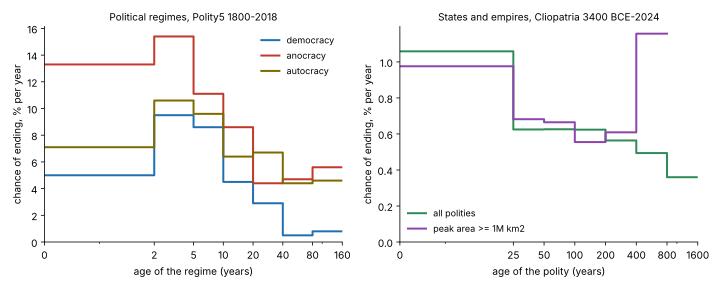

# civ-patterns: how long do regimes, states and empires last, and what does history predict for today's?

Does a state's risk of collapse grow with age, as the "rise and fall" story says, or shrink, or
stay constant? Two open datasets answer this: 1,387 political regimes since 1800 (Polity5) and
1,543 named states and empires from 3400 BCE to 2024 (Seshat's Cliopatria). The duration models
are backtested out of sample and then applied to the regimes and states of today.

**Headline results.**

- **Regimes do not age into collapse. They age out of it, and democracies most of all.** The
  yearly chance that a Polity regime spell ends peaks at 12% in years 2 to 5 and falls to 2% after
  age 80. For democracies it falls to 0.5% a year after age 40. Anocracies (Polity -5 to 5) and
  autocracies level off near 4.5 to 5.5% a year whatever their age. Anocracies end 1.9 times as
  fast as democracies (95% CI 1.6 to 2.2), as Gates et al. (2006) found, with a median life of
  4.8 years against 8.9 for democracies and 7.3 for autocracies.
- **A duration model forecasts regime change better than chance, but it runs low.** Fitted only
  on data before each cutoff (1966 to 2006), a piecewise hazard by regime type and age reaches an
  AUC of 0.69 on "will this regime end within 10 years" (696 forecasts). It beats a
  constant-hazard baseline on Brier score by 0.030 (0.222 against 0.252), and fitted on the last 40 years only it
  improves on a Weibull model by 0.015 (95% CI 0.005 to 0.026). Every model forecast fewer
  endings than happened after 1960. The recent-window fit is the best calibrated.
- **Empires: Arbesman's constant hazard holds for big empires, not for states in general.** For
  the 224 polities that ever held a million km², the Weibull shape is 0.91 (95% CI 0.82 to 1.02),
  consistent with a memoryless (exponential) lifetime (Arbesman 2011). Across all 1,543 polities,
  the hazard is 1.1% a year in the first 25 years. It then sits near 0.6% a year (46% a century)
  until age 400 and falls to 0.36% a year after age 800 (k = 0.83, CI 0.80 to 0.87). Starting
  bigger does not help: the hazard ratio per tenfold initial area is 1.06 (1.00 to 1.13).
- **For states over a century, age tells you almost nothing; the era tells you a lot.** Of the
  polities on the map in 1600, 35% were gone by 1700; of those in 1800 and 1900, 78% and 79% were
  gone a century later. Duration models trained on earlier centuries scored an AUC of only 0.46
  to 0.61 within each cutoff. A model of age alone cannot see turnover waves such as
  colonisation, decolonisation and the 20th-century wars.

**Applied to today.** From the end of 2018 the regime model expects 67 of the 162 regimes in
place (41%) to have ended by 2028. That is 32% of democracies, 60% of anocracies and 46% of
autocracies ([`forecast_2018.csv`](experiments/regimes/forecast_2018.csv)). The highest
probabilities go to young anocracies (Fiji, Comoros, Cuba, Ethiopia, Cambodia, Venezuela:
70 to 72%). The lowest go to democracies at Polity 10 for 40 or more years (Japan, Ireland,
Costa Rica, the Nordic countries: 5 to 7%). The model gave the United States' young spell
(Polity 8 since November 2016) a 55% chance of ending by 2028. Polity5 itself, the one country it
updates past 2018, records it ending in March 2019 and the score falling to 5 by November 2020.
That is one case, not a validation. For states on the 2024 map, the age-only model expects about
half (0.53) to still exist under the same name and borders' continuity in 2124
([`current_polities.csv`](experiments/empires/current_polities.csv)). The backtest says the real
range runs from 0.2 (a century like the 19th or 20th) to 0.65 (like the 17th).

**What these numbers are not.** A "regime spell" ends with any change of 3 or more Polity points
(Polity's own definition), so most endings are reforms or backslides, not collapses. A
Cliopatria polity ends when its mapped name changes. The probabilities are what a duration model
fitted to the past says for a regime or state of that type and age. They are not judgements about
any country's politics, and they include none of the things a country analyst would use
(economy, elites, conflict, neighbours). Produced with AI assistance (Claude).

**Live page:** https://duncan-haywood.github.io/oss-monorepo/research/civ-patterns/



## Data

| Source | What | Licence and handling |
|---|---|---|
| Polity5 regime spells, `p5v2018d.xls` (Marshall and Gurr 2020, Center for Systemic Peace) | 1,692 spells for 167 countries, 1800 to 2018 | Redistribution not permitted: `regimes.fetch()` downloads it to `~/.cache/civ-patterns`; only derived figures are committed |
| Cliopatria v0.2.1 (Chalstrey et al. 2025, *Scientific Data*, doi:10.1038/s41597-025-04516-9; Zenodo doi:10.5281/zenodo.23128623) | 13,412 polity rows (1,587 named polities), 3400 BCE to 2024 | CC BY 4.0. `data/cliopatria_v021_rows.csv` is the attribute table with the polygons removed (the only change) |

Choices that shape the numbers:

- Polity spells coded -66, -77 and -88 (foreign interruption, interregnum, transition) are gaps,
  not regimes.
- Spells or polities already running when a dataset starts (23 Polity spells in 1800, one polity
  in 3400 BCE) are dropped because their age is unknown.
- Polity5 extends a few countries (the US, Armenia, Bangladesh, Sri Lanka and others) into 2019
  and 2020. Everything is censored at 31 Dec 2018 so every country is observed equally.
- Cliopatria's 43 parenthesised umbrella names (such as "(Holy Roman Empire)", which often
  duplicate a member polity) are set aside.
- A polity's life is its first continuous run under one name. 278 polities return after a gap;
  counting the whole named span instead changes the median from 95 to 117 years and k from 0.83
  to 0.84.
- Cliopatria maps a snapshot every ~100 years before 1000 BCE and every 2 to 7 years after.
  Bronze Age lifespans (26 polities) are only as precise as that spacing.

## Methods

`src/civ_patterns/survival.py` contains the following. Each piece is checked in
`tests/test_survival.py` against hand-worked or simulated cases:

- Kaplan-Meier with delayed entry.
- A Weibull proportional-hazards fit with right censoring, left truncation, covariates and Wald
  intervals.
- A piecewise-constant hazard by age band (stratified, no proportional-hazards assumption).
- Brier score, log loss and AUC.
- Unit-resampling bootstrap intervals for score differences.

The backtests fit only on what was known at each cutoff: spells begun before it, censored at it.
They then forecast the regimes or polities in place.

```
python3 experiments/regimes/run.py   # downloads Polity5 once; writes results.txt, forecast_2018.csv
python3 experiments/empires/run.py   # results.txt, current_polities.csv
python3 experiments/figure.py        # hazard_by_age.svg from both results.txt
python3 -m pytest tests              # 11 tests
```

Needs numpy, scipy, pandas, xlrd (Polity's .xls) and matplotlib (figure).

## Prior work

- Arbesman (2011), "The life-spans of empires", *Historical Methods* 44(3): 127-129: Taagepera's
  41 empires fit an exponential with mean about 220 years.
- Ciliberti (2025), *Cliodynamics*: a larger empire sample, again exponential, time-scale about
  300 years.
- Gates, Hegre, Jones and Strand (2006), "Institutional inconsistency and political instability:
  polity duration, 1800-2000", *AJPS* 50(4): 893-908: consistent regimes outlast inconsistent ones.
- Taagepera (1978, 1979), empire sizes. Turchin (2003) and Turchin and Nefedov (2009), secular
  cycles: the structural-demographic model is in [`civ-levers`](../civ-levers) (`history.py`),
  which so far has not produced cycles.
- Goldstone et al. (2010), "A global model for forecasting political instability", *AJPS*: the
  regime-type-plus-covariates forecasting this project's model is a duration-only baseline for.

## Next

- Add covariates a forecaster would use (infant mortality, neighbourhood conflict, factionalism,
  as in Goldstone et al. 2010) and test whether the age effect survives them.
- Score the 2018 forecasts against V-Dem's Episodes of Regime Transformation (2019 to 2024).
- Give Cliopatria polities a calendar-time hazard (turnover waves) and test it as a forecast.
- Join Seshat's Equinox variables (scale, government, military technology) to the lifespans.
