# civ-seeding: does technology adoption spread through village networks as a simple or a complex contagion, and which households should a rollout seed?

Does a new product spread through a village like news (one informed contact is enough) or like
a behaviour that needs reinforcement from several adopters? And if the data cannot tell, whom
should a rollout seed first? This programme asks that on the 43 Karnataka village networks of
Banerjee, Chandrasekhar, Duflo and Jackson (2013), where a lender introduced microfinance
through village leaders. **Latest step (milestone 24): an end-line awareness question ("have you heard of the product?") is the cheap survey addition that tells a simple contagion from reinforcement, but nothing tested tells a threshold from reinforcement, and fewer than about 20 villages identify nothing.** Reusing milestone 3's identification harness unchanged (it reproduces milestone 3's 58.5 / 82.0 / 55.5% recovery exactly), adding awareness lifts leave-one-village-out recovery of the information and reinforcement models to 91% and 91.5%, robust to 15% misreporting, and removes the in-sample criterion's bias towards the bigger model (98.5 / 95.5 / 100% in sample), while the threshold model drops to 73.5%; trimester adoption timing adds about 1.5 points, and with 20 villages the best design recovers every model in only 64% of datasets. The largest effect was not a measurement: scaling each moment by its spread lifts the plain cross-section to 83.5% or more for every model, so milestone 3's weak identification was partly its identity weighting ([`experiments/m24_measure/results.txt`](experiments/m24_measure/results.txt), figure [`recovery.svg`](experiments/m24_measure/recovery.svg)).

**Milestone 23:** the cost of echoed false ties is a slope, not a step, under the fitted contagion models, and the seed swaps cost by crowding seeds together, not by picking weaker ones. Scoring milestone 22's seed draws (43 villages &times; 100) under the three point fits with common random numbers, census degree discount with one-sided ties at half weight loses 0.80 adopters (z 5.5) from no echoed false ties to a tenth echoed and 1.65 more (z 10.4) by a quarter: 8 then 11 adopters per unit share, a mild steepening, so milestone 22's step lives in the refitted processes that set the worst case. From a tenth to a quarter the seeds gain 26 true ties among themselves (se 2.6) and reach 0.21 point fewer households (se 0.02), while the swapped-in seeds' true degree is only 0.33 below the ones they replace; 42 of 43 villages lose. The advice is unchanged: with the echo share unknown, keep every report ([`experiments/m23_swaps/results.txt`](experiments/m23_swaps/results.txt), [`LOG.md`](LOG.md), 2026-11-21).

**Earlier steps.** Milestone 22: the half weight's step in worst-case regret sits between a tenth and a quarter of false ties mutual (+0.47 point, z 4.1), and an oracle that halves only one-sided false ties only ties keeping every report ([`experiments/m22_step/verdicts.txt`](experiments/m22_step/verdicts.txt)). Milestone 21: with ten copies, milestone 20's dip is noise (&minus;0.06 point, se 0.16) and the half weight's cost against keeping every report is a step (+0.30 to +0.42 point from a quarter of false ties mutual upward) ([`experiments/m21_kappa_dip/verdicts.txt`](experiments/m21_kappa_dip/verdicts.txt)). Milestone 20: taken unchanged to three more cells, the half weight beats the hard filter's worst case in both false-tie cells but is worse than keeping every report by 0.50 point at one false tie per four with half of them mutual (z 4.3) ([`experiments/m20_soft_cells/verdicts.txt`](experiments/m20_soft_cells/verdicts.txt)). Milestone 19: at one triangle-closing false tie per two true ones, keeping one-sided ties at half weight saves census degree discount 0.73 point when false ties are one-sided (z 4.4) and costs nothing measurable when all are mutual (+0.05, se 0.27) ([`experiments/m19_soft/verdicts.txt`](experiments/m19_soft/verdicts.txt)). Milestone 18: the hard reciprocity filter stops paying once about half of false ties are named by both ends; at &kappa; = 1 it costs census degree discount +0.63 point (z 3.0) ([`experiments/m18_joint/verdicts.txt`](experiments/m18_joint/verdicts.txt)). Milestone 17: keeping only the ties both ends name fixes a census's false-tie problem, but not a partial survey's. With triangle-closing false ties at one per two true ones, the reciprocity filter brings census degree discount from 2.8% back to 2.2% of adopters lost (z 2.6) and census top degree from 5.1% to 4.6% (z 2.4), and leaves both flat in the false-tie rate; with no false ties it costs top degree 0.2 point of lost recall. On the half survey, where only ties between two surveyed households can be checked, it saves nothing (&minus;0.01 point) and costs 0.2&ndash;0.5 point under random false ties (z 3.7&ndash;3.9). So filter a census, not a partial survey; and the half-point the filter saves is small next to the 2-point gap between degree discount and top degree ([`experiments/m17_reciprocity/verdicts.txt`](experiments/m17_reciprocity/verdicts.txt), figure [`reciprocity.svg`](experiments/m17_reciprocity/reciprocity.svg), [`LOG.md`](LOG.md), 2026-11-19).

**Before that.** Milestone 16: survey respondents who name ties that do not exist do not change the seeding advice, but the kind of false tie matters more than how many. At the measured 85% recall plus up to one false tie per four true ones, census degree discount still loses 1.6&ndash;1.9% of adopters and the half survey 2.2&ndash;2.7%, both beating a perfect census ranked by top degree in 95&ndash;99% of draws. False ties placed at random cost no rule anything measurable; false ties that close triangles (naming a friend's friend) cost every rule more, top degree 0.8 point at one per four (z 3.5 against random placement), and at one per two they push census degree discount to 2.8% and the half survey to 2.9% ([`experiments/m16_false_ties/verdicts.txt`](experiments/m16_false_ties/verdicts.txt), figure [`false_ties.svg`](experiments/m16_false_ties/false_ties.svg), [`LOG.md`](LOG.md), 2026-11-18). Before that, milestone 15: between 70% and 90% tie recall, the range a field survey reaches, more recall never makes the seeding advice worse, and it barely matters for census-based rules. Ten pooled Monte Carlo copies per rule (se 0.10&ndash;0.16 point) put census top degree at 4.2&ndash;4.3% and census degree discount at 1.4&ndash;1.6% of adopters lost across the whole range, while the half survey improves from 2.4% at 70% recall to 1.8% at 90% (0.21 point per tenth of recall, se 0.07) and beats census top degree in at least 97% of draws at every level. Milestone 14's apparent dip for census degree discount at 85% recall was noise (+0.12 point, se 0.15) ([`experiments/m15_grid/verdicts.txt`](experiments/m15_grid/verdicts.txt), figure [`grid.svg`](experiments/m15_grid/grid.svg), [`LOG.md`](LOG.md), 2026-11-18). Before that, milestone 14: pooling five Monte Carlo copies of 16 randomised rules settles which of the survey findings are real. Forgetting half the ties now costs more than forgetting a quarter (+0.5 point for census degree discount and +1.1 for the survey, each over 2 Monte Carlo standard errors; +0.4, 1.3 se, for census top degree), so milestone 11's non-monotone recall was noise. Milestone 10's preferred split (three quarters of the survey at random) is not distinguishable from a one-quarter split (1.79% against 1.81%); both edge the half split (2.17%) by under 2 standard errors. The headline holds on pooled scores: the half survey at the measured recall loses a median 2.2% of adopters and beats census top degree (4.0%) in 97% of draws. Pooling also shows that a single Monte Carlo copy biases every worst-case regret up by about 0.15 point ([`experiments/m14_pooled/verdicts.txt`](experiments/m14_pooled/verdicts.txt), figure [`copies.svg`](experiments/m14_pooled/copies.svg), [`LOG.md`](LOG.md), 2026-11-18). Before that, milestone 13 found milestone 12's surprise, that uneven forgetting helps degree discount on a census, was Monte Carlo noise. With every randomised rule scored on its own random stream and four rules re-drawn five times, census degree discount scores a mean 1.51% under the measured, uneven recall and 1.58% under a uniform recall at the same level (gap &minus;0.07 point; milestone 12 had 0.9% against 1.8%). The re-draws show that one randomised rule's joint median moves by up to 0.47 point (sd) from one Monte Carlo copy to the next, which the bootstrap intervals do not include, so sub-point differences between randomised rules in milestones 10 to 12 are within noise; the advice itself (half survey about 2%, census degree discount about 1.5%, census top degree about 4%) is unchanged ([`experiments/m13_streams/verdicts.txt`](experiments/m13_streams/verdicts.txt), figure [`copies.svg`](experiments/m13_streams/copies.svg), [`LOG.md`](LOG.md), 2026-11-17). Before that, milestone 12 found survey respondents forget weak ties far more than strong ones (61% against 94% recall) without hurting the seeding advice.

**Milestone 11: the survey advice survives respondents who forget ties, at the recall measured in the same villages.** Capture&ndash;recapture on the survey's converse questions (borrow from / lend to, visit / invite) shows a BCDJ respondent names about 84% of a household's ties (one question alone: 68&ndash;83%). With that much forgetting, the half-village survey (three quarters at random, then the most-named, ranked by degree discount) loses a median 1.8% of adopters under its worst refitted model, against 1.4% for a census with the same forgetting and 4.1% for top degree. Even with half of all ties forgotten, degree discount on the census still beats top degree on a perfect census in 99% of draws.

**Milestone 10: the half-village survey still seeds almost as well as a census when the fitted models are uncertain, and it does best spending most of the survey at random.** Rescored over 500 village bootstrap draws that refit every model, two-stage survey of half the households plus degree discount loses a median 1.9% of adopters under its worst model (5&ndash;95%: 1.0&ndash;3.3%), against 1.1% for degree discount on a full census and 3.9% for top degree on a census, which it beats in 97% of draws. Splitting that survey three quarters at random and one quarter by most-named lowers it to 1.5% (0.5&ndash;2.9%); at a quarter-village survey the half split is best (4.2%), and the adaptive stage beats a plain random sample in 89&ndash;93% of draws. **Milestone 9: a rollout that surveys half the households can seed almost as well as one with a full census of ties, if it surveys adaptively and ranks by degree discount.** Survey half the households at random, then the households they named most, and rank by degree discount on the ties seen: that loses 1.6% of adopters under the worst fitted model, against 1.4% for degree discount on a full census and 3.3% for the same ranking on a plain random half. The second, adaptive stage pays only together with degree discount: ranking by estimated degree it does not help (5.9% against 5.2% for a random quarter), and surveying a quarter of households still loses more (4.5% at best) than top degree on a full census (4.1%). **Milestone 8: complex centrality keeps its place when the fitted models are uncertain.** Rescored over 500 village bootstrap draws that refit every model, degree discount beats every complex-centrality rule in every draw; the best one (absolute threshold 2) loses a median 3.3% of adopters under its worst model (5&ndash;95%: 2.4&ndash;5.3%) and beats top degree in 74% of draws. Under the threshold model it helps more the higher the fitted adoption threshold (it loses 4.9% at a threshold of 0.4, 2.7% at 0.6), as its theory says, but never gets down to degree discount's 1%.

**Milestone 7: complex centrality, the seeding measure built for complex contagions, does not beat degree discount here.** Its best version (absolute threshold 2) loses up to 3.7% of adopters against the best rule (degree discount 1.4%, top degree 4.1%), and seeding whole neighbourhoods, as the measure presumes, loses 10 to 13%, about as much as random seeds. **Milestone 6: the cheap rule stays robust when the fitted models themselves are uncertain.** Refitting all three contagion models in each of 500 village bootstrap draws (the fits move a lot: 205 distinct fitted processes), degree discount loses a median 1.0% of adopters against the best rule under its worst model (5&ndash;95%: 0.3&ndash;1.6%), beats top degree in every draw, and its one rate parameter hardly matters (0.9&ndash;1.2% for any p from 0.01 to 0.15). The model-specific greedy rules get longer tails (greedy under the threshold model up to 2.4%, under the information model up to 7.3%); degree discount does not. **Milestone 5: a seeding rule that needs a list of who knows whom but no fitted model comes within 1.4% of the best rule under every model, and surveying a quarter of households costs about one more point.** Degree discount (Chen, Wang and Yang 2009), which picks well-connected households while discounting ties to households already seeded, loses at most 1.4% of adopters under the three fitted models (top degree: 4.1%; greedy under the threshold model, which also needs a fitted model: 0.5%). Simply forbidding adjacent seeds does worse (3.4%): it pushes seeds down to 13 ties each. If a rollout surveys only 25% of households, top degree on the estimated degrees loses up to 4.5%; asking random households to name a contact and seeding the named (friend nomination, no network data) loses up to 6.2%, against 12.1% for random seeds.

**Milestone 4: whom to seed barely depends on which contagion model is right, and the best seeds are spread out, not clustered.** Scoring ten seeding rules under all three fitted models on the 43 real networks, one rule, greedy seeding under the threshold model, loses at most 0.5% of adopters against the best rule under every model; the structural rules rank almost the same under all three (Kendall &tau; 0.81 to 1.0). Seeding the highest-degree households loses 1.7 to 4.1%; the lender's actual leaders lose 6 to 10%; one clustered patch of neighbours loses 6 to 10.5%, even under the threshold model, where clustering was supposed to help. The greedy seeds have moderate degree (12 to 15 ties against 23 for the top-degree rule) and are rarely neighbours of each other. **Milestone 3b: the real villages cluster their adopters far more than the simple model allows, and a village random effect does not fix it; a threshold cascade model does.** Letting each village's base adoption rate vary (a random effect fitted to how much take-up varies between villages) adds nothing: the fitted spread is zero for all three models, because word of mouth alone already makes take-up vary as much between simulated villages as between real ones. The real held-out error (0.181) stays far above every synthetic dataset from the simple model (5&ndash;95%: 0.044&ndash;0.068), and 57% of it is one moment that measures adopters next to adopters' neighbours. A threshold model, where a household adopts once half its neighbours have, produces that clustering: 19% of its synthetic datasets reach the real error, and it now predicts held-out villages best (0.169 against 0.181 for the simple model and 0.210 for reinforcement). **Third step (milestone 3): the estimation cannot reliably tell the
models apart, and the real villages fit none of them.** On 200 synthetic datasets per model,
simulated on the real networks, the in-sample criterion picks the reinforcement model for 85%
of datasets made by the simple model; leaving one village out recovers the true model 58.5%
(simple), 82% (threshold) and 55.5% (reinforcement) of the time. The real villages' held-out
prediction errors are two to four times larger than any fitted model produces in its own
synthetic data. **Second step (milestone 2): reinforcement and threshold models fit the villages better in
sample (reinforcement &gamma; = 0.10, positive in 99.5% of bootstrap draws; criterion 41% lower)
but predict held-out villages worse than the simple information model (better in 13 and 19 of
43 villages), while take-up by number of adopting neighbours (8% with none, 35% with four or
more) is more convex than the simple model's.** First step (milestone 1): a Python port of the authors' own
estimation code reproduces their data (non-leader take-up 18.7% against the published 18.5%,
leaders 24.7% against 24.8%), their finding that adopters pass the news on more than
non-adopters (q<sub>P</sub> &gt; q<sub>N</sub> in 98.4% of 1,000 bootstrap draws) and the published
effect of switching off non-adopters' word of mouth (take-up falls by a third: 0.337 against
the paper's 0.32). It does not land on the published point estimate: the criterion minimum is
at q<sub>N</sub> = 0.05, q<sub>P</sub> = 0.30 for three simulation seeds, against the published
0.10 and 0.50, and the published point scores 11 times our minimum. q<sub>P</sub> is weakly
identified (bootstrap 95% interval 0.15 to 1.0)**, a first hint for the programme's question
of what these data can and cannot identify. Produced with AI assistance (Claude Code); no
affiliation with the data's authors is implied. Results are about a fitted model of past
adoption, not advice about any real village or household.

**Live page:** https://marisstella.app/research/civ-seeding/

Programme: [`PROPOSAL.md`](PROPOSAL.md) (question, 15 checked references, hypotheses, plan,
target venue). Research log, written before each run: [`LOG.md`](LOG.md). Track 24 (`civ`,
`research/PROJECTS.md`); earlier synthetic-graph seeding results in
[`research/civ-levers`](../civ-levers).

## Why this question

Two literatures give opposite seeding advice. Fitting a simple information model to these
villages, Banerjee et al. (2013) rank households by diffusion centrality; experiments and
models of *complex* contagion find clustered seeds beat central ones (Centola and Macy 2007;
Centola 2010), and a Malawi field trial found seeds chosen for a complex contagion raised
adoption of a farming technology (Beaman et al. 2021). Which one a rollout of solar home
systems, cookstoves or farm kits should follow depends on which contagion is at work, and
on whether adoption data of this kind can tell. The plan is in `PROPOSAL.md`.

## Data

`data/bcdj_villages.json.gz` (146 kB): the 43 villages the authors' estimation code uses, each
household network restricted to its giant component (9,126 households, 44,367 ties of any
kind), with microfinance take-up, leader status, six household covariates and months of
exposure. Built by `data/build_dataset.py` from the replication archive (Harvard Dataverse,
doi:10.7910/DVN/U3BIHX, CC0 1.0). The Dataverse file sits behind a guestbook form, so this
session read the same `datav4.0` archive from a public GitHub mirror
(`ftschofenig/EmergentDirectedness`); the builder checks sizes and symmetry, and the test suite
checks the take-up figures against the paper.

## Milestone 1: reproduce the information model (`experiments/m1_reproduce/`)

Model (`src/civ_seeding/bcdj.py`, a port of `diffusion_model.m`, `moments.m`,
`divergence_model.m` and `Main_models_1_3.m`): leaders are told first; a household decides
once, when first told, with a logit probability in its covariates fitted on leaders; every
informed household tells each neighbour each four-month period with probability q<sub>P</sub>
if it adopted, q<sub>N</sub> if not. Five moments (take-up among households with no adopting
neighbour, next to adopting and non-adopting leaders, and covariances with neighbours' and
second neighbours' take-up), identity weights, the authors' grid (31 &times; 39 points), 75
simulations per village, common random numbers, and the authors' Bayesian bootstrap over
villages (1,000 draws). Hypotheses were logged before the run.

| check | ours | published (NBER w17743) | verdict |
|---|---|---|---|
| non-leader take-up, mean (SD) | 0.187 (0.082) | 0.185 (0.084) | H1 held |
| leader take-up, mean (SD) | 0.247 (0.126) | 0.248 (0.125) | H1 held |
| q<sub>N</sub>, q<sub>P</sub> (grid minimum) | 0.05, 0.30 (seeds 0, 1, 2) | 0.10, 0.50 | H2 refuted for q<sub>P</sub> |
| bootstrap 95% interval q<sub>N</sub> / q<sub>P</sub> | [0.05, 0.10] / [0.15, 1.00] | both &gt; 0 | covers the published point |
| share of draws with q<sub>P</sub> &gt; q<sub>N</sub> | 0.984 | significant | H3 held |
| take-up with q<sub>N</sub> = 0, relative drop | 0.194 &rarr; 0.129 (0.337) | 0.202 &rarr; 0.137 (0.32) | H4 held |
| informed share, q<sub>N</sub> = 0 | 0.78 &rarr; 0.55 | 0.81 &rarr; 0.57 | close |

At our estimate the simulated take-up (19.4%) and informed share (78%) sit closer to the
published 20.2% and 81% than the same simulation at the published (0.10, 0.50) does (22.8%,
89%). Restricting q<sub>N</sub> = q<sub>P</sub> doubles the criterion (q = 0.10), the
paper's case for a difference.

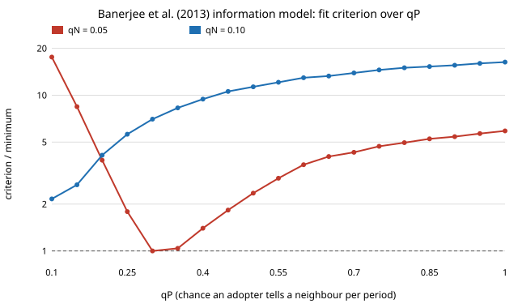

Not pre-registered, run after seeing the gap (`twostep.py`, `periods.py`): two-step optimal
weights move q<sub>P</sub> lower (0.20 to 0.25), not toward 0.50; q<sub>N</sub> stays at 0.05.
Shorter periods mean more rounds of telling, so the fitted probabilities fall: quarters give
(0.05, 0.15) and months (0.01, 0.10), with the published point at 17 and 38 times the minimum.
No setting we tried moves toward (0.10, 0.50).

What we can say: the port reproduces the data, the sign and significance of
q<sub>P</sub> &gt; q<sub>N</sub>, and the counterfactual, but not the published point. Possible
reasons we have not ruled out: the published table may use other moments, weights or a
finer grid than the archived script's defaults; the Science version (not opened) may differ
from the 2012 working paper; or our port differs in a way the tests do not catch. The criterion
is flat in q<sub>P</sub> (within a factor of 2 of the minimum from 0.25 to 0.50 at
q<sub>N</sub> = 0.05), so the published q<sub>P</sub> is not far out in fit; q<sub>N</sub> = 0.10
is (2 to 16 times the minimum at every q<sub>P</sub>).

## Milestone 2: simple or complex contagion? (`experiments/m2_complex/`)

Two complex-contagion families next to the information model (I), on the same information
spread (`src/civ_seeding/complex.py`): **reinforcement** (R), where an informed household's
logit gains &gamma; per adopting neighbour and it can adopt in any later period as that count
grows (&gamma; = 0 is I exactly), and a **fractional threshold** (T, after Granovetter 1978), where an informed household
also adopts once a share &theta; of its neighbours has. Fitted by the same simulated method of
moments, on the BCDJ five moments and an extended set of eight that adds take-up among
households with 1, 2 and 3+ adopting neighbours. Compared out of sample by leaving each
village out in turn: fit on 42 villages with one simulation seed, score the held-out village
with another, paired Bayesian bootstrap over villages. Plan logged before the run.

| comparison (extended moments) | in-sample criterion | held-out loss (mean, 43 villages) | complex model better in | verdict |
|---|---|---|---|---|
| I: q<sub>N</sub> 0.05, q<sub>P</sub> 0.3 | 4.22e&minus;3 | 0.174 | | |
| T: &theta; 0.60, q<sub>N</sub> 0.075, q<sub>P</sub> 0.1 | 3.45e&minus;3 | 0.184 | 23.8% of paired draws, 19/43 villages | H3b held |
| R, pre-registered grid, beta fixed | = I (&gamma;-hat 0) | 0.174 | 0% | H3 held, uninformative |
| R&delta;, post-hoc fine grid, free intercept: &gamma; 0.10, &delta; &minus;0.25, q<sub>N</sub> 0.10, q<sub>P</sub> 0.1 | 2.47e&minus;3 | 0.191 | 12.2% of paired draws, 13/43 villages | prediction held |

**Reinforcement fits these villages better and predicts them worse.** With a fine grid and a
free intercept, &gamma;-hat is 0.10 and positive in 99.5% of 1,000 bootstrap draws, and the
in-sample criterion falls 41%; but a model fitted on 42 villages scores the 43rd worse than the
plain information model in 30 of 43 cases. The threshold model behaves the same way. So far the
data do not let either complex contagion beat the simple one where it counts, out of sample.
Freeing &gamma; also moves the fitted q<sub>P</sub> from 0.3 to 0.1: reinforcement and adopters'
word of mouth stand in for each other, which is the identification question of milestone 3.

The pre-registered reinforcement grid (&gamma; in steps of 0.25, beta fixed by the leader logit)
could not see a small &gamma;: with the level already matched, any &gamma; &ge; 0.25 adds adoption
that nothing absorbs, and the criterion rises 13-fold. That is a design fault the run found;
the free-intercept, fine-grid re-run (`refine.py`) is labelled post hoc in the log.

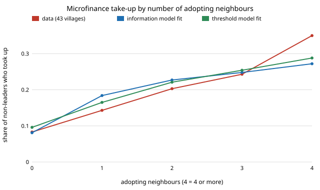

The descriptive that does stand out: take-up among non-leaders rises from 8.3% with no
adopting neighbour to 35.0% with four or more, a steeper, more convex curve than the fitted
information model's (8.1% to 27.2%). The model puts too many adopters next to exactly one
adopter (0.184 against 0.143, gap interval [&minus;0.063, &minus;0.018]) and too few next to four or
more (0.272 against 0.350, [+0.037, +0.117]). That is the shape reinforcement predicts, and also
the shape homophily or a degree effect would leave in one cross-section.

## Milestone 3: can these moments tell the models apart? (`experiments/m3_identify/`)

Identification by simulation, on the real networks. From each milestone-2 fit (information I;
threshold T at &theta; 0.60; reinforcement R&delta; at &gamma; 0.10, &delta; &minus;0.25) we drew 200
synthetic datasets (one adoption outcome per village each), refitted all three families on an
850-point grid with disjoint families, and asked which family two selection rules pick: lowest
in-sample criterion, and lowest leave-one-village-out loss (the milestone-2 protocol). Moments 2
and 3 depend on each dataset's leader take-up; they are linear in simulated adoption, so one
simulation per grid point serves every dataset exactly (`tests/test_identify.py`). The leader
logit is held at its real-data value, which helps the rules, so these recovery rates are if
anything optimistic. Plan logged before the run.

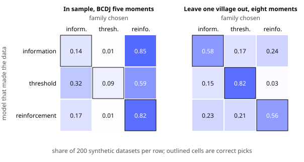

| rule, moments | recovers I | recovers T | recovers R&delta; |
|---|---|---|---|
| in sample, BCDJ five | 14.5% | 8.5% | 82.5% |
| in sample, eight | 27.0% | 48.5% | 99.5% |
| leave one village out, BCDJ five | 56.5% | 83.0% | 12.5% |
| leave one village out, eight | 58.5% | 82.0% | 55.5% |

- **H2 held.** In sample, the criterion picks the bigger model whatever made the data: data
  from the simple model are called reinforcement 85% of the time (BCDJ five moments).
- **H2b held.** With reinforcement as the truth, leave-one-out on the eight moments prefers it to
  the simple model in only 67% of datasets, so milestone 2's verdict against reinforcement is
  weak evidence.
- **Local identification.** The Jacobian of the moment map at the reinforcement fit has
  condition number 79 (256 on the BCDJ five alone). The weak direction is not, as we predicted,
  adopters' word of mouth against reinforcement: it is the base adoption rate against
  non-adopters' word of mouth and reinforcement together (raise one, lower the others, and the
  moments barely move). Our prediction failed.
- **The real data are not like any model's data** (a post-hoc check, labelled as such). Real
  held-out losses (0.17 to 0.19) sit above the 95th percentile of every model's synthetic losses
  (0.04 to 0.12), and the real 13-of-43 village count for reinforcement against the simple model
  is below what any model produces in all but 2.5% (simple) and 13% (threshold) of datasets.
  The villages differ from each other far more than these models allow. That misfit is larger
  than the simple-against-complex difference itself, so the next step adds village-level
  heterogeneity before any seeding comparison.

## Milestone 3b: is it village heterogeneity? (`experiments/m3b_hetero/`)

Milestone 3 found the real villages' held-out errors two to four times larger than any fitted
model's own synthetic data. The obvious suspect was village-level heterogeneity in the base
adoption rate, so every family gained &sigma;, the SD of a per-village, per-run shift of every
household's logit, identified by a ninth moment (the squared non-leader take-up rate, which pins
the cross-village variance of take-up). I and T also gained the intercept shift &delta; that
R&delta; already had. Grid of 8,100 points; fit on nine moments, held-out loss on milestone 3's
eight; 200 synthetic datasets from each family's real-data fit. Plan and hypotheses logged
before the run; a per-moment breakdown was added after a smoke run on a tiny grid, and is
labelled as such.

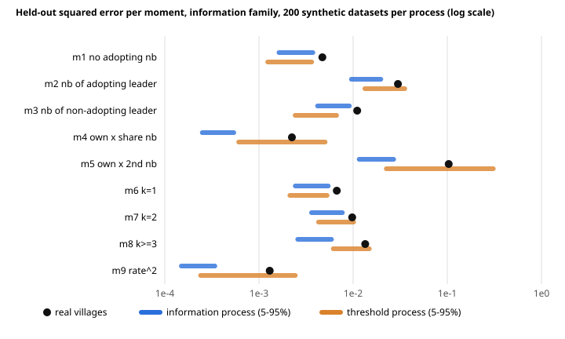

| | information (I) | threshold (T) | reinforcement (R&delta;) |
|---|---|---|---|
| in-sample fit, nine moments | q<sub>N</sub> 0.05, q<sub>P</sub> 0.3, &sigma; 0 | &theta; 0.50, &delta; &minus;0.25, &sigma; 0 | &gamma; 0.10, &delta; &minus;0.25, &sigma; 0 |
| &sigma;-hat = 0 in bootstrap draws | 20.1% | 73.6% | 70.9% |
| real held-out loss | 0.181 | 0.169 | 0.210 |
| that model's synthetic held-out loss of I, 5&ndash;95% | 0.044&ndash;0.068 | 0.062&ndash;0.369 | 0.050&ndash;0.087 |
| synthetic datasets reaching the real I loss | 0% | 19% | 0% |
| recovered, leave one village out (milestone 3) | 37.0% (58.5%) | 77.5% (82.0%) | 49.5% (55.5%) |

- **H6 refuted: there is no base-rate heterogeneity to find.** &sigma;-hat is 0 in every
  family. With &sigma; = 0 the simple model already matches the mean squared village take-up
  rate (residual &minus;0.0004): in a village of about 200 households, whether the news happens
  to spread gives as much village-to-village variation in take-up as the data show.
- **H7 refuted for the simple model:** no synthetic dataset from it, or from reinforcement,
  reaches the real held-out loss. **The threshold model reaches it** (reported, not tested):
  its outcomes are close to all-or-nothing village by village, and 19% of its datasets are as
  far from the fit as the real villages are.
- **Where the misfit is.** The real error is above the simple model's band in all nine moments,
  and 57% of it is moment 5 (own adoption times second-neighbour adopters, divided by degree,
  as the authors' `moments.m` computes it): 0.103 against 0.012&ndash;0.027. Moments 4 and 8
  (adopters next to adopters; take-up with three or more adopting neighbours) are next. The
  villages are not over-dispersed in how many households adopt but in *where* adoption sits.
  The threshold band covers the real value in seven of nine moments.
- **Identification gets worse, not better.** With &sigma; and &delta; free, leave-one-out
  recovers the simple model in 37% of its datasets (calling it reinforcement 39% of the time),
  and in sample still picks the bigger model. &sigma; itself is poorly recovered: with true
  &sigma; = 0, the simple model's fit returns 0.25 or 0.5 in 58% of datasets.
- Caveats: beta stays at the real-data leader logit and ignores the random effect; the
  threshold model is the only one of three that fits the dispersion, and homophily (similar
  households befriending each other) would also cluster adopters; moment 5's scale, a quirk
  kept for faithfulness, dominates the identity-weighted criterion.

## Milestone 4: whom should a rollout seed? (`experiments/m4_seeding/`)

Ten seeding rules at each village's own leader budget (1,140 seeds in all), each scored under the
three milestone-3b fits (I: q<sub>N</sub> 0.05, q<sub>P</sub> 0.3; T: &theta; 0.50, &delta;
&minus;0.25, q<sub>N</sub> 0.075, q<sub>P</sub> 0.1; R&delta;: &gamma; 0.10, &delta; &minus;0.25,
q<sub>N</sub> 0.10, q<sub>P</sub> 0.1) and two sensitivity points (T at &theta; 0.60; I at the
published q<sub>N</sub> 0.10, q<sub>P</sub> 0.50). Seeds take the leaders' place in the model:
told first, and adopting by the model's own rule. Rules (`src/civ_seeding/seeding.py`): the
observed leaders, uniform random, top degree, top eigenvector and diffusion centrality
(q = 1/&lambda;<sub>1</sub>, the village's period count; after Banerjee et al. 2013), one
clustered ball grown breadth-first from the top-degree household, patches of four (a hub and its
three best-connected neighbours, hubs not adjacent), and greedy influence maximisation (Kempe et
al. 2003) under each of the three models. Greedy searched on 32 runs with common random numbers
(a batched simulator that reproduces `complex.simulate` exactly, `tests/test_seeding.py`); every
rule is then scored on 200 fresh runs per village. Regret is the share of expected adopters lost
against the best rule under that model; intervals are a village Bayesian bootstrap (B = 1,000).
Plan, hypotheses and predictions logged before the run.


| rule | regret under I | under T | under R&delta; | worst case | mean seed degree |
|---|---|---|---|---|---|
| greedy under T | 0.5% | 0 | 0.2% | **0.5%** | 15.0 |
| greedy under R&delta; | 0.3% | 1.0% | 0 | 1.0% | 14.6 |
| greedy under I | 0 | 2.6% | 0.9% | 2.6% | 12.0 |
| patches of four | 2.8% | 3.6% | 1.6% | 3.6% | 20.6 |
| top degree | 3.2% | 4.1% | 1.7% | 4.1% | 23.1 |
| diffusion centrality | 5.3% | 7.9% | 4.0% | 7.9% | 22.6 |
| eigenvector | 6.7% | 10.0% | 5.5% | 10.0% | 22.0 |
| observed leaders | 6.2% | 10.4% | 6.2% | 10.4% | 12.9 |
| one clustered ball | 7.1% | 10.5% | 6.4% | 10.5% | 18.9 |
| uniform random | 6.9% | 12.1% | 8.6% | 12.1% | 9.7 (all households) |

Best rule's adopters per village: 44.7 (I), 43.9 (T), 45.5 (R&delta;), about 21% of households.

- **H4 held only in its weak half.** Each model's own greedy set is best under it, so the best
  rule differs; but the seven structural rules rank almost identically (Kendall &tau; 0.81, 0.81,
  1.00 between the three model pairs; with greedy included, 0.78 to 0.96). The &tau; &lt; 0.6
  half is refuted.
- **H5 held.** Greedy under the threshold model is within 0.5% of the best rule under all three
  models (bootstrap interval of its worst case 0.2&ndash;0.8%) and both sensitivity points, and is
  the minimax-regret rule in 94% of draws. **For seeding, the identification problem of
  milestones 2 to 3b does not bite.**
- **Clustering does not help, even under the threshold model** (our prediction failed). The
  clustered ball is about as bad as random seeding; greedy picks moderate-degree households that
  are rarely neighbours (tie density among seeds 0.04&ndash;0.07, against 0.24 for top degree and
  0.22 for the ball). Our reading, not tested: when information spreads from every seed and a
  household decides when it is told, overlapping seeds waste budget, and a fractional threshold
  of one half is reached more easily around a low-degree household than a hub.
- **How much seeding is worth here:** the worst rule loses 7 to 12% of the best rule's adopters.
  The lender's leaders give up 6 to 10%; top degree, which needs only a census of ties, gives up
  2 to 4%.
- Against the field evidence: Beaman et al. (2021) found seeds chosen for a threshold-2
  contagion raised adoption of a farming technique in Malawi. Our threshold is fractional
  (half of a household's ties), fitted to microfinance, and its seeds still favour spread over
  clustering; the two results are about different products and different thresholds, and this
  one is a model's counterfactual, not an experiment.
- Caveats: point fits (parameter uncertainty only through the two sensitivity points); a fixed
  budget equal to the leader count; homophily not modelled; greedy needs the whole network and a
  fitted model, which a rollout rarely has. Complex centrality (Guilbeault and Centola 2021) is
  not implemented yet.

## Milestone 5: does a cheap rule, or a partial survey, do as well? (`experiments/m5_cheap/`)

Milestone 4's greedy rule needs the whole network and a fitted model. This step adds rules that
need less, scored exactly as in milestone 4 (same models, budgets, 200 runs per village, village
Bayesian bootstrap; the reference best rule is the best of all twenty). **Census, no model:**
spread degree (degree order, skipping anyone next to a seed), single discount and degree
discount (Chen, Wang and Yang 2009; degree discount's one parameter set to p = 0.05, the
information model's fitted q<sub>N</sub>, chosen before the run and not tuned). **Partial survey:** a
random share f of households reports its ties; an unsurveyed household's degree is estimated as
its surveyed neighbours / f; then top estimated degree, or spread degree on the seen ties.
**No network data:** friend nomination (after Kim et al. 2015): random households each name a
random contact, and the named are seeded. Randomised rules are scored over 200 independent
draws. Plan, hypotheses and predictions logged before the run.

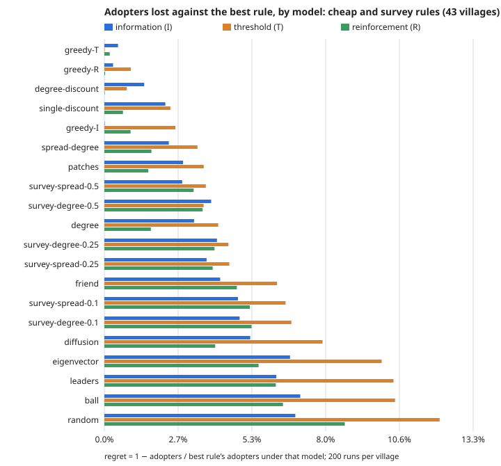

| rule | needs | under I | under T | under R&delta; | worst case [90% interval] | seed degree | tie density |
|---|---|---|---|---|---|---|---|
| greedy under T | network + fitted model | 0.5% | 0 | 0.2% | **0.5%** [0.3, 2.6] | 15.0 | 0.07 |
| degree discount | network (+ one rate) | 1.4% | 0.8% | 0 | **1.4%** [1.0, 3.2] | 20.5 | 0.09 |
| single discount | network | 2.2% | 2.4% | 0.7% | 2.4% [2.1, 4.7] | 22.8 | 0.18 |
| spread degree | network | 2.3% | 3.4% | 1.7% | 3.4% [2.9, 5.8] | 13.3 | 0 |
| top degree | network | 3.2% | 4.1% | 1.7% | 4.1% [3.5, 6.3] | 23.1 | 0.24 |
| survey 50%, spread | half the ties | 2.8% | 3.7% | 3.2% | 3.7% [1.1, 8.6] | 17.6 | 0.09 |
| survey 25%, top degree | a quarter of the ties | 4.1% | 4.5% | 4.0% | 4.5% [1.7, 9.7] | 21.2 | 0.20 |
| survey 10%, top degree | a tenth of the ties | 4.9% | 6.7% | 5.3% | 6.7% [3.8, 11.6] | 18.6 | 0.17 |
| friend nomination | one name per asked household | 4.2% | 6.2% | 4.8% | 6.2% [3.3, 11.0] | 15.1 | 0.10 |
| observed leaders | the lender's list | 6.2% | 10.4% | 6.2% | 10.4% | 12.9 | 0.08 |
| uniform random | nothing | 6.9% | 12.1% | 8.7% | 12.1% | 9.7 | 0.04 |

Full table, both sensitivity points and the remaining rules: `experiments/m5_cheap/results.txt`.
The milestone-4 rules' adopter counts reproduce milestone 4 exactly (same streams); their regrets under R&delta; move by up to 0.1 point because degree discount is the new best there.

- **H6 held, by one rule.** Degree discount loses at most 1.4% (below the 2% bar) and is better
  than top degree in every bootstrap draw; under the reinforcement model it ties greedy (45.51
  against 45.50 adopters per village). Single discount (2.4%) and spread degree (3.4%) miss the
  bar: our prediction that they would match failed.
- **No adjacent seeds is not enough.** Spread degree seats no two neighbours in any village but
  drops mean seed degree to 13, and loses more than patches of four under the threshold model.
  Greedy's sets combine moderate-to-high degree with few ties among seeds; degree discount gets
  closest to that (degree 20.5, tie density 0.09).
- **H7 held, narrowly.** With a 25% survey the better survey rule loses at most 4.5% (bar 5%),
  but its interval is wide (1.7&ndash;9.7%) and it beats census top degree in only about a third
  of bootstrap draws. Spreading seeds on the seen ties helps only at f = 0.5. Friend nomination
  beats random seeding under all three models (by 1.2 to 2.6 adopters per village) and sits
  close to a 10% survey.
- **What a programme officer gets:** with a census of ties, rank by degree discount; without one,
  a quarter-sample survey gives up about one more point than a census, and asking households for
  one name gives up about two. The gaps are a model's counterfactual on 43 villages, not a field
  result; between the best and worst rule there are 7 to 12% of adopters at stake.
- Caveats: as milestone 4 (point fits, fixed leader budget, no homophily); degree discount's p is
  one model number (q<sub>N</sub> of the information fit), not swept; the survey samples
  households uniformly and assumes they report all their ties; BCDJ's own network survey sampled
  households and asked about named relationships, which this step does not mimic.

## Milestone 6: do the robust rules survive uncertain fits? (`experiments/m6_uncertainty/`)

Milestones 4 and 5 scored every rule under three point fits, so their intervals carried village
sampling but not the uncertainty in the parameters the rules are scored under. This step refits
the information (I), threshold (T) and reinforcement (R&delta;) models in each of 500 village
Bayesian bootstrap draws (milestone 3b's grid with a village random effect &sigma; in {0, 0.25,
0.5, 0.75}, nine moments, 5,400 grid points), scores every rule under each draw's three refitted
processes with the same village weights (100 runs per village), and takes the worst case over
the three models within each draw. Degree discount's rate p is swept from 0.01 to 0.3. Greedy
sets are those searched at the point fits. Plan and hypotheses logged before the run.


| rule | point fits | refitted: median [5%, 95%] | fixed fits, same draws |
|---|---|---|---|
| greedy under T | 0.3% | 0.5% [0.1, 2.4] | 0.4% [0.1, 0.7] |
| degree discount, p = 0.075 | 1.2% | 0.9% [0.1, 1.5] | 1.2% [0.7, 1.6] |
| greedy under R&delta; | 1.0% | 0.9% [0.1, 4.1] | 1.0% [0.7, 1.3] |
| degree discount, p = 0.05 | 1.3% | 1.0% [0.3, 1.6] | 1.3% [0.9, 1.7] |
| single discount | 2.4% | 2.1% [1.7, 2.6] | 2.4% [2.0, 2.8] |
| greedy under I | 2.7% | 2.7% [0.7, 7.3] | 2.7% [2.4, 3.1] |
| top degree | 4.1% | 3.9% [3.2, 4.8] | 4.1% [3.5, 4.8] |
| survey 25%, spread | 5.0% | 4.7% [3.4, 6.5] | 5.1% [4.3, 5.8] |
| friend nomination | 6.7% | 7.1% [5.3, 9.5] | 6.7% [5.8, 7.7] |
| observed leaders | 10.5% | 10.6% [7.8, 14.7] | 10.6% [9.3, 12.0] |
| uniform random | 11.5% | 11.6% [8.2, 16.5] | 11.6% [10.2, 13.2] |

Full table, the fitted-parameter histograms and the diagnostics: `experiments/m6_uncertainty/results.txt`.

- **The fits move.** The information model refits to its point estimate in only 7% of draws
  (&sigma; &gt; 0 in 81%); the threshold model splits &theta; 0.4 / 0.5 / 0.6 in 17 / 37 / 44% of
  draws; the reinforcement model's q<sub>P</sub> ranges over the whole grid.
- **H8 held.** Degree discount (p = 0.05) keeps a median worst-case regret of 1.0% (bar 2%) and
  beats top degree in all 500 draws.
- **H9 held.** Its median worst case is 0.9&ndash;1.2% for every p from 0.01 to 0.15 (p = 0.3:
  1.8%). The best p in the grid is 0.075, 0.09 point better than the 0.05 chosen in milestone 5.
- **Not pre-registered: uncertain fits lengthen the greedy rules' tails, not degree discount's.**
  A greedy set is tuned to one fitted process; when the process moves, its 95th percentile rises
  (threshold-greedy 0.7% to 2.4%, information-greedy 3.1% to 7.3%), while degree discount's stays
  at 1.6%. Its worst draws are information or high-q<sub>P</sub> reinforcement processes, where
  information-greedy's spread-out, low-degree seeds win.
- **A correction to milestone 5.** The first full run scored the randomised rules' 100 draws
  on one shared simulated run per village, as milestone 5 did; the noisy means inflated every
  tail (kept as `results_shared_runs.txt`). Scored on independent runs (this table), the 25%
  survey rules lose 5.0&ndash;5.1% at the point fits, at milestone 5's 5% bar rather than under it,
  and friend nomination 6.7% rather than 6.2%. Milestone 5's deterministic results stand.
- Caveats: greedy sets are not re-searched per draw; the bootstrap distribution is a histogram
  on a coarse grid; the fixed leader budget, seeding-as-informing and no homophily, as before.

## Milestone 7: does complex centrality seed as well? (`experiments/m7_complex/`)

Complex centrality (Guilbeault and Centola 2021) is the published seeding measure built for
complex contagions: seed a household's whole neighbourhood, run a threshold cascade, and rank
households by how far and how fast it spreads. This step implements it (fractional threshold
&theta; = 0.5 and 0.25, and the paper's absolute threshold of 2), ranks by reach and then by mean
complex path length, and scores six rules built on it with milestone 5's protocol: top b
households, neighbourhood seeding (the central household plus its ties, repeated), and a
no-adjacent-seeds version. Plan and hypotheses logged before the run.

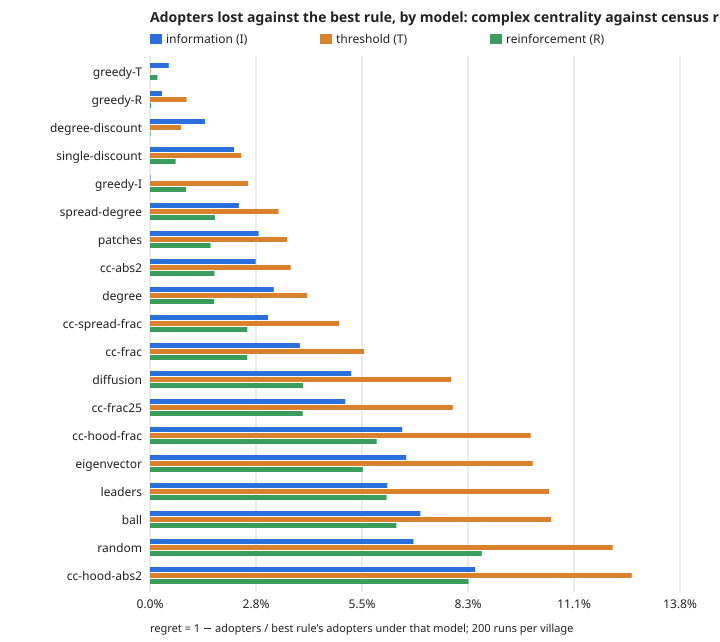

| rule | I | T | R&delta; | worst case [90%] |
|---|---|---|---|---|
| greedy under T | 0.5% | 0 | 0.2% | 0.5% [0.3, 0.8] |
| degree discount | 1.4% | 0.8% | 0 | 1.4% [1.0, 1.8] |
| complex centrality, absolute 2 | 2.8% | 3.7% | 1.7% | 3.7% [3.1, 4.3] |
| top degree | 3.2% | 4.1% | 1.7% | 4.1% [3.4, 4.8] |
| complex centrality, &theta; 0.5, no adjacent seeds | 3.1% | 4.9% | 2.5% | 4.9% [4.4, 5.6] |
| complex centrality, &theta; 0.5 | 3.9% | 5.6% | 2.5% | 5.6% [4.9, 6.4] |
| complex centrality, &theta; 0.25 | 5.1% | 7.9% | 4.0% | 7.9% [6.8, 9.1] |
| neighbourhoods, &theta; 0.5 | 6.6% | 9.9% | 5.9% | 9.9% [8.3, 11.7] |
| uniform random | 6.9% | 12.1% | 8.7% | 12.1% [7.3, 16.6] |
| neighbourhoods, absolute 2 | 8.5% | 12.6% | 8.3% | 12.6% [10.8, 14.8] |

Full table and seed-set shapes: `experiments/m7_complex/results.txt`.

- **H10 refuted.** No complex-centrality rule is within 2% everywhere; the best (absolute
  threshold 2) loses up to 3.7%, and degree discount beats every one of them in all 1,000
  bootstrap draws.
- **H11 held, narrowly.** Under the threshold model the absolute-2 rule beats top degree (42.30
  against 42.11 adopters per village); the fractional versions do not.
- **H12 held.** Seeding whole neighbourhoods, as the measure presumes, loses in all six
  comparisons, by 1.2 to 3.9 adopters per village; with the absolute threshold it is worse than
  random seeds. This matches milestone 4: on these villages spread-out seeds win.
- At &theta; = 0.5 a seeded neighbourhood rarely reaches past itself, so the measure is mostly
  degree (overlap with top degree 0.79). The fitted models spread *information* by simple word of
  mouth and apply the threshold only to adoption; a measure built for contagions where the
  information itself needs reinforcement is aimed at a different process. This is a statement
  about the processes the data support, not a test of complex centrality on its own models.
- Caveats: point fits only; reach-first ordering is our reading of the measure; the fixed leader
  budget, seeding-as-informing and no homophily, as before.

## Milestone 8: complex centrality under parameter uncertainty (`experiments/m8_cc_uncertainty/`)

Milestone 7 scored complex centrality at the three point fits. This step adds its six rules to
milestone 6's joint village bootstrap (500 draws, each refitting the information, threshold and
reinforcement models; 205 distinct fitted processes) with milestone 6's code, seeds and scoring
unchanged, so all of milestone 6's rows reproduce exactly. Plan and hypotheses logged before the
run.

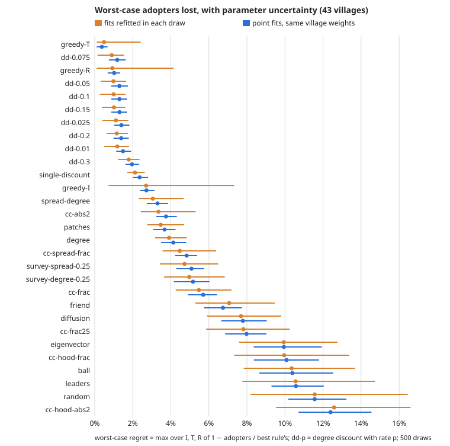

| rule | worst case, point fits | refitted draws, median [5&ndash;95%] | beats top degree |
|---|---|---|---|
| degree discount (p 0.05) | 1.3% | 1.0% [0.3, 1.6] | 100% |
| complex centrality, absolute 2 | 3.8% | 3.3% [2.4, 5.3] | 74% |
| top degree | 4.1% | 3.9% [3.2, 4.8] | &ndash; |
| complex centrality, &theta; 0.5, no adjacent seeds | 4.8% | 4.5% [3.6, 6.4] | 8% |
| complex centrality, &theta; 0.5 | 5.7% | 5.5% [4.3, 7.2] | 0 |
| complex centrality, &theta; 0.25 | 7.9% | 7.8% [5.9, 10.2] | 0 |
| neighbourhoods, &theta; 0.5 | 10.0% | 10.0% [7.3, 13.4] | 0 |
| neighbourhoods, absolute 2 | 12.4% | 12.6% [9.5, 16.6] | 0 |

Under the threshold model, by the threshold each draw refits to (median regret):

| refitted &theta; (draws) | complex centrality, absolute 2 | top degree | degree discount |
|---|---|---|---|
| 0.40 (86) | 4.9% | 4.2% | 0.0% |
| 0.50 (184) | 3.7% | 4.1% | 0.5% |
| 0.60 (218) | 2.7% | 3.6% | 0.6% |
| 0.75 (12) | 2.4% | 3.6% | 1.0% |

- **H13 held.** Degree discount has the lower worst case against every complex-centrality rule in
  all 500 draws.
- **H14 held.** The absolute-2 rule beats top degree in 74% of draws (89% in milestone 7's
  village-only bootstrap).
- **H15 held.** The higher the fitted threshold, the more the absolute-2 rule helps: behind top
  degree at &theta; 0.4, ahead from 0.5 up. This is the direction its theory predicts. The
  comparison is across draws, so the threshold moves together with each draw's village weights
  and other parameters; a controlled threshold sweep is the next check.
- No complex-centrality rule is the best worst-case rule in any draw. Full tables:
  `experiments/m8_cc_uncertainty/results.txt` and `verdicts.txt`.

## Milestone 9: can a smarter survey replace a census? (`experiments/m9_survey/`)

Most rollouts cannot map every tie in a village. Milestone 5's survey rules sampled households
uniformly; milestone 6 corrected their worst case to 5.0&ndash;5.1%, while census degree discount
loses 1.4%. This step keeps the survey budget (k = f n households, f 10%, 25% or 50%; each
surveyed household reports all its ties, so ties reach unsurveyed households as in BCDJ's own
survey) and changes how the households are chosen: **uniform** (k at random), **adaptive** (k/2 at
random, then the k/2 households the first half named most) or **walk** (k/2 at random, then
households named by randomly chosen first-stage respondents, a survey version of Kim et al. 2015's
nomination step). Each survey feeds two rankings: top estimated degree (milestone 5's) and **degree
discount on the ties seen** (Chen, Wang and Yang 2009, p = 0.05). Unsurveyed households' degree is
estimated from first-stage respondents only, so the estimate stays unbiased. Scored as milestone 5
(point fits I, T, R; 200 runs per village; village Bayesian bootstrap B = 1,000), with independent
runs for every randomised draw (milestone 6's correction). Plan and hypotheses logged before the run.

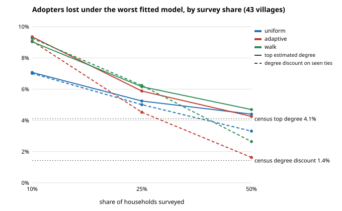

| survey | top estimated degree | degree discount on seen ties |
|---|---|---|
| 10%: uniform / adaptive / walk | 7.1% / 9.4% / 9.0% | 7.0% / 9.1% / 9.3% |
| 25%: uniform / adaptive / walk | 5.2% / 5.9% / 6.2% | 5.0% / **4.5%** / 6.2% |
| 50%: uniform / adaptive / walk | 4.4% / 4.3% / 4.7% | 3.3% / **1.6%** / 2.6% |
| full census (reference) | 4.1% (top degree) | **1.4%** (degree discount) |

Worst case = the largest share of adopters lost against the best rule over the three fitted
models. 90% bootstrap intervals and every rule under every model: `experiments/m9_survey/results.txt`.
Milestone 5's deterministic rules reproduce its adopter counts exactly.

- **H16 refuted.** With top estimated degree the adaptive stage does not help: 5.9% against 5.2%
  for a uniform quarter, worse in every bootstrap draw. The walk design is worse still.
- **H17 held, narrowly.** On a uniform quarter, degree discount on the seen ties beats top
  estimated degree by 0.2 point (in all 1,000 draws); on a uniform half by 1.1 points.
- **H18 refuted, narrowly.** The best quarter-sample rule (adaptive, degree discount) loses 4.5%
  [90%: 4.0&ndash;5.1%], above census top degree's 4.1%.
- **Not pre-registered: the adaptive stage and degree discount need each other.** Adaptive degree
  discount beats uniform degree discount in every draw at 25% and 50%, and at 50% it is within 0.2
  point of the census rule (1.6% [1.3&ndash;2.0%]) and beats census top degree in every draw. Its
  seeds have the fewest ties among themselves of any survey rule (tie density 0.083&ndash;0.089,
  census degree discount 0.092). Our reading, not tested: the second stage surveys the households
  most likely to be chosen, so the ties among candidate seeds are seen and the discount can act on
  them; ranking by degree alone has nothing to discount and only pays for the second stage with a
  noisier estimate.
- **What a programme officer gets:** with half a village surveyed in two visits (random half, then
  the most named), degree discount on the reported ties gives up about 0.2 point against a full
  census. With a quarter it gives up about as much as ranking a full census by degree. Below that,
  sample uniformly; asking households for one name (friend nomination, 6.4%) is close to a quarter
  survey.
- Caveats: point fits only; households report every tie and second-stage households can be found by
  name; each interview costs the same; budgets, seeding-as-informing and no homophily as before.

## Milestone 10: does the half survey hold up under uncertain fits? (`experiments/m10_survey_uncertainty/`)

Milestone 9 scored its survey rules at the point fits only. This step reruns milestone 6's joint
village bootstrap unchanged (500 Dirichlet draws, each refitting I, T and R on the same grid;
100 scoring runs per village under each of the 205 distinct refitted processes) with nine survey
rules added: uniform and adaptive degree discount at 25% and 50% of households, adaptive top
estimated degree at 25%, and adaptive degree discount with the first, random stage taking a
quarter or three quarters of the survey instead of half (`seeding.survey_design(..., split=s)`).
Each survey rule gets 100 survey draws per village, scored on independent runs from their own
random streams. Plan and hypotheses (H19&ndash;H21) logged before the run.

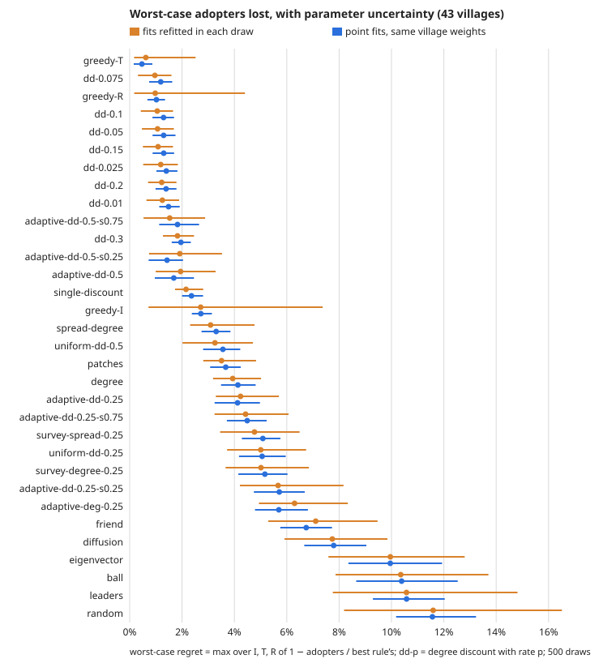

| rule | point fits | refitted, median [5%, 95%] | beats census top degree |
|---|---|---|---|
| census degree discount (p 0.05) | 1.3% | 1.1% [0.5, 1.7] | 100% |
| adaptive degree discount, 50%, split 3/4 random | 1.8% | **1.5%** [0.5, 2.9] | 99% |
| adaptive degree discount, 50%, half split | 1.6% | 1.9% [1.0, 3.3] | 97% |
| adaptive degree discount, 50%, split 1/4 random | 1.3% | 1.9% [0.7, 3.5] | 96% |
| uniform degree discount, 50% | 3.6% | 3.3% [2.0, 4.7] | 85% |
| census top degree | 4.1% | 3.9% [3.2, 5.0] | n/a |
| adaptive degree discount, 25%, half split | 4.1% | 4.2% [3.3, 5.7] | 31% |
| adaptive degree discount, 25%, split 3/4 random | 4.5% | 4.4% [3.2, 6.1] | 22% |
| uniform degree discount, 25% | 5.0% | 5.0% [3.7, 6.7] | 3% |
| uniform top estimated degree, 25% | 5.1% | 5.0% [3.7, 6.8] | 3% |
| adaptive degree discount, 25%, split 1/4 random | 5.7% | 5.7% [4.2, 8.2] | 1% |
| adaptive top estimated degree, 25% | 5.7% | 6.3% [4.9, 8.3] | 0% |

Worst case = the largest share of adopters lost against the best of all 32 rules over I, T and R
within a draw. Every row: `experiments/m10_survey_uncertainty/results.txt` and `verdicts.txt`.
Milestone 6's point-fit column reproduces exactly; its bootstrap columns move by at most 0.3 point,
because a survey rule is now the best rule under some draws' processes.

- **H19 held.** The half survey (adaptive, half split, degree discount) has a median worst case of
  1.9% and beats census top degree in 96.8% of draws. Its gap to the census rule widens from 0.3
  point at the point fits to 0.8 point, and its 95th percentile (3.3%) is twice the census rule's:
  under the information model with stronger word of mouth, the partial picture costs more.
- **H20 held.** The adaptive stage beats a plain random sample of the same size in 88.8% of draws at
  25% and 92.8% at 50% (milestone 9, village bootstrap only: every draw).
- **H21 held, with a lean.** The half split is best at 25% and 0.4 point behind the best at 50%,
  inside the pre-registered 0.5 point. At 50% the three-quarters-random split beats it in 72% of
  draws; at 25% a one-quarter-random split is clearly worse (5.7%). The prediction that a longer
  adaptive stage would help at 50% failed: a short one is better.
- **Not predicted:** survey rules are the minimax rule in some draws (the 50%, 3/4-random rule in 8%),
  which no survey rule was at the point fits.
- **What a programme officer gets, revised:** with half a village surveyable, survey three quarters of
  that budget at random and the rest by most-named, then rank by degree discount on the ties seen:
  a median 1.5% of adopters lost under the worst refitted model, against 1.1% for a full census.
  A quarter survey is close to census top degree (4.2% against 3.9%) but not a substitute.
- Caveats: greedy rules searched at the point fits only; 100 survey draws per village; households
  report every tie and stage-two households can be found by name; three split values only.

## Milestone 11: does the survey advice survive respondents who forget ties? (`experiments/m11_recall/`)

Milestones 9 and 10 assumed every surveyed household names every tie. This step measures how many
ties a BCDJ respondent actually names, then scores the survey and census rules with that much
forgetting. Plan and hypotheses (H22&ndash;H24) logged before the run.

**Part A: recall measured in the BCDJ archive** (`measure_recall.py`, `recall.txt`). The survey
asked converse questions: whom do you borrow money from, and to whom do you lend it? Whom do you
borrow kerosene or rice from, and to whom do you lend it? Whom do you visit, and whom do you invite
home? So a relationship between two surveyed households is captured twice, once by each end. On
the 43 microfinance villages (4,414 of 9,598 households surveyed), Lincoln&ndash;Petersen
capture&ndash;recapture gives these recall figures:

| question pair | recall, first [95%] | recall, converse [95%] |
|---|---|---|
| borrow / lend money | 0.754 [0.724, 0.786] | 0.683 [0.648, 0.720] |
| borrow / lend kerosene or rice | 0.805 [0.764, 0.847] | 0.806 [0.771, 0.844] |
| visit / invite home | 0.834 [0.805, 0.865] | 0.812 [0.781, 0.844] |
| the three together | 0.849 [0.828, 0.872] | 0.822 [0.801, 0.845] |

Intervals come from a village bootstrap. Village by village, the three-question figure runs from
0.72 to 0.97. The mean of the two directions, **0.84**, sets the grid value of 0.85.

**Part B: scoring under forgetting** (`run.py`, `verdicts.txt`). Each surveyed household reports
each true tie independently with probability &rho;, and a tie is seen if a surveyed end reported it.
The degree estimate is not corrected for &rho;, because a field team would not know it. A census
with forgetting surveys every household. The setup is otherwise milestone 10's joint bootstrap.

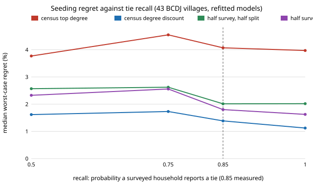

| rule, median worst case [5%, 95%] | &rho; = 1 | 0.85 (measured) | 0.75 | 0.5 |
|---|---|---|---|---|
| census degree discount | 1.1% | 1.4% [0.4, 2.9] | 1.7% | 1.6% |
| half survey, 3/4 random, degree discount | 1.6% | **1.8%** [0.8, 3.0] | 2.6% | 2.3% |
| half survey, half split, degree discount | 2.0% | 2.0% [1.0, 3.3] | 2.6% | 2.6% |
| census top degree | 4.0% | 4.1% [2.9, 5.7] | 4.5% | 3.8% |

- **H22 held.** At the measured recall, the 3/4-random half survey loses a median 1.8% and beats a
  perfect census ranked by degree in 99.2% of draws.
- **H23 held.** Halving recall raises the survey rule's median by 0.7 point and the census degree
  discount's by 0.5 point, inside the 1-point bar.
- **H24 held.** Degree discount on a census that forgets half of each respondent's ties still beats
  top degree on a perfect census in 99.0% of draws (1.6% against 4.0%).
- Not monotone: &rho; = 0.75 scores worse than 0.5 for three of the four rules. The intervals
  overlap, so this may be noise in the random reports; it was not tested.
- Sanity: milestone 10's rows move by at most 0.4 point on the re-drawn streams. The recall rules
  also join the reference set: a forgetful census's degree discount is the minimax rule in 12% of
  draws, so milestone 6's point-fit regrets move by up to 0.2 point.
- Caveats: recall is independent across ties and respondents (correlated recall would make 0.85
  an overestimate); the BCDJ graph, itself a 12-question survey, is taken as the truth; no false
  ties are reported; three recall values.

## Milestone 12: do respondents forget weak ties more, and does that hurt? (`experiments/m12_strength/`)

Milestone 11 treated recall as one number. This step splits ties by a free strength proxy, the
number of the six other survey questions (advice, decisions, medical help, kin, non-kin, temple
company) that name the same pair, and re-runs capture&ndash;recapture within each group. Plan and
hypotheses (H25&ndash;H29) logged before the run ([`LOG.md`](LOG.md), 2026-11-17).

| ties named by the six other questions | share of model ties | three-question recall [95%] |
|---|---|---|
| none | 19.5% | 0.606 [0.564, 0.651] |
| one | 41.1% | 0.805 |
| two or more | 39.4% | 0.942 |

The stratified recall is 0.812 [0.787, 0.839], against the pooled 0.836 (H25 and H26 held;
[`strength.txt`](experiments/m12_strength/strength.txt)). Scoring with recall set per stratum
([`verdicts.txt`](experiments/m12_strength/verdicts.txt)): the 3/4-random half survey loses a
median 2.2% and beats perfect-recall census top degree in 98.4% of draws (H27 held); with weak-tie
recall halved, census degree discount still beats it in every draw (H29 held). H28 was refuted in
an unexpected direction: census degree discount scored 0.9% under the measured, uneven recall and
1.8% under one uniform recall at the same mean. That gap was under twice the harness's re-draw
noise, which milestone 13 measures.

## Milestone 13: is milestone 12's census gain real? (`experiments/m13_streams/`)

Until now every extra randomised rule shared one scoring stream, so adding a rule re-drew the
others, and milestone 12's unexpected gap (census degree discount 0.9% under uneven recall against
1.8% under uniform recall) was under twice that re-draw noise. This step gives each rule its own
stream, keyed by its name (`PER_RULE_STREAMS` in `m6_uncertainty/run.py`; `tests/test_streams.py`
checks that adding a rule leaves another's score bit-identical), and re-draws four rules four extra
times (surveys and scoring runs afresh), keeping the bootstrap draws, refits and every other rule
fixed. Plan and hypotheses (H31&ndash;H33) logged before the run.

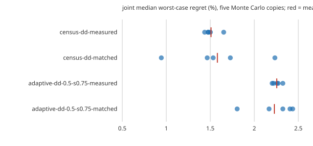

| rule, joint median worst case | copy 0 | 1 | 2 | 3 | 4 | mean | sd |
|---|---|---|---|---|---|---|---|
| census dd, measured recall | 1.48% | 1.65% | 1.48% | 1.50% | 1.44% | 1.51% | 0.08 |
| census dd, matched uniform recall | 1.73% | 0.94% | 1.47% | 1.53% | 2.23% | 1.58% | 0.47 |
| half survey (s0.75), measured | 2.20% | 2.26% | 2.22% | 2.32% | 2.27% | 2.25% | 0.05 |
| half survey (s0.75), matched | 1.80% | 2.32% | 2.40% | 2.44% | 2.17% | 2.23% | 0.26 |

- **H31 refuted.** The Monte Carlo sd of a randomised rule's joint median reaches 0.47 point
  (bar 0.25); two copies of the same rule differ by up to 1.29 point (median 0.14). The bootstrap
  5&ndash;95% intervals reported since milestone 6 carry parameter uncertainty only, not this.
- **H32 refuted.** Census degree discount, measured minus matched: &minus;0.25, +0.71, +0.01,
  &minus;0.03, &minus;0.80 point (mean &minus;0.07); the paired share of draws in which measured
  wins swings from 16% to 90% across copies. Milestone 12's H28 refutation for the census rule was
  noise: unevenness at a matched level makes no measurable difference.
- **H33 held.** The survey rule's gap averages +0.03 point.
- Prediction missed: moving milestone 12's rows to their own streams shifted them by up to 0.80
  point (bar 0.6), consistent with the noise above.
- Not explained: why the matched rules vary five to six times more between copies than the
  measured ones. Caveat: five copies give a rough sd; replicates re-draw only these four rules.

## Milestone 14: which survey findings survive pooled Monte Carlo copies? (`experiments/m14_pooled/`)

Milestone 13 showed that one Monte Carlo copy of a randomised rule can move its joint median by
half a point. This step re-draws 16 rules four extra times on milestone 13's harness (own stream
per rule, surveys and scoring runs afresh, bootstrap draws and refits shared) and pools the five
copies into one score with 500 survey draws per village. The Monte Carlo standard error of a
pooled median is the sd of the five copy medians over &radic;5. Plan and hypotheses
(H34&ndash;H37) logged before the run; rebuilding milestone 13's copies from this run reproduces
them to its rounding.


| rule, pooled joint median [5%, 95%] (MC se) | perfect recall | &rho; = 0.85 | 0.75 | 0.5 |
|---|---|---|---|---|
| census top degree | 4.0% | 4.28% (0.08) | 4.20% (0.21) | 4.58% (0.17) |
| census degree discount | 1.1% | 1.75% (0.18) | 1.25% (0.11) | 1.74% (0.12) |
| half survey, 3/4 random | 1.79% [0.96, 2.87] (0.12) | **2.23%** [1.47, 3.45] (0.24) | 1.99% (0.10) | 3.05% (0.19) |
| half survey, half split | 2.17% (0.22) | | | |
| half survey, 1/4 random | 1.81% (0.24) | | | |

- **H34 refuted.** Pooling five copies brings the Monte Carlo se to 0.03&ndash;0.24 point, not
  under 0.15 for all 16 rules; reaching 0.1 for the noisiest would take about 30 copies.
- **H35 refuted.** The three-quarters-random split beats the half split by 0.38 point (se 0.23,
  1.7 se; lower in 83% of pooled draws), and the one-quarter split by as much (0.36); the two
  unequal splits are 0.02 point apart. At half a village, how the survey is split matters little.
- **H36 held.** No rule scores worse at &rho; = 0.75 than at 0.5 any more: forgetting half the
  ties costs census degree discount +0.48 point (se 0.17) and the survey +1.06 (se 0.22) more than
  forgetting a quarter, and census top degree +0.38 (se 0.29, the same direction but within
  noise). Milestone 11's non-monotonicity was noise.
- **H37 held.** At the measured recall the half survey loses a median 2.2% and beats perfect-census
  top degree in 97.2% of draws.
- Milestone 12's measured against matched recall, pooled: &minus;0.07 point (se 0.25) for census
  degree discount, +0.04 (se 0.10) for the survey, as milestone 13 read it.
- Not planned: every pooled median sits 0.11&ndash;0.21 point (mean 0.15) below the mean of its
  copies. Worst-case regret takes a maximum over models and a best over rules, so Monte Carlo
  noise biases a single copy upward; the rows of milestones 10 to 13 carry that bias. Census degree
  discount at &rho; = 0.85 scores 0.49 point above 0.75 (about 2 se on the rules' own sds) and 0.33
  above the matched uniform 0.82, so the range from 0.75 to 0.85 is not resolved.
- Exploratory: rules that are often the minimax rule do not vary more between copies (rank
  correlation &minus;0.04). Instead the two rules under stratified recall are unusually stable
  (copy sd 0.06&ndash;0.08 point against 0.17&ndash;0.54 for the rest); not explained.

## Milestone 15: does more tie recall always help, between 0.7 and 0.9? (`experiments/m15_grid/`)

Milestone 14 left one oddity: census degree discount scored half a point worse at 85% recall
than at 75%. The field range (milestones 11 and 12 measured 81&ndash;84%) is where a survey
designer needs the answer, so this step scores census top degree, census degree discount and
the half survey at &rho; = 0.7, 0.75, 0.8, 0.85 and 0.9, each in ten Monte Carlo copies (1,000
survey and scoring draws per village pooled), against one fixed reference set. Plan and
hypotheses (H38&ndash;H41) logged before the run.

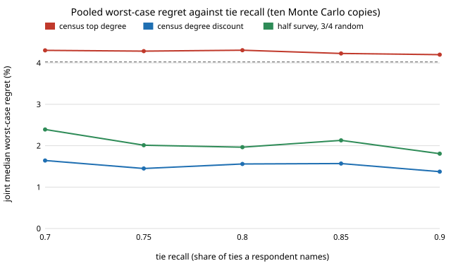

| rule, pooled joint median (MC se) | &rho; = 0.7 | 0.75 | 0.8 | 0.85 | 0.9 |
|---|---|---|---|---|---|
| census top degree | 4.30% (0.14) | 4.29% (0.13) | 4.31% (0.11) | 4.23% (0.11) | 4.20% (0.10) |
| census degree discount | 1.64% (0.16) | 1.45% (0.10) | 1.56% (0.12) | 1.57% (0.12) | 1.37% (0.10) |
| half survey, 3/4 random | 2.39% (0.11) | 2.01% (0.10) | 1.96% (0.10) | 2.13% (0.14) | **1.81%** (0.12) |

- **H38 held.** In none of the 12 adjacent pairs does more recall score worse by over 2 se.
- **H39 held.** Census degree discount at 0.85 minus 0.75 is +0.12 point (se 0.15). The first five
  copies, which reproduce milestone 14's, all ran high at 0.85; the five new ones do not.
- **H40 held.** Ten copies bring every Monte Carlo se to 0.10&ndash;0.16 point.
- **H41 held.** The half survey loses 1.8&ndash;2.4% at every recall level and beats perfect-census
  top degree in 97&ndash;99% of draws.
- Slopes: census rules are flat across the range (&minus;0.05 and &minus;0.08 point per 0.1 of
  recall, within noise); the half survey gains 0.21 point per 0.1 of recall (se 0.07), since it
  uses named ties twice, to pick its second stage and to rank.
- Sanity half met: copy 0 reproduces milestone 14's to 0.05 point, but copies 1&ndash;4 differ
  by up to 0.14, because a key rule beats the fixed reference in 2&ndash;5% of cells of a single
  copy (the plan expected near zero) and milestone 14 put the swapped rules in the reference.

## Milestone 16: what if respondents name ties that do not exist? (`experiments/m16_false_ties/`)

Every survey error modelled so far was a forgotten tie. The other kind is a false one: a
respondent names a household they have no tie to. The archive cannot separate a one-sided name
from a forgotten tie, so the false-tie rate is swept, not measured: at the measured recall of
0.85, each household also names Poisson(&phi; &times; its degree) households it has no tie to,
with &phi; = 0.1, 0.25 and 0.5, placed either uniformly at random or among friends of friends
(triadic closure, the error of mistaking a friend's friend for a friend). Three rules, five
Monte Carlo copies each, scored against milestone 15's fixed reference; the contagion always runs
on the true network. Plan and hypotheses (H42&ndash;H45) logged before the run.


| rule, pooled joint median (MC se) | no false ties | &phi; = 0.1 uniform / closure | 0.25 uniform / closure | 0.5 uniform / closure |
|---|---|---|---|---|
| census top degree | 4.33% (0.09) | 4.61 / 4.78% | 4.30 / 5.09% | 4.41 / 5.12% |
| census degree discount | 1.82% (0.19) | 1.70 / 1.64% | 1.81 / 1.92% | 2.16 / 2.78% |
| half survey, 3/4 random | 2.32% (0.24) | 2.21 / 2.24% | 2.42 / 2.70% | 2.60 / 2.89% |

Monte Carlo se 0.07&ndash;0.29 point per cell (`verdicts.txt`).

- **H42 held.** With up to one false tie per four true ones, the half survey loses 2.2&ndash;2.7%
  and beats perfect-census top degree in 95&ndash;98% of draws.
- **H43 held.** False ties at &phi; = 0.25 cost census degree discount nothing measurable
  (&minus;0.01 point uniform, +0.10 closure, se about 0.25).
- **H44 refuted, the other way round.** The plan predicted uniform false ties would hurt top
  degree more. Closure-placed ones do: at &phi; = 0.25, uniform scores 0.80 point better (se 0.22).
  Uniform false ties cost top degree nothing measurable at any rate; closure ones cost 0.5&ndash;0.8
  point. At &phi; = 0.5 the same holds for degree discount (0.62 point, se 0.20).
- **H45 held.** Even at one false tie per two true ones, census degree discount beats
  perfect-census top degree in 95&ndash;99% of draws.
- Exploratory (`diagnose.py`, after the run): the two placements scramble the degree ranking
  equally (a noisy census keeps 84% of the true top-b either way). Closure errors keep the chosen
  seeds slightly more clustered (3.15 true ties among them per seed against 3.09 under uniform);
  consistent with the scores, not established as the mechanism.

The kind of error matters more than its rate. Random false names are harmless at these rates;
names that close triangles cost every rule up to 1 point at &phi; = 0.5, where census degree
discount and the half survey become indistinguishable (2.8% and 2.9%). A survey's quality check
should look for triadic-closure errors, not only count unreciprocated names.

## Milestone 17: does keeping only reciprocated ties undo false ties? (`experiments/m17_reciprocity/`)

Milestone 16 found triangle-closing false ties cost every rule up to a point. The usual field fix
is a reciprocity filter: keep a tie only if both ends name it. At 85% recall per tie end that
costs true ties too (a census sees a true tie with probability 0.85<sup>2</sup> = 0.72 instead of
0.98), and in a partial survey only ties between two surveyed households can be checked. Milestone
16's harness and reference, three rules &times; five false-tie cells &times; with and without the
filter, five Monte Carlo copies each. Plan and hypotheses (H46&ndash;H50) logged before the run.

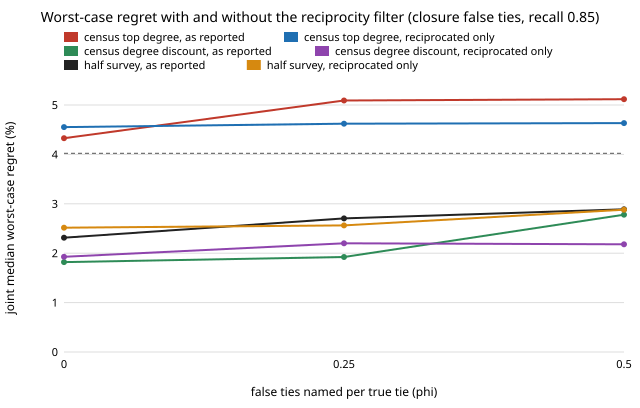

| pooled joint median, as reported &rarr; reciprocated only | no false ties | &phi; = 0.25 uniform / closure | &phi; = 0.5 uniform / closure |
|---|---|---|---|
| census top degree | 4.33 &rarr; 4.55% | 4.30 &rarr; 4.34 / 5.09 &rarr; 4.62% | 4.41 &rarr; 4.57 / 5.12 &rarr; 4.63% |
| census degree discount | 1.82 &rarr; 1.93% | 1.81 &rarr; 1.61 / 1.92 &rarr; 2.20% | 2.16 &rarr; 1.75 / 2.78 &rarr; 2.18% |
| half survey, 3/4 random | 2.32 &rarr; 2.52% | 2.42 &rarr; 2.90 / 2.70 &rarr; 2.56% | 2.60 &rarr; 2.81 / 2.89 &rarr; 2.88% |

Monte Carlo se 0.03&ndash;0.31 point per cell; paired differences and z in `verdicts.txt`. The 15
unfiltered rules reproduce milestone 16 to 5e-6.

- **H46 held.** At one closure false tie per two true ones the filter saves census degree discount
  0.60 point (se 0.24).
- **H47 held, weakly.** With no false ties the filter costs census degree discount +0.11 point, but
  se 0.36, so up to about 0.8 is not excluded; census top degree pays a clear +0.23 (se 0.10).
- **H48 held, weakly.** Filtered census degree discount shows no detectable slope in &phi; (+0.25
  at 0.5 closure, se 0.48); filtered top degree is flat with tighter se (+0.08, se 0.16, against
  +0.79 unfiltered).
- **H49 refuted.** The filter does nothing for the half survey under closure errors (&minus;0.01,
  se 0.16) and hurts it under random ones (+0.48 at &phi; = 0.25, z 3.7).
- **H50 held.** Census top degree at &phi; = 0.25, closure: &minus;0.47 point (se 0.20).

Filter a census; do not filter a partial survey. These are best cases for the filter, since false
reports are drawn independently at each end; correlated false reports would survive it.

## Milestone 18: does the filter survive false ties both ends report? (`experiments/m18_joint/`)

Milestone 17's filter assumed each end invents a false tie on its own, so almost none survive it.
Survey methodologists measure how often two respondents' reports of the same tie agree (Adams and
Moody 2007) and how respondent reports are biased (Feld and Carter 2002); here the case that matters
is two households who both name the same tie that does not exist. The archive cannot measure it
(its matrices are symmetrised), so the share &kappa; of false ties named by both ends is swept:
each false report i &rarr; j is echoed j &rarr; i with probability &kappa;
(`survey_recall(..., fp_joint=&kappa;)`). The echo adds no new pair, so an unfiltered census sees
exactly the same ties at every &kappa; (tested) and only the filter is affected. Milestone 17's
harness, &rho; = 0.85, &phi; = 0.5, 22 rules, five Monte Carlo copies each; plan and hypotheses
(H51&ndash;H55) logged before the run.

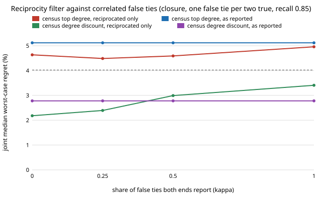

| pooled joint median (MC se) | as reported (any &kappa;) | filtered, &kappa; = 0 | 0.25 | 0.5 | 1 |
|---|---|---|---|---|---|
| census top degree, closure | 5.12% (0.26) | 4.63 (0.16) | 4.49 (0.08) | 4.59 (0.14) | 4.96% (0.18) |
| census degree discount, closure | 2.78% (0.22) | 2.18 (0.21) | 2.39 (0.18) | 2.99 (0.12) | 3.41% (0.12) |
| census top degree, uniform | 4.41% (0.20) | 4.57 (0.18) | | 4.58 (0.07) | 4.28% (0.07) |
| census degree discount, uniform | 2.16% (0.09) | 1.75 (0.11) | | 2.15 (0.06) | 2.69% (0.07) |
| half survey, closure | 2.89% (0.10) at &kappa; = 0, 3.18% (0.18) at 1 | 2.88 (0.07) | | | 3.56% (0.07) |

The 10 rules at &kappa; = 0 reproduce milestone 17's copies to 5e-6. Same-reference rows: perfect
census degree discount 1.18%, perfect census top degree 4.02%.

- **H51 refuted.** At &kappa; = 0.5 under closure, the filter no longer helps census degree
  discount: +0.21 point (se 0.19). The gain falls from &minus;0.60 (&kappa; = 0) to &minus;0.39
  (0.25) and crosses zero at &kappa; &asymp; 0.41 by interpolation (0.52 under uniform
  placement); the plan predicted about 0.85.
- **H52 refuted.** Census top degree does not pay for the filter even at &kappa; = 1: &minus;0.16
  (se 0.18) closure, &minus;0.13 (se 0.17) uniform. The degree ranking keeps working on the
  filtered ties.
- **H53 held.** Raising &kappa; never makes filtered closure scores better by more than 2 se; for
  census degree discount every step past 0.25 makes them worse (+0.60, z 7.6; +0.42, z 3.1).
- **H54 held.** For the half survey at &kappa; = 1 the filter costs +0.37 point (se 0.22).
- **H55 refuted.** Filtered census degree discount at &kappa; = 1, closure, beats a perfect census
  ranked by top degree in 87.6% of draws (bar 90%); unfiltered it does in 95.4%.

Degree discount suffers far more than top degree. At &kappa; = 1 the filter costs census degree
discount +0.63 (z 3.0) under closure and +0.52 (z 7.9) under uniform placement, five times milestone
17's +0.11 cost with no false ties. A likely reason, not tested: the filtered census keeps every
false tie but only 72% of true ones, so false ties make up a larger share of the ties degree
discount uses to space its seeds. Without a way to tell one-sided from mutual false ties, the
filter's sign for degree discount depends on a number the survey does not measure; top degree, the
weaker rule, is safe to filter either way.

## Milestone 19: does a soft filter keep the gain without the cost? (`experiments/m19_soft/`)

Milestone 18 left the filter's sign for degree discount depending on the share &kappa; of false ties
both ends report, which reciprocity cannot reveal. Instead of choosing, a checkable tie that only one
end names is kept at weight w (`survey_recall(..., recip=True, recip_w=w)`; w = 0 is the hard filter,
w = 1 keeps every report, both checked bit for bit in the tests). Weighted ties are the usual way to
carry measurement uncertainty into a network measure (Newman 2018), and degree discount's update
takes a weight unchanged. Milestone 18's harness, &rho; = 0.85, &phi; = 0.5, closure placement,
w = 0, 0.25, 0.5, 0.75 at &kappa; = 0, 0.5, 1 for both census rules: 26 rules, five Monte Carlo
copies each; plan and hypotheses (H56&ndash;H59) logged before the run.

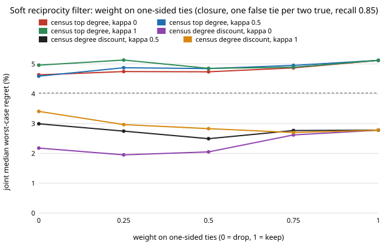

| census degree discount, pooled joint median | w = 0 (hard) | 0.25 | 0.5 | 0.75 | 1 (as reported) |
|---|---|---|---|---|---|
| &kappa; = 0 | 2.18% | 1.95 | 2.05 | 2.62 | 2.78% |
| &kappa; = 0.5 | 2.99% | 2.75 | 2.49 | 2.77 | 2.78% |
| &kappa; = 1 | 3.41% | 2.97 | 2.83 | 2.70 | 2.78% |
| worst over &kappa; | 3.41% | 2.97 | 2.83 | 2.77 | 2.78% |

The 8 shared rules reproduce milestone 18's copies to 4.8e-6. Monte Carlo se 0.09&ndash;0.32 point
per cell (`verdicts.txt`).

- **H56 held.** At &kappa; = 0, w = 0.5 saves census degree discount 0.73 point against keeping
  every report (se 0.17, z &minus;4.4); the hard filter saves 0.60.
- **H57 held.** At &kappa; = 1, w = 0.5 costs +0.05 (se 0.27); the hard filter costs +0.63 (z 3.0).
- **H58 held only in the letter.** The best worst case, w = 0.75 at 2.77%, beats keeping every
  report (2.78%) by 0.01 point; w = 0.5's worst is 2.83%. Read as a tie with the unfiltered census
  in the worst case, not a win.
- **H59 refuted.** For census top degree, w = 0.5 at &kappa; = 0 helps by 0.38 (se 0.29). No soft
  weight helps top degree measurably at any &kappa;, and post hoc the hard filter beats the soft one
  at &kappa; = 0.5 (z 1.9&ndash;3.4, [`paired.txt`](experiments/m19_soft/paired.txt)).

The plan predicted regret linear in w, which would have refuted H56 and H58. For degree discount all
9 soft cells sit below that line (by up to 0.43 point): a middle weight gets most of each end's
advantage. Post hoc, paired against the hard filter, the half weight is better at &kappa; = 0.5
(&minus;0.50, z &minus;3.2) and &kappa; = 1 (&minus;0.58, z &minus;3.7), and w = 0.25 is better even
at &kappa; = 0 (&minus;0.23, z &minus;2.8). A likely reason, not tested: degree discount uses the seen
ties both to rank candidates and to push seeds apart, and a half-weight one-sided tie keeps some of
the true ties the hard filter drops while a false one pushes seeds apart only half as hard. For a
census ranked by degree discount the advice no longer hinges on &kappa;: count a tie only one end
names as half a tie. Checked at one false-tie rate and placement, the worst case for every rule in
milestone 16; other rates and random placement are untested.

## Milestone 20: does the half weight hold in other cells? (`experiments/m20_soft_cells/`)

Milestone 19's half weight was found at one false-tie rate and placement (&phi; = 0.5, closing
triangles), the worst case for every rule. A team cannot tune w to its unknown error, so w = 0.5 is
fixed and taken to three cells it would meet more often: no false ties, &phi; = 0.25 closing
triangles, and &phi; = 0.5 placed at random. In each, both census rules, unfiltered, hard-filtered
and half-weighted, the filtered ones at &kappa; = 0, 0.5, 1: 34 rules, five Monte Carlo copies each
(16 reproduce milestones 17 and 18 to 5.0e-6); plan and hypotheses (H60&ndash;H64) logged before the
run.

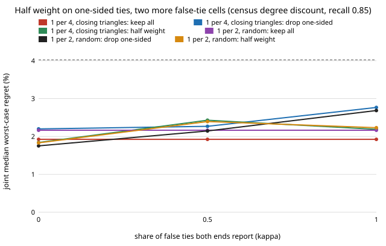

| census degree discount, pooled joint median | keep every report | hard filter, &kappa; = 0 / 0.5 / 1 | half weight, &kappa; = 0 / 0.5 / 1 |
|---|---|---|---|
| no false ties | 1.82% | 1.93% | 1.45% |
| &phi; = 0.25, closing triangles | 1.92% | 2.20 / 2.27 / 2.77% | 1.84 / 2.43 / 2.19% |
| &phi; = 0.5, random placement | 2.16% | 1.75 / 2.15 / 2.69% | 1.83 / 2.39 / 2.23% |
| &phi; = 0.5, closing triangles (milestone 19) | 2.78% | 2.18 / 2.99 / 3.41% | 2.05 / 2.49 / 2.83% |

Monte Carlo se 0.06&ndash;0.31 point per cell (`verdicts.txt`).

- **H60 held.** With no false ties the half weight costs census top degree +0.20 (se 0.14), about
  the hard filter's +0.23.
- **H61 refuted.** At &phi; = 0.25 closing triangles, &kappa; = 0.5, the half weight is worse than
  keeping every report by 0.50 point (se 0.12, z 4.3); at &kappa; = 1 by 0.26 (z 2.0).
- **H62 held.** The half weight's worst case over &kappa; is below the hard filter's in both cells
  (2.43 against 2.77%; 2.39 against 2.69%); paired at &kappa; = 1 it is better by 0.58 (z &minus;2.7)
  and 0.45 (z &minus;8.5).
- **H63 refuted.** At &phi; = 0.5 random placement and &kappa; = 0 the half weight saves 0.33
  (se 0.20, z &minus;1.6), short of the bar; the hard filter's 0.41 (z &minus;2.9) is the clearer gain.
- **H64 refuted.** The half weight's worst case is above keeping every report in both cells:
  +0.51 (se 0.12) and +0.23 (se 0.17).

Two of five hypotheses held, against a plan that expected all five. Over the four cells and three
&kappa; points the worst case of census degree discount is 2.78% keeping every report, 2.83% at half
weight and 3.41% with the hard filter, so a team that knows nothing about its false ties loses about
the same either of the first two ways, and the hard filter is dominated. The half weight's edge
(milestone 19's &minus;0.73) is confined to abundant, triangle-closing, mostly one-sided false ties;
with fewer false ties some of them mutual, it costs up to half a point. Not explained: at
&phi; = 0.25 the half weight is worse at &kappa; = 0.5 than at &kappa; = 1 (2.43 against 2.19%),
which five copies cannot separate from noise. For census top degree either filter saves 0.4&ndash;0.5
point under triangle-closing false ties and nothing elsewhere.

## What this does and does not say

It says the archived code and data, ported, give q<sub>N</sub> &asymp; 0.05 and a weakly
pinned q<sub>P</sub>. Milestone 2 says two
complex-contagion models fit better in sample and predict held-out villages no better (worse
on average), and that the take-up curve by adopting neighbours is more convex than the simple
model's. It does not say adoption is a simple contagion: it says these moments, on 43
villages, do not reward the extra parameter out of sample. Identification and seeding come in
milestones 3 and 4. Milestone 3 says the moments used here cannot reliably choose between
the models (in sample they cannot at all), and that all three models are too homogeneous across
villages. Adoption is observed once, not over time, so homophily and contagion are confounded
(Shalizi and Thomas 2011); every model here is a fitted description of these 43 villages.

## Run it

```
python3 data/build_dataset.py "<mirror>/datav4.0/Matlab Replication"   # optional, rebuilds the data
python3 -m pytest -q tests                                                # 90 tests, about 5 s
python3 experiments/m1_reproduce/run.py      # about 2 minutes on 4 cores, writes results.txt
python3 experiments/m1_reproduce/twostep.py  # seconds, needs run.py's dgrid.npz
python3 experiments/m1_reproduce/periods.py  # about 12 minutes, periods.txt
python3 experiments/m1_reproduce/figure.py
python3 experiments/m2_complex/run.py        # about 2 minutes, results.txt
python3 experiments/m2_complex/refine.py     # about 4 minutes, refine.txt (post hoc)
python3 experiments/m2_complex/figure.py
python3 experiments/m3_identify/run.py       # about 2 minutes on 4 cores, results.txt
python3 experiments/m3_identify/figure.py
OMP_NUM_THREADS=1 python3 experiments/m3b_hetero/run.py   # about 16 minutes on 4 cores, results.txt
python3 experiments/m3b_hetero/figure.py
OMP_NUM_THREADS=1 python3 experiments/m4_seeding/run.py   # about 3 minutes on 4 cores, results.txt, regret.json
python3 experiments/m4_seeding/figure.py
OMP_NUM_THREADS=1 python3 experiments/m5_cheap/run.py     # about 3.5 minutes on 4 cores, results.txt, regret.json
python3 experiments/m5_cheap/figure.py
OMP_NUM_THREADS=1 python3 experiments/m6_uncertainty/run.py  # about 10 minutes on 4 cores, results.txt, regret.json
python3 experiments/m6_uncertainty/figure.py
OMP_NUM_THREADS=1 python3 experiments/m7_complex/run.py      # about 3.5 minutes on 4 cores, results.txt, regret.json
python3 experiments/m7_complex/figure.py
OMP_NUM_THREADS=1 python3 experiments/m8_cc_uncertainty/run.py  # about 11 minutes on 4 cores, results.txt, verdicts.txt
python3 experiments/m8_cc_uncertainty/figure.py
OMP_NUM_THREADS=1 python3 experiments/m9_survey/run.py         # about 3.5 minutes on 4 cores, results.txt, regret.json
python3 experiments/m9_survey/figure.py
OMP_NUM_THREADS=1 python3 experiments/m10_survey_uncertainty/run.py  # about 12 minutes on 4 cores, results.txt, verdicts.txt
python3 experiments/m10_survey_uncertainty/figure.py
python3 experiments/m11_recall/measure_recall.py "<path to datav4.0>"  # 1 s, recall.txt (needs pandas)
OMP_NUM_THREADS=1 python3 experiments/m11_recall/run.py         # about 14 minutes on 4 cores, verdicts.txt
python3 experiments/m11_recall/figure.py
python3 experiments/m12_strength/measure_strength.py "<path to datav4.0>"  # 2 s, strength.txt (needs pandas)
OMP_NUM_THREADS=1 python3 experiments/m12_strength/run.py      # about 17 minutes on 4 cores, verdicts.txt
OMP_NUM_THREADS=1 python3 experiments/m13_streams/run.py       # about 20 minutes on 4 cores, verdicts.txt
python3 experiments/m13_streams/figure.py
OMP_NUM_THREADS=1 python3 experiments/m14_pooled/run.py        # about 26 minutes on 4 cores, verdicts.txt
python3 experiments/m14_pooled/figure.py
OMP_NUM_THREADS=1 python3 experiments/m15_grid/run.py          # about 50 minutes on 4 cores, verdicts.txt
python3 experiments/m15_grid/figure.py
OMP_NUM_THREADS=1 python3 experiments/m16_false_ties/run.py    # about 38 minutes on 4 cores, verdicts.txt
python3 experiments/m16_false_ties/figure.py
python3 experiments/m16_false_ties/diagnose.py                 # about 20 s, diagnose.txt (exploratory)
OMP_NUM_THREADS=1 python3 experiments/m17_reciprocity/run.py  # about 56 minutes on 4 cores, verdicts.txt
python3 experiments/m17_reciprocity/figure.py
OMP_NUM_THREADS=1 python3 experiments/m18_joint/run.py        # about 40 minutes on 4 cores, verdicts.txt
python3 experiments/m18_joint/figure.py
OMP_NUM_THREADS=1 python3 experiments/m19_soft/run.py         # about 58 minutes on 4 cores, verdicts.txt
python3 experiments/m19_soft/figure.py
python3 experiments/m19_soft/paired.py                        # seconds, paired.txt (post hoc)
OMP_NUM_THREADS=1 python3 experiments/m20_soft_cells/run.py   # about 70 minutes on 4 cores, verdicts.txt
python3 experiments/m20_soft_cells/figure.py
```

Needs numpy (and scipy for the data builder).

## Milestone 21: is milestone 20's dip real? (`experiments/m21_kappa_dip/`)

Milestone 20 found the half weight worse at &kappa; = 0.5 (2.43%) than at &kappa; = 1 (2.19%) at
&phi; = 0.25 false ties per true tie closing triangles, the cell that carried its strongest refutation.
This run takes census degree discount in that one cell to ten Monte Carlo copies (copies 0&ndash;4
reproduce milestone 20 to 4.9e-6; 5&ndash;9 are new streams) and adds &kappa; = 0.25 and 0.75 for the
half weight: nine rules; plan and hypotheses (H65&ndash;H68) logged before the run (about 50 minutes
on 4 cores).

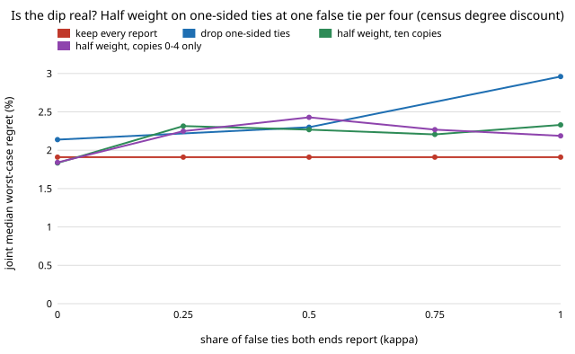

| census dd, &phi; = 0.25 closure, pooled joint median (10 copies) | &kappa; = 0 | 0.25 | 0.5 | 0.75 | 1 |
|---|---|---|---|---|---|
| keep every report | 1.91% | 1.91% | 1.91% | 1.91% | 1.91% |
| hard filter | 2.14% | | 2.30% | | 2.96% |
| half weight | 1.83% | 2.32% | 2.27% | 2.21% | 2.33% |
| half weight, milestone 20's copies 0&ndash;4 | 1.84% | 2.25% | 2.43% | 2.27% | 2.19% |

Monte Carlo se 0.08&ndash;0.12 point per rule (`verdicts.txt`).

- **H65 refuted.** The dip is not real: half weight at &kappa; = 0.5 minus &kappa; = 1 is &minus;0.06
  (se 0.16) over ten copies.
- **H66 refuted.** On copies 5&ndash;9 alone the sign reverses (&minus;0.36, se 0.23).
- **H67 held.** The half weight at &kappa; = 0.5 is still worse than keeping every report, +0.36
  (se 0.09, z 3.8), smaller than milestone 20's +0.50.
- **H68 held.** Worst over &kappa;, the half weight (2.33% at &kappa; = 1) is below the hard filter
  (2.96% at &kappa; = 1); paired at &kappa; = 1 it is better by 0.63 (z &minus;4.5).

The predictions that the dip would shrink below 0.15 point and that the half weight's cost would stay
above 2 se held; the prediction that &kappa; = 0.25 and 0.75 would fall between their neighbours did
not (&kappa; = 0.25 is already at the plateau). Reading: in this cell the half weight's curve is a
step. With no mutual false ties it ties keeping every report (&minus;0.08, se 0.11); from a quarter
mutual upward it costs 0.30&ndash;0.42 point (z 2.9&ndash;3.9), flat within noise
(adjacent steps &le; 0.12 point, z &le; 0.9). A likely reason, not tested: a mutual false tie keeps
full weight while one-sided true ties are halved, so even a few of them weigh more in the discount
than the false ties do unfiltered. The hard filter, by contrast, worsens steadily with &kappa;
(+0.23, +0.39, +1.05 against keeping every report). For a team that cannot know &kappa;, nothing
changes from milestone 20: keeping every report is the worst-case choice here, the half weight second
and the hard filter last. The ten copies also moved milestone 20's numbers by up to 0.19 point (hard
filter at &kappa; = 1: 2.77 to 2.96%), a reminder that five copies were thin for differences under
0.3 point.

## Milestone 22: where does the half weight's step come from? (`experiments/m22_step/`)

Milestone 21 found the half weight's cost at &phi; = 0.25 closure is a step in &kappa;, the share of
false ties both ends name, and guessed that mutual false ties keep full weight while one-sided true
ties are halved. Writing the test turned up an identity that settles part of the guess by construction
(`test_m22_census_kappa_moves_only_false_tie_weights`): in a census the recall draw is shared across
&kappa; and the echo is one uniform matrix thresholded at &kappa;, so &kappa; changes nothing but
which false ties keep full weight, a set nested in &kappa;; true-tie weights are the same at every
&kappa;. This run puts two new points near &kappa; = 0 and adds an oracle weighting that halves only
one-sided false ties (a diagnostic no field team can run): eight rules, ten copies, the four shared
with milestone 21 reproducing it to 4.9e-6; plan and hypotheses (H69&ndash;H73) logged before the
run (about 40 minutes on 4 cores). `seeds.py` compares the seed sets themselves.

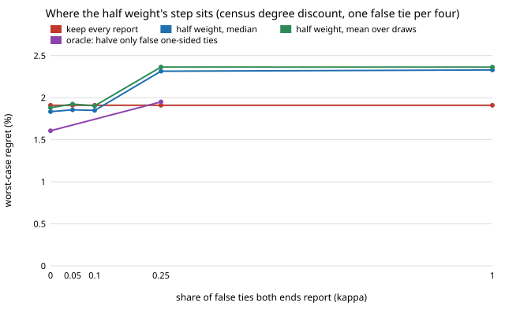

| census dd, &phi; = 0.25 closure, 10 copies | &kappa; = 0 | 0.05 | 0.1 | 0.25 | 1 |
|---|---|---|---|---|---|
| keep every report | 1.91% | 1.91% | 1.91% | 1.91% | 1.91% |
| half weight, joint median | 1.83% | 1.86% | 1.85% | 2.32% | 2.33% |
| half weight, mean over draws | 1.88% | 1.92% | 1.90% | 2.36% | 2.36% |
| oracle (halve only one-sided false ties) | 1.61% | | | 1.95% | |
| seeds swapped from the &kappa; = 0 set (copy 0) | 0% | 10.5% | 14.1% | 18.6% | 25.0% |
| seeds with a full-weight false tie seen | 18.7% | 48.4% | 67.0% | 90.8% | 99.9% |

Monte Carlo se 0.08&ndash;0.14 point per rule (`verdicts.txt`); seed shares over 43 villages &times;
100 draws (`seeds.txt`).

- **H69 refuted.** The step is not at the first mutual false ties: &kappa; = 0.05 minus &kappa; = 0 is
  +0.02 (se 0.18), and &kappa; = 0.1 is still +0.01 (se 0.16).
- **H70 refuted.** The step sits between &kappa; = 0.1 and 0.25: +0.47 (se 0.11, z 4.1), then flat to
  &kappa; = 1 (+0.02, se 0.09). The mean over draws gives the same numbers, so the step is in the
  seeding, not in the median.
- **H71 held.** At &kappa; = 0.25 the oracle beats the half weight by 0.37 (se 0.14, z 2.6): halving
  one-sided true ties is a real cost.
- **H72 refuted.** Yet the oracle only ties keeping every report at &kappa; = 0.25 (+0.04, se 0.16). At
  &kappa; = 0 it gains &minus;0.30 (se 0.15, z &minus;2.0, at the bar; copy 9 alone gives 0.52%).
- **H73 refuted, narrowly.** The seed sets change concavely, not as a step: 10.5% of seeds swapped at
  &kappa; = 0.05 against 25.0% at &kappa; = 1 (ratio 0.42, the bar was 0.5).

Predictions: H69 refuted and H71 held, as expected; H70 and H72 missed, and H73 was refuted as
predicted but closer to the bar than "in proportion to &kappa;". Reading: the regret step is not a
step in which seeds are picked, which drift steadily with &kappa;, but in what the swaps cost. Up to
&kappa; = 0.1 the swapped seeds are as good as the ones they replace; by &kappa; = 0.25, when nine in ten
seeds carry a full-weight false tie, they are not. Why the swaps turn costly in that window is not
answered here. Two parts are clear. With one false tie in four mutual, the half weight's gain from
halving the rest is gone. And even a perfect labeller of one-sided false ties only matches keeping
every report. A team that cannot measure &kappa; should therefore expect the half weight to help only
when false reports are almost never echoed, and should keep every report otherwise.

## Milestone 23: what do the costly swaps do? (`experiments/m23_swaps/`)

Milestone 22 put the half weight's step in worst-case regret between &kappa; = 0.1 and 0.25 while the
seed sets drift smoothly. This run looks at the swaps directly, without the bootstrap harness: copy 0's
seed draws (milestone 22's streams, checked by assertion), 43 villages &times; 100 draws, each set
scored under the three point fits (I, T, R) with 40 contagion runs shared across every set of a
village, so paired differences are tight. Alongside adopters it measures each set's true coverage
(households that are a seed or a true neighbour of one), the true ties among seeds, and the true degree
of the seeds swapped in and out. Plan and hypotheses (H74&ndash;H78) logged before the run (about 5
minutes on 4 cores).

| census dd, &phi; = 0.25 closure, point fits | half, &kappa; = 0 | half, &kappa; = 0.1 | half, &kappa; = 0.25 | keep every report |
|---|---|---|---|---|
| adopters (43 villages, mean of I, T, R) | 1896.53 | 1895.73 | 1894.08 | 1891.68 |
| true coverage of the seed set | 87.22% | 87.15% | 86.94% | 86.65% |
| true ties among seeds (summed) | 1719.6 | 1728.8 | 1755.3 | 1716.5 |
| false share of a seed's seen tie weight | 20.6% | 22.3% | 24.7% | 31.5% |

Contrasts paired over the 100 draws (`results.txt`).

- **H74 refuted.** No step under the point fits: &minus;0.80 adopters from &kappa; = 0 to 0.1 (se 0.15,
  z &minus;5.5) and &minus;1.65 from 0.1 to 0.25 (se 0.16, z &minus;10.4), 8.0 then 11.0 per unit
  &kappa;, with every family agreeing. The step milestone 22 saw is a property of the refitted
  processes that set the worst case, which turn a 0.09% average loss into 0.47 point of regret.
- **H75 held.** From &kappa; = 0.1 to 0.25 the sets cover 0.211 point fewer households (se 0.022)
  against 0.063 (se 0.021) before; per unit &kappa; the coverage loss steepens 2.2&times;, and true ties
  among seeds rise 26.5 (se 2.6) against 9.2.
- **H76 refuted.** The swapped-in seeds' true degree is lower, but by less in the costly window
  (&minus;0.33, se 0.05) than before it (&minus;0.45, se 0.06).
- **H77 refuted.** The loss is spread: 42 of 43 villages lose, the top five carry 27%.
- **H78 refuted, at the bar.** Village loss and coverage drop correlate at Spearman 0.295 (bar 0.3).

Reading: echoed false ties cost the half weight by crowding its seeds, pairs of true neighbours it
should have spread apart, not by swapping in weaker households, and on the average process the cost
grows smoothly. A guess, not tested: full-weight false ties among friends of friends spend degree
discount's discount on households that are not neighbours. Under the point fits the half weight still
beats keeping every report at every &kappa; (+2.40 adopters at &kappa; = 0.25, z 11.8); the worst case
over refits is where it loses, so a team that cannot measure &kappa; should still keep every report.
Limits: one copy of the seed draws, point fits only, coverage at one step.

## Milestone 24: which extra measurement would identify the model? (`experiments/m24_measure/`)

The proposal's third gap, never run until now: if the cross-section cannot tell the models apart
(milestone 3), which cheap addition to the survey would, and in how many villages? Two additions a
rollout's evaluator can budget for: an end-line **awareness** question (the model's informed set) and
adoption **timing** by trimester (from loan records). `src/civ_seeding/measure.py` keeps both in the
simulator (same draws as `complex.simulate`, `tests/test_measure.py`) and adds five moments each:
awareness share and take-up among the aware by adopting neighbours (0, 1, 2, 3+); the per-period
hazard by adopting neighbours and the mean adoption period. Milestone 3's harness runs unchanged (850
grid points, its three fitted processes, the same 200 synthetic datasets each), with random subsets of
20 and 10 villages for the power curve. Plan and six hypotheses logged before the run.

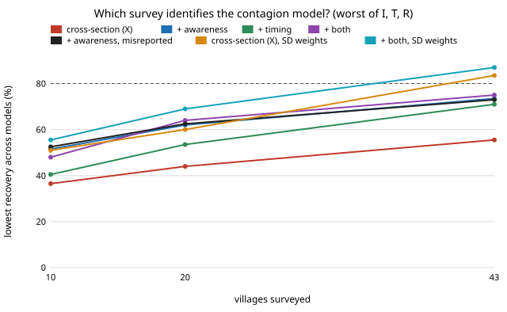

| design, leave one village out, identity weights | I | T | R&delta; | lowest, 43 villages | lowest, 20 | lowest, 10 |
|---|---|---|---|---|---|---|
| cross-section (milestone 3) | 58.5% | 82.0% | 55.5% | 55.5% | 44.0% | 36.5% |
| + awareness | 91.0% | 73.5% | 91.5% | 73.5% | 62.0% | 51.5% |
| + awareness, misreported 15% / 5% | 86.5% | 73.0% | 90.0% | 73.0% | 62.5% | 52.5% |
| + timing | 71.0% | 80.0% | 72.5% | 71.0% | 53.5% | 40.5% |
| + both | 93.5% | 75.0% | 92.0% | 75.0% | 64.0% | 48.0% |
| cross-section, each moment scaled by its SD (secondary) | 83.5% | 87.0% | 87.5% | 83.5% | 60.0% | 51.0% |
| + both, SD-scaled (secondary) | 96.0% | 87.0% | 98.0% | 87.0% | 69.0% | 55.5% |

- **Awareness separates simple from reinforcement; nothing here separates threshold from
  reinforcement.** Under the information model take-up among the aware is flat in adopting
  neighbours (25.2% with none, 26.1% with 3+); under reinforcement it rises (20.4% to 29.0%), and
  under the threshold model too (25.3% to 28.1%), so 22% of threshold datasets are called
  reinforcement once awareness is added (H79 refuted by that one family; H81 refuted).
- **Misreporting barely matters** (H84 held: 73.0% against 73.5%), and in sample awareness ends the
  criterion's pull towards the bigger model (recovery 98.5 / 95.5 / 100%, against 27.0 / 48.5 /
  99.5% for the cross-section).
- **Timing at trimester resolution helps less than awareness** (H80 held, narrowly at the bottom).
- **Village count matters as much as design** (H82 refuted): with 20 villages no identity-weighted
  design recovers every model in more than 64% of datasets.
- **The weighting was half the problem** (reported, not tested): scaling each moment by its spread
  across synthetic villages, instead of milestone 3's identity weights where moment 5 dominates,
  lifts the plain cross-section to 83.5% or more for every model. The scale came from the synthetic
  data; a study would take it from a bootstrap of its own, which was not tested.
- For seeding this changes nothing (milestones 4 to 23: the advice barely depends on the model); it
  says what an evaluator can learn and what to put in the end-line survey.

## Next steps

Milestone 24 finds an awareness question separates the simple model from reinforcement and that SD scaling of the moments matters more than either new measurement. Next: refit the real villages under SD or two-step weights and redo milestone 2's out-of-sample comparison; a moment that splits threshold from reinforcement (take-up among the aware by the share, not the count, of adopting neighbours). Then, from milestone 23: Milestone 23 finds the half weight's step is not in the average fitted process (a slope there, 8 then
11 adopters per unit &kappa;) and that the costly swaps crowd seeds together rather than pick weaker
ones. Next: which refitted processes set the worst case between &kappa; = 0.1 and 0.25 (the harness's
per-draw arg-max family and its parameters) and whether coverage loss predicts regret there; the
paper's tables with pooled medians and Monte Carlo error (milestones 10 to 23), moving the key
contrasts to ten copies; the half survey under the half weight; whether the hard filter's cost at high &kappa; comes from the
false share of seen ties; tie strength in the contagion itself; the controlled threshold sweep for
complex centrality (milestone 8); the two milestone-3b checks; then the paper draft, with milestones 4
to 23 as its seeding section.

## References

- Adams, J., Moody, J. (2007). To tell the truth: measuring concordance in multiply reported network data. *Social Networks* 29, 44–58. doi:10.1016/j.socnet.2005.11.009
- Banerjee, A., Chandrasekhar, A. G., Duflo, E., Jackson, M. O. (2013). The diffusion of microfinance. *Science* 341, 1236498. doi:10.1126/science.1236498. Working paper NBER w17743 (2012), the text quoted here.
- Banerjee, A., Chandrasekhar, A. G., Duflo, E., Jackson, M. O. (2013). The Diffusion of Microfinance [data]. Harvard Dataverse. doi:10.7910/DVN/U3BIHX (CC0 1.0).
- Beaman, L., BenYishay, A., Magruder, J., Mobarak, A. M. (2021). Can network theory-based targeting increase technology adoption? *American Economic Review* 111, 1918–1943. doi:10.1257/aer.20200295
- Centola, D., Macy, M. (2007). Complex contagions and the weakness of long ties. *American Journal of Sociology* 113, 702–734. doi:10.1086/521848
- Centola, D. (2010). The spread of behavior in an online social network experiment. *Science* 329, 1194–1197. doi:10.1126/science.1185231
- Guilbeault, D., Centola, D. (2021). Topological measures for identifying and predicting the spread of complex contagions. *Nature Communications* 12, 4430. doi:10.1038/s41467-021-24704-6
- Chen, W., Wang, Y., Yang, S. (2009). Efficient influence maximization in social networks. *Proc. KDD 2009*, 199–208. doi:10.1145/1557019.1557047
- Feld, S. L., Carter, W. C. (2002). Detecting measurement bias in respondent reports of personal networks. *Social Networks* 24, 365–383. doi:10.1016/S0378-8733(02)00013-8
- Granovetter, M. (1978). Threshold models of collective behavior. *American Journal of Sociology* 83, 1420–1443. doi:10.1086/226707
- Kempe, D., Kleinberg, J., Tardos, É. (2003). Maximizing the spread of influence through a social network. *Proc. KDD 2003*, 137–146. doi:10.1145/956750.956769
- Kim, D. A., Hwong, A. R., Stafford, D., Hughes, D. A., O'Malley, A. J., Fowler, J. H., Christakis, N. A. (2015). Social network targeting to maximise population behaviour change: a cluster randomised controlled trial. *The Lancet* 386, 145–153. doi:10.1016/S0140-6736(15)60095-2
- Newman, M. E. J. (2018). Network structure from rich but noisy data. *Nature Physics* 14, 542–545. doi:10.1038/s41567-018-0076-1
- Shalizi, C. R., Thomas, A. C. (2011). Homophily and contagion are generically confounded in observational social network studies. *Sociological Methods & Research* 40, 211–239. doi:10.1177/0049124111404820
