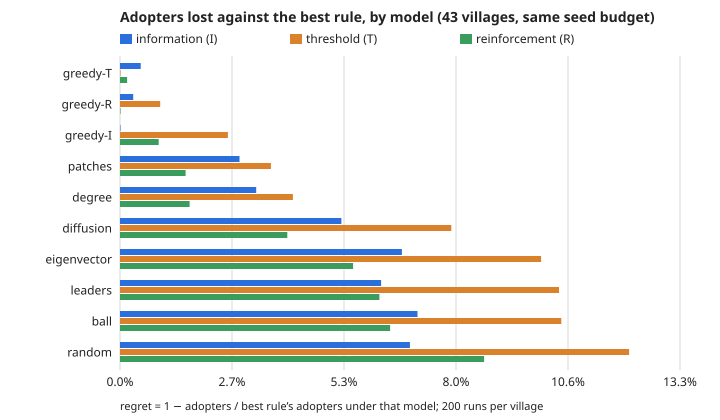
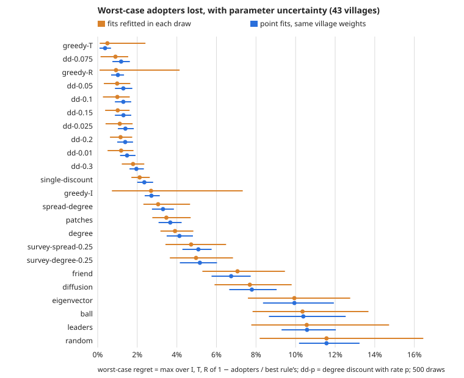

# civ-seeding: does technology adoption spread through village networks as a simple or a complex contagion, and which households should a rollout seed?

Does a new product spread through a village like news (one informed contact is enough) or like
a behaviour that needs reinforcement from several adopters? And if the data cannot tell, whom
should a rollout seed first? This programme asks that on the 43 Karnataka village networks of
Banerjee, Chandrasekhar, Duflo and Jackson (2013), where a lender introduced microfinance
through village leaders. **Latest step (milestone 6): the cheap rule stays robust when the fitted models themselves are uncertain.** Refitting all three contagion models in each of 500 village bootstrap draws (the fits move a lot: 205 distinct fitted processes), degree discount loses a median 1.0% of adopters against the best rule under its worst model (5&ndash;95%: 0.3&ndash;1.6%), beats top degree in every draw, and its one rate parameter hardly matters (0.9&ndash;1.2% for any p from 0.01 to 0.15). The model-specific greedy rules get longer tails (greedy under the threshold model up to 2.4%, under the information model up to 7.3%); degree discount does not. **Milestone 5: a seeding rule that needs a list of who knows whom but no fitted model comes within 1.4% of the best rule under every model, and surveying a quarter of households costs about one more point.** Degree discount (Chen, Wang and Yang 2009), which picks well-connected households while discounting ties to households already seeded, loses at most 1.4% of adopters under the three fitted models (top degree: 4.1%; greedy under the threshold model, which also needs a fitted model: 0.5%). Simply forbidding adjacent seeds does worse (3.4%): it pushes seeds down to 13 ties each. If a rollout surveys only 25% of households, top degree on the estimated degrees loses up to 4.5%; asking random households to name a contact and seeding the named (friend nomination, no network data) loses up to 6.2%, against 12.1% for random seeds. **Milestone 4: whom to seed barely depends on which contagion model is right, and the best seeds are spread out, not clustered.** Scoring ten seeding rules under all three fitted models on the 43 real networks, one rule, greedy seeding under the threshold model, loses at most 0.5% of adopters against the best rule under every model; the structural rules rank almost the same under all three (Kendall &tau; 0.81 to 1.0). Seeding the highest-degree households loses 1.7 to 4.1%; the lender's actual leaders lose 6 to 10%; one clustered patch of neighbours loses 6 to 10.5%, even under the threshold model, where clustering was supposed to help. The greedy seeds have moderate degree (12 to 15 ties against 23 for the top-degree rule) and are rarely neighbours of each other. **Milestone 3b: the real villages cluster their adopters far more than the simple model allows, and a village random effect does not fix it; a threshold cascade model does.** Letting each village's base adoption rate vary (a random effect fitted to how much take-up varies between villages) adds nothing: the fitted spread is zero for all three models, because word of mouth alone already makes take-up vary as much between simulated villages as between real ones. The real held-out error (0.181) stays far above every synthetic dataset from the simple model (5&ndash;95%: 0.044&ndash;0.068), and 57% of it is one moment that measures adopters next to adopters' neighbours. A threshold model, where a household adopts once half its neighbours have, produces that clustering: 19% of its synthetic datasets reach the real error, and it now predicts held-out villages best (0.169 against 0.181 for the simple model and 0.210 for reinforcement). **Third step (milestone 3): the estimation cannot reliably tell the
models apart, and the real villages fit none of them.** On 200 synthetic datasets per model,
simulated on the real networks, the in-sample criterion picks the reinforcement model for 85%
of datasets made by the simple model; leaving one village out recovers the true model 58.5%
(simple), 82% (threshold) and 55.5% (reinforcement) of the time. The real villages' held-out
prediction errors are two to four times larger than any fitted model produces in its own
synthetic data. **Second step (milestone 2): reinforcement and threshold models fit the villages better in
sample (reinforcement &gamma; = 0.10, positive in 99.5% of bootstrap draws; criterion 41% lower)
but predict held-out villages worse than the simple information model (better in 13 and 19 of
43 villages), while take-up by number of adopting neighbours (8% with none, 35% with four or
more) is more convex than the simple model's.** First step (milestone 1): a Python port of the authors' own
estimation code reproduces their data (non-leader take-up 18.7% against the published 18.5%,
leaders 24.7% against 24.8%), their finding that adopters pass the news on more than
non-adopters (q<sub>P</sub> &gt; q<sub>N</sub> in 98.4% of 1,000 bootstrap draws) and the published
effect of switching off non-adopters' word of mouth (take-up falls by a third: 0.337 against
the paper's 0.32). It does not land on the published point estimate: the criterion minimum is
at q<sub>N</sub> = 0.05, q<sub>P</sub> = 0.30 for three simulation seeds, against the published
0.10 and 0.50, and the published point scores 11 times our minimum. q<sub>P</sub> is weakly
identified (bootstrap 95% interval 0.15 to 1.0)**, a first hint for the programme's question
of what these data can and cannot identify. Produced with AI assistance (Claude Code); no
affiliation with the data's authors is implied. Results are about a fitted model of past
adoption, not advice about any real village or household.

**Live page:** https://marisstella.app/research/civ-seeding/

Programme: [`PROPOSAL.md`](PROPOSAL.md) (question, 15 checked references, hypotheses, plan,
target venue). Research log, written before each run: [`LOG.md`](LOG.md). Track 24 (`civ`,
`research/PROJECTS.md`); earlier synthetic-graph seeding results in
[`research/civ-levers`](../civ-levers).

## Why this question

Two literatures give opposite seeding advice. Fitting a simple information model to these
villages, Banerjee et al. (2013) rank households by diffusion centrality; experiments and
models of *complex* contagion find clustered seeds beat central ones (Centola and Macy 2007;
Centola 2010), and a Malawi field trial found seeds chosen for a complex contagion raised
adoption of a farming technology (Beaman et al. 2021). Which one a rollout of solar home
systems, cookstoves or farm kits should follow depends on which contagion is at work, and
on whether adoption data of this kind can tell. The plan is in `PROPOSAL.md`.

## Data

`data/bcdj_villages.json.gz` (146 kB): the 43 villages the authors' estimation code uses, each
household network restricted to its giant component (9,126 households, 44,367 ties of any
kind), with microfinance take-up, leader status, six household covariates and months of
exposure. Built by `data/build_dataset.py` from the replication archive (Harvard Dataverse,
doi:10.7910/DVN/U3BIHX, CC0 1.0). The Dataverse file sits behind a guestbook form, so this
session read the same `datav4.0` archive from a public GitHub mirror
(`ftschofenig/EmergentDirectedness`); the builder checks sizes and symmetry, and the test suite
checks the take-up figures against the paper.

## Milestone 1: reproduce the information model (`experiments/m1_reproduce/`)

Model (`src/civ_seeding/bcdj.py`, a port of `diffusion_model.m`, `moments.m`,
`divergence_model.m` and `Main_models_1_3.m`): leaders are told first; a household decides
once, when first told, with a logit probability in its covariates fitted on leaders; every
informed household tells each neighbour each four-month period with probability q<sub>P</sub>
if it adopted, q<sub>N</sub> if not. Five moments (take-up among households with no adopting
neighbour, next to adopting and non-adopting leaders, and covariances with neighbours' and
second neighbours' take-up), identity weights, the authors' grid (31 &times; 39 points), 75
simulations per village, common random numbers, and the authors' Bayesian bootstrap over
villages (1,000 draws). Hypotheses were logged before the run.

| check | ours | published (NBER w17743) | verdict |
|---|---|---|---|
| non-leader take-up, mean (SD) | 0.187 (0.082) | 0.185 (0.084) | H1 held |
| leader take-up, mean (SD) | 0.247 (0.126) | 0.248 (0.125) | H1 held |
| q<sub>N</sub>, q<sub>P</sub> (grid minimum) | 0.05, 0.30 (seeds 0, 1, 2) | 0.10, 0.50 | H2 refuted for q<sub>P</sub> |
| bootstrap 95% interval q<sub>N</sub> / q<sub>P</sub> | [0.05, 0.10] / [0.15, 1.00] | both &gt; 0 | covers the published point |
| share of draws with q<sub>P</sub> &gt; q<sub>N</sub> | 0.984 | significant | H3 held |
| take-up with q<sub>N</sub> = 0, relative drop | 0.194 &rarr; 0.129 (0.337) | 0.202 &rarr; 0.137 (0.32) | H4 held |
| informed share, q<sub>N</sub> = 0 | 0.78 &rarr; 0.55 | 0.81 &rarr; 0.57 | close |

At our estimate the simulated take-up (19.4%) and informed share (78%) sit closer to the
published 20.2% and 81% than the same simulation at the published (0.10, 0.50) does (22.8%,
89%). Restricting q<sub>N</sub> = q<sub>P</sub> doubles the criterion (q = 0.10), the
paper's case for a difference.


Not pre-registered, run after seeing the gap (`twostep.py`, `periods.py`): two-step optimal
weights move q<sub>P</sub> lower (0.20 to 0.25), not toward 0.50; q<sub>N</sub> stays at 0.05.
Shorter periods mean more rounds of telling, so the fitted probabilities fall: quarters give
(0.05, 0.15) and months (0.01, 0.10), with the published point at 17 and 38 times the minimum.
No setting we tried moves toward (0.10, 0.50).

What we can say: the port reproduces the data, the sign and significance of
q<sub>P</sub> &gt; q<sub>N</sub>, and the counterfactual, but not the published point. Possible
reasons we have not ruled out: the published table may use other moments, weights or a
finer grid than the archived script's defaults; the Science version (not opened) may differ
from the 2012 working paper; or our port differs in a way the tests do not catch. The criterion
is flat in q<sub>P</sub> (within a factor of 2 of the minimum from 0.25 to 0.50 at
q<sub>N</sub> = 0.05), so the published q<sub>P</sub> is not far out in fit; q<sub>N</sub> = 0.10
is (2 to 16 times the minimum at every q<sub>P</sub>).

## Milestone 2: simple or complex contagion? (`experiments/m2_complex/`)

Two complex-contagion families next to the information model (I), on the same information
spread (`src/civ_seeding/complex.py`): **reinforcement** (R), where an informed household's
logit gains &gamma; per adopting neighbour and it can adopt in any later period as that count
grows (&gamma; = 0 is I exactly), and a **fractional threshold** (T, after Granovetter 1978), where an informed household
also adopts once a share &theta; of its neighbours has. Fitted by the same simulated method of
moments, on the BCDJ five moments and an extended set of eight that adds take-up among
households with 1, 2 and 3+ adopting neighbours. Compared out of sample by leaving each
village out in turn: fit on 42 villages with one simulation seed, score the held-out village
with another, paired Bayesian bootstrap over villages. Plan logged before the run.

| comparison (extended moments) | in-sample criterion | held-out loss (mean, 43 villages) | complex model better in | verdict |
|---|---|---|---|---|
| I: q<sub>N</sub> 0.05, q<sub>P</sub> 0.3 | 4.22e&minus;3 | 0.174 | | |
| T: &theta; 0.60, q<sub>N</sub> 0.075, q<sub>P</sub> 0.1 | 3.45e&minus;3 | 0.184 | 23.8% of paired draws, 19/43 villages | H3b held |
| R, pre-registered grid, beta fixed | = I (&gamma;-hat 0) | 0.174 | 0% | H3 held, uninformative |
| R&delta;, post-hoc fine grid, free intercept: &gamma; 0.10, &delta; &minus;0.25, q<sub>N</sub> 0.10, q<sub>P</sub> 0.1 | 2.47e&minus;3 | 0.191 | 12.2% of paired draws, 13/43 villages | prediction held |

**Reinforcement fits these villages better and predicts them worse.** With a fine grid and a
free intercept, &gamma;-hat is 0.10 and positive in 99.5% of 1,000 bootstrap draws, and the
in-sample criterion falls 41%; but a model fitted on 42 villages scores the 43rd worse than the
plain information model in 30 of 43 cases. The threshold model behaves the same way. So far the
data do not let either complex contagion beat the simple one where it counts, out of sample.
Freeing &gamma; also moves the fitted q<sub>P</sub> from 0.3 to 0.1: reinforcement and adopters'
word of mouth stand in for each other, which is the identification question of milestone 3.

The pre-registered reinforcement grid (&gamma; in steps of 0.25, beta fixed by the leader logit)
could not see a small &gamma;: with the level already matched, any &gamma; &ge; 0.25 adds adoption
that nothing absorbs, and the criterion rises 13-fold. That is a design fault the run found;
the free-intercept, fine-grid re-run (`refine.py`) is labelled post hoc in the log.


The descriptive that does stand out: take-up among non-leaders rises from 8.3% with no
adopting neighbour to 35.0% with four or more, a steeper, more convex curve than the fitted
information model's (8.1% to 27.2%). The model puts too many adopters next to exactly one
adopter (0.184 against 0.143, gap interval [&minus;0.063, &minus;0.018]) and too few next to four or
more (0.272 against 0.350, [+0.037, +0.117]). That is the shape reinforcement predicts, and also
the shape homophily or a degree effect would leave in one cross-section.

## Milestone 3: can these moments tell the models apart? (`experiments/m3_identify/`)

Identification by simulation, on the real networks. From each milestone-2 fit (information I;
threshold T at &theta; 0.60; reinforcement R&delta; at &gamma; 0.10, &delta; &minus;0.25) we drew 200
synthetic datasets (one adoption outcome per village each), refitted all three families on an
850-point grid with disjoint families, and asked which family two selection rules pick: lowest
in-sample criterion, and lowest leave-one-village-out loss (the milestone-2 protocol). Moments 2
and 3 depend on each dataset's leader take-up; they are linear in simulated adoption, so one
simulation per grid point serves every dataset exactly (`tests/test_identify.py`). The leader
logit is held at its real-data value, which helps the rules, so these recovery rates are if
anything optimistic. Plan logged before the run.


| rule, moments | recovers I | recovers T | recovers R&delta; |
|---|---|---|---|
| in sample, BCDJ five | 14.5% | 8.5% | 82.5% |
| in sample, eight | 27.0% | 48.5% | 99.5% |
| leave one village out, BCDJ five | 56.5% | 83.0% | 12.5% |
| leave one village out, eight | 58.5% | 82.0% | 55.5% |

- **H2 held.** In sample, the criterion picks the bigger model whatever made the data: data
  from the simple model are called reinforcement 85% of the time (BCDJ five moments).
- **H2b held.** With reinforcement as the truth, leave-one-out on the eight moments prefers it to
  the simple model in only 67% of datasets, so milestone 2's verdict against reinforcement is
  weak evidence.
- **Local identification.** The Jacobian of the moment map at the reinforcement fit has
  condition number 79 (256 on the BCDJ five alone). The weak direction is not, as we predicted,
  adopters' word of mouth against reinforcement: it is the base adoption rate against
  non-adopters' word of mouth and reinforcement together (raise one, lower the others, and the
  moments barely move). Our prediction failed.
- **The real data are not like any model's data** (a post-hoc check, labelled as such). Real
  held-out losses (0.17 to 0.19) sit above the 95th percentile of every model's synthetic losses
  (0.04 to 0.12), and the real 13-of-43 village count for reinforcement against the simple model
  is below what any model produces in all but 2.5% (simple) and 13% (threshold) of datasets.
  The villages differ from each other far more than these models allow. That misfit is larger
  than the simple-against-complex difference itself, so the next step adds village-level
  heterogeneity before any seeding comparison.

## Milestone 3b: is it village heterogeneity? (`experiments/m3b_hetero/`)

Milestone 3 found the real villages' held-out errors two to four times larger than any fitted
model's own synthetic data. The obvious suspect was village-level heterogeneity in the base
adoption rate, so every family gained &sigma;, the SD of a per-village, per-run shift of every
household's logit, identified by a ninth moment (the squared non-leader take-up rate, which pins
the cross-village variance of take-up). I and T also gained the intercept shift &delta; that
R&delta; already had. Grid of 8,100 points; fit on nine moments, held-out loss on milestone 3's
eight; 200 synthetic datasets from each family's real-data fit. Plan and hypotheses logged
before the run; a per-moment breakdown was added after a smoke run on a tiny grid, and is
labelled as such.


| | information (I) | threshold (T) | reinforcement (R&delta;) |
|---|---|---|---|
| in-sample fit, nine moments | q<sub>N</sub> 0.05, q<sub>P</sub> 0.3, &sigma; 0 | &theta; 0.50, &delta; &minus;0.25, &sigma; 0 | &gamma; 0.10, &delta; &minus;0.25, &sigma; 0 |
| &sigma;-hat = 0 in bootstrap draws | 20.1% | 73.6% | 70.9% |
| real held-out loss | 0.181 | 0.169 | 0.210 |
| that model's synthetic held-out loss of I, 5&ndash;95% | 0.044&ndash;0.068 | 0.062&ndash;0.369 | 0.050&ndash;0.087 |
| synthetic datasets reaching the real I loss | 0% | 19% | 0% |
| recovered, leave one village out (milestone 3) | 37.0% (58.5%) | 77.5% (82.0%) | 49.5% (55.5%) |

- **H6 refuted: there is no base-rate heterogeneity to find.** &sigma;-hat is 0 in every
  family. With &sigma; = 0 the simple model already matches the mean squared village take-up
  rate (residual &minus;0.0004): in a village of about 200 households, whether the news happens
  to spread gives as much village-to-village variation in take-up as the data show.
- **H7 refuted for the simple model:** no synthetic dataset from it, or from reinforcement,
  reaches the real held-out loss. **The threshold model reaches it** (reported, not tested):
  its outcomes are close to all-or-nothing village by village, and 19% of its datasets are as
  far from the fit as the real villages are.
- **Where the misfit is.** The real error is above the simple model's band in all nine moments,
  and 57% of it is moment 5 (own adoption times second-neighbour adopters, divided by degree,
  as the authors' `moments.m` computes it): 0.103 against 0.012&ndash;0.027. Moments 4 and 8
  (adopters next to adopters; take-up with three or more adopting neighbours) are next. The
  villages are not over-dispersed in how many households adopt but in *where* adoption sits.
  The threshold band covers the real value in seven of nine moments.
- **Identification gets worse, not better.** With &sigma; and &delta; free, leave-one-out
  recovers the simple model in 37% of its datasets (calling it reinforcement 39% of the time),
  and in sample still picks the bigger model. &sigma; itself is poorly recovered: with true
  &sigma; = 0, the simple model's fit returns 0.25 or 0.5 in 58% of datasets.
- Caveats: beta stays at the real-data leader logit and ignores the random effect; the
  threshold model is the only one of three that fits the dispersion, and homophily (similar
  households befriending each other) would also cluster adopters; moment 5's scale, a quirk
  kept for faithfulness, dominates the identity-weighted criterion.

## Milestone 4: whom should a rollout seed? (`experiments/m4_seeding/`)

Ten seeding rules at each village's own leader budget (1,140 seeds in all), each scored under the
three milestone-3b fits (I: q<sub>N</sub> 0.05, q<sub>P</sub> 0.3; T: &theta; 0.50, &delta;
&minus;0.25, q<sub>N</sub> 0.075, q<sub>P</sub> 0.1; R&delta;: &gamma; 0.10, &delta; &minus;0.25,
q<sub>N</sub> 0.10, q<sub>P</sub> 0.1) and two sensitivity points (T at &theta; 0.60; I at the
published q<sub>N</sub> 0.10, q<sub>P</sub> 0.50). Seeds take the leaders' place in the model:
told first, and adopting by the model's own rule. Rules (`src/civ_seeding/seeding.py`): the
observed leaders, uniform random, top degree, top eigenvector and diffusion centrality
(q = 1/&lambda;<sub>1</sub>, the village's period count; after Banerjee et al. 2013), one
clustered ball grown breadth-first from the top-degree household, patches of four (a hub and its
three best-connected neighbours, hubs not adjacent), and greedy influence maximisation (Kempe et
al. 2003) under each of the three models. Greedy searched on 32 runs with common random numbers
(a batched simulator that reproduces `complex.simulate` exactly, `tests/test_seeding.py`); every
rule is then scored on 200 fresh runs per village. Regret is the share of expected adopters lost
against the best rule under that model; intervals are a village Bayesian bootstrap (B = 1,000).
Plan, hypotheses and predictions logged before the run.



| rule | regret under I | under T | under R&delta; | worst case | mean seed degree |
|---|---|---|---|---|---|
| greedy under T | 0.5% | 0 | 0.2% | **0.5%** | 15.0 |
| greedy under R&delta; | 0.3% | 1.0% | 0 | 1.0% | 14.6 |
| greedy under I | 0 | 2.6% | 0.9% | 2.6% | 12.0 |
| patches of four | 2.8% | 3.6% | 1.6% | 3.6% | 20.6 |
| top degree | 3.2% | 4.1% | 1.7% | 4.1% | 23.1 |
| diffusion centrality | 5.3% | 7.9% | 4.0% | 7.9% | 22.6 |
| eigenvector | 6.7% | 10.0% | 5.5% | 10.0% | 22.0 |
| observed leaders | 6.2% | 10.4% | 6.2% | 10.4% | 12.9 |
| one clustered ball | 7.1% | 10.5% | 6.4% | 10.5% | 18.9 |
| uniform random | 6.9% | 12.1% | 8.6% | 12.1% | 9.7 (all households) |

Best rule's adopters per village: 44.7 (I), 43.9 (T), 45.5 (R&delta;), about 21% of households.

- **H4 held only in its weak half.** Each model's own greedy set is best under it, so the best
  rule differs; but the seven structural rules rank almost identically (Kendall &tau; 0.81, 0.81,
  1.00 between the three model pairs; with greedy included, 0.78 to 0.96). The &tau; &lt; 0.6
  half is refuted.
- **H5 held.** Greedy under the threshold model is within 0.5% of the best rule under all three
  models (bootstrap interval of its worst case 0.2&ndash;0.8%) and both sensitivity points, and is
  the minimax-regret rule in 94% of draws. **For seeding, the identification problem of
  milestones 2 to 3b does not bite.**
- **Clustering does not help, even under the threshold model** (our prediction failed). The
  clustered ball is about as bad as random seeding; greedy picks moderate-degree households that
  are rarely neighbours (tie density among seeds 0.04&ndash;0.07, against 0.24 for top degree and
  0.22 for the ball). Our reading, not tested: when information spreads from every seed and a
  household decides when it is told, overlapping seeds waste budget, and a fractional threshold
  of one half is reached more easily around a low-degree household than a hub.
- **How much seeding is worth here:** the worst rule loses 7 to 12% of the best rule's adopters.
  The lender's leaders give up 6 to 10%; top degree, which needs only a census of ties, gives up
  2 to 4%.
- Against the field evidence: Beaman et al. (2021) found seeds chosen for a threshold-2
  contagion raised adoption of a farming technique in Malawi. Our threshold is fractional
  (half of a household's ties), fitted to microfinance, and its seeds still favour spread over
  clustering; the two results are about different products and different thresholds, and this
  one is a model's counterfactual, not an experiment.
- Caveats: point fits (parameter uncertainty only through the two sensitivity points); a fixed
  budget equal to the leader count; homophily not modelled; greedy needs the whole network and a
  fitted model, which a rollout rarely has. Complex centrality (Guilbeault and Centola 2021) is
  not implemented yet.

## Milestone 5: does a cheap rule, or a partial survey, do as well? (`experiments/m5_cheap/`)

Milestone 4's greedy rule needs the whole network and a fitted model. This step adds rules that
need less, scored exactly as in milestone 4 (same models, budgets, 200 runs per village, village
Bayesian bootstrap; the reference best rule is the best of all twenty). **Census, no model:**
spread degree (degree order, skipping anyone next to a seed), single discount and degree
discount (Chen, Wang and Yang 2009; degree discount's one parameter set to p = 0.05, the
information model's fitted q<sub>N</sub>, chosen before the run and not tuned). **Partial survey:** a
random share f of households reports its ties; an unsurveyed household's degree is estimated as
its surveyed neighbours / f; then top estimated degree, or spread degree on the seen ties.
**No network data:** friend nomination (after Kim et al. 2015): random households each name a
random contact, and the named are seeded. Randomised rules are scored over 200 independent
draws. Plan, hypotheses and predictions logged before the run.


| rule | needs | under I | under T | under R&delta; | worst case [90% interval] | seed degree | tie density |
|---|---|---|---|---|---|---|---|
| greedy under T | network + fitted model | 0.5% | 0 | 0.2% | **0.5%** [0.3, 2.6] | 15.0 | 0.07 |
| degree discount | network (+ one rate) | 1.4% | 0.8% | 0 | **1.4%** [1.0, 3.2] | 20.5 | 0.09 |
| single discount | network | 2.2% | 2.4% | 0.7% | 2.4% [2.1, 4.7] | 22.8 | 0.18 |
| spread degree | network | 2.3% | 3.4% | 1.7% | 3.4% [2.9, 5.8] | 13.3 | 0 |
| top degree | network | 3.2% | 4.1% | 1.7% | 4.1% [3.5, 6.3] | 23.1 | 0.24 |
| survey 50%, spread | half the ties | 2.8% | 3.7% | 3.2% | 3.7% [1.1, 8.6] | 17.6 | 0.09 |
| survey 25%, top degree | a quarter of the ties | 4.1% | 4.5% | 4.0% | 4.5% [1.7, 9.7] | 21.2 | 0.20 |
| survey 10%, top degree | a tenth of the ties | 4.9% | 6.7% | 5.3% | 6.7% [3.8, 11.6] | 18.6 | 0.17 |
| friend nomination | one name per asked household | 4.2% | 6.2% | 4.8% | 6.2% [3.3, 11.0] | 15.1 | 0.10 |
| observed leaders | the lender's list | 6.2% | 10.4% | 6.2% | 10.4% | 12.9 | 0.08 |
| uniform random | nothing | 6.9% | 12.1% | 8.7% | 12.1% | 9.7 | 0.04 |

Full table, both sensitivity points and the remaining rules: `experiments/m5_cheap/results.txt`.
The milestone-4 rules' adopter counts reproduce milestone 4 exactly (same streams); their regrets under R&delta; move by up to 0.1 point because degree discount is the new best there.

- **H6 held, by one rule.** Degree discount loses at most 1.4% (below the 2% bar) and is better
  than top degree in every bootstrap draw; under the reinforcement model it ties greedy (45.51
  against 45.50 adopters per village). Single discount (2.4%) and spread degree (3.4%) miss the
  bar: our prediction that they would match failed.
- **No adjacent seeds is not enough.** Spread degree seats no two neighbours in any village but
  drops mean seed degree to 13, and loses more than patches of four under the threshold model.
  Greedy's sets combine moderate-to-high degree with few ties among seeds; degree discount gets
  closest to that (degree 20.5, tie density 0.09).
- **H7 held, narrowly.** With a 25% survey the better survey rule loses at most 4.5% (bar 5%),
  but its interval is wide (1.7&ndash;9.7%) and it beats census top degree in only about a third
  of bootstrap draws. Spreading seeds on the seen ties helps only at f = 0.5. Friend nomination
  beats random seeding under all three models (by 1.2 to 2.6 adopters per village) and sits
  close to a 10% survey.
- **What a programme officer gets:** with a census of ties, rank by degree discount; without one,
  a quarter-sample survey gives up about one more point than a census, and asking households for
  one name gives up about two. The gaps are a model's counterfactual on 43 villages, not a field
  result; between the best and worst rule there are 7 to 12% of adopters at stake.
- Caveats: as milestone 4 (point fits, fixed leader budget, no homophily); degree discount's p is
  one model number (q<sub>N</sub> of the information fit), not swept; the survey samples
  households uniformly and assumes they report all their ties; BCDJ's own network survey sampled
  households and asked about named relationships, which this step does not mimic.

## Milestone 6: do the robust rules survive uncertain fits? (`experiments/m6_uncertainty/`)

Milestones 4 and 5 scored every rule under three point fits, so their intervals carried village
sampling but not the uncertainty in the parameters the rules are scored under. This step refits
the information (I), threshold (T) and reinforcement (R&delta;) models in each of 500 village
Bayesian bootstrap draws (milestone 3b's grid with a village random effect &sigma; in {0, 0.25,
0.5, 0.75}, nine moments, 5,400 grid points), scores every rule under each draw's three refitted
processes with the same village weights (100 runs per village), and takes the worst case over
the three models within each draw. Degree discount's rate p is swept from 0.01 to 0.3. Greedy
sets are those searched at the point fits. Plan and hypotheses logged before the run.



| rule | point fits | refitted: median [5%, 95%] | fixed fits, same draws |
|---|---|---|---|
| greedy under T | 0.3% | 0.5% [0.1, 2.4] | 0.4% [0.1, 0.7] |
| degree discount, p = 0.075 | 1.2% | 0.9% [0.1, 1.5] | 1.2% [0.7, 1.6] |
| greedy under R&delta; | 1.0% | 0.9% [0.1, 4.1] | 1.0% [0.7, 1.3] |
| degree discount, p = 0.05 | 1.3% | 1.0% [0.3, 1.6] | 1.3% [0.9, 1.7] |
| single discount | 2.4% | 2.1% [1.7, 2.6] | 2.4% [2.0, 2.8] |
| greedy under I | 2.7% | 2.7% [0.7, 7.3] | 2.7% [2.4, 3.1] |
| top degree | 4.1% | 3.9% [3.2, 4.8] | 4.1% [3.5, 4.8] |
| survey 25%, spread | 5.0% | 4.7% [3.4, 6.5] | 5.1% [4.3, 5.8] |
| friend nomination | 6.7% | 7.1% [5.3, 9.5] | 6.7% [5.8, 7.7] |
| observed leaders | 10.5% | 10.6% [7.8, 14.7] | 10.6% [9.3, 12.0] |
| uniform random | 11.5% | 11.6% [8.2, 16.5] | 11.6% [10.2, 13.2] |

Full table, the fitted-parameter histograms and the diagnostics: `experiments/m6_uncertainty/results.txt`.

- **The fits move.** The information model refits to its point estimate in only 7% of draws
  (&sigma; &gt; 0 in 81%); the threshold model splits &theta; 0.4 / 0.5 / 0.6 in 17 / 37 / 44% of
  draws; the reinforcement model's q<sub>P</sub> ranges over the whole grid.
- **H8 held.** Degree discount (p = 0.05) keeps a median worst-case regret of 1.0% (bar 2%) and
  beats top degree in all 500 draws.
- **H9 held.** Its median worst case is 0.9&ndash;1.2% for every p from 0.01 to 0.15 (p = 0.3:
  1.8%). The best p in the grid is 0.075, 0.09 point better than the 0.05 chosen in milestone 5.
- **Not pre-registered: uncertain fits lengthen the greedy rules' tails, not degree discount's.**
  A greedy set is tuned to one fitted process; when the process moves, its 95th percentile rises
  (threshold-greedy 0.7% to 2.4%, information-greedy 3.1% to 7.3%), while degree discount's stays
  at 1.6%. Its worst draws are information or high-q<sub>P</sub> reinforcement processes, where
  information-greedy's spread-out, low-degree seeds win.
- **A correction to milestone 5.** The first full run scored the randomised rules' 100 draws
  on one shared simulated run per village, as milestone 5 did; the noisy means inflated every
  tail (kept as `results_shared_runs.txt`). Scored on independent runs (this table), the 25%
  survey rules lose 5.0&ndash;5.1% at the point fits, at milestone 5's 5% bar rather than under it,
  and friend nomination 6.7% rather than 6.2%. Milestone 5's deterministic results stand.
- Caveats: greedy sets are not re-searched per draw; the bootstrap distribution is a histogram
  on a coarse grid; the fixed leader budget, seeding-as-informing and no homophily, as before.

## What this does and does not say

It says the archived code and data, ported, give q<sub>N</sub> &asymp; 0.05 and a weakly
pinned q<sub>P</sub>. Milestone 2 says two
complex-contagion models fit better in sample and predict held-out villages no better (worse
on average), and that the take-up curve by adopting neighbours is more convex than the simple
model's. It does not say adoption is a simple contagion: it says these moments, on 43
villages, do not reward the extra parameter out of sample. Identification and seeding come in
milestones 3 and 4. Milestone 3 says the moments used here cannot reliably choose between
the models (in sample they cannot at all), and that all three models are too homogeneous across
villages. Adoption is observed once, not over time, so homophily and contagion are confounded
(Shalizi and Thomas 2011); every model here is a fitted description of these 43 villages.

## Run it

```
python3 data/build_dataset.py "<mirror>/datav4.0/Matlab Replication"   # optional, rebuilds the data
python3 -m pytest -q tests                                                # 53 tests, about 5 s
python3 experiments/m1_reproduce/run.py      # about 2 minutes on 4 cores, writes results.txt
python3 experiments/m1_reproduce/twostep.py  # seconds, needs run.py's dgrid.npz
python3 experiments/m1_reproduce/periods.py  # about 12 minutes, periods.txt
python3 experiments/m1_reproduce/figure.py
python3 experiments/m2_complex/run.py        # about 2 minutes, results.txt
python3 experiments/m2_complex/refine.py     # about 4 minutes, refine.txt (post hoc)
python3 experiments/m2_complex/figure.py
python3 experiments/m3_identify/run.py       # about 2 minutes on 4 cores, results.txt
python3 experiments/m3_identify/figure.py
OMP_NUM_THREADS=1 python3 experiments/m3b_hetero/run.py   # about 16 minutes on 4 cores, results.txt
python3 experiments/m3b_hetero/figure.py
OMP_NUM_THREADS=1 python3 experiments/m4_seeding/run.py   # about 3 minutes on 4 cores, results.txt, regret.json
python3 experiments/m4_seeding/figure.py
OMP_NUM_THREADS=1 python3 experiments/m5_cheap/run.py     # about 3.5 minutes on 4 cores, results.txt, regret.json
python3 experiments/m5_cheap/figure.py
OMP_NUM_THREADS=1 python3 experiments/m6_uncertainty/run.py  # about 10 minutes on 4 cores, results.txt, regret.json
python3 experiments/m6_uncertainty/figure.py
```

Needs numpy (and scipy for the data builder).

## Next steps

Milestone 6 finds degree discount robust to the uncertainty in the fits (median worst case 1.0%,
95th percentile 1.6%) and insensitive to its rate. Next: survey designs closer to BCDJ's own (a
household sample that names relationships, so nominations reach unsurveyed households) and
adaptive ones (survey, then survey the named), since the survey rules are now at the 5% bar;
complex centrality (Guilbeault and Centola 2021); the two checks left from milestone 3b (moments
standardised by their synthetic SD, and a degree-band moment to separate a threshold cascade from
homophily); then the paper draft, with milestones 4 to 6 as its seeding section.

## References

- Banerjee, A., Chandrasekhar, A. G., Duflo, E., Jackson, M. O. (2013). The diffusion of microfinance. *Science* 341, 1236498. doi:10.1126/science.1236498. Working paper NBER w17743 (2012), the text quoted here.
- Banerjee, A., Chandrasekhar, A. G., Duflo, E., Jackson, M. O. (2013). The Diffusion of Microfinance [data]. Harvard Dataverse. doi:10.7910/DVN/U3BIHX (CC0 1.0).
- Beaman, L., BenYishay, A., Magruder, J., Mobarak, A. M. (2021). Can network theory-based targeting increase technology adoption? *American Economic Review* 111, 1918–1943. doi:10.1257/aer.20200295
- Centola, D., Macy, M. (2007). Complex contagions and the weakness of long ties. *American Journal of Sociology* 113, 702–734. doi:10.1086/521848
- Centola, D. (2010). The spread of behavior in an online social network experiment. *Science* 329, 1194–1197. doi:10.1126/science.1185231
- Guilbeault, D., Centola, D. (2021). Topological measures for identifying and predicting the spread of complex contagions. *Nature Communications* 12, 4430. doi:10.1038/s41467-021-24704-6
- Chen, W., Wang, Y., Yang, S. (2009). Efficient influence maximization in social networks. *Proc. KDD 2009*, 199–208. doi:10.1145/1557019.1557047
- Granovetter, M. (1978). Threshold models of collective behavior. *American Journal of Sociology* 83, 1420–1443. doi:10.1086/226707
- Kempe, D., Kleinberg, J., Tardos, É. (2003). Maximizing the spread of influence through a social network. *Proc. KDD 2003*, 137–146. doi:10.1145/956750.956769
- Kim, D. A., Hwong, A. R., Stafford, D., Hughes, D. A., O'Malley, A. J., Fowler, J. H., Christakis, N. A. (2015). Social network targeting to maximise population behaviour change: a cluster randomised controlled trial. *The Lancet* 386, 145–153. doi:10.1016/S0140-6736(15)60095-2
- Shalizi, C. R., Thomas, A. C. (2011). Homophily and contagion are generically confounded in observational social network studies. *Sociological Methods & Research* 40, 211–239. doi:10.1177/0049124111404820
