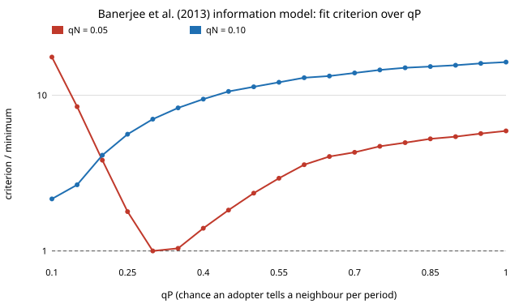

# civ-seeding: does technology adoption spread through village networks as a simple or a complex contagion, and which households should a rollout seed?

Does a new product spread through a village like news (one informed contact is enough) or like
a behaviour that needs reinforcement from several adopters? And if the data cannot tell, whom
should a rollout seed first? This programme asks that on the 43 Karnataka village networks of
Banerjee, Chandrasekhar, Duflo and Jackson (2013), where a lender introduced microfinance
through village leaders. **First step (milestone 1): a Python port of the authors' own
estimation code reproduces their data (non-leader take-up 18.7% against the published 18.5%,
leaders 24.7% against 24.8%), their finding that adopters pass the news on more than
non-adopters (q<sub>P</sub> &gt; q<sub>N</sub> in 98.4% of 1,000 bootstrap draws) and the published
effect of switching off non-adopters' word of mouth (take-up falls by a third: 0.337 against
the paper's 0.32). It does not land on the published point estimate: the criterion minimum is
at q<sub>N</sub> = 0.05, q<sub>P</sub> = 0.30 for three simulation seeds, against the published
0.10 and 0.50, and the published point scores 11 times our minimum. q<sub>P</sub> is weakly
identified (bootstrap 95% interval 0.15 to 1.0)**, a first hint for the programme's question
of what these data can and cannot identify. Produced with AI assistance (Claude Code); no
affiliation with the data's authors is implied. Results are about a fitted model of past
adoption, not advice about any real village or household.

**Live page:** https://marisstella.app/research/civ-seeding/

Programme: [`PROPOSAL.md`](PROPOSAL.md) (question, 15 checked references, hypotheses, plan,
target venue). Research log, written before each run: [`LOG.md`](LOG.md). Track 24 (`civ`,
`research/PROJECTS.md`); earlier synthetic-graph seeding results in
[`research/civ-levers`](../civ-levers).

## Why this question

Two literatures give opposite seeding advice. Fitting a simple information model to these
villages, Banerjee et al. (2013) rank households by diffusion centrality; experiments and
models of *complex* contagion find clustered seeds beat central ones (Centola and Macy 2007;
Centola 2010), and a Malawi field trial found seeds chosen for a complex contagion raised
adoption of a farming technology (Beaman et al. 2021). Which one a rollout of solar home
systems, cookstoves or farm kits should follow depends on which contagion is at work, and
on whether adoption data of this kind can tell. The plan is in `PROPOSAL.md`.

## Data

`data/bcdj_villages.json.gz` (146 kB): the 43 villages the authors' estimation code uses, each
household network restricted to its giant component (9,126 households, 44,367 ties of any
kind), with microfinance take-up, leader status, six household covariates and months of
exposure. Built by `data/build_dataset.py` from the replication archive (Harvard Dataverse,
doi:10.7910/DVN/U3BIHX, CC0 1.0). The Dataverse file sits behind a guestbook form, so this
session read the same `datav4.0` archive from a public GitHub mirror
(`ftschofenig/EmergentDirectedness`); the builder checks sizes and symmetry, and the test suite
checks the take-up figures against the paper.

## Milestone 1: reproduce the information model (`experiments/m1_reproduce/`)

Model (`src/civ_seeding/bcdj.py`, a port of `diffusion_model.m`, `moments.m`,
`divergence_model.m` and `Main_models_1_3.m`): leaders are told first; a household decides
once, when first told, with a logit probability in its covariates fitted on leaders; every
informed household tells each neighbour each four-month period with probability q<sub>P</sub>
if it adopted, q<sub>N</sub> if not. Five moments (take-up among households with no adopting
neighbour, next to adopting and non-adopting leaders, and covariances with neighbours' and
second neighbours' take-up), identity weights, the authors' grid (31 &times; 39 points), 75
simulations per village, common random numbers, and the authors' Bayesian bootstrap over
villages (1,000 draws). Hypotheses were logged before the run.

| check | ours | published (NBER w17743) | verdict |
|---|---|---|---|
| non-leader take-up, mean (SD) | 0.187 (0.082) | 0.185 (0.084) | H1 held |
| leader take-up, mean (SD) | 0.247 (0.126) | 0.248 (0.125) | H1 held |
| q<sub>N</sub>, q<sub>P</sub> (grid minimum) | 0.05, 0.30 (seeds 0, 1, 2) | 0.10, 0.50 | H2 refuted for q<sub>P</sub> |
| bootstrap 95% interval q<sub>N</sub> / q<sub>P</sub> | [0.05, 0.10] / [0.15, 1.00] | both &gt; 0 | covers the published point |
| share of draws with q<sub>P</sub> &gt; q<sub>N</sub> | 0.984 | significant | H3 held |
| take-up with q<sub>N</sub> = 0, relative drop | 0.194 &rarr; 0.129 (0.337) | 0.202 &rarr; 0.137 (0.32) | H4 held |
| informed share, q<sub>N</sub> = 0 | 0.78 &rarr; 0.55 | 0.81 &rarr; 0.57 | close |

At our estimate the simulated take-up (19.4%) and informed share (78%) sit closer to the
published 20.2% and 81% than the same simulation at the published (0.10, 0.50) does (22.8%,
89%). Restricting q<sub>N</sub> = q<sub>P</sub> doubles the criterion (q = 0.10), the
paper's case for a difference.



Not pre-registered, run after seeing the gap (`twostep.py`, `periods.py`): two-step optimal
weights move q<sub>P</sub> lower (0.20 to 0.25), not toward 0.50; q<sub>N</sub> stays at 0.05.
Shorter periods mean more rounds of telling, so the fitted probabilities fall: quarters give
(0.05, 0.15) and months (0.01, 0.10), with the published point at 17 and 38 times the minimum.
No setting we tried moves toward (0.10, 0.50).

What we can say: the port reproduces the data, the sign and significance of
q<sub>P</sub> &gt; q<sub>N</sub>, and the counterfactual, but not the published point. Possible
reasons we have not ruled out: the published table may use other moments, weights or a
finer grid than the archived script's defaults; the Science version (not opened) may differ
from the 2012 working paper; or our port differs in a way the tests do not catch. The criterion
is flat in q<sub>P</sub> (within a factor of 2 of the minimum from 0.25 to 0.50 at
q<sub>N</sub> = 0.05), so the published q<sub>P</sub> is not far out in fit; q<sub>N</sub> = 0.10
is (2 to 16 times the minimum at every q<sub>P</sub>).

## What this does and does not say

It says the archived code and data, ported, give q<sub>N</sub> &asymp; 0.05 and a weakly
pinned q<sub>P</sub>. It does not yet test complex contagion, identification or seeding (milestones
2 to 4). Adoption is observed once, not over time, so homophily and contagion are confounded
(Shalizi and Thomas 2011); every model here is a fitted description of these 43 villages.

## Run it

```
python3 data/build_dataset.py "<mirror>/datav4.0/Matlab Replication"   # optional, rebuilds the data
python3 -m pytest -q tests                                                # 10 tests, about 1 s
python3 experiments/m1_reproduce/run.py      # about 2 minutes on 4 cores, writes results.txt
python3 experiments/m1_reproduce/twostep.py  # seconds, needs run.py's dgrid.npz
python3 experiments/m1_reproduce/periods.py  # about 12 minutes, periods.txt
python3 experiments/m1_reproduce/figure.py
```

Needs numpy (and scipy for the data builder).

## Next steps

Milestone 2: a reinforcement model (adoption probability rising with the number of adopting
informers) and a fractional-threshold model, fitted with the same moments plus take-up by
number of adopting neighbours, compared out of sample. Then the identification study
(milestone 3) and seeding rules under every model the data cannot reject (milestone 4).

## References

- Banerjee, A., Chandrasekhar, A. G., Duflo, E., Jackson, M. O. (2013). The diffusion of microfinance. *Science* 341, 1236498. doi:10.1126/science.1236498. Working paper NBER w17743 (2012), the text quoted here.
- Banerjee, A., Chandrasekhar, A. G., Duflo, E., Jackson, M. O. (2013). The Diffusion of Microfinance [data]. Harvard Dataverse. doi:10.7910/DVN/U3BIHX (CC0 1.0).
- Beaman, L., BenYishay, A., Magruder, J., Mobarak, A. M. (2021). Can network theory-based targeting increase technology adoption? *American Economic Review* 111, 1918–1943. doi:10.1257/aer.20200295
- Centola, D., Macy, M. (2007). Complex contagions and the weakness of long ties. *American Journal of Sociology* 113, 702–734. doi:10.1086/521848
- Centola, D. (2010). The spread of behavior in an online social network experiment. *Science* 329, 1194–1197. doi:10.1126/science.1185231
- Shalizi, C. R., Thomas, A. C. (2011). Homophily and contagion are generically confounded in observational social network studies. *Sociological Methods & Research* 40, 211–239. doi:10.1177/0049124111404820
