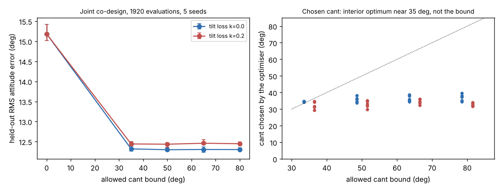

# Where is the best rotor cant angle for a quadrotor co-designed with its controller?

Follow-up to `codesign-aero-cant` (track 14, `codesign`), whose joint optimum sat on its 35° cap, so it could not say whether more tilt would help. This project raises the cap to 50°, 65° and 80° and adds a tilt efficiency loss. Produced with AI assistance (Claude). **Simulated; the model, reaction-torque ratio, plant ranges and cost model are the earlier projects' assumed fits, and the tilt-loss factor k is assumed and swept (no source gives a figure for rotors of this size).**

**Live page:** https://duncan-haywood.github.io/monorepo-projects/research/codesign-aero-cant-bound/



**Headline (simulated; all numbers from `experiments/results.txt`).** Joint CMA-ES over arm length, propeller diameter, cant and six PID gains, 1920 evaluations, 5 seeds, scored on 64 held-out wide-plant episodes:
- **The optimum is interior and flat.** With the bound at 35°, 50°, 65° and 80° the held-out error is 12.32°, 12.30°, 12.30° and 12.30° (k = 0). The chosen cant is 34–40° in all 20 runs, mostly below 38°. The earlier result "35° every time" was the optimiser reaching a plateau that happened to sit just under the cap, not a bound-limited optimum; extra tilt authority is not worth its thrust cost.
- **Against no cant** (bound 0, 15.18°) the gain is −2.87° to −2.89° in 5 of 5 paired seeds at every bound.
- **A tilt efficiency loss barely moves it.** With hover power divided by 1 − 0.2 sin²α the error is 12.44° to 12.46° at all bounds, the chosen cant drops slightly (29–36°), and the paired gain against no cant is −2.72° to −2.75°.
- **Seed noise is small** (per-seed spread about ±0.1°), so the 0.02° differences between bounds ≥ 50° are not distinguishable; the claim is that nothing improves, not that 50° is better than 80°.

## Method
`src/codesign_aero_cant_bound/aero.py` is `codesign-aero-cant`'s model (three-axis Euler rigid body, gust, noise, delay, motor lag, wide plant randomisation, sizing closure with yaw authority 2ΔT(κ cos α + r sin α)) with two additions: the cant range is a parameter (`alpha_max`), and `size` takes `tilt_loss` k, dividing hover power by (1 − k sin²α). Experiment (`experiments/run.py`): bound ∈ {0, 35, 50, 65, 80}° × k ∈ {0, 0.2} × 5 seeds, same optimiser, budget, cost cap ($300) and clearance rule as the parent. Bound 0 does not depend on k, so its rows repeat. No LLM is used.

## Reproduce
```bash
cd research/codesign-aero-cant-bound
PY=$(python3 ../../platform/ci/pyenv.py pytest numpy cma matplotlib)
"$PY" -m pytest -q tests          # 11 tests
"$PY" experiments/run.py          # about 6 minutes on 4 cores; results.txt, results.json
"$PY" experiments/figure.py       # experiments/bound.png
```

## Limitations
- The tilt loss is one functional form with one assumed coefficient (k = 0.2 swept against 0); a real loss from rotor-airframe interference and internal force fighting could be larger or shaped differently. The thrust cost 1/cos α in hover is already in the model.
- Hover thrust components only: tangential force cancellation assumes a perfectly symmetric vehicle; no position control, so lateral coupling of the tilted thrust is not tested.
- Cost, mass and motor models, κ = 0.016 m and plant ranges are inherited assumed fits; the parent swept κ (×0.5, ×3) in a grid but this project does not.
- Attitude steps only; no hardware.

## Next steps
Add position hold so lateral thrust components are tested; compare at equal cost with a larger propeller or a yaw-only motor upgrade; take κ and propeller efficiency from published propeller data.

## Owner steps
Measure yaw step response on a real quad with 3D-printed canted arm mounts at 0° and about 35°. Not done here.

## Builds on
`codesign-aero-cant` (the model, the grid and the 35° cap). Tilted-propeller multirotors: Rajappa, Ryll, Bülthoff and Franchi (2015), *IEEE ICRA*, pp. 4006–4013, doi:10.1109/ICRA.2015.7139759 (idea only; nothing is reproduced). CMA-ES: Hansen and Ostermeier (2001), *Evolutionary Computation* 9(2).

## Lab tags
RECUV and the Autonomous Systems IRT (UAV simulation, safe autonomy), as direction only; nothing is affiliated with or endorsed by them.

## Outside dependencies (vitamins)
numpy, cma, matplotlib. No model API is called.

MIT.
