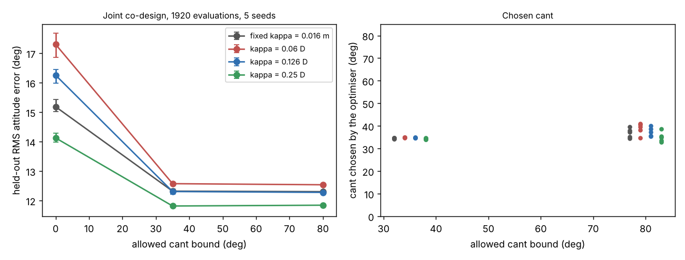

# Does the best rotor cant angle change when yaw reaction torque scales with propeller size?

Follow-up to `codesign-aero-cant-bound` (track 14, `codesign`). There the reaction torque per newton of thrust, κ, was a fixed 0.016 m, so the optimiser could enlarge the propeller to save energy without losing yaw authority. For a real propeller Q/T = (C_P/C_T)·D/(2π), so κ grows with D. This project makes κ = c·D and sweeps c. Produced with AI assistance (Claude). **Simulated; c is swept, not sourced: the UIUC propeller database host was unreachable from the run sandbox, so no measured C_P/C_T is cited. Cost, mass, motor and plant models are inherited assumed fits.**

**Live page:** https://duncan-haywood.github.io/monorepo-projects/research/codesign-aero-cant-kappa/



**Headline (simulated; all numbers from `experiments/results.txt`).** Joint CMA-ES over arm length, propeller diameter, cant and six PID gains, 1920 evaluations, 5 seeds, 64 held-out wide-plant episodes:
- **The interior optimum survives.** With the bound at 80° the held-out error is 12.54°, 12.28° and 11.84° for c = 0.06, 0.126 and 0.25 (fixed κ: 12.30°), and the chosen cant is 33–41° in all 15 runs. Raising the bound from 35° to 80° changes the error by at most 0.03°.
- **Cant helps most when reaction torque is weakest.** Against no cant (17.30°, 16.26°, 14.13°; fixed κ 15.18°) the paired gain at bound 80° is −4.77°, −3.98° and −2.28°, better in 5 of 5 seeds each (fixed κ: −2.88°).
- **Scaled κ is a stronger case for cant than the fixed value** at c ≤ 0.126, because a small propeller then has little reaction torque. At c = 0.126, which equals the old value at D = 127 mm, the cant gain is −3.98° against −2.88°: the old fixed κ was generous to a no-cant design that chose a large propeller.
- **Caveat on the 35° bound.** For c = 0.06, 0.126 and 0.25 the chosen cant at bound 35° is 34–35° in 15 of 15 runs, i.e. on the cap, but the bound-80° runs choose 33–41° and gain at most 0.03°, so the cap costs nothing measurable here.

## Method
`src/codesign_aero_cant_kappa/aero.py` is `codesign-aero-cant-bound`'s model with one addition: `size(..., kappa_per_d=c)` sets κ = c·D in the yaw authority 2ΔT(κ cos α + r sin α); `None` keeps the fixed 0.016 m. c = 0.126 is 0.016/0.127, so it matches the old value at a 127 mm propeller. c = 0.06 and 0.25 correspond to C_P/C_T = 2πc of about 0.38 and 1.6, a range chosen to bracket it, not measured. Experiment (`experiments/run.py`): c ∈ {fixed, 0.06, 0.126, 0.25} × bound ∈ {0°, 35°, 80°} × 5 seeds, same optimiser, budget, $300 cost cap and clearance rule as the parent. No LLM is used.

## Reproduce
```bash
cd research/codesign-aero-cant-kappa
PY=$(python3 ../../platform/ci/pyenv.py pytest numpy cma matplotlib)
"$PY" -m pytest -q tests          # 15 tests
"$PY" experiments/run.py          # several minutes on 4 cores; results.txt, results.json
"$PY" experiments/figure.py       # experiments/kappa.png
```

## Limitations
- c is swept, not taken from measured propeller data. Replace the three values with C_P/C_T from the UIUC propeller database (Brandt and Selig 2011; Deters et al. 2018) for the propellers at the optimiser's chosen sizes.
- Hover thrust components only; no position hold, so lateral coupling of the tilted thrust is not tested.
- Cost, mass and motor models and plant ranges are inherited assumed fits; attitude steps only; no hardware.
- Tilt efficiency loss is not combined with scaled κ here (the parent found it moves the error by about 0.1°).

## Next steps
Read C_P/C_T for the chosen diameters from published static propeller data; add position hold; compare at equal cost with a larger propeller or a yaw-only motor upgrade.

## Owner steps
Measure yaw step response on a real quad with 3D-printed canted arm mounts at 0° and about 35°, with the propeller sizes chosen here. Not done here.

## Builds on
`codesign-aero-cant-bound` and `codesign-aero-cant` (model, grid, cap). Static propeller coefficients: Brandt and Selig (2011), AIAA 2011-1255; Deters et al. (2018), AIAA 2018-4122 (named as the source to use next; no value is taken from them here). Tilted-propeller multirotors: Rajappa, Ryll, Bülthoff and Franchi (2015), *IEEE ICRA*, pp. 4006–4013 (idea only). CMA-ES: Hansen and Ostermeier (2001), *Evolutionary Computation* 9(2).

## Lab tags
RECUV and the Autonomous Systems IRT (UAV simulation, safe autonomy), as direction only; nothing is affiliated with or endorsed by them.

## Outside dependencies (vitamins)
numpy, cma, matplotlib. No model API is called.

MIT.
