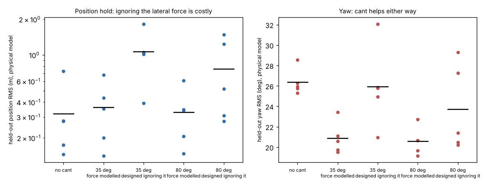

# Does rotor cant still pay once a co-designed quadrotor must hold position?

Follow-up to `codesign-aero-cant-bound`, and five sibling READMEs that all defer the same step: "add position hold so lateral thrust components are tested". A canted rotor makes a sideways force whenever roll or pitch torque is commanded. Here the vehicle gets translation, an outer position loop and that force. Produced with AI assistance (Claude). **Simulated; the cost model, mass model, reaction-torque ratio, noise levels and plant ranges are inherited or assumed (marked in `src/.../aero.py`).**

**Live page:** https://marisstella.app/research/codesign-aero-cant-poshold/



**Correction (2026-11-10).** `rollout_pos` multiplied a (N,1) drag coefficient into a (N,E,2) array. When the number of designs equals the number of episodes (CMA-ES training: population 16, 16 episodes) NumPy broadcast it without error over the wrong axis, so each training rollout used another design's drag coefficient. Held-out scoring (one design, 64 episodes) was unaffected, but the optimiser was misled. Fixed, a regression test added (it fails on the old code), and `run.py` and `run_restart.py` rerun. The numbers below are the rerun; the earlier ones (J 3.33/2.61 etc., restart J 3.73 to 2.99) are superseded. The qualitative findings hold; two claims change and are marked.

**Headline (simulated; numbers from `experiments/results.txt`).** Joint CMA-ES over arm length, propeller diameter, cant, six attitude gains and three position gains (3200 evaluations, 5 seeds), scored on 64 held-out wide-plant episodes (start up to 0.5 m off the origin in a gust, hold position while yaw steps ±30°):
- **The lateral force of a canted rotor is large enough to break a design that ignores it.** F = τ·tan α / r (checked against an explicit four-rotor allocation in the tests). Designs tuned with the force switched off and scored with it on have a mean position error of 1.07 m (cant ≤ 35°) and 0.76 m (≤ 80°), against 0.36 m and 0.33 m when the force is in the loop; J worse by 6.7 and 4.1, worse in 5 of 5 and 4 of 5 seeds.
- **The force costs position accuracy.** Re-scoring force-aware designs with the force switched off improves them (J 4.25 to 3.04 at 35°, 3.95 to 3.14 at 80°).
- **Cant buys yaw, not position.** Against no cant, paired by seed, yaw RMS falls 5.5° (35°) and 5.8° (80°), better in 5 of 5 seeds each; position RMS is not better (+0.04 m, +0.01 m). J improves by only 0.04 and 0.34, better in 3 of 5 seeds each: not distinguishable from noise at this budget. (Changed: the earlier run showed J gains of 0.18 and 0.48.)

## Restart check: how much of the seed noise was the optimiser? (rerun 2026-11-10)
`experiments/run_restart.py` repeats the 3200-evaluation CMA-ES run with 8 seeds, then restarts from each seed's best point (sigma 0.1, 3200 more evaluations), physical model, same 64 held-out episodes (`results_restart.txt`, simulated).
- **Yaw is robust:** cant cuts yaw RMS by 5.1° (35°) and 6.1° (80°) before restart, 6.0° and 6.4° after, better in 8 of 8 seeds every time.
- **Position stays flat:** +0.08 m and -0.05 m before restart, -0.04 m and -0.09 m after; better in only 3 to 4 of 8 seeds.
- **After restart cant lowers J at both bounds:** mean J 4.36 (no cant), 3.58 (35°), 3.11 (80°); paired gain -0.78 (4 of 8 seeds better) and -1.25 (6 of 8). (Changed: the earlier run found the 80° bound did not recover and was worse than no cant in 4 of 8 seeds; with the bug fixed it is the better arm.) Seed spread is large (one no-cant seed stays at J 7.8), so the 35° gain rests on a few seeds.
- Limit: 8 seeds, no significance test, restart selected on 16 training episodes (the overfitting explanation for the no-cant arm is untested; a 64-episode training set is a next step). Model limits above are unaffected.

## Method
`src/codesign_aero_cant_poshold/aero.py`: the earlier model (sizing closure, attitude dynamics, gust, wide plant randomisation) plus `rollout_pos`: world position and velocity, perfect altitude hold (vertical force balances weight; the small vertical part of the lateral force is neglected), wind drag force 0.5 ρ A v|v| from the same gust that drives the torque, and the body lateral force from the *actual* (lagged, saturated) roll/pitch torque. An outer PID on noisy position (σ 0.02 m) and velocity (σ 0.05 m/s) turns the position error into roll/pitch references (small-angle, rotated by measured yaw, clipped at 20°); an inner PID tracks them. `couple=False` switches only the lateral force off. `rotor_layout` is the explicit four-rotor allocation used by the tests to verify the closed form and the yaw authority of `size`. Experiment (`experiments/run.py`): bound ∈ {0°, 35°, 80°} × (force in or out of the design loop) × 5 seeds; each trained design is scored on held-out episodes with the force both on and off. Same cost cap ($300) and clearance rule as the parents. No LLM is used.

## Reproduce
```bash
cd research/codesign-aero-cant-poshold
PY=$(python3 ../../platform/ci/pyenv.py pytest numpy cma matplotlib)
"$PY" -m pytest -q tests          # 18 tests
"$PY" experiments/run.py          # a few minutes on 4 cores; results.txt, results.json
"$PY" experiments/figure.py       # experiments/poshold.png
```

## Limitations
- Episodes are 2 s long (the parents' length), enough for the initial offset and a few yaw steps but not for slow position drift; the objective weights (0.1 m ↔ 10°) are a choice, so the position and yaw parts are reported separately.
- Seven of the 25 trained designs sit well above the best (optimiser local optima at 3200 evaluations); means are therefore dominated by those seeds and per-seed values are given. The paired seed counts are small (5).
- One arm/spin layout; the lateral force is the linear closed form for a symmetric vehicle at hover (no airflow interaction, no loss from rotors fighting each other beyond the earlier tilt loss, no vertical part of the force). Altitude hold is perfect. Noise levels, the offset size and drag coefficient are assumed.
- Cost, mass, motor model, κ and plant ranges are inherited assumed fits. No hardware.

## Next steps
Longer episodes with a wind step to test position drift; a PX4 or other full-stack software-in-the-loop check of the sign of the lateral force on both axes; compare at equal cost with a larger propeller or a yaw-only motor upgrade; a larger training-episode set so restarts stop overfitting.

## Owner steps
Measure sideways thrust from a 3D-printed canted-arm quad on a load cell while commanding roll torque. Not done here.

## Builds on
`codesign-aero-cant-bound` (the model, the 35° plateau). Tilted-propeller multirotors: Rajappa, Ryll, Bülthoff and Franchi (2015), *IEEE ICRA*, pp. 4006–4013, doi:10.1109/ICRA.2015.7139759 (idea only; nothing is reproduced). CMA-ES: Hansen and Ostermeier (2001), *Evolutionary Computation* 9(2).

## Lab tags
RECUV and the Autonomous Systems IRT (UAV simulation, safe autonomy), as direction only; nothing is affiliated with or endorsed by them.

## Outside dependencies (vitamins)
numpy, cma, matplotlib. No model API is called.

MIT.
