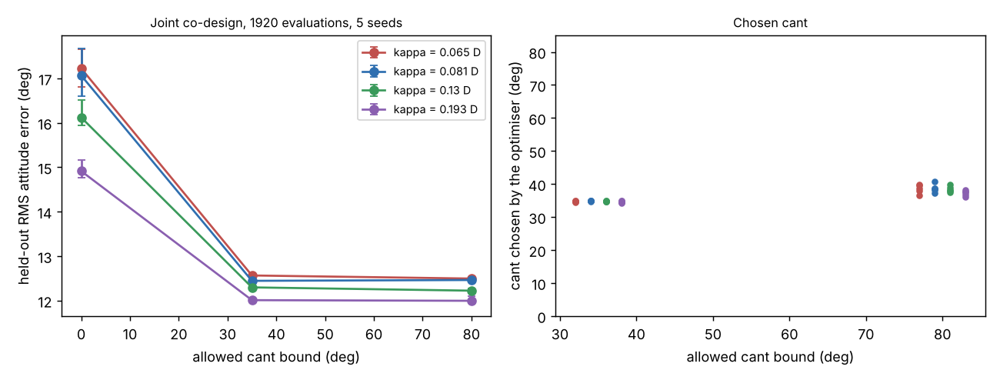

# What reaction-torque-to-thrust ratio do real small propellers have, and does the best rotor cant angle survive it?

Follow-up to `codesign-aero-cant-kappa` (track 14, `codesign`). That project made the yaw reaction torque per newton of thrust κ = c·D and swept c over 0.06, 0.126 and 0.25 because the UIUC propeller database was unreachable. It is reachable now, so c is taken from measured static tests of 160 propellers. Produced with AI assistance (Claude). **Simulated; c is sourced from measured data (UIUC Propeller Data Site); cost, mass, motor and plant models are inherited assumed fits.**

**Live page:** https://duncan-haywood.github.io/monorepo-projects/research/codesign-aero-cant-propdata/



**Headline (all numbers from `experiments/results.txt` and `data/propdata_c.csv`).**
- **Measured c is small.** For the 77 propellers of 3.15–9.85 in (the optimiser's 80–250 mm range) c = CP/(2π·CT) has median 0.081 (CP/CT ≈ 0.51), 10th percentile 0.065, 90th percentile 0.13, maximum 0.193. It does not depend on diameter in this set (Pearson r = −0.11). The 0.25 swept upper end in the parent is above every measured propeller, and the old fixed κ = 0.016 m equals c = 0.126 only at D = 127 mm.
- **The interior cant optimum survives.** Joint CMA-ES (arm length, propeller diameter, cant, six PID gains; 1920 evaluations; 5 seeds; 64 held-out wide-plant episodes). At bound 80° the held-out error is 12.50°, 12.46°, 12.22° and 12.00° for c = 0.065, 0.081, 0.13 and 0.193, against 17.22°, 17.06°, 16.12° and 14.91° with no cant. Cant helps in 5 of 5 paired seeds at every c, by 4.7°, 4.6°, 3.9° and 2.9°.
- **Chosen cant is 36–41° at bound 80°,** and 34–35° (on the cap) at bound 35°; the 35° cap costs at most 0.08° against 80°.
- **At the median measured c the gain is 4.6°, larger than the parent's fixed-κ 2.9°:** a realistic propeller gives less yaw torque than the old fixed value did at the sizes the optimiser then chose.

## Method
`experiments/extract_c.py --fetch` downloads every static-thrust file (`*_static_*.txt`, columns RPM, CT, CP) listed on the UIUC Propeller Data Site volume 1 and 2 indexes and writes `data/propdata_c.csv`: per propeller, the median over RPM rows with CT > 0.02 of CP/CT, and c = CP/(2π·CT). The identity Q/T = (CP/CT)·D/(2π) follows from Q = CP ρ n² D⁵/(2π) and T = CT ρ n² D⁴ (checked in `tests/test_extract.py`). `experiments/run.py` then runs the parent's experiment (`src/.../aero.py` unchanged) with c at the 10th, 50th, 90th percentile and maximum of the in-range propellers, bound ∈ {0°, 35°, 80°}, 5 seeds, the parent's optimiser, budget, $300 cost cap and clearance rule. No LLM is used. The percentile is np.percentile (interpolated), so 0.065 rounds slightly above the 0.064 of a quantile call.

## Reproduce
```bash
cd research/codesign-aero-cant-propdata
PY=$(python3 ../../platform/ci/pyenv.py pytest numpy cma matplotlib)
"$PY" -m pytest -q tests                  # 19 tests
"$PY" experiments/extract_c.py --fetch    # optional: re-download and regenerate data/propdata_c.csv (about 200 files)
"$PY" experiments/run.py                  # several minutes on 4 cores; results.txt, results.json
"$PY" experiments/figure.py               # experiments/propdata.png
```

## Limitations
- Static (zero-airspeed) coefficients only; CP/CT of a loaded propeller in forward flight differs. Hover is what is simulated.
- The set is mostly hobby propellers (APC, GWS, Graupner, Master Airscrew and others) tested at the laboratory's RPM; c is a median over the RPM rows of each file, not at the optimiser's operating point. Several families repeat across diameters, so the 77 are not independent.
- Cost, mass and motor models and plant ranges are inherited assumed fits; attitude steps only; no position hold; no hardware.
- c is held independent of D because the data show no trend; the optimiser can still pick any D.

## Next steps
Add position hold so the lateral component of the tilted thrust is checked; compare at equal cost with a larger propeller or a yaw-only motor upgrade; take the loaded (advance-ratio) coefficients for forward flight.

## Owner steps
Measure yaw step response on a real quad with 3D-printed canted arm mounts at 0° and about 35°. Not done here.

## Builds on
`codesign-aero-cant-kappa` (model and experiment). Data: Brandt and Selig (2011), "Propeller performance data at low Reynolds numbers", AIAA 2011-1255; Deters, Ananda, Dantsker and Selig (2018), AIAA 2018-4122; UIUC Propeller Data Site, https://m-selig.ae.illinois.edu/props/propDB.html, volumes 1 and 2, fetched 2026-10-23. Check the site's terms before redistributing the raw files; only derived per-propeller ratios are committed here. CMA-ES: Hansen and Ostermeier (2001), *Evolutionary Computation* 9(2).

## Lab tags
RECUV and the Autonomous Systems IRT (UAV simulation, safe autonomy), as direction only; nothing is affiliated with or endorsed by them.

## Outside dependencies (vitamins)
numpy, cma, matplotlib; the UIUC data for `--fetch`. No model API is called.

MIT.
