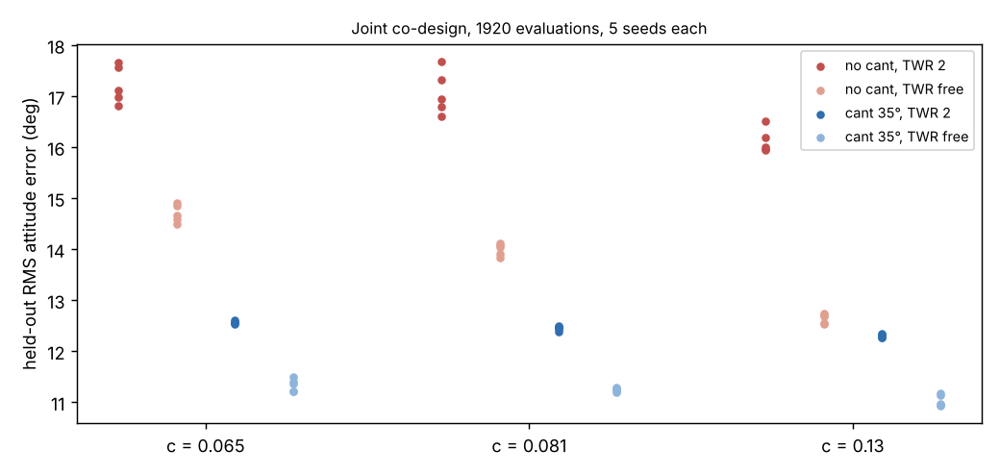

# Is rotor cant just a cheap way to buy yaw authority that bigger motors would buy as well?

Follow-up to `codesign-aero-cant-propdata` (track 14, `codesign`), taking its next step "compare at equal cost with a larger propeller or a yaw-only motor upgrade". Here motor headroom (thrust-to-weight, TWR) is a design variable, so a no-cant quadcopter can buy yaw authority with bigger motors. Produced with AI assistance (Claude). **Simulated; c is sourced from measured data (UIUC Propeller Data Site, via the parent); the TWR range, cost, mass, motor and plant models are inherited or assumed.**

**Live page:** https://duncan-haywood.github.io/oss-monorepo/research/codesign-aero-cant-twr/



**Headline (all numbers from `experiments/results.txt`).** Held-out RMS attitude error, degrees, mean of 5 seeds:

| c | no cant, TWR 2 | no cant, TWR free | cant ≤35°, TWR 2 | cant ≤35°, TWR free |
|---|---|---|---|---|
| 0.065 (10th pct) | 17.22 | 14.69 | 12.57 | 11.34 |
| 0.081 (median) | 17.06 | 14.00 | 12.45 | 11.24 |
| 0.13 (90th pct) | 16.12 | 12.64 | 12.30 | 11.03 |

- **Headroom alone buys most, but not all, of the cant benefit.** Free TWR improves the no-cant design by 2.5, 3.1 and 3.5° (5 of 5 seeds each). Cant at fixed TWR 2 improved it by 4.7, 4.6 and 3.8°.
- **Cant still helps once headroom is bought:** with TWR free, cant to 35° improves the error by 3.4, 2.8 and 1.6° (5 of 5 seeds at every c). The benefit shrinks as c grows, since a larger reaction torque per newton already gives yaw authority.
- **The two levers overlap.** With both available the optimiser picks less cant (23–29° against the 35° cap) and TWR 3.7–3.8; with cant it needs less of the TWR range.
- **At the largest c the levers are nearly equal:** cant with TWR 2 beats no cant with free TWR by only 0.3° (5 of 5 seeds), against 1.6 and 2.1° at the other two.

## Method
Same model, optimiser and held-out protocol as the parent (`src/codesign_aero_cant_twr/aero.py` differs only in taking `twr` as a size argument and mapping an optional fourth design column to TWR ∈ [1.5, 4.0] when `twr_free=True`). Joint CMA-ES over arm length, propeller diameter, cant, (TWR) and six PID gains; 1920 evaluations; 5 seeds; 16 training and 64 held-out wide-plant episodes; $300 cost cap and 1.05 clearance rule unchanged. κ = c·D with c the 10th, 50th and 90th percentile of the 77 in-range propellers in `data/propdata_c.csv` (copied from the parent). Headroom costs money and mass through the inherited motor fits: motor mass 0.045·(Tmax/9 N)^1.2 kg, motor cost 12·(Tmax/9 N)^1.1 $ each. No LLM is used.

## Reproduce
```bash
cd research/codesign-aero-cant-twr
PY=$(python3 ../../platform/ci/pyenv.py pytest numpy cma matplotlib)
"$PY" -m pytest -q tests          # 23 tests
"$PY" experiments/run.py          # about 10 minutes on 4 cores; results.txt, results.json
"$PY" experiments/figure.py       # experiments/twr.png
```

## Limitations
- **The TWR ceiling binds.** Without cant the optimiser chooses TWR 3.99–4.00 in every seed, so the no-cant arm is limited by the range I set (1.5–4.0, assumed), not by cost; it could do better with more headroom. The gain from headroom is therefore a lower bound, and the cant advantage with free TWR may be overstated. Raising the ceiling (and checking the motor-cost fit beyond the range it was fitted on) is the first next step.
- A single yaw-only motor upgrade, which would add yaw authority without roll and pitch authority, is not modelled; TWR raises all axes together.
- Motor cost and mass, plant ranges and the gust model are inherited assumed fits; attitude steps only; no position hold; static propeller coefficients only; no hardware.

## Next steps
Raise the TWR ceiling to 6 and see where no-cant saturates; add position hold so lateral thrust components are tested; take motor mass and cost from a motor catalogue instead of the inherited fit.

## Owner steps
Measure yaw step response on a real quad with 3D-printed canted mounts at 0° and about 30°, with two motor sizes. Not done here.

## Builds on
`codesign-aero-cant-propdata` (model, data, experiment), `codesign-aero-cant-kappa`. Data: Brandt and Selig (2011), AIAA 2011-1255; Deters et al. (2018), AIAA 2018-4122; UIUC Propeller Data Site. CMA-ES: Hansen and Ostermeier (2001), *Evolutionary Computation* 9(2).

## Lab tags
RECUV and the Autonomous Systems IRT (UAV simulation, safe autonomy), as direction only; nothing is affiliated with or endorsed by them.

## Outside dependencies (vitamins)
numpy, cma, matplotlib. No model API is called.

MIT.
