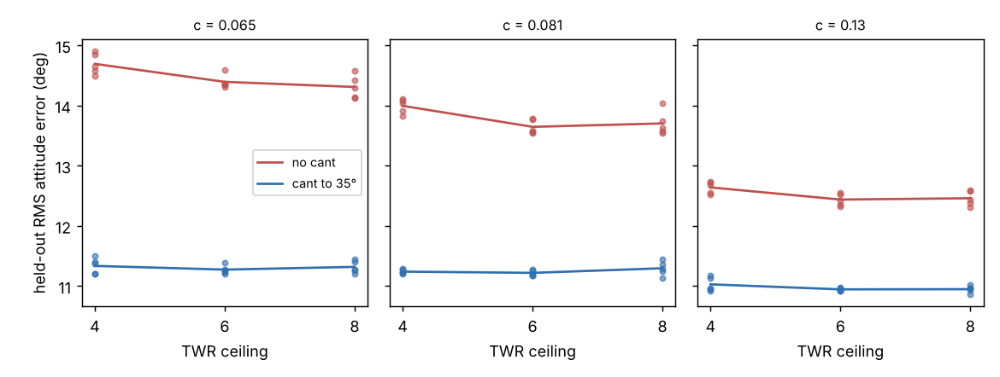

# Was the thrust-to-weight ceiling of 4 what made rotor cant look good?

Follow-up to `codesign-aero-cant-twr` (track 14, `codesign`), taking its first next step: "raise the TWR ceiling to 6". That project found that without cant the optimiser sat on its assumed TWR ceiling of 4.0, so its cant advantage might be overstated. Here the ceiling is 4, 6 and 8. Produced with AI assistance (Claude). **Simulated; c is sourced from measured data (UIUC Propeller Data Site, via the grandparent); the TWR range, motor mass and cost fits, plant and gust models are inherited or assumed.**

**Live page:** https://duncan-haywood.github.io/oss-monorepo/research/codesign-aero-cant-twrceil/



**Headline (all numbers from `experiments/results.txt`).** Held-out RMS attitude error, degrees, mean of 5 seeds:

| c | no cant, ceiling 4 | no cant, 6 | no cant, 8 | cant ≤35°, 4 | cant, 6 | cant, 8 |
|---|---|---|---|---|---|---|
| 0.065 (10th pct) | 14.69 | 14.39 | 14.31 | 11.34 | 11.27 | 11.32 |
| 0.081 (median) | 14.00 | 13.65 | 13.70 | 11.24 | 11.22 | 11.30 |
| 0.13 (90th pct) | 12.64 | 12.44 | 12.46 | 11.03 | 10.95 | 10.95 |

- **The ceiling was binding, but only slightly.** Raising it from 4 to 6 improves the no-cant design by 0.30, 0.35 and 0.20° (5, 5 and 4 of 5 seeds). The optimiser then picks TWR 4.9–5.1, not the new ceiling.
- **There is an interior optimum near TWR 5.** Going from 6 to 8 changes nothing (−0.08 to +0.06°, within seed spread); the chosen TWR stays at 4.9–5.0. More headroom costs mass and money under the inherited fits.
- **Cant's advantage survives.** At ceiling 8, cant to 35° still beats no cant by 3.0, 2.4 and 1.5° (5 of 5 seeds at every c), against 3.4, 2.8 and 1.6° at ceiling 4, so the earlier figure was overstated by 0.1 to 0.4°.
- **Cant barely uses extra headroom:** its error moves by at most 0.08° with the ceiling, and it picks TWR 3.7–4.1 and 20–31° of cant.

## Method
`src/codesign_aero_cant_twrceil/aero.py` is the parent's model with one added argument, `twr_max`, which sets the top of the TWR range [1.5, `twr_max`]. Joint CMA-ES over arm length, propeller diameter, cant, TWR and six PID gains; 1920 evaluations; 5 seeds; 16 training and 64 held-out wide-plant episodes; $300 cost cap unchanged. κ = c·D with c the 10th, 50th and 90th percentile of the 77 in-range propellers in `data/propdata_c.csv`. Motor mass 0.045·(Tmax/9 N)^1.2 kg and cost 12·(Tmax/9 N)^1.1 $ each are inherited. No LLM is used.

## Reproduce
```bash
cd research/codesign-aero-cant-twrceil
PY=$(python3 ../../platform/ci/pyenv.py pytest numpy cma matplotlib)
"$PY" -m pytest -q tests          # 24 tests
"$PY" experiments/run.py          # about 20 minutes on 4 cores; results.txt, results.json
"$PY" experiments/figure.py       # experiments/twr_ceiling.png
```

## Limitations
- The location of the optimum near TWR 5 is set by the inherited motor mass and cost power-law fits, which were fitted for a range that stops well below TWR 8 and are assumed here, not taken from a catalogue. A different cost exponent would move it. Taking mass and cost from a motor catalogue is the next step.
- Single yaw-only motor upgrades are not modelled; TWR raises all axes together.
- Attitude steps only, no position hold, static propeller coefficients, no hardware. The mass iteration clamps at 20 kg, which no result approaches (masses 2.3–2.7 kg).
- Differences below about 0.1° are inside seed spread.

## Next steps
Replace the motor fits with catalogue mass, thrust and price; add position hold so lateral thrust components are tested.

## Owner steps
Measure yaw step response on a real quad with 3D-printed canted mounts at 0° and about 30°, with two motor sizes. Not done here.

## Outside dependencies
None beyond pip packages (numpy, cma, matplotlib); propeller data are the UIUC Propeller Data Site, copied from earlier projects.

## Builds on
`codesign-aero-cant-twr` (the experiment and the ceiling-4 result), `codesign-aero-cant-propdata`. Data: Brandt and Selig (2011), AIAA 2011-1255; Deters et al. (2018), AIAA 2018-4122. CMA-ES: Hansen and Ostermeier (2001), *Evolutionary Computation* 9(2).
