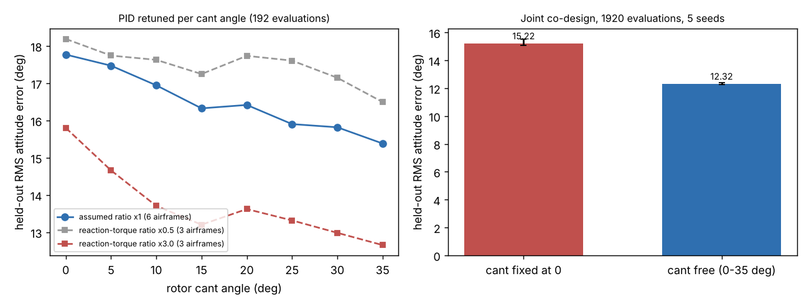

# Does tilting a quadrotor's rotors buy the yaw authority that no attitude controller could?

Follow-up to `codesign-aero-coupled` (track 14, `codesign`). That project found yaw, which has only weak reaction-torque authority, sets the attitude error (about 29° RMS on 30° steps) and that changing the control-law class (residual network, gyroscopic compensation) changed nothing, while tripling yaw authority helped. This project asks the co-design question that follows: if authority is the limit, can the airframe supply it? The new design variable is the rotor cant angle α. Produced with AI assistance (Claude). **Simulated; the reaction-torque ratio, plant ranges, gust model and cost model are assumed round numbers inherited from the earlier projects and swept where stated; they are not measurements.**

**Live page:** https://duncan-haywood.github.io/monorepo-projects/research/codesign-aero-cant/



**Headline (simulated; all numbers from `experiments/results.txt`).** Held-out combined RMS attitude error, 64 wide-plant episodes:
- **Cant helps, monotonically in this range.** PID retuned at each angle (192 CMA-ES evaluations), 6 airframes × 5 seeds: 17.77° at 0°, 16.33° at 15°, 15.38° at 35°. Paired against 0° on the same airframe and seed: −2.85° at 35° (better in 20 of 20 pairs), −1.44° at 15° (28 of 30). Yaw RMS falls 28.9° to 24.0° while roll/pitch RMS rises slightly (7.4° to 8.1°), the thrust cost showing.
- **It costs feasibility.** Cant raises hover thrust per rotor by 1/cos α, so motors, battery and cost grow: only 20 of 30 grid cells stay inside the $300 cost cap and propeller-clearance rule at 30° and 35° (25 of 30 at 20° and 25°). The paired numbers above use feasible cells only, which flatters the high-cant rows slightly.
- **Co-design picks it.** Joint CMA-ES over arm length, propeller diameter, cant and six PID gains, 1920 evaluations, 5 seeds: 12.32° with cant free against 15.22° with cant fixed at 0 (free cant better in 5 of 5 seeds, +2.71° to +3.24°). Free cant chose 34–35° every time, **the upper bound I set (35°), so the optimum is not found and the gain at a larger bound is unknown**; yaw RMS is still 19.4°. *Follow-up: `codesign-aero-cant-bound` raised the cap to 80° and the optimum stays at 34–40°.*
- **The sign survives the assumed ratio.** With the reaction-torque ratio κ halved the error still falls (18.19° to 16.50°, 3 airframes × 3 seeds); tripled it falls more (15.80° to 12.66°). The curves are not smooth (a bump near 20° where airframes drop out of the feasible set), so read the trend, not the individual points.

## Method
`src/codesign_aero_cant/aero.py` is `codesign-aero-coupled`'s three-axis model (Euler rigid-body equations, ZYX kinematics, gust, sensor noise, one-step delay, motor lag, wide plant randomisation, same sizing closure) with one change in `size(L, D, alpha)`. Rotors are tilted about their arm axes, alternating with spin direction, so tangential thrust components cancel in hover and add in differential yaw. Vertical thrust per rotor is T cos α, so hover thrust per rotor is mg/(4 cos α) and maximum thrust is TWR times that; roll/pitch authority is 4ΔT·r·cos α; yaw authority is 2ΔT(κ cos α + r sin α) with ΔT = Tmax − Thover, r = L/√2 and κ = 0.016 m (assumed, the earlier projects' value). Tests check these against hand values (`tests/test_cant.py`). The residual network and gyroscopic compensation are dropped, since the earlier project found them worth nothing.
Experiments (`experiments/run.py`): **grid**, six airframes taken from `codesign-aero-robust`'s ranking (ranks 1, 10, 20, 30, 40, 50) × α ∈ {0, 5, …, 35}° × 5 seeds, six PID gains tuned by CMA-ES on 16 training episodes; **κ sweep**, ×0.5 and ×3 on three airframes × 3 seeds; **joint**, CMA-ES over (L, D, α, gains) against (L, D, gains) at the same 1920 evaluations. Baselines are the same optimiser with cant fixed at 0; no LLM is used.

## Reproduce
```bash
cd research/codesign-aero-cant
PY=$(python3 ../../platform/ci/pyenv.py pytest numpy cma matplotlib)
"$PY" -m pytest -q tests          # 8 tests
"$PY" experiments/run.py          # a few minutes on 4 cores; results.txt, results.json
"$PY" experiments/figure.py       # experiments/cant.png
```

## Limitations
- The tilted thrust vectors are modelled only through their vertical and tangential components. Not modelled: lower rotor efficiency when tilted, internal force fighting under manoeuvre, roll/pitch cross-coupling from tilt, motor-mount mass. All make the real benefit smaller than here.
- The cost, mass and motor models are the earlier projects' assumed fits; κ is swept over ×0.5 to ×3 only in the grid, not in the joint run.
- Cant is capped at 35°; the joint optimum sits on the cap.
- Step references and attitude only; no position control, no hardware.
- 192-evaluation PID tuning per grid cell; seed-to-seed SD of the paired difference is 0.6° to 1.1°.

## Next steps
Raise the cant bound and add a tilt efficiency penalty to find the true optimum; compare with the same authority from a larger propeller or a yaw-only motor upgrade at equal cost; include position hold so lateral thrust components are checked.

## Owner steps
Measure reaction-torque ratio and yaw step response on a real quad with 3D-printed canted arm mounts. Not done here.

## Builds on
`codesign-aero-coupled`, `codesign-aero-robust` (airframes), `codesign-aero-skip`. Tilted-propeller multirotors: Rajappa, Ryll, Bülthoff and Franchi (2015), "Modeling, control and design optimization for a fully-actuated hexarotor aerial vehicle with tilted propellers", *IEEE ICRA*, pp. 4006–4013, doi:10.1109/ICRA.2015.7139759 (idea only; their vehicle is a fully-actuated hexarotor and nothing is reproduced). CMA-ES: Hansen and Ostermeier (2001), *Evolutionary Computation* 9(2).

## Lab tags
RECUV and the Autonomous Systems IRT (UAV simulation, safe autonomy), as direction only; nothing is affiliated with or endorsed by them.

## Outside dependencies (vitamins)
numpy, cma, matplotlib. No model API is called.

MIT.
