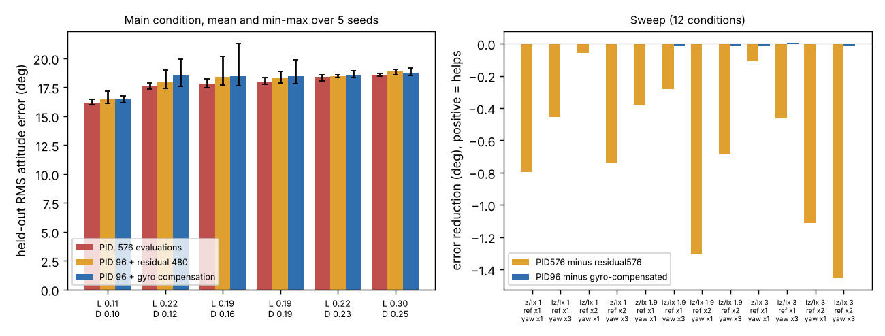

# Does a neural residual help a quadrotor attitude controller once roll, pitch and yaw are coupled?

Follow-up to `codesign-aero-skip` (track 14, `codesign`), whose "Next steps" asked for pitch and yaw coupling "so a nonlinear policy has structure a linear law cannot represent". This project adds it: three-axis attitude with Euler's rigid-body equations (gyroscopic term ω×Iω), a yaw axis that has reaction-torque authority only, and a residual network that sees all six states. It also adds an arm that needs no search: the analytic gyroscopic compensation, which is the part of the coupling a network could in principle learn. Produced with AI assistance (Claude). **Simulated; the plant, gust and randomisation ranges are the assumed round numbers of the earlier projects, not measurements; the yaw reaction-torque ratio and the Iz/Ix ratio are assumed and swept.**

**Live page:** https://duncan-haywood.github.io/oss-monorepo/research/codesign-aero-coupled/



**Headline (simulated; all numbers from `experiments/results.txt`, negative result).** Held-out combined RMS attitude error (64 wide-plant episodes, a different seed), 6 airframes × 5 CMA-ES seeds:
- **The residual network is worse than plain PID, not just no better.** PID 96 evaluations then residual 480: 18.08° against 17.76° for a PID given all 576 evaluations; the PID is better in 26 of 30 airframe-seed pairs (mean 0.32°, seed SD of the difference 0.45°). With 2400 residual evaluations the gap is 0.20° (PID better in 22 of 30). The residual fits its 16 training episodes (it never scores below the PID there, by construction) and loses on held-out ones.
- **Analytic gyroscopic compensation changes nothing:** 18.197° against 18.199° (mean difference −0.001°). Where the coupling term peaks at a median 2.3% of the torque limit (max 8.8%) there is no room for it to matter, and the sweep below pushes it much further.
- **Yaw sets the error.** Roll and pitch RMS are about 7.3° but yaw RMS is about 29° on 30° steps every 0.5 s: reaction torque is about an order of magnitude weaker than roll torque (`tau_yaw` against `tau_max` in `src/codesign_aero_coupled/aero.py`), so yaw is authority-limited and no control law reaches the step in time. Tripling the assumed yaw authority lowers the combined error by 1.8° (17.6° to 15.8°) in the sweep; changing the control-law class does not.

**Sweep (12 conditions: Iz/Ix 1.0, 1.9, 3.0 × reference scale 1, 2 × yaw authority ×1, ×3; 3 airframes × 3 seeds each).** PID576 beats the residual in all 12 (by 0.06° to 1.45°). Compensated against uncompensated PID differs by at most 0.016° in any condition, even where the gyroscopic term peaks at 71% of the torque limit (Iz/Ix 3.0, double-size steps, yaw ×3). At Iz/Ix = 1.0 the term is exactly zero and the compensation is a no-op, as a check.

## Method
`src/codesign_aero_coupled/aero.py` extends `codesign-aero-skip`'s model (same sizing closure, gust, sensor noise, one-step delay, motor lag and wide randomisation) to three axes: dω/dt = I⁻¹(τ + τ_gust − ω×Iω), ZYX Euler kinematics, per-axis first-order torque lag and saturation. Inertia is `size()`'s Ix = Iy, with Iz = 1.9 Ix in the main condition; yaw torque limit is 2(Tmax − Thover)·κ with κ = 0.016 m (assumed). References are independent ±15°, ±15°, ±30° step sequences (four 0.5 s segments). Arms: per-axis PID (roll and pitch share three gains, yaw has three; CMA-ES on log gains); PID + residual (83-parameter, 8-unit tanh network of the three errors and three gyro rates, zero at init, sigma 0.1, the zero residual is the incumbent); PID + gyroscopic compensation (u += ω̂×(Inom ω̂)/τnom from the measured rates and the nominal inertia and limit, so the randomised plant mismatches it). Training scores 16 wide-plant episodes per evaluation; testing uses 64 held-out episodes. Airframes are `codesign-aero-skip`'s six.

## Reproduce
```bash
cd research/codesign-aero-coupled
PY=$(python3 ../../platform/ci/pyenv.py pytest numpy cma matplotlib)
"$PY" -m pytest -q tests          # 10 tests
"$PY" experiments/run.py          # about 25 min on 4 cores (multiprocessing); results.txt, results.json
"$PY" experiments/figure.py       # experiments/coupled.png
```

## Builds on
`codesign-aero-skip`, `codesign-aero-mlp`, `codesign-aero-robust`, `codesign-aero` (model). Rigid-body attitude dynamics and gyroscopic coupling of a quadrotor: Mahony, Kumar and Corke (2012), "Multirotor aerial vehicles: modeling, estimation, and control of quadrotor", *IEEE Robotics & Automation Magazine* 19(3) (cited for the equations; nothing is reproduced from its code). Residual policies on a classical controller: Johannink et al. (2019), ICRA, arXiv:1812.03201 (idea only). CMA-ES: Hansen and Ostermeier (2001), *Evolutionary Computation*.

## Lab tags
RECUV and the Autonomous Systems IRT (UAV simulation, safe autonomy), as direction only; nothing is affiliated with or endorsed by them.

## Limitations
- The yaw reaction-torque ratio κ, Iz/Ix and the plant ranges are assumed, not measured on a build; the sweep covers Iz/Ix 1.0 to 3.0 and yaw ×1 to ×3 only. A real airframe with stronger yaw authority or fast flips could put the coupling in a regime the sweep did not reach.
- Attitude only, no position loop, no rotor gyroscopics or blade flapping, step references rather than aggressive trajectories; coupling is small on this task by construction of its rates (peak ω×Iω share median 2.3%).
- An 83-parameter network searched by CMA-ES with 480 or 2400 evaluations on 16 training episodes overfits; more training episodes, regularisation or PPO might change the sign. "Worse here" is not "worse always".
- Six airframes (three in the sweep), five seeds (three in the sweep); differences under about 0.1° are not resolved. Not a safety case; no weapons or harmful payloads are modelled.

## Next steps
Aggressive trajectories (flips, fast yaw) where ω×Iω is a large share of the torque limit for most of the episode; more training episodes for the residual; PPO; PX4 software-in-the-loop.

## Owner steps
Measure real yaw reaction torque, motor lag and torque spread on a built airframe.

## Outside dependencies (vitamins)
numpy, cma, matplotlib. No model API is called.

MIT.
