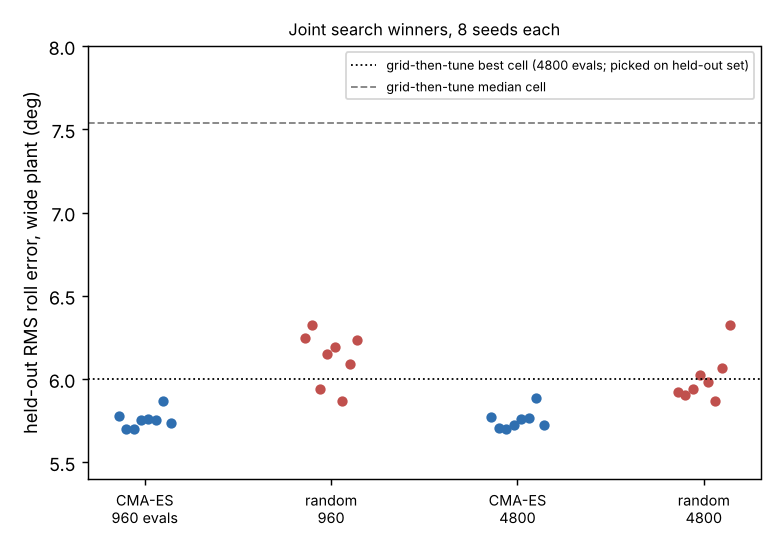

# Should a quadrotor’s airframe and controller gains be searched jointly when the plant is uncertain?

**Should you search airframe and controller gains jointly when the plant is uncertain, instead of grid-then-tune? In this stylised quadrotor model, yes: joint CMA-ES finds a better design than the grid with a fifth of the evaluations.**

Follow-up to `codesign-aero-robust` (track 14, `codesign`; its "Next steps" asked for joint CMA-ES with randomised training plants). `codesign-aero` already compared joint and sequential search on the nominal plant; this asks it on the wide randomised plant, with 8 seeds and a random-search baseline at equal budget. Produced with AI assistance (Claude). **Stylised simulation: every constant and randomisation range is an assumed round number; roll axis only; no hardware, no PX4/ArduPilot software-in-the-loop; a three-gain linear policy.**

**Live page:** https://duncan-haywood.github.io/oss-monorepo/research/codesign-aero-joint/



**Headline (simulated; all numbers from `experiments/results.txt`, 8 seeds per cell).** Held-out RMS roll error on the wide randomised plant (64 episodes, a different seed from training):
- Joint CMA-ES, 960 evaluations: median **5.75°** (range 5.70 to 5.87). At 4800 evaluations: **5.74°** (5.70 to 5.89). Extra budget bought nothing here.
- Uniform random search over the same 5 parameters, 960 evaluations: 6.17° (5.87 to 6.33); 4800 evaluations: 5.96° (5.87 to 6.33).
- Reference, grid-then-tune from `codesign-aero-robust` (50 airframes × 96 evaluations = 4800): best cell 6.00°, median cell 7.54°. The 6.00° is the minimum over cells chosen on the held-out set, so it flatters the grid.
- So at one fifth of the grid's budget, every one of 8 CMA-ES seeds (worst 5.87°) beat the grid's best cell, and the worst CMA-ES seed at 4800 (5.89°) did too. Random search at 4800 evaluations only matched the grid's best cell.
- The winners converge on a smaller airframe than the grid's best: median L 0.125 m, D 0.094 m (grid best: L 0.107 m, D 0.101 m, and the nominal optimum L 0.135 m, D 0.101 m).
- Training-score winners are optimistic by about 0.4 to 0.5° on the held-out episodes for both methods (selection on 16 noisy episodes); the comparison uses held-out numbers only.

## Method
`src/codesign_aero_joint/aero.py` is `codesign-aero-robust`'s model unchanged (wide plant: torque 0.7 to 1.0×, inertia 0.9 to 1.3×, motor lag 1 to 2×, drawn per episode). `joint.py` searches the unit cube of 5 parameters (arm length, prop diameter, log gains kp, kd, ki) with CMA-ES (population 16, σ 0.25, start at a feasible mid design) or uniform random sampling; infeasible airframes score −99. Training: 16 episodes per evaluation, seed 100. Each seed's best-training-score point is re-scored on 64 held-out episodes (seed 9999). Seeds 0 to 7; budgets 960 and 4800 evaluations.

## Reproduce
```bash
cd research/codesign-aero-joint
PY=$(python3 ../../platform/ci/pyenv.py pytest numpy cma matplotlib)
PYTHONPATH=src "$PY" -m pytest -q tests     # 5 tests
"$PY" experiments/run.py                     # about 25 min; results.txt, results.json (reads ../codesign-aero-robust results.json)
"$PY" experiments/figure.py                  # experiments/seeds.png
```

## Builds on
`codesign-aero-robust` (model, grid reference), `codesign-aero` (nominal-plant joint search). CMA-ES: Hansen and Ostermeier (2001), *Evolutionary Computation*. Domain randomisation: Tobin et al. (2017), IROS.

## Lab tags
RECUV and the Autonomous Systems IRT (UAV simulation, safe autonomy), as direction only; no paper of theirs is reproduced and nothing is affiliated with or endorsed by them.

## Limitations
- The 5-parameter space is small and smooth; the joint advantage may not carry to larger design spaces or to higher-fidelity simulators.
- The grid reference used a coarse 9×9 airframe grid and a different (per-cell) budget split, and its best cell was chosen on the held-out set; this is not a like-for-like tuned-grid benchmark. A finer grid might close the gap.
- CMA-ES at 960 and 4800 evaluations ends at the same score, so the model's optimum is probably reached by 960; the budget comparison says little beyond that point.
- Held-out score of the winner is itself a 64-episode estimate; differences of ~0.1° are within noise and are not claimed.
- Randomisation ranges are assumed; gust level, sensor lag and thrust margin are not randomised. Not a safety case.

## Next steps
Randomise thrust margin with mass; a finer grid and a held-out selection protocol for the reference; PX4 software-in-the-loop.

## Owner steps
None (simulation only).

## Outside dependencies (vitamins)
numpy, cma, matplotlib. No model API is called.

MIT.
