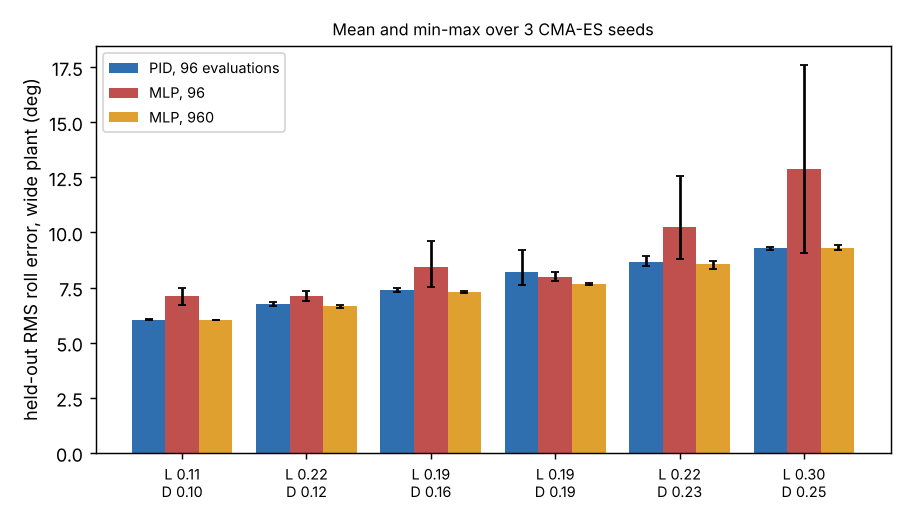

# Does a small neural roll controller beat the three-gain PID on a randomised quadrotor, and does it change which airframe is best?

Follow-up to `codesign-aero` (track 14, `codesign`; its "Next steps" asked for "a small neural policy" in place of the linear law) on the wide randomised plant of `codesign-aero-robust`. Instead of PPO, the 31-parameter network is trained by CMA-ES, the same optimiser as the PID gains, so only the controller class differs. Produced with AI assistance (Claude). **Simulated; the plant, gust and randomisation ranges are the assumed round numbers of the earlier projects, not measurements.** Six airframes only, three CMA-ES seeds each.

**Live page:** https://duncan-haywood.github.io/monorepo-projects/research/codesign-aero-mlp/



**Headline (simulated; all numbers from `experiments/results.txt`).** Held-out RMS roll error (64 episodes, a different seed) on the wide plant, mean over 3 seeds:
- **At the same 96 evaluations the neural controller is worse than the PID on 5 of 6 airframes.** Mean over airframes 8.96° against 7.72°; the gap is 0.4° to 3.6° and the network's seeds scatter widely (largest airframe 9.1° to 17.6°). Thirty-one parameters need more search than three gains.
- **With 10× the evaluations (960) it only matches the PID.** 7.59° against 7.72°; the per-airframe gain is +0.02 to +0.09° on four airframes, +0.53° on one (L 0.190, D 0.186) and 0.00° on the last. The error floor here is set by the gusts, sensor noise and motor lag, not by the shape of the control law.
- **The airframe ranking does not change.** The best of the six is the same airframe under every controller, and the Spearman correlation of the airframe means for PID and 960-evaluation network is 1.00. Choosing the airframe with the three-gain law was not a distortion in `codesign-aero`.

## Method
`src/codesign_aero_mlp/aero.py` is `codesign-aero-robust`'s model with a pluggable controller. The network maps `[e/0.26, gyro/3, ∫e/0.3]` to the normalised torque command through 6 tanh units (31 parameters, each in [−3, 3]). The six airframes are the wide-tuned ranks 1, 10, 20, 30, 40 and 50 of the 50 feasible grid cells in `codesign-aero-robust/experiments/results.json`. Per airframe and seed, CMA-ES (population 16) tunes the PID with 96 evaluations, the network with 96 and with 960, each evaluation scoring 16 training episodes on the wide plant.

## Reproduce
```bash
cd research/codesign-aero-mlp
PY=$(python3 ../../platform/ci/pyenv.py pytest numpy cma matplotlib)
"$PY" -m pytest -q tests          # 6 tests
"$PY" experiments/run.py          # about 5 min; results.txt, results.json
"$PY" experiments/figure.py       # experiments/mlp.png
```

## Builds on
`codesign-aero-robust`, `codesign-aero` (model). CMA-ES: Hansen and Ostermeier (2001), *Evolutionary Computation*. Neuroevolution as a policy search method: Salimans et al. (2017), "Evolution strategies as a scalable alternative to reinforcement learning", arXiv:1703.03864 (cited for the method class; nothing from it is reproduced).

## Lab tags
RECUV and the Autonomous Systems IRT (UAV simulation, safe autonomy), as direction only; nothing is affiliated with or endorsed by them.

## Limitations
- Six airframes and three seeds; gaps under about 0.1° are not resolved.
- Evolution strategies, not PPO: a gradient-based learner or a better initialisation (for example starting the network at the tuned PID) might do better. The network has no skip path, so it must learn the linear behaviour from scratch.
- Roll only, one hidden width (6), and the plant ranges are assumptions. Not a safety case; no weapons or harmful payloads are modelled.

## Next steps
Start the network at the tuned PID (a linear skip path) and see whether it then finds anything below the floor; add pitch and yaw coupling so a nonlinear policy has something a linear law cannot do; PX4 software-in-the-loop.

## Owner steps
Measure real motor lag and torque spread on a built airframe to replace the assumed ranges.

## Outside dependencies (vitamins)
numpy, cma, matplotlib. No model API is called.

MIT.
