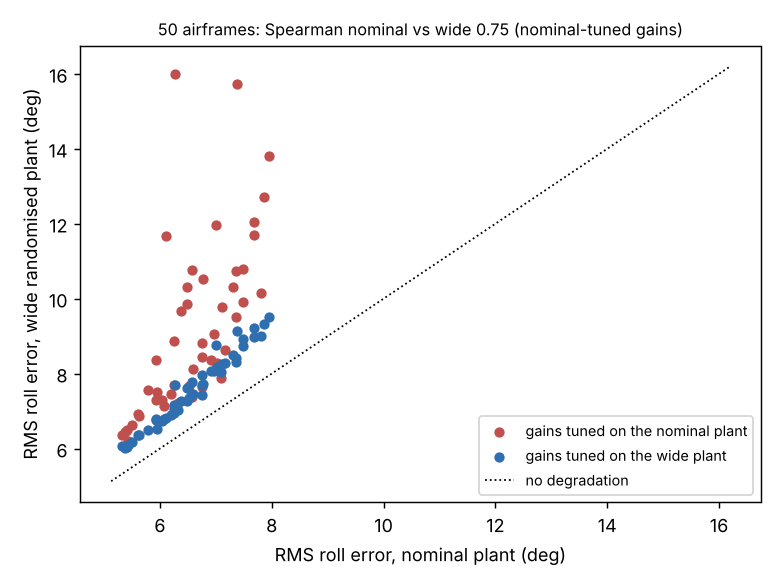

# Does the best quadrotor airframe stay best when motor strength, mass and motor lag are randomised?

Robustness follow-up to `codesign-aero` (track 14, `codesign`; its "Next steps" asked for this): the airframe grid of that project is re-scored with per-episode randomisation of torque authority, inertia and motor lag, with gains tuned on the nominal plant (the original pipeline), on a narrow randomised plant and on a wide one. Produced with AI assistance (Claude). **Stylised simulation: every constant, and the randomisation ranges, are assumed round numbers; roll axis only; no hardware, no PX4/ArduPilot software-in-the-loop; the policy is a three-gain linear law. The "mass" multiplier scales roll inertia only, not the thrust margin.**

**Live page:** https://duncan-haywood.github.io/monorepo-projects/research/codesign-aero-robust/



**Headline (simulated; all numbers from `experiments/results.txt`, one tuning run per cell, no seed repeats).**
- **The airframe ranking mostly survives.** Over 50 feasible airframes with nominal-tuned gains, the nominal and wide-plant RMS errors have Spearman correlation 0.75 (0.96 for the narrow plant). The five best airframes are the same five on nominal, narrow and wide plants. The nominal optimum (L 0.135 m, D 0.101 m) is 2nd of 50 on the wide plant, 0.17° behind the best (6.37° against 6.20°).
- **Retuning the gains matters more than moving the airframe.** Tuning gains on the wide plant lowers the median cell's wide-plant error by 0.91° (66% of cells improve by more than 0.5°); median 8.41° with nominal-tuned gains, 7.54° with wide-tuned. The best cell moves from 6.20° to 6.00° (L 0.107 m, D 0.101 m), and the nominal optimum airframe with wide-tuned gains is 3rd of 50 (6.08°).
- **Nothing went unstable.** No airframe exceeds 20° RMS on the wide plant with either gain set.
- **Cost of a nominal-only controller:** at nominal, the nominal-tuned best is 5.33°; on the wide plant the best is 6.20°, so about 0.9° of error is the price of the widened plant itself.

## Method
`src/codesign_aero_robust/aero.py` is `codesign-aero`'s model with `plant=` added to `rollout`: each episode draws multipliers uniformly for torque authority (`tau`), roll inertia (`mass`) and motor lag (`lag`). Narrow: tau 0.9 to 1.0, mass 0.95 to 1.15, lag 1.0 to 1.4. Wide: tau 0.7 to 1.0, mass 0.9 to 1.3, lag 1.0 to 2.0 (assumed, not from component tolerances). Grid: 9×9 over arm length and prop diameter, 50 feasible cells. Per cell CMA-ES tunes the three gains for 96 evaluations of 16 training episodes, once per training plant. Every cell and gain set is then scored on 64 held-out episodes (different seed) on each plant. Ranking is compared with Spearman correlation and top-5 overlap.

## Reproduce
```bash
cd research/codesign-aero-robust
PY=$(python3 ../../platform/ci/pyenv.py pytest numpy cma matplotlib)
PYTHONPATH=src "$PY" -m pytest -q tests     # 7 tests
"$PY" experiments/run.py                     # about 2.5 min; results.txt, results.json
"$PY" experiments/figure.py                  # experiments/ranking.png
```

## Builds on
`codesign-aero` (model and grid), `codesign-transfer` (the same question for gripper designs). Widened domain randomisation: Tobin et al. (2017), IROS. CMA-ES: Hansen and Ostermeier (2001), *Evolutionary Computation*.

## Lab tags
RECUV and the Autonomous Systems IRT (UAV simulation, safe autonomy), as direction only; no paper of theirs is reproduced and nothing is affiliated with or endorsed by them.

## Limitations
- One tuning run per cell and 64 held-out episodes: differences of a few tenths of a degree between neighbouring cells (the 0.17° regret, rank 2 versus 3) are within the tuning noise and are not claimed as ordering.
- The randomisation ranges are my assumptions; narrower or wider ranges, or randomising gust level and sensor lag, were not tried.
- Gains are not tuned jointly with the airframe here (the grid is ground truth, as in `codesign-aero`), so this says nothing about how joint CMA-ES behaves under randomisation.
- Not a safety case; no weapons or harmful payloads are modelled.

## Next steps
Repeat tuning over seeds to put intervals on the ranks; run joint CMA-ES with randomised training plants; randomise thrust margin together with mass; try PX4 software-in-the-loop.

## Owner steps
Measure real motor lag and torque authority spread on a built airframe to replace the assumed ranges.

## Outside dependencies (vitamins)
numpy, cma, matplotlib. No model API is called.

MIT.
