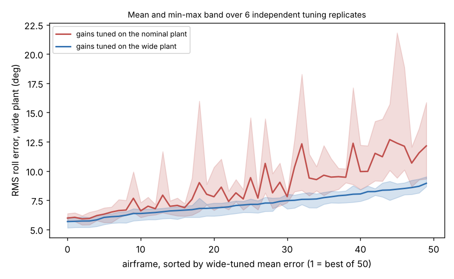

# Is the quadrotor airframe ranking from one CMA-ES tuning run reproducible, or is it tuning noise?

Seed-repeat follow-up to `codesign-aero-robust` (track 14, `codesign`; its "Next steps" asked for this). The same 50-airframe grid, the same three-gain roll controller and the same wide randomised plant, but the whole pipeline (CMA-ES seed, training episodes, held-out episodes) is repeated six times, so the ranks get intervals. Produced with AI assistance (Claude). **Stylised simulation: every constant and randomisation range is an assumed round number; roll axis only; no hardware, no PX4/ArduPilot software-in-the-loop. Six replicates is small: the intervals are ranges, not confidence intervals.**

**Live page:** https://duncan-haywood.github.io/oss-monorepo/research/codesign-aero-seeds/



**Headline (simulated; all numbers from `experiments/results.txt`; replicate 0 uses the seeds of `codesign-aero-robust` and reproduces its optimum and its rank 3).**
- **With gains tuned on the wide plant the ranking is very reproducible.** Spearman between independent replicates 0.99 on average (min 0.99), the same five airframes are the top five in every replicate, and the best airframe is L 0.135 m, D 0.101 m in 5 of 6 replicates (L 0.107 m in the other).
- **With nominal-tuned gains evaluated on the wide plant it is much noisier.** Replicate-to-replicate Spearman is 0.84 on average (min 0.70), only 3 airframes are in every top five (mean top-5 overlap 4.1/5), and the winner is L 0.190 m (3 times), L 0.135 m (2) or L 0.162 m (1), D 0.101 m throughout. A nominal-tuned controller is a noisier measuring instrument for a wide plant.
- **The earlier "nominal optimum is 2nd of 50 on the wide plant, 0.17° behind" was inside the noise.** Nominal vs wide Spearman inside a replicate ranges 0.75 to 0.93 (mean 0.85; the single earlier run, 0.75, was the lowest). With wide-tuned gains, each replicate's own nominal-optimum airframe ranks 1st of 50 in five replicates and 3rd in one.
- **Retuning gains for the wide plant helps the median airframe by 0.88° on average** (replicates +0.40 to +1.29°), confirming the earlier +0.91° as typical in sign and size. The per-replicate median error itself moves by 1.5° (nominal-tuned, wide plant: 7.01 to 8.52°), mostly from the held-out episodes, so absolute errors from one run should not be compared across runs.
- **Few airframes are separable from the best.** Within 2 standard errors of the best mean (paired, six replicates): 4 of 50 with nominal-tuned gains, 3 of 50 with wide-tuned gains. Neighbouring grid cells are not ordered by this data.

## Method
`src/codesign_aero_seeds/aero.py` is `codesign-aero-robust`'s model unchanged. Replicate r uses CMA-ES seed 8+13r, training seed 100+17r and held-out seed 9999+31r (r = 0 is the earlier run). For each of the 50 feasible airframes on the 9×9 (arm length × prop diameter) grid, CMA-ES tunes the three gains for 96 evaluations of 16 training episodes, once on the nominal plant and once on the wide plant (torque 0.7–1.0×, inertia 0.9–1.3×, motor lag 1–2×, assumed); each gain set is scored on 64 held-out episodes on the nominal and on the wide plant. `seeds.py` holds the rank statistics (pairwise Spearman, top-5 sets, winner counts, paired indistinguishable-from-best test).

## Reproduce
```bash
cd research/codesign-aero-seeds
PY=$(python3 ../../platform/ci/pyenv.py pytest numpy cma matplotlib)
"$PY" -m pytest -q tests          # 6 tests
"$PY" experiments/run.py          # about 8 min on 4 cores; results.txt, results.json
"$PY" experiments/figure.py       # experiments/seeds.png
```

## Builds on
`codesign-aero-robust` and `codesign-aero` (model, grid). Domain randomisation: Tobin et al. (2017), IROS. CMA-ES: Hansen and Ostermeier (2001), *Evolutionary Computation*.

## Lab tags
RECUV and the Autonomous Systems IRT (UAV simulation, safe autonomy), as direction only; no paper of theirs is reproduced and nothing is affiliated with or endorsed by them.

## Limitations
- Six replicates; the "range" and "within 2 SE" figures are descriptive and the SE rests on n = 6.
- The grid is coarse (9×9); neighbouring cells differ by less than the noise, so a finer grid would not resolve the ordering without more replicates.
- The randomisation ranges are assumptions, the three-gain linear law is simple, and only roll is modelled. Not a safety case; no weapons or harmful payloads are modelled.
- Joint airframe-and-gain CMA-ES under randomisation, and thrust margin randomised with mass, are still untried.

## Next steps
Joint CMA-ES with randomised training plants and seed repeats; randomise thrust margin with mass; PX4 software-in-the-loop.

## Owner steps
Measure real motor lag and torque authority spread on a built airframe to replace the assumed ranges.

## Outside dependencies (vitamins)
numpy, cma, matplotlib. No model API is called.

MIT.
