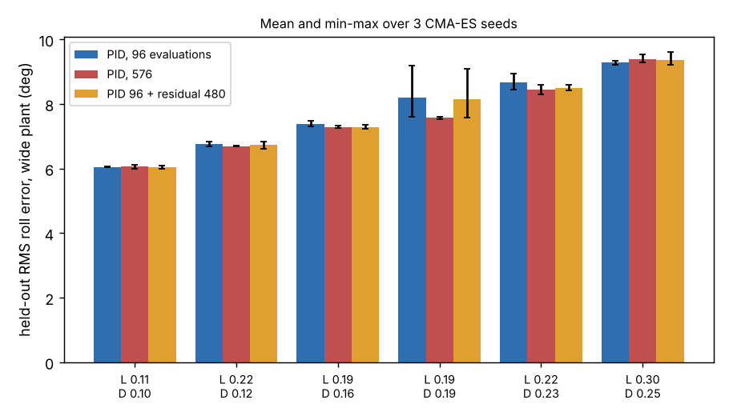

# Does a neural residual on top of the tuned PID get a quadrotor roll controller below the PID error floor?

Follow-up to `codesign-aero-mlp` (track 14, `codesign`), whose "Next steps" asked to start the network at the tuned PID with a linear skip path. Here the controller is u = PID + a 31-parameter residual network that is exactly zero at the start, so the search begins at the PID and can only add to it. Produced with AI assistance (Claude). **Simulated; the plant, gust and randomisation ranges are the assumed round numbers of the earlier projects, not measurements.** Six airframes, three CMA-ES seeds each.

**Live page:** https://duncan-haywood.github.io/monorepo-projects/research/codesign-aero-skip/



**Headline (simulated; all numbers from `experiments/results.txt`, negative result).** Held-out RMS roll error (64 episodes, a different seed) on the wide randomised plant, mean over 3 seeds:
- **At the same 576 evaluations the residual does not beat plain PID.** PID 96 evaluations then residual 480: 7.68° mean over airframes, against 7.58° for a PID tuned with all 576. Over the 18 airframe-seed pairs the residual is better in 7 and worse in 11 (mean +0.11° worse), and most of that difference is one airframe (L 0.190, D 0.186; PID 7.58° against 8.16°) where the residual arm inherits a poorly tuned 96-evaluation PID.
- **Against the PID it started from, it is better in 14 of 18 pairs but by 0.04° on average**, which is inside the seed scatter. Most of the PID's own improvement from 96 to 576 evaluations is better gains, not a nonlinear term.
- **The airframe ranking is unchanged** (Spearman 1.00 between PID and residual arm), the same result as `codesign-aero-mlp`. The error floor is set by gust, sensor noise and motor lag, not by the control-law class, now with the network starting from the PID instead of from scratch.

## Method
`src/codesign_aero_skip/aero.py` is `codesign-aero-mlp`'s model with a `skip` controller: u = kp·e − kd·gyro + ki·∫e + MLP([e/0.26, gyro/3, ∫e/0.3]). Per airframe and seed: CMA-ES tunes the PID (96 evaluations, population 16); then CMA-ES (sigma 0.1, start at the zero residual) tunes the 31 residual parameters for 480 evaluations with the PID fixed; the zero residual is the incumbent, so the training score never falls below the PID's. The comparison PID gets 576 evaluations from scratch. Each evaluation scores 16 wide-plant training episodes; the same six wide-tuned airframes (ranks 1, 10, 20, 30, 40, 50) as `codesign-aero-mlp`.

## Reproduce
```bash
cd research/codesign-aero-skip
PY=$(python3 ../../platform/ci/pyenv.py pytest numpy cma matplotlib)
"$PY" -m pytest -q tests          # 8 tests
"$PY" experiments/run.py          # about 4 min; results.txt, results.json
"$PY" experiments/figure.py       # experiments/skip.png
```

## Builds on
`codesign-aero-mlp` (controller classes, which this extends), `codesign-aero-robust`, `codesign-aero` (model). Residual policies on top of a classical controller are a standard idea in robot learning (for example Johannink et al. 2019, "Residual reinforcement learning for robot control", ICRA, arXiv:1812.03201), cited for the idea only; nothing from it is reproduced. CMA-ES: Hansen and Ostermeier (2001), *Evolutionary Computation*. Neuroevolution as a policy search method: Salimans et al. (2017), "Evolution strategies as a scalable alternative to reinforcement learning", arXiv:1703.03864 (cited for the method class; nothing from it is reproduced).

## Lab tags
RECUV and the Autonomous Systems IRT (UAV simulation, safe autonomy), as direction only; nothing is affiliated with or endorsed by them.

## Limitations
- Six airframes and three seeds; gaps under about 0.1° are not resolved, and one airframe (L 0.190, D 0.186) carries most of the mean difference because its PID96 seeds scatter widely.
- The residual is a 6-unit network searched by CMA-ES with sigma 0.1 and parameter scale 1.0; a gradient learner (PPO), a different scale or a wider network might find something this search did not. "No gain here" is not "no gain possible".
- Roll only, so the plant has nothing a linear law cannot do. The residual's best case is the nonlinearity of torque saturation and the quadratic gust drag, which the PID already handles to the noise floor. Plant ranges are assumed round numbers from `codesign-aero`. Not a safety case; no weapons or harmful payloads are modelled.

## Next steps
Add pitch and yaw coupling so a nonlinear policy has structure a linear law cannot represent; PPO for the residual; PX4 software-in-the-loop.

## Owner steps
Measure real motor lag and torque spread on a built airframe to replace the assumed ranges.

## Outside dependencies (vitamins)
numpy, cma, matplotlib. No model API is called.

MIT.
