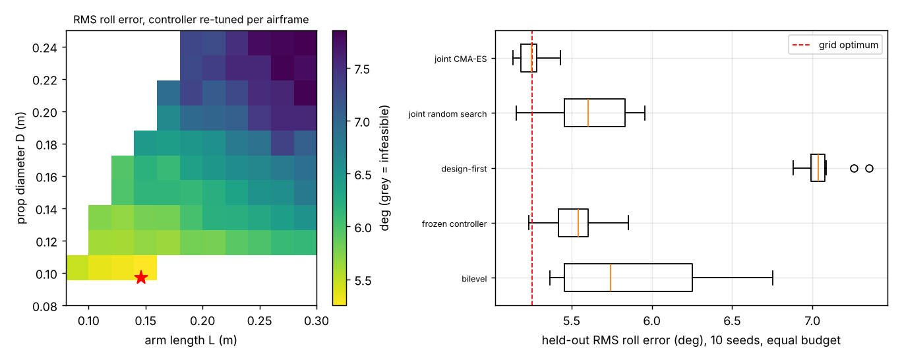

# Should a quadrotor's airframe and its learned attitude controller be sized together, or one after the other?

Sixth milestone of the agentic co-design track (`research/PROJECTS.md`, track 14, `codesign`; `codesign-aero`): an airframe and a learned roll-attitude controller for a 15-minute inspection quadrotor, designed jointly and compared with design-first, frozen-controller, bilevel and random-search pipelines at equal budget. Produced with AI assistance (Claude). **Every constant (masses, thrust scaling, motor lag, gust torque, noise) is an assumed round number in `src/codesign_aero/aero.py`, not a measurement of any product; roll axis only, simulation only, nothing was built or flown. The PX4 or ArduPilot software-in-the-loop run that the milestone mentions was not attempted, and the "learned" controller is a three-gain linear policy found by CMA-ES policy search, not deep RL.**

**Live page:** https://duncan-haywood.github.io/monorepo-projects/research/codesign-aero/



**Headline (simulated, stylised; all numbers from `experiments/results.txt`).**
- **Sizing the airframe with the controller in the loop beat sizing it by weight.** Held-out RMS roll error over a ±15° step sequence in gusts, mean of 10 seeds at 320 candidate evaluations each: joint CMA-ES over arm length, prop diameter and three gains **5.25°** (best airframe on an 11×11 grid with a controller tuned for each cell: 5.25°); joint random search 5.63°; frozen controller 5.52°; bilevel 5.88°; **design-first** (lightest feasible airframe, then the whole budget on the controller) **7.06°**. Joint beats design-first in 10/10 seeds and random search, the frozen controller and bilevel in 9/10, 9/10 and 10/10.
- **A controller tuned on one airframe does not carry over.** Gains tuned on a reference airframe (L 0.146 m, D 0.139 m, 5.91° with its own gains) and reused unchanged on every feasible grid airframe give a median 7.23° against 6.52° when retuned per airframe; on 41% of the 76 feasible cells the reused controller is more than 1° worse. None went unstable (no cell above 40°).
- **The best airframe is the one a small, fast prop makes possible, not the lightest.** The grid optimum is L = 0.146 m, D = 0.097 m, at the small-prop edge of the feasible region (props may not overlap, √2·L ≥ 1.05·D). Small props need a bigger battery for the same endurance but have less motor lag, and in this model the lag costs more tracking than the mass does. The lightest feasible airframe is a large-prop one with a slow response, which is why design-first loses.
- **Null result: the gust level did not move the optimum.** Best grid RMS error at gust standard deviation 0, 2, 4 and 6 m/s is 5.36, 5.36, 5.33 and 5.44°, at arm lengths of 0.107, 0.135, 0.107 and 0.162 m. The spread is smaller than the noise between cells, so no trend is claimed: the 30° step flips dominate the error, and the gust torque I assumed is a small fraction of motor authority.
- **The joint-versus-frozen gap is small.** 5.25° against 5.52° is 9/10 seeds, but the two overlap (worst joint run 5.43°, best frozen 5.23°).

## Method
`src/codesign_aero/aero.py`. *Airframe* (two design variables): arm length L in 0.08 to 0.30 m and prop diameter D in 0.08 to 0.25 m. Motors are sized for a thrust-to-weight ratio of 2; the battery is sized by fixed-point mass closure for 15 min of hover (actuator-disc power, figure of merit 0.65, drive efficiency 0.75, 80% depth of discharge, 150 Wh/kg), as in `osrobot-uav`. Roll inertia comes from motor and arm masses at radius L/√2, torque authority from the thrust headroom, motor lag from prop size (15 ms at 0.127 m, growing as D^1.5), BOM cost from assumed unit prices (cap USD 300, never binding). *Task:* track a ±15° roll set-point that flips every 0.5 s for 2 s, with a mean 3 m/s plus Ornstein-Uhlenbeck gust (sd 4 m/s, time constant 0.5 s) acting on frame and sensor-pod area through an assumed lever arm, gyro noise 0.05 rad/s, angle noise 0.005 rad and a one-step sensing delay. *Policy:* u = kp·e − kd·gyro + ki·∫e, scaled to the torque limit, gains on log scales (kp 1 to 500, kd 0.01 to 10, ki 0.1 to 100), found by CMA-ES. The policy sees only measurements, so it must be retuned when the body changes. *Score:* RMS roll error in degrees over 8 training episodes, re-scored on 64 held-out episodes; an episode past 60° counts as 60° for its remaining steps. *Pipelines* (320 evaluations each unless noted): joint CMA-ES over all five variables; joint random search; design-first; frozen controller (160 evaluations tuning gains on the reference airframe, 160 searching the airframe with gains fixed); bilevel (outer CMA-ES over the airframe, 16 inner evaluations of gain tuning per candidate). The grid spends 192 inner evaluations per cell, far more than any pipeline, and serves as ground truth.

## Reproduce
```bash
cd research/codesign-aero
PY=$(python3 ../../platform/ci/pyenv.py pytest numpy cma matplotlib)
PYTHONPATH=src "$PY" -m pytest -q tests          # 9 tests, under a second
"$PY" experiments/run.py                         # about 2.5 min; writes results.txt and results.json
"$PY" experiments/figure.py                      # experiments/landscape.png, from results.json
```

## Builds on
Codesign track (`research/PROJECTS.md`, milestone 6) and its sibling projects `osrobot-uav` and `uav-energy-twin` (mass closure and endurance models). Hover power is momentum theory (Leishman 2006, *Principles of Helicopter Aerodynamics*, 2nd ed., Cambridge University Press). The idea of optimising body and policy together is the subject of Sims (1994), SIGGRAPH, and Gupta, Savarese, Ganguli and Fei-Fei (2021), *Nature Communications*; neither is reproduced. CMA-ES: Hansen and Ostermeier (2001), *Evolutionary Computation*. Wind-torque and gust are textbook-style assumptions (Stevens, Lewis and Johnson 2016, *Aircraft Control and Simulation*, 3rd ed., Wiley), not fitted to data.

## Lab tags
RECUV and the Autonomous Systems IRT (UAV simulation and safe autonomy), as direction only: no paper of theirs is reproduced, and nothing here is affiliated with or endorsed by them.

## Limitations
- One axis (roll), decoupled from the others: no yaw, pitch coupling, rotor flapping, battery sag or aerodynamic drag on the body. Every number is a model output; no component was checked against a data sheet.
- Two design variables only; the motor choice, number of rotors, frame stiffness and battery chemistry are fixed. The grid optimum sits at the edge of the feasible region, so a larger design space could move it.
- The controller family is a three-gain linear law. A neural policy might exploit airframes differently; not tested.
- The gust model barely stresses the loop, so the result is mostly a step-tracking result.
- The score is not a safety case. No weapons or harmful payloads are modelled.

## Next steps
Add pitch and yaw coupling; make the gust matter (a bigger sensor-pod lever, ground effect); replace the linear law by a small neural policy trained with PPO; run `codesign-transfer`'s widened-randomisation test on this airframe (motor strength, mass and lag tolerance); try PX4 software-in-the-loop if it installs.

## Owner steps
Build the grid-optimum and the lightest airframe on a test stand with an IMU and measure step response, then compare with the simulated ranking. A priced bill of materials with dated sources is needed first; none is given here.

## Outside dependencies (vitamins)
Open-source Python packages (numpy, cma, matplotlib). No model API is called. A real airframe would need motors, props, ESCs, battery and a flight controller bought.

MIT.
