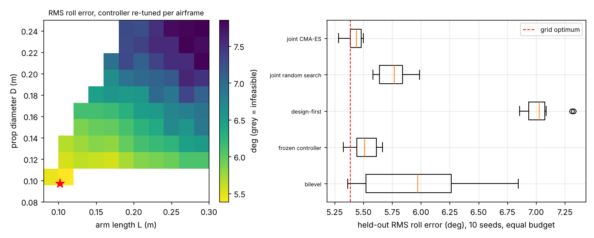

# Should a quadrotor's airframe and its learned attitude controller be sized together, or one after the other?

Sixth milestone of the agentic co-design track (`research/PROJECTS.md`, track 14, `codesign`; `codesign-aero`): an airframe and a learned roll-attitude controller for a 15-minute inspection quadrotor, designed jointly and compared with design-first, frozen-controller, bilevel and random-search pipelines at equal budget. Produced with AI assistance (Claude). **Every constant (masses, thrust scaling, motor lag, gust torque, noise) is an assumed round number in `src/codesign_aero/aero.py`, not a measurement of any product; roll axis only, simulation only, nothing was built or flown. The PX4 or ArduPilot software-in-the-loop run that the milestone mentions was not attempted, and the "learned" controller is a three-gain linear policy found by CMA-ES policy search, not deep RL.**

**Live page:** https://marisstella.app/research/codesign-aero/



**Headline (simulated, stylised; all numbers from `experiments/results.txt`, re-run 2026-11-15 after the mass-closure fix below).**
- **Sizing the airframe with the controller in the loop beat sizing it by weight.** Held-out RMS roll error over a ±15° step sequence in gusts, mean of 10 seeds at 320 candidate evaluations each: joint CMA-ES over arm length, prop diameter and three gains **5.42°** (best airframe on an 11×11 grid with a controller tuned for each cell: 5.39°); joint random search 5.76°; frozen controller 5.52°; bilevel 5.95°; **design-first** (lightest feasible airframe, then the whole budget on the controller) **7.05°**. Joint beats design-first and random search in 10/10 seeds and bilevel in 9/10.
- **Against a frozen controller the joint search barely wins.** 5.42° against 5.52°, and joint is better in only 6/10 seeds; the two overlap (worst joint run 5.50°, best frozen 5.33°). No claim is made that joint beats frozen.
- **Whether a controller tuned on one airframe carries over is unsettled.** Gains tuned on a reference airframe (L 0.146 m, D 0.139 m, 5.85° with its own gains) and reused unchanged on every feasible grid airframe give a median 6.64° against 6.56° when retuned per airframe; on 15% of the 74 feasible cells the reused controller is more than 1° worse, and none went unstable (no cell above 40°). Before the fix this read 7.23° against 6.52° and 41%. Dropping two unclosed cells is not the whole change: the extra closure iterations move the reference airframe's sized mass by one part in 10^7, and that alone sends its CMA-ES gain tuning down a different path (5.91° before, 5.85° now, on the reference itself). A result that one tuning run can move from 41% to 15% needs several tuning seeds before it says anything.
- **The best airframe is the smallest prop whose mass still closes, not the lightest.** The grid optimum is L = 0.102 m, D = 0.097 m. One grid step smaller (D 0.080 m) no battery gives 15 min of hover at any arm length, so the optimum sits on the closure boundary, not on the prop-overlap rule (which bounds large props). Small props need a bigger battery for the same endurance but have less motor lag, and in this model the lag costs more tracking than the mass does. The lightest feasible airframe is a large-prop one with a slow response, which is why design-first loses.
- **Null result: the gust level did not move the optimum.** Best grid RMS error at gust standard deviation 0, 2, 4 and 6 m/s is 5.35, 5.37, 5.37 and 5.45°, at arm lengths of 0.162, 0.107, 0.162 and 0.162 m (D 0.101 m throughout). The spread is smaller than the noise between cells, so no trend is claimed: the 30° step flips dominate the error, and the gust torque I assumed is a small fraction of motor authority.

## Method
`src/codesign_aero/aero.py`. *Airframe* (two design variables): arm length L in 0.08 to 0.30 m and prop diameter D in 0.08 to 0.25 m. Motors are sized for a thrust-to-weight ratio of 2; the battery is sized by fixed-point mass closure for 15 min of hover (actuator-disc power, figure of merit 0.65, drive efficiency 0.75, 80% depth of discharge, 150 Wh/kg), as in `osrobot-uav`. A design is feasible only if the closure reaches a fixed point (relative residual under 1e-4 after 1,000 damped steps); small-prop designs with no fixed point are rejected. Roll inertia comes from motor and arm masses at radius L/√2, torque authority from the thrust headroom, motor lag from prop size (15 ms at 0.127 m, growing as D^1.5), BOM cost from assumed unit prices (cap USD 300). On a 40×40 grid the closure check removes 234 of the 1,269 overlap-feasible points; the cost cap removes none beyond them (the most expensive closed design on the 11×11 grid costs USD 130). *Task:* track a ±15° roll set-point that flips every 0.5 s for 2 s, with a mean 3 m/s plus Ornstein-Uhlenbeck gust (sd 4 m/s, time constant 0.5 s) acting on frame and sensor-pod area through an assumed lever arm, gyro noise 0.05 rad/s, angle noise 0.005 rad and a one-step sensing delay. *Policy:* u = kp·e − kd·gyro + ki·∫e, scaled to the torque limit, gains on log scales (kp 1 to 500, kd 0.01 to 10, ki 0.1 to 100), found by CMA-ES. The policy sees only measurements, so it must be retuned when the body changes. *Score:* RMS roll error in degrees over 8 training episodes, re-scored on 64 held-out episodes; an episode past 60° counts as 60° for its remaining steps. *Pipelines* (320 evaluations each unless noted): joint CMA-ES over all five variables; joint random search; design-first; frozen controller (160 evaluations tuning gains on the reference airframe, 160 searching the airframe with gains fixed); bilevel (outer CMA-ES over the airframe, 16 inner evaluations of gain tuning per candidate). The grid spends 192 inner evaluations per cell, far more than any pipeline, and serves as ground truth.

## Reproduce
```bash
cd research/codesign-aero
PY=$(python3 ../../platform/ci/pyenv.py pytest numpy cma matplotlib)
PYTHONPATH=src "$PY" -m pytest -q tests          # 14 tests, under a second
"$PY" experiments/run.py                         # about 3 min; writes results.txt and results.json
"$PY" experiments/figure.py                      # experiments/landscape.png, from results.json
```

## Builds on
Codesign track (`research/PROJECTS.md`, milestone 6) and its sibling projects `osrobot-uav` and `uav-energy-twin` (mass closure and endurance models). Hover power is momentum theory (Leishman 2006, *Principles of Helicopter Aerodynamics*, 2nd ed., Cambridge University Press). The idea of optimising body and policy together is the subject of Sims (1994), SIGGRAPH, and Gupta, Savarese, Ganguli and Fei-Fei (2021), *Nature Communications*; neither is reproduced. CMA-ES: Hansen and Ostermeier (2001), *Evolutionary Computation*. Wind-torque and gust are textbook-style assumptions (Stevens, Lewis and Johnson 2016, *Aircraft Control and Simulation*, 3rd ed., Wiley), not fitted to data.

## Lab tags
RECUV and the Autonomous Systems IRT (UAV simulation and safe autonomy), as direction only: no paper of theirs is reproduced, and nothing here is affiliated with or endorsed by them.

## Limitations
- **Correction, 2026-11-15 ([audit](../../portfolio/quality/audits/2026-11-15-codesign-aero.json)).** The first version never checked that the mass closure converged. Its reported optimum (L 0.146 m, D 0.097 m, 5.25°) has no fixed point: the update `m_new − m` is positive for every mass from 0.5 to 20 kg, and the auditor found 9 of 10 joint CMA-ES winners of that kind. `size()` now requires a closed mass, and every number above is from the re-run. Joint still beats design-first, random search and bilevel; the advantage over a frozen controller and the controller-transfer gap both shrank, and the transfer result turned out to hinge on a single tuning run (see the headline). The 13 `codesign-aero-*` projects carry a copy of the old `size()` and have not been re-run (each README says so).
- One axis (roll), decoupled from the others: no yaw, pitch coupling, rotor flapping, battery sag or aerodynamic drag on the body. Every number is a model output; no component was checked against a data sheet.
- Two design variables only; the motor choice, number of rotors, frame stiffness and battery chemistry are fixed. The grid optimum sits at the edge of the feasible region, so a larger design space could move it.
- The controller family is a three-gain linear law. A neural policy might exploit airframes differently; not tested.
- The gust model barely stresses the loop, so the result is mostly a step-tracking result.
- The score is not a safety case. No weapons or harmful payloads are modelled.

## Next steps
Repeat the transfer test over several tuning seeds for the reference gains (one run moved it from 41% to 15% of cells); port the closure check to the 13 `codesign-aero-*` copies and re-run them. Add pitch and yaw coupling; make the gust matter (a bigger sensor-pod lever, ground effect); replace the linear law by a small neural policy trained with PPO; run `codesign-transfer`'s widened-randomisation test on this airframe (motor strength, mass and lag tolerance); try PX4 software-in-the-loop if it installs.

## Owner steps
Build the grid-optimum and the lightest airframe on a test stand with an IMU and measure step response, then compare with the simulated ranking. A priced bill of materials with dated sources is needed first; none is given here.

## Outside dependencies (vitamins)
Open-source Python packages (numpy, cma, matplotlib). No model API is called. A real airframe would need motors, props, ESCs, battery and a flight controller bought.

MIT.
