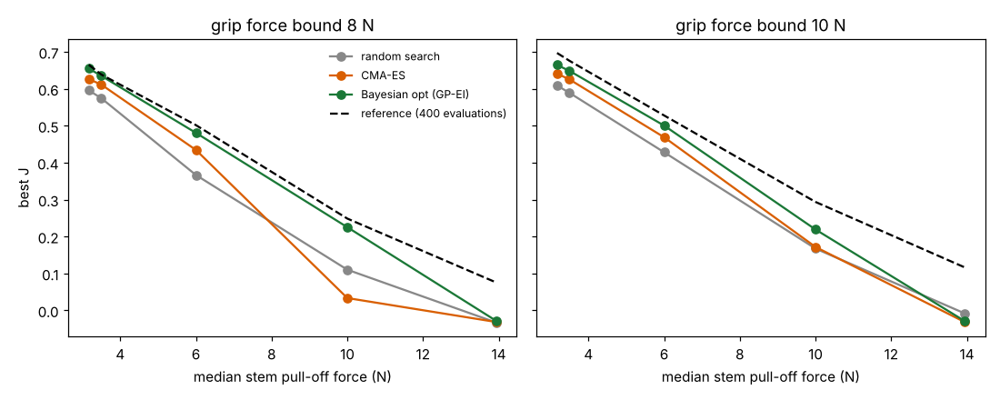

# Does the strawberry gripper co-design of `codesign-agri` survive the measured range of stem pull-off force?

Follow-up to `codesign-agri` and to `codesign-agri-sweep` (track 14, `codesign`; agriculture). The sweep's next step was to source the invented constants; for the stem pull-off force there are two published measurements, and one of them is four times the value `codesign-agri` assumed. Produced with AI assistance (Claude). **Simulated; the pull-off median and the grip-force limit are sourced, the bruise threshold, friction, ripeness law, prices and every other constant are inherited assumptions.**

**Live page:** https://duncan-haywood.github.io/oss-monorepo/research/codesign-agri-pulloff/



**Headline (all numbers from `experiments/results.txt`; 600 fruit, budget 40, 20 seeds per method, reference = best of five 400-evaluation Bayesian runs).**
- **The achievable objective collapses as stems get stronger.** With grip force bounded at 8 N, the reference best J is 0.665 at a median pull-off of 3.17 N, 0.639 at the parent's assumed 3.5 N, 0.502 at 6 N, 0.249 at 10 N and 0.075 at 13.94 N. At 13.94 N the best design picks 19% of fruit cleanly and slips 52%. Nothing in the 8 N range holds a stem that needs 13.94 N.
- **At 13.94 N no 40-evaluation run finds a working gripper.** The median best J is -0.033, -0.032 and -0.029 for random search, CMA-ES and Bayesian optimisation (8 N bound), i.e. the best design picked nothing and only paid its cost. (The "yes" for this cell in the ranking table below is a ranking among three failures.)
- **The ranking holds in 8 of 10 cells** (Bayesian optimisation above CMA-ES above random search by median at 40 evaluations). The two exceptions are 10 N pull-off with the 8 N bound, where CMA-ES (0.033) falls below random search (0.110), and 13.94 N with the 10 N bound, where all three fail. At 3.5 N / 8 N the parent's numbers are reproduced exactly (0.574, 0.611, 0.635).
- **The 10 N gripping limit buys 0.03 to 0.04 of reference J** at 3.17 N (0.697 vs 0.665), 3.5 N (0.676 vs 0.639), 6 N (0.528 vs 0.502) and 10 N (0.294 vs 0.249); it is not enough to rescue the 13.94 N case (0.117).
- **The best design changes shape.** Two fingers when pull-off is low (3.17 N, and 3.5 N with the 10 N bound), three or four from 6 N up, always at or near the grip-force bound. The parent's 3-finger winner is specific to its assumed 3.5 N at an 8 N bound.
- **Reading the sourced numbers.** 3.17 N is for bending then pulling a thin peduncle; 13.94 N is a straight pull of a thicker one. A gripper that bends the stem before pulling sits at the favourable end, so the picking motion decides which row applies. The model has no picking motion, only a pull-off force.

## Method
`src/codesign_agri_pulloff/pulloff.py` imports `codesign-agri`'s model and optimisers unchanged and rebuilds the 600-fruit population with the same random stream (a test confirms identical fruit at the parent's median) but a different lognormal median for the pull-off force (the parent's ripeness factor 1.2 - 0.5 ripe and spread 0.3 are kept, so the realised median is about 0.95 times the nominal). `experiments/run.py` runs random search, CMA-ES and GP-EI Bayesian optimisation (parent code, budget 40, 20 seeds) for medians 3.17, 3.5, 6, 10, 13.94 N and grip-force upper bound 8 N (parent) or 10 N, and five 400-evaluation Bayesian runs per cell as a reference optimum. No language model and no reinforcement learning are used.

### Sourced inputs
| Input | Value | Source |
|---|---|---|
| Pull-off, bend and pull | 3.17 N (peduncle 1.78 mm) | Dimeas et al. (2015), as reported by Rajendran et al. (2022); I did not read the original |
| Pull-off, pull only | 13.94 N (peduncle 2.17 mm) | same |
| Peduncle gripping limit | 10 N | Rajendran, Parsa, Parsons, Ghalamzan Esfahani (2022), arXiv:2207.12552; Robofruit (arXiv:2301.03947) lowest peak compression 22.5 to 26.8 N with a safety factor 2 |

The two arXiv ids could not be auto-checked (timeout and HTTP 429 from `cite_check.py`); I confirmed both titles in a web search on 2026-10-24.

I searched for a strawberry bruise-pressure threshold in kPa and found none (the apple figure of about 0.10 MPa is for another fruit), so the 40 to 110 kPa band stays assumed.

## Reproduce
```bash
cd research/codesign-agri-pulloff
PY=$(python3 ../../platform/ci/pyenv.py pytest numpy scipy cma matplotlib)
PYTHONPATH=src "$PY" -m unittest discover -s tests     # 5 tests
OMP_NUM_THREADS=1 PYTHONPATH=src "$PY" experiments/run.py   # about 10 min on 4 cores -> experiments/results.txt, results.json
"$PY" experiments/figure.py                             # experiments/pulloff.png
```
Set `OMP_NUM_THREADS=1`: without it the multiprocess Bayesian runs oversubscribe the cores and one attempt did not finish in 30 minutes.

## Limitations
- Only two measured pull-off values exist in what I could find, both from one second-hand report; the intermediate medians 6 and 10 N are interpolation, not data. Cultivar, ripeness and picking motion are not modelled.
- Everything else in the fruit and gripper model is the parent's assumed round numbers (bruise band, friction, clutter law, prices, 60 USD cap).
- The reference optimum is the best of five 400-evaluation runs, not a proven global optimum. Medians over 20 seeds at 40 evaluations; differences of a few hundredths between methods are within seed spread in places.
- Simulation is not a harvesting trial or a safety case.

## Next steps
Find a measured strawberry bruise threshold and fruit-diameter distribution for a named cultivar and re-draw the population; add a bend-then-pull motion to the model so pull-off becomes a design consequence; run the diagnostic readers of `codesign-agri` where Bayesian optimisation fails (13.94 N).

## Owner steps
Measure stem pull-off and bruise onset on real fruit with a force gauge; price the servo and TPU parts.

## Builds on
`codesign-agri` (model, optimisers), `codesign-agri-sweep` (named this follow-up). Dimeas, Sako, Gaskell et al. (2015) as cited by Rajendran et al. (2022), "Peduncle gripping and cutting force for strawberry harvesting robotic end-effector design", ICCR, https://arxiv.org/abs/2207.12552.

## Lab tags
None fits closely; nothing is affiliated with or endorsed by any group.

## Outside dependencies (vitamins)
numpy, scipy, cma, matplotlib. No model API is called.

MIT.
