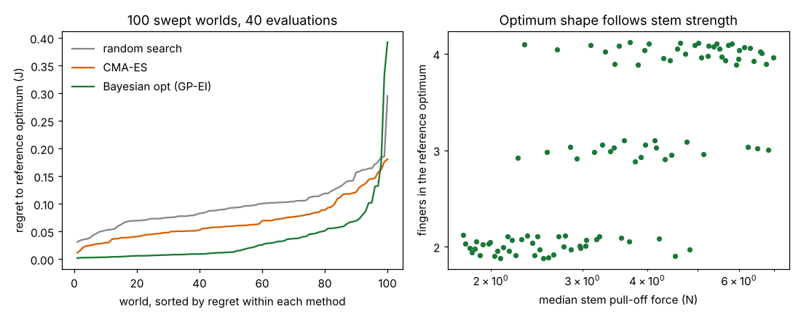

# Do the codesign-agri conclusions survive when its assumed constants change?

**Does the ranking of gripper-design optimisers, and the shape of the best gripper, hold when the twelve invented constants of the `codesign-agri` soft-fruit model are swept over plausible ranges? The optimiser ranking mostly does (Bayesian optimisation beats CMA-ES beats random search in 82 of 100 worlds); the best design does not (two, three or four fingers, depending mostly on stem strength), and the nominal winner is over budget or 0.06 J short in most worlds.** (Stylised model; the sweep ranges are my choices and are not sourced.)

Track 14 (agentic co-design of low-cost robots, `codesign`). `../codesign-agri` chose its constants (fruit size, bruise threshold, stem force, prices, collision length scale) as round numbers and found Bayesian optimisation ahead of the session agent, CMA-ES and random search at 40 evaluations. The owner's rule of 2026-10-21 (`../CLAUDE.md`, "Run the numbers") says that when nothing sourced exists, sweep the plausible range and report whether the conclusion survives. This does that. It is not the same as `../codesign-transfer`, which draws per-fruit and per-print variation *inside* one world; here the world's constants themselves move. Produced with AI assistance (Claude). No CU Boulder group's work is built on; no connection is claimed.

**Live page:** https://duncan-haywood.github.io/monorepo-projects/research/codesign-agri-sweep/



## Method
- `src/codesign_agri_sweep/world.py` is the `codesign-agri` evaluator with its constants as a parameter dict. A test checks that the nominal dict reproduces `codesign_agri.agri.evaluate` to 12 decimals on 25 random designs.
- 12 constants, each given a range around its original value (table below), sampled by a 100-point Latin hypercube (log-uniform where the range is multiplicative). Each point is a "world": its own 600-fruit population (same random stream, shifted by the constants) and its own prices.
- In each world: a **reference optimum** (best of 2000 random designs and three 400-evaluation CMA-ES runs), then the three baselines of `codesign-agri`, unchanged (`../codesign-agri/src/codesign_agri/optimisers.py`), at 40 evaluations and 8 seeds each. Regret is the reference J minus the median best J of a method over its 8 seeds. The reference is itself a search result, not a proof of optimality; no method's median ever exceeded it (smallest regret 0.0019).
- The nominal world is run through the same code as a check: median best J 0.569 / 0.614 / 0.634 (random / CMA-ES / Bayesian) against 0.574 / 0.611 / 0.635 in `codesign-agri`.
- The session-agent row of `codesign-agri` is not repeated: it was one hand-written run by the model's author and cannot be re-run in 100 worlds.

| constant | nominal | swept range | source |
|---|---|---|---|
| `bruise_scale` (multiplies 40-110 kPa band) | 1 | 0.5 to 2 | none; original band was assumed |
| `diam_mean`, `diam_sd` (mm) | 28, 5 | 22 to 34, 3 to 7 | none |
| `stem_median` (N) | 3.5 | 1.75 to 7 | none |
| `place_sd` (mm) | 4 | 2 to 8 | none |
| `wet_share` | 0.3 | 0.1 to 0.5 | none |
| `mu_scale` (multiplies friction) | 1 | 0.7 to 1.4 | none |
| `clutter_len` (mm) | 400 | 200 to 800 | none |
| `value_bruised` | 0.2 | 0 to 0.5 | none |
| `cost_weight` (J per USD) | 0.002 | 0.001 to 0.004 | none |
| `servo_price`, `plastic_price` | 4 USD/N, 0.004 USD/mm² | x0.5 to x2 | none |

The ranges are factor-of-two bands around the original round numbers. I did not look up strawberry or pad data for this run, so the sweep says whether the *conclusion* is fragile to these constants, not which world is real. Sourcing them is the natural next step.

## Results (`experiments/results.txt`)
- **Ranking survives, mostly.** Median regret to the reference: Bayesian optimisation 0.013, CMA-ES 0.060, random search 0.093. Per world (median over seeds, ties within 0.002 J) Bayesian optimisation beats random search in 96 of 100 worlds and CMA-ES in 91; CMA-ES beats random search in 88. The full order BO >= CMA-ES >= random holds in 82. Bayesian optimisation is within 0.01 J of the reference in 42 worlds; CMA-ES and random search in none.
- **Four worlds break it.** Bayesian optimisation's median is below random search's in worlds 61, 80, 83 and 91. In world 80 (strong stems, tender fruit) five of eight Bayesian seeds end at J = -0.02, a design that picks nothing, while the reference reaches 0.374: the useful region is narrow and the surrogate gets no gradient from a flat landscape. Over the 97 worlds whose reference is at least 0.25, 10 of 776 Bayesian seeds, 14 of 776 CMA-ES seeds and 4 of 776 random seeds are stuck below 0.05.
- **Sample efficiency.** Seeds reaching within 0.02 J of the reference in 40 evaluations: Bayesian 432 of 800, CMA-ES 89, random 27.
- **The best design is not stable.** The reference optimum has 2, 3 and 4 fingers in 42, 21 and 37 worlds (3 at nominal). Stem strength explains most of it: Spearman rho +0.74 with finger count. Grip force sits at its 8 N bound in 52 worlds, pad width at its 25 mm bound in 32, so the design ranges themselves bind. The reference J spans 0.10 to 0.86.
- **The nominal winner does not transfer.** Scoring the nominal reference design in every world: it exceeds the cost cap in 37 worlds (prices moved), and in the other 63 its regret to that world's reference has median 0.056, 90th percentile 0.120 and worst 0.189, over 0.05 in 36. This agrees in direction with `../codesign-transfer`, which found a 13% loss under per-world variation.
- **What moves what** (Spearman, n = 100, |rho| > 0.2 is about the 5% level, many tests so treat single hits loosely): stem strength lowers the best achievable J (-0.62) and raises the finger count (+0.74); friction raises J (+0.45); tougher fruit (a higher bruise band, rho -0.54) and pricier servos (-0.42) shrink Bayesian optimisation's lead over random search, plausibly because easier or tighter-budget worlds leave less to find.

## Reproduce
```bash
PY=$(python3 ../../platform/ci/pyenv.py pytest numpy scipy cma matplotlib)
cd research/codesign-agri-sweep
"$PY" -m pytest -q tests                  # 4 tests, about 1 s
"$PY" experiments/run.py                  # about 1 minute on 4 cores -> results.json
"$PY" experiments/analyse.py              # -> results.txt
"$PY" experiments/figure.py               # -> experiments/sweep.png
```
It imports the optimisers from `../codesign-agri`, so that directory must be present.

## Limitations
- Every sweep range is my choice, a factor of two around an assumed number; none is sourced, so "survives" means survives *these* ranges. The model's structure (collision law, bruise rule, friction) is not varied, only its constants.
- One-at-a-time interpretation is not possible: the 100 worlds move all 12 constants at once, and the correlations are rank correlations on 100 points, not a variance decomposition.
- The reference optimum is a search result with a finite budget; regrets are lower bounds on distance to the true optimum.
- 8 seeds per method per world: the per-world median is noisy, which is why ties and sign tests are reported over worlds, not single worlds.
- Not an LLM benchmark and no LLM is used. Nothing was printed or measured on a real gripper.

## Next steps
Source the constants: strawberry bruise-pressure thresholds, stem pull-off forces and fruit diameters from the horticultural-engineering literature, and print-material moduli from datasheets, then re-draw the worlds from measured ranges instead of factor-of-two bands. Re-run the diagnostic-feedback readers of `codesign-agri` (`experiments/diagnose.py`) in the worlds where Bayesian optimisation is stuck, since a flat landscape is where failure feedback should help.

## Owner steps
None for the simulation.

## Outside dependencies (vitamins)
numpy, scipy, cma, matplotlib, and the `codesign-agri` project in this repository. No model API is called. A real gripper would need servos, a printer and TPU filament.

## Lab tags
None fits closely; nothing of any lab is used here.

MIT.
