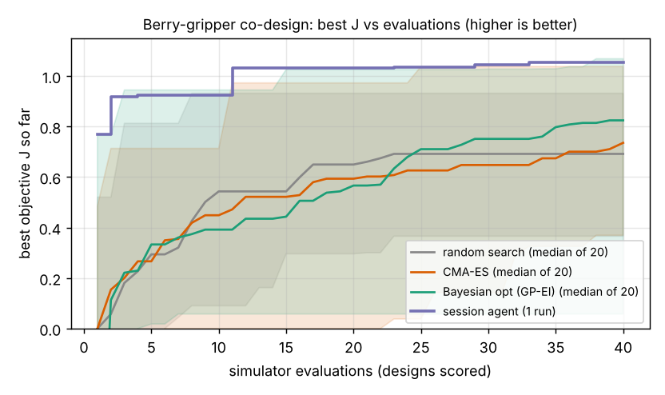

# Which three-finger pad design picks the most unbruised strawberry-like fruit under a 60 USD cap, and does a session agent beat CMA-ES and Bayesian optimisation at 40 evaluations?

Fourth milestone of the agentic co-design track (`research/PROJECTS.md`, track 14, `codesign`; agriculture domain). A printed soft-fruit gripper is described by five numbers (pad width, pad length, pad modulus, grip force, number of fingers) and scored on a fixed population of 600 simulated fruit for clean picks, bruises, slips and misses. Produced with AI assistance (Claude).

**Live page:** https://duncan-haywood.github.io/oss-monorepo/research/codesign-agri/



**Headline (simulated, stylised, one agent run, 20 seeds per baseline; all numbers from `experiments/results.txt`).**
- **Bayesian optimisation won.** Median best J at 40 evaluations: Bayesian optimisation 0.635, session agent 0.618, CMA-ES 0.611, random search 0.574. All 20 Bayesian-optimisation seeds matched or beat the agent's best, 3 of 20 CMA-ES seeds did, no random-search seed did. The model is noise-free (the same 600 fruit score every design), so the 0.017 gap is real in this model.
- **The agent was faster early and plateaued.** It first reached J of at least 0.60 at evaluation 12 (Bayesian optimisation: median 17; CMA-ES 27.5 with 6 of 20 seeds never; random search 23 with 17 of 20 never), then stalled at 0.618 because its last round refined a neighbourhood at 6.5 to 7.5 N and 0.2 to 0.35 MPa, while the best design seen uses the 8 N bound.
- **The best design seen in any run** is pad 25 x 26 mm (width at its bound), modulus 0.19 MPa, 8 N (at its bound), 3 fingers, J = 0.638, 53 USD: 74% clean picks, 0% bruised, 6% slipped, 20% missed.
- **The ceiling is set by clutter, not by the gripper pads.** Misses (about 20% at three fingers) are almost all collisions with leaves and neighbours, which in this model depend only on finger count and length. Two fingers cut collisions to 13% but slip rose from 10% to 14-17% because there is no caging bonus.
- **Diagnostics steered the agent, as designed.** Round 1 showed bruising near zero (median pressure 21-55 kPa against a 40-110 kPa threshold) and slip of 7-47%, so round 2 spent the pressure headroom on grip force (5-8 N). Round 2 showed collision as the loss, so round 3 tried two fingers. This is one worked example, not a test of whether diagnostic feedback helps (`codesign-diagnose` does that).
- **Not a result about language models.** I wrote the model and the proposals in one session, so the agent knew the model's structure (the collision law, the bruise threshold range) in a way a model-blind proposer would not. Treat the agent row as one worked example.

## What "agent" means here
The run environment has no model API key. The proposer is the **session agent itself**: 4 rounds of 10 designs, committed as `proposals/round1.json` to `round4.json`, each round written after reading the previous round's diagnostics from `experiments/diagnose.py` (outcome shares, median contact pressure, cost). 40 proposals in all; round 1 was written before any evaluation. Baselines got no prior and 20 seeds each; the agent has one run, so its spread is unknown.

## Method
- **Design** (`src/codesign_agri/agri.py`): pad width `w` 4 to 25 mm, pad length `l` 10 to 40 mm, pad modulus `E` 0.1 to 10 MPa (searched on a log scale), total grip force `Fg` 0.5 to 8 N, fingers `n` 2 to 4 (rounded, so the objective has plateaus in that axis). Designs costing over 60 USD score J = -1 and still use an evaluation.
- **Fruit:** 600 fruit drawn once (fixed seed): diameter N(28, 5) mm, ripeness U(0, 1) setting the bruise pressure (110 kPa firm to 40 kPa ripe) and lowering stem pull-off force (lognormal, median about 3.5 N), placement error |N(0, 4)| mm, 30% wet fruit with friction 0.35 against 0.8 dry. All ASSUMED round numbers.
- **Physics, stated plainly:** (1) *capture*: the opening is 15 + 1.4 l mm and must exceed diameter plus twice the placement error; collision with leaves or neighbours has probability 1 - exp(-n l / 400). (2) *bruise*: each finger carries `Fg / n`; a soft pad against a sphere gives a line contact of half-length `a = sqrt(4 F R / (pi E* w))` capped at `l / 2` (bottoming raises pressure 1.5x); mean pressure `F / (2 a w)`, multiplied by a first-touch overload when the pad cannot deflect (`a^2 / R`) enough to absorb the placement error. Bruised if above the fruit's threshold; a held but bruised fruit is worth 0.2. (3) *hold*: friction `mu Fg`, tackier on soft pads, times a caging bonus for long fingers when `n >= 3`, reduced by pad shear strain `Fd / (G w l)`; slip if below 1.1 times the stem pull-off force.
- **Objective** `J = mean fruit value (clean 1, bruised 0.2, missed or slipped 0) - 0.002 x cost`. Cost: servo 4 + 4 Fg USD, plastic 0.004 USD per mm^2 of pad times a stiffness factor, 8 USD fixed.
- **Baselines** (`optimisers.py`, no language model): random search; CMA-ES (`cma`, population 6); Gaussian-process Bayesian optimisation (Matern 5/2, 8 Sobol points, then expected improvement). 40 evaluations, 20 seeds. The optimisers are the `codesign-sar` ones with the modulus mapped to a log scale.
- **Cost of the study:** one evaluation is about 1 ms (vectorised numpy); the whole comparison runs in about 4 s. There is no reinforcement learning: grip force is a design variable, not a learned policy. The milestone's "policy per design" part is not done here.

## Reproduce
```bash
cd research/codesign-agri
PY=$(python3 ../../platform/ci/pyenv.py pytest numpy scipy cma matplotlib)
PYTHONPATH=src "$PY" -m unittest discover -s tests      # 7 tests
"$PY" experiments/run.py                                  # ~4 s -> results.txt, results.json
"$PY" experiments/figure.py                               # -> curves.png
"$PY" experiments/diagnose.py proposals/round1.json       # the per-round diagnostics the agent read
```

## Bill of materials (assumed, unsourced)
The cost model in `cost_usd` is a placeholder written for this study; none of its prices comes from a supplier quote or a dated source. The 60 USD cap is a modelling choice, not a priced build. Pricing real servos and TPU filament is an owner step.

## Limitations
- Every constant is an assumed round number, not a measurement of any strawberry, pad material or servo. The bruise threshold, friction and stem pull-off distributions in particular decide the ranking and have not been checked against fruit-handling literature.
- Contact is a closed-form Hertz-style line contact; there is no deformation of the fruit, no dynamics and no physics engine. This is a screening model.
- Collision depends only on `n` and `l`, so about 20% of fruit are lost to a term the pads cannot change; a real cluttered canopy would also depend on approach path and sensing, which this does not model.
- Finger count is rounded, which gives CMA-ES and the GP flat regions; this may disadvantage them relative to a continuous problem.
- One agent run, written by the author of the model. The best design sits on two bounds (width 25 mm, force 8 N), so the true optimum may lie outside the range.
- **Simulation is not a safety case or a harvesting trial**; whether any design picks real fruit is an owner step.

## Lab tags
None fits closely. The track allows ARPG's field-robot work (<https://arpg.colorado.edu/>) for agriculture, but nothing of theirs is used or reproduced here and nothing is affiliated with or endorsed by them. Prior work: Ha, Xu and Song (2020), Fit2Form, gripper form design, CoRL; Lehman et al. (2022), evolution through large models; Hertz line-contact mechanics as in Johnson (1985), *Contact Mechanics*. Companion projects: `codesign-sar`, `codesign-gripper`, `osrobot-field`.

## Next steps
Replace fixed grip force by a learned closing policy in MuJoCo with deformable fruit, calibrate the bruise threshold and pull-off force against published fruit-handling data, make clutter depend on approach path, then `codesign-logistics` and `codesign-transfer` (widen the fruit distribution and see whether the winning design's rank holds).

## Owner steps
Price a real bill of materials with dated sources, print the top design in TPU with the chosen Shore hardness, and test on real fruit while counting bruises.

## Outside dependencies (vitamins)
Open-source Python packages (numpy, scipy, cma, matplotlib). No model API is called. A real servo, TPU filament, controller and camera would be bought.

MIT.
