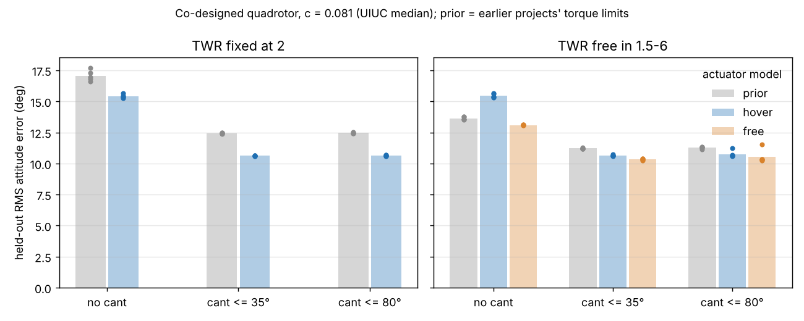

# When does rotor cant pay on a small quadrotor co-designed with its motors and controller?

Research programme `codesign-cant` (track 14, `codesign`; proposal: [`PROPOSAL.md`](PROPOSAL.md), log: [`LOG.md`](LOG.md)). It gathers seven earlier single-step projects on canted-rotor quadrotors (`codesign-aero-cant`, `-bound`, `-kappa`, `-propdata`, `-twr`, `-twrceil`, `-poshold`) into one question aimed at *IEEE RA-L*. Produced with AI assistance (Claude). **Simulated. The propeller torque ratio c comes from measured UIUC data; the mass, cost and motor fits, the plant ranges and the gust model are inherited assumptions.**

**Live page:** https://marisstella.app/research/codesign-cant/



## Milestone 1: the earlier actuator model, checked against a full allocation

**Question.** All seven earlier projects gave the simulator two hand-written torque limits. Are they right, and do the conclusions survive if they are not?

**Headline (numbers from `experiments/m1_allocation/results.txt`; simulated, 5 seeds).**

- **The formulas were wrong in three places.** The full 6×4 thrust-to-wrench map with every thrust in [0, Tmax], maximised by a linear programme (closed forms agree to 1e-15 on 300 random designs), gives yaw 4Δ(L sin α + κ cos α) and roll 4Δ(L cos α − κ sin α)/√2, where Δ = min(Th, Tmax − Th) with altitude held, or Tmax/2 if the mixer may give up altitude. The earlier yaw limit used 2 in place of 4 and the moment arm L/√2 in place of L, which understated yaw authority by 2× with no cant and up to 2.8× with cant. The earlier roll limit kept growing above TWR 2 by assuming negative rotor thrust. The side force per unit roll torque in `-poshold` was √2 too large.
- **Cant's advantage survives the correction.** Paired by seed, cant ≤ 35° beats no cant by 4.81° RMS (SD 0.12, 5 of 5 seeds) with corrected limits at TWR 2, against 4.62° with the old ones. With TWR free the gap is 4.81° (altitude held) or 2.77° (collective free), against 2.43° before.
- **The chosen cant does not move.** 35–37° at an 80° bound, the same plateau as before. That plateau comes from the objective: attitude error only, with cost as a $300 cap. The 35° design weighs 3.17 kg against 1.74 kg without cant and needs cos(35°)^−1.5 = 1.35× the ideal hover power. Naming a best cant angle needs an objective that prices energy.
- **The motor-headroom result does not survive.** `-twrceil`'s interior optimum near TWR 5 depended on the roll limit growing past TWR 2. With altitude held the optimiser picks TWR 2.0–2.3; with collective free it picks 3.3–4.7.
- The earlier numbers are reproduced exactly when the old limits are switched back on (13.65° and 11.22° for twrceil, 17.06° and 12.46° for propdata).

## Method

`src/codesign_cant/allocation.py` builds the wrench map from vectors (rotor positions, canted thrust axes, spin-signed reaction torque). It solves the largest pure roll, pitch and yaw torque as a linear programme (`scipy.optimize.linprog`, HiGHS), with no net side force and the other torques at zero, and gives the closed forms the tests check against it. `src/codesign_cant/aero.py` is `codesign-aero-cant-twrceil`'s simulator, unchanged except for an `actuator` switch (`prior`, `hover`, `free`) that sets the two torque limits. `experiments/m1_allocation/run.py` reruns joint CMA-ES over arm length, propeller diameter, cant, optional TWR and six PID gains: 1920 evaluations, 5 seeds, 16 training and 64 held-out wide-plant episodes, $300 cap, κ = c·D with c = 0.081, the median of 77 measured UIUC propellers. The predictions in `LOG.md` were committed before the run. P1, P4 and P6 held; P2, P3 and P5 were refuted.

## Reproduce

```bash
cd research/codesign-cant
PY=$(python3 ../../platform/ci/pyenv.py pytest numpy scipy cma matplotlib)
"$PY" -m pytest -q tests                        # 8 tests
"$PY" experiments/m1_allocation/run.py          # about 9 minutes on 4 cores; results.txt, results.json
"$PY" experiments/m1_allocation/figure.py       # m1_allocation.png
```

## Limitations

- Torque limits are still a per-axis box. A real mixer shares one polytope across combined commands (milestone 2).
- The objective is attitude error only. Mass, cost and hover power enter only through the sizing closure and the cost cap, which is why cant looks free up to the cap.
- Attitude steps only, 2 s episodes, five seeds, one κ. The mass, cost and motor fits and the plant ranges are inherited assumptions, not catalogue data. No hardware.

## Next steps

Milestone 2: the combined-command torque polytope with an attitude-priority mixer, and an energy term in the objective. After that: motor catalogue data, INDI and geometric attitude baselines, and a RotorPy check (`PROPOSAL.md`, "Milestones").

## Owner steps

Print canted motor mounts at 0° and about 30° for one frame. Then log yaw step response, and measure side force on a load cell while roll torque is commanded. Not done here.

## Builds on

The seven `codesign-aero-cant*` projects. Allocation theory: Johansen and Fossen (2013), *Automatica* 49(5), doi:10.1016/j.automatica.2013.01.035; Crowther et al. (2011), *JGCD* 34(4), doi:10.2514/1.51186. Propeller data: Brandt and Selig (2011), AIAA 2011-1255, doi:10.2514/6.2011-1255. CMA-ES: Hansen and Ostermeier (2001), *Evolutionary Computation* 9(2), doi:10.1162/106365601750190398. The full related work is in `PROPOSAL.md`.

## Lab tags

RECUV and the Autonomous Systems IRT (UAV simulation, safe autonomy), as a direction only. Nothing here is affiliated with or endorsed by them.

## Outside dependencies (vitamins)

numpy, scipy, cma, matplotlib. No model API is called. `data/propdata_c.csv` holds derived per-propeller ratios from the UIUC Propeller Data Site (copied from `codesign-aero-cant-propdata`).

MIT.
