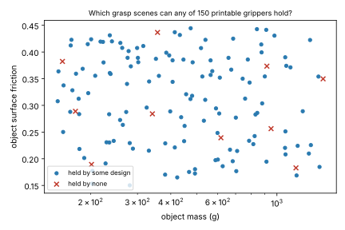

# codesign-ceiling: which grasp scenes can no printable two-finger gripper hold, and what limits the ceiling?

Track 14 (agentic co-design of low-cost robots), milestone 3. `../codesign-diagnose` ended with every method, from random search to Bayesian optimisation, stuck near 0.85 held-out grasp success, and its "Next steps" asked which test scenes nothing holds. This project answers that with an oracle sweep. Produced with AI assistance (Claude). No CU Boulder group's work is built on; no connection is claimed.

**Live page:** https://duncan-haywood.github.io/oss-monorepo/research/codesign-ceiling/

**Headline (simulation only).** Of 140 grasp scenes, **10 (7%) are held by none of 150 feasible gripper designs at any allowed force**, and all 10 are spheres whose centre sits more than about 2 mm below the simulated hand height (`dz_mm` minus radius of 1.9 mm or more). Lowering only the hand height makes every one of them holdable (10 of 10 with the hand at table level, 8 of 10 with the hand at the sphere's centre height). So the plateau is a property of the scene generator, not of friction, mass, grasp force or finger strength. Separately, the finger strength limit does cost something: ignoring it lifts the best single design (one force, chosen on the test scenes) from 0.77 to 0.89 on 100 fresh scenes.

## Method
- Task, simulator, scenes and print-time cap are copied unchanged from `../codesign-diagnose` (`src/codesign_ceiling/{sim,problem}.py`): five printable-finger parameters, 40 test scenes and 100 fresh scenes, MuJoCo grasp-lift-shake.
- **Designs:** the first 150 Sobol points (seed 7) of the five-parameter space that meet the 40-minute print cap. Not an optimised set.
- **Forces:** 2, 4, 8, 15, 30 and 60 N plus each design's own force cap, every design at every force on all 140 scenes (about 126,000 rollouts, 20 minutes on 4 cores).
- **Reachable** means some design holds the scene at some allowed force. That is an oracle over designs and forces, so it is an upper bound on any single design. Three conditions: **A** as in `codesign-diagnose` (force capped by finger strength and 30 N), **B** finger strength ignored, 30 N, **C** strength ignored, 60 N.
- **Probe:** for the 10 unreached scenes, change only the hand height and re-run the 25 best designs at all allowed forces (`experiments/dz_probe.py`).

## Reproduce
```bash
pip install numpy scipy mujoco matplotlib pytest
cd research/codesign-ceiling
python -m pytest -q tests            # 7 tests, under a second
python experiments/reach.py          # about 20 minutes on 4 cores; writes experiments/reach.json
python experiments/analyse.py        # writes results.txt and unreachable.svg
python experiments/dz_probe.py       # writes dz_probe.txt
```

## Results (from `experiments/results.txt` and `experiments/dz_probe.txt`)

| condition | scenes held by some design (test / fresh) | best single design, test / fresh | best design with per-scene force oracle |
|---|---|---|---|
| A: as before | 0.950 / 0.920 | 0.875 / 0.770 | 0.850 |
| B: strength ignored, 30 N | 0.950 / 0.920 | 0.925 / 0.890 | 0.907 |
| C: strength ignored, 60 N | 0.950 / 0.920 | 0.950 / 0.880 | 0.907 |



- **The unreached set does not change** between A, B and C: the same 2 test and 8 fresh scenes. More force and stronger fingers add nothing there.
- **Not mass or friction.** Reachable share in A is 0.94, 0.95, 0.91 and 0.88 across four mass bands (0 to 1600 g) and 0.93, 0.90, 0.95 across three friction bands. Cylinders and boxes are 100% reachable; spheres 78% (36 of 46).
- **The pattern.** Among the 46 spheres, those with `dz_mm` minus radius of at most 0.9 mm are all held (33 of 33); the 10 never-held spheres all have a difference of about 1.9 mm or more and a radius under 18 mm. Two larger spheres at 2.1 and 2.2 mm (radius 22 mm) are held, so the boundary is not a single line. A plausible mechanism is that the finger pads then touch the sphere only above its equator and squeeze it out; this was not examined in the contact data.
- **Intervention** (best 25 designs): hand height as drawn 0 of 10 now held; hand at table level 10 of 10; hand at sphere-centre height 8 of 10.
- **Selection effect.** A design picked as best on the 40 test scenes loses 0.04 to 0.11 on fresh scenes in every condition (winner's curse again).
- **What this means for `codesign-diagnose`.** Its 40-scene test set holds 2 of these scenes, so its hard ceiling was 0.95 and the plateau near 0.85 was partly the winner's curse and partly those scenes. Readers and baselines had little headroom to differ in, which fits its null result; it does not show that diagnostic feedback cannot help.

## Limitations
- The 10-scene pattern was found after looking at the results; the dz intervention supports it for those 10 scenes but is one experiment on one scene generator. The 2 mm threshold is descriptive, not fitted.
- 150 random designs are not the best the space contains; a design outside the sample might hold a scene reported unreachable (the dz probe used the best 25 designs and held all 10 once the hand was lower, which shows the designs are not the limit there).
- Only the hand height was varied; no change to finger geometry, a wider opening or an extra degree of freedom was tried.
- Stylised simulator with assumed costs and strengths; rigid fingers; nothing printed.

## Next steps
Fix the scene generator (keep `dz_mm` at or below the object's centre height) and re-run the `codesign-diagnose` readers on a task with real headroom, ideally with an LLM proposer once a key is available; then `codesign-sar` and `codesign-agri`.

## Owner steps
None.

## Outside dependencies (vitamins)
Open-source Python packages (numpy, scipy, mujoco, matplotlib). No model API is called.

MIT.
