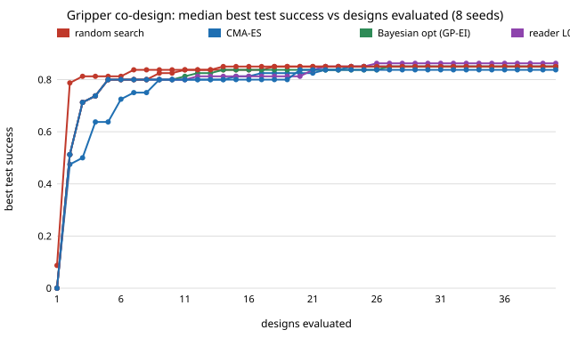

# codesign-diagnose: does diagnostic feedback (a failure summary, full rollout logs) help a design loop find better printable grippers than the score alone?

Track 14 (agentic co-design of low-cost robots), milestone 2. It follows `../codesign-forcefresh`, whose "Next steps" asked for a harder task before this ablation. Here three **scripted readers** of a MuJoCo gripper co-design loop differ only in what they may read about each evaluated design, and are compared with random search, CMA-ES and Bayesian optimisation at 40 designs and 8 seeds each. Produced with AI assistance (Claude). No CU Boulder group's work is built on; no connection is claimed.

**Live page:** https://duncan-haywood.github.io/oss-monorepo/research/codesign-diagnose/

**Headline (simulation only, negative).** Diagnostic feedback did not help. After 40 designs the median best held-out grasp success is 0.863 for the score-only reader, 0.850 for the failure-summary reader and 0.837 for the full-rollout-log reader, against 0.850 for random search, CMA-ES and Bayesian optimisation. With 40 test scenes the standard error is about 0.05, so none of these differences is resolved. The richest feedback was the worst: its mean test success over feasible proposals was 0.467, against 0.693 for the score-only reader, because its rule-based moves overshoot. On 100 fresh scenes the best designs score 0.76 to 0.80 for every method.

**What "reader" means.** The environment has no model API key, and a 6-method × 8-seed × 40-design study cannot be written by hand. Each reader is a **rule written by the author before the runs** (`src/codesign_diagnose/readers.py`), not a language model. The study therefore asks whether the extra information is usable by a sensible reader, not whether an LLM would use it. It says nothing about LLM agents. The rules were not tuned after seeing results (a 24-design smoke test was run to check the pipeline).

## Method
- **Task** (adapted from `codesign-forcefresh`, made harder): five parameters of a printable two-finger gripper (width, thickness, length, V-groove depth, TPU pad), print-time cap 40 min, objects 150 to 1500 g with friction 0.15 to 0.45, a shake of about 12 m/s², force range 0.5 to 30 N. Costs, strengths and rates are assumptions, not measurements.
- **Policy per design:** grasp force searched on 12 training scenes (8 + 4 forces), smallest best force times a 1.3 margin, capped by the finger's breaking force. Grid search, not deep RL.
- **Score** (all methods): success on 40 held-out test scenes. Print time and feasibility are visible to all.
- **Feedback levels** (from training scenes only, never test scenes):
  - L0: nothing beyond the score. Gaussian perturbation of the best design.
  - L1: failure counts by mode (`lift_loss`, `shake_loss`, `creep`) and whether the trained force hit the finger's strength limit. Moves along named directions (stronger finger, grippier pad, lighter finger).
  - L2: every training scene (mass, friction, mode, slip) and the force-versus-success sweep. Computes the grip force the heaviest failed scene needs and sizes the pad and finger to it.
- **Skeleton shared by readers:** 8 Sobol designs, then rounds of 4 proposals around the best feasible design. **Baselines:** random search, CMA-ES (population 6), GP-EI (8 Sobol, then 32 EI steps).

## Reproduce
```bash
pip install numpy scipy cma mujoco matplotlib pytest
cd research/codesign-diagnose
python -m pytest -q tests          # 10 tests, about 10 s
python experiments/run.py          # about 35 minutes on 4 cores; writes experiments/results.{json,txt}
python experiments/figure.py       # writes experiments/best_so_far.svg
```

## Results (from `experiments/results.txt`)
Best feasible test success after n designs, median [min to max] over 8 seeds.

| method | n=10 | n=20 | n=40 |
|---|---|---|---|
| random search | 0.837 [0.75-0.95] | 0.850 [0.82-0.95] | 0.850 [0.82-0.95] |
| CMA-ES | 0.800 [0.40-0.93] | 0.825 [0.80-0.93] | 0.850 [0.82-0.95] |
| Bayesian opt (GP-EI) | 0.800 [0.75-0.93] | 0.837 [0.80-0.95] | 0.850 [0.80-0.95] |
| L0 score only | 0.800 [0.78-0.88] | 0.812 [0.78-0.88] | 0.863 [0.80-0.95] |
| L1 failure summary | 0.825 [0.78-0.88] | 0.850 [0.80-0.88] | 0.850 [0.80-0.88] |
| L2 full rollout logs | 0.800 [0.72-0.88] | 0.837 [0.72-0.90] | 0.837 [0.78-0.90] |



- **Evaluations to reach 0.80:** median 4.5 to 7.5 for every method; L2 reached it in 7 of 8 seeds (the others 8 of 8). The task is still easy to get to 0.80.
- **Feasible share / mean success of feasible proposals:** L1 0.66 / 0.760 (highest quality per feasible proposal, but it proposes more over-cap designs), Bayesian optimisation 0.86 / 0.740, L0 0.78 / 0.693, L2 0.83 / 0.467, random 0.46 / 0.523. L1's directed moves raise the quality of what it proposes without raising the best found.
- **Ceiling and winner's curse.** Every method plateaus near 0.85 on test scenes, probably a few scenes no finger in this space holds (not checked). Re-scored on 100 fresh scenes the best designs drop by 0.05 to 0.07 (medians 0.76 to 0.80).

## Limitations
- Readers are author-written rules with untuned constants (step sizes, a 1.15 safety factor, `G_EFF` = 9.81 + 12 m/s²). A different rule set could give a different answer; the L2 rule in particular moves the pad and finger aggressively and often lands on poor designs. The result is "these rules did not profit", not "diagnostics never help".
- Ranking is on 40 shared test scenes (standard error ≈ 0.05) and the task plateaus, so the study could only detect large effects. 8 seeds.
- Stylised simulator and assumed costs; rigid fingers; three object shapes; nothing printed.
- Not tested: an LLM reading the logs, which is what the track's question is really about.

## Next steps
Raise the ceiling (find which test scenes nothing holds and add a gripper degree of freedom or a wider opening); give an LLM proposer the three feedback levels once a key is available; then `codesign-sar` and `codesign-agri`.

## Owner steps
None for the simulation. Printing needs a priced, dated bill of materials, not given here.

## Outside dependencies (vitamins)
Open-source Python packages (numpy, scipy, cma, mujoco, matplotlib). No model API is called. A real gripper would need a servo gripper base, a printer, PLA and TPU filament.

MIT.
