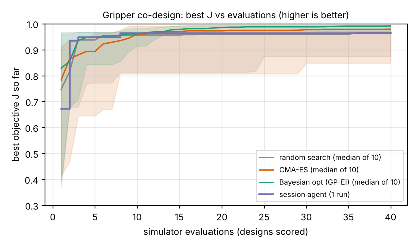

# Which printable two-finger gripper holds eight different objects for the least plastic, and can an agent's design proposals beat CMA-ES and Bayesian optimisation at 40 simulations?

First milestone of the agentic co-design track (`research/PROJECTS.md`, track 14, `codesign`; manufacturing domain). A parametric 3D-printable finger is scored in MuJoCo on eight objects (cylinders, cubes, a sphere, a thin plate). Four ways of choosing designs get the same 40 simulator evaluations. Produced with AI assistance (Claude).

**Live page:** https://duncan-haywood.github.io/monorepo-projects/research/codesign-gripper/



**Headline (simulated, one agent run, 10 seeds per baseline; all numbers from `experiments/results.txt` and `robust.txt`).**
- **The baselines beat the agent.** At 40 evaluations the median best objective is 0.991 for Gaussian-process Bayesian optimisation, 0.979 for CMA-ES, 0.965 for random search and 0.963 for the session agent. Bayesian optimisation matched or beat the agent in 10 of 10 seeds, CMA-ES in 8 of 10, and random search in 6 of 10.
- **Why the agent lost.** It anchored on wide V-shaped pads (30 mm wide, 30 degree V) that work but use 3.7 g of plastic. The best designs any method found are small and flat, for example a 15 mm long, 1.7 mm thick, 8 mm wide flat finger (0.5 g) that holds all eight objects. The agent never tried that corner of the space.
- **But the cheapest designs are the fragile ones.** Re-scored with object offsets tripled, the 0.5 g Bayesian-optimisation winner holds 5 of 8 objects, against 6 of 8 for the agent's wide-V design (`experiments/robust.txt`). The objective rewards plastic saved and says nothing about margin, which is exactly the question `codesign-transfer` (milestone 7) is for.
- **Not a result about language models.** The agent is the Claude session that wrote this project, one run of four rounds, and it had seen a handful of probe evaluations while debugging the simulator. Treat the agent row as one worked example.

## What "agent" means here
The run environment has no model API key. The proposer is the **session agent itself**, writing 4 rounds of 10 designs as committed files (`proposals/round1.json` to `round4.json`), reading the simulator's per-object diagnostics (which object failed and how) between rounds. 40 proposals in all. Round 1 was written before any scoring of the final simulator. I had run about ten debugging evaluations beforehand, and the first scoring of round 1 ran on a version where the fingers dragged on the table; I discarded those scores, fixed the bug (the palm is now held 4 mm above the table) and re-scored round 1 with the fixed simulator before writing round 2. The baselines got no hand-written prior. Each baseline has 10 seeds; the agent has one run, so its spread is unknown.

## Method
- **Design** (`src/codesign_gripper/gripper.py`): finger length `L` 15 to 60 mm, plate thickness `t` 1.5 to 8 mm, pad width `w` 8 to 40 mm, V half-angle `a` 0 to 50 degrees (0 is a flat pad). Each finger is two rotated PLA plates forming a V; two identical fingers close on the object.
- **Objects:** small and large cylinder, cube, wide block, sphere, thin plate, heavy cylinder (200 g) and a 12 mm cube; masses 10 to 200 g, friction 0.5, small x offsets of the start position (up to 4 mm).
- **Controller (not reinforcement learning):** close at constant speed, ramp the grip force over 0.3 s, lift 80 mm, then shake at 6 Hz, 10 mm amplitude (about 1.4 g). The grip force is chosen **per design** from four fractions (0.25, 0.5, 0.75, 1.0) of the largest force that design allows: an 8 N servo limit, or the bending stress limit of the finger (tip load, 20 MPa for printed PLA). The lowest force with the best success is kept. That per-design choice is the whole "policy". A learned policy per design is the part of the track's brief this milestone does **not** do yet.
- **Objective** `J = success rate - 0.01 x plastic grams`. Success means the object rose at least 72 mm and was within 12 mm of the palm at the end. Plastic is two fingers' plate volume at 1.24 g/cm3; print time (not in `J`) is volume over 10 mm3/s.
- **Baselines** (`optimisers.py`), none using a language model: random search; CMA-ES (`cma`, population 6); Gaussian-process Bayesian optimisation (Matern 5/2, 8 Sobol points, then 32 expected-improvement steps). Each has 40 evaluations and 10 seeds.
- **Cost:** one evaluation is 8 to 32 short MuJoCo rollouts, about 1 s on a CPU. The whole comparison is about 1,200 evaluations.

## Reproduce
```bash
pip install numpy scipy mujoco cma matplotlib
cd research/codesign-gripper
PYTHONPATH=src python3 -m unittest discover -s tests -v   # 9 tests, a few seconds
python3 experiments/score_round.py proposals/round1.json  # the diagnostics the agent read
python3 experiments/run.py                                # about 8 minutes on 4 cores; writes results.txt, results.json
python3 experiments/robust.py                             # stress test, writes robust.txt
python3 experiments/figure.py                             # writes curves.png and stl/finger_winner.stl
```
Produced with MuJoCo 3.16.0, Python 3.11.

## Results
Best `J` after n evaluations (median [min, max] over 10 seeds; agent is one run):

| method | n=10 | n=20 | n=30 | n=40 |
|---|---|---|---|---|
| random search | 0.956 [0.813, 0.968] | 0.959 [0.813, 0.968] | 0.959 [0.874, 0.968] | 0.965 [0.874, 0.982] |
| CMA-ES | 0.960 [0.807, 0.991] | 0.972 [0.807, 0.991] | 0.977 [0.848, 0.991] | 0.979 [0.848, 0.992] |
| Bayesian opt (GP-EI) | 0.960 [0.914, 0.982] | 0.985 [0.970, 0.995] | 0.988 [0.970, 0.995] | 0.991 [0.970, 0.995] |
| session agent | 0.963 | 0.963 | 0.963 | 0.963 |

- The agent's first round already scored 0.963 (a design that held all eight objects with 3.7 g), then the next three rounds found nothing cheaper that still held everything: shaving length or width one step at a time dropped the large cylinder. Only 22.5% of its proposals held all eight objects, against 72% for Bayesian optimisation, which converged on the cheap flat corner.
- The success landscape is ragged: around the agent's (20, 2.5, 30, 30), most neighbours that changed `t`, `w` or `a` by 10% or less lost the large cylinder, while a few others held everything. Contact outcomes in a rigid-body simulator switch abruptly, so a smooth surrogate (the GP) can still do well but a hand-tuned local search wastes evaluations.
- The overall best design is `(15.0, 1.7, 8.0, 0.0)`: J = 0.995, 0.51 g of plastic, 5.2 N grip force. Its STL is `stl/finger_winner.stl` (a V of two plates at angle 0 is one flat plate pair; mirror it for the second finger).
- Stress test (`robust.txt`, no re-search): success rate of each method's best design with pad friction 0.35 and offsets tripled.

| design (L, t, w, a) | nominal | mu 0.35 | offsets x3 | both |
|---|---|---|---|---|
| agent (20, 2.5, 30, 30) | 1.000 | 0.875 | 0.750 | 0.750 |
| random (16, 2.0, 21.9, 1.0) | 1.000 | 1.000 | 0.875 | 0.875 |
| CMA-ES (15.1, 2.1, 10.2, 2.7) | 1.000 | 1.000 | 0.625 | 0.625 |
| GP-EI (15, 1.7, 8, 0) | 1.000 | 0.875 | 0.625 | 0.500 |

## Limitations
- **Simulated and rigid.** No pad compliance, no object-position error beyond a few mm, no finger flex (bending stress is only a force cap), a fixed friction of 0.5, and rigid PLA contacts. The 0.5 g winner is a symptom: a real 8 mm pad that thin would flex and lose objects. Nothing here has been printed or tested.
- **One agent run.** The agent row is a sample of size one by an agent that knew the physics and the simulator's code; it says little about language models in general.
- **Success is thresholded.** A grasp counts only if it rises 72 mm and stays within 12 mm; slip is reported but does not enter `J`. Sensitive thresholds and sharp contact switching make the surface ragged.
- **Not reinforcement learning, and no diagnostic ablation.** The brief's "RL policy per design" and the score-only versus failure-summary comparison are `codesign-diagnose`. Here the agent always saw per-object failure reasons; baselines saw only the scalar.
- **No CAD kernel.** CadQuery was not used; the STL is written from the same box geometry the simulator uses. It is a flat-sided prototype, not a finished printable part with a mounting hole.
- **Equal evaluations, not equal wall-clock or tokens.**

## Builds on
`research/robofab-grasp` (MuJoCo friction-hold check, same simulator choice), and the loop in `research/simdesign-llm` (same four proposers at equal budget; here the problem is a contact simulation, not a finite-element one). Related work: Sims (1994), evolving virtual creatures, SIGGRAPH; Lehman et al. (2022), evolution through large models; Ha, Xu and Song (2020), Fit2Form, CoRL; CMA-ES: Hansen and Ostermeier (2001), *Evolutionary Computation* 9(2); Todorov, Erez and Tassa (2012), MuJoCo, IROS. Citations taken from `PROJECTS.md`, not independently re-verified in this run. No lab's work is reproduced; the HIRO Group's manipulation interests (<https://hiro-group.ronc.one/>) are the nearest fit, with no affiliation or endorsement implied.

## Next steps
`codesign-diagnose`: the same agent with score only, score plus failure summary, and full logs, over several seeds. `codesign-transfer`: add a robustness term and widen the randomisation, since the cheapest designs here are the fragile ones. A trained policy per design, and compliant fingers.

## Owner steps
None done. Printing and testing the top designs would need a priced bill of materials with sourced, dated prices, which are not given here (a hobby-class servo drive is assumed for the 8 N limit, not priced).

## Outside dependencies
`mujoco`, `numpy`, `scipy`, `cma` and `matplotlib` (pip). No model API, key or hardware. Civilian manipulation only.

MIT.
