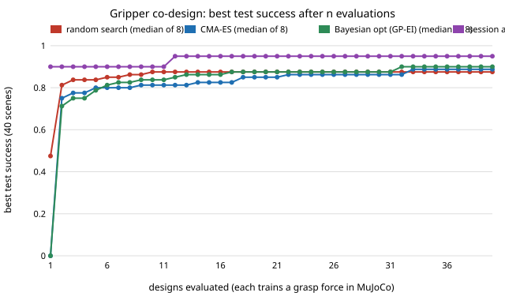

# codesign-gripper: do agent-proposed finger designs beat random search, CMA-ES and Bayesian optimisation when each design gets its own trained grasp force?

First milestone of the agentic robot co-design track (`PROJECTS.md`, track 14). Five parameters of a 3D-printable two-finger gripper are searched; for every design a grasp-force policy is tuned in MuJoCo, and the design is scored on 40 held-out grasp scenes. Four ways of choosing designs get the same 40 designs. Produced with AI assistance (Claude).

**Live page:** https://duncan-haywood.github.io/monorepo-projects/research/codesign-gripper/

**Headline (simulation only, preliminary, mostly negative).** The task is close to saturated: the best of 40 designs scores 0.95 test success for all four methods' best seeds, and the medians at n = 40 are 0.875 (random search), 0.887 (CMA-ES), 0.900 (Bayesian optimisation). The session agent (one trajectory, n = 1) reached 0.95 after 20 designs, earlier than any median. But on 100 fresh scenes the agent's best design scores 0.81, the same as the baselines' median (0.81 to 0.85). With 40 test scenes the standard error of a success rate near 0.9 is about 0.05, so the ranking of the methods is not resolved by this experiment.

**What "agent" means here.** The run environment has no model API key. The proposer is the **session agent itself** (the Claude session that wrote this project), writing 4 rounds of 10 proposals by hand as committed files (`proposals/round1.json` to `round4.json`, with notes) and reading the simulator's scores between rounds (`proposals/scores_round*.json`). One trajectory by one agent (n = 1): **not a reproducible LLM benchmark**. Scoring is fully scripted. The agent had advantages the baselines lack (below), and during development it also looked at the scores of about 43 trial designs (random and hand-picked) to calibrate the problem, which the baselines did not see.

## Motivation and what this builds on
Track 14 asks whether a loop that lets an agent propose a body, train a controller for it and read the result designs better cheap robots than blind search. This first step uses the smallest version that has a body and a learned part: gripper fingers plus a per-design grasp force. It builds on `../robofab-grasp` (MuJoCo friction-grip check) and `../simdesign-llm` (agent against baselines; its optimiser code is adapted here). It builds on none of the CU Boulder groups in `prompt.md` and claims no connection to them.

Prior work (entries taken from `PROJECTS.md`, not independently re-verified in this run: the Crossref API was unreachable): Todorov, Erez and Tassa (2012), "MuJoCo: a physics engine for model-based control", IROS. Hansen and Ostermeier (2001), CMA-ES, *Evolutionary Computation* 9(2). Jones, Schonlau and Welch (1998), expected improvement, *Journal of Global Optimization* 13. Ha, Xu and Song (2020), Fit2Form (learned gripper finger shape), CoRL. Gupta et al. (2021), learning and evolution of bodies, *Nature Communications*. Lehman et al. (2022), evolution through large models. Ma et al. (2024), Eureka, ICLR.

## Method
- **Design** (`src/codesign_gripper/problem.py`): finger width `w` 8 to 26 mm, thickness `t` 2 to 6 mm, length `L` 25 to 60 mm, V-groove depth `v` (0 flat, 1 is 35 degree faces) and TPU pad thickness `s` (0 bare PLA, 1 is 2 mm of TPU).
- **Cost model, all assumed, none sourced:** PLA 1.24 g/cm³ at 50% effective fill, $20/kg, 12 g/h; TPU 1.2 g/cm³, $30/kg, 4 g/h; pad friction 0.35 + 0.55 `s`; breaking force from a cantilever bending formula with a 30 MPa printed-PLA strength and a 1.5 safety factor. **Constraint: print time for the pair at most 45 min** (a design over it is infeasible, is not simulated, and counts as an evaluation).
- **Simulation** (`sim.py`): table, free object, hand on z and y slides, two fingers on x slides with a 30 g carriage each. Each pad is two plates tilted by ±`v`·35°. The fingers close at about 0.1 m/s, then hold with force `F` per finger; the hand lifts 80 mm in 0.4 s and shakes 20 mm at 3 Hz (about 7 m/s² peak). Success: the object is more than 40 mm up and within 12 mm of its position relative to the hand just after closing. MuJoCo 3.x, 2 ms step, elliptic friction cones.
- **Scenes** (`scenarios`): cylinder (r 10 to 25 mm), sphere (r 12 to 25) or box (side 20 to 50), 100 to 900 g, object friction 0.2 to 0.5, hand offset ±10 mm sideways and 0 to 25 mm up. 12 training scenes tune the policy, 40 test scenes score every design (the same for all designs), 100 fresh scenes are used once, at the end.
- **Policy training:** one parameter, the grasp force `F`. 8 log-spaced forces from 0.5 N to the finger's allowed maximum, then 4 more around the best; the smallest force with the highest training success wins. This is **grid-plus-refine policy search, not deep reinforcement learning**: a deliberate simplification to keep a design evaluation near 4 s on a CPU (about 168 rollouts of 1.6 s simulated each).
- **Baselines** (`optimisers.py`, no LLM): random search; CMA-ES (population 6); GP-EI Bayesian optimisation (8 Sobol points, then 32 EI steps). 40 designs and 8 seeds each. Infeasible designs get a penalty.
- **Session agent:** round 1 written with no scores from the 40-design budget (from the physics: required grip force, finger strength, print time), rounds 2 to 4 each after seeing all earlier scores. The reasoning is in each file's `notes`.

## Reproduce
```bash
pip install numpy scipy cma mujoco matplotlib pytest
cd research/codesign-gripper
python -m pytest -q tests                  # 10 tests, about 1 minute
python experiments/score_round.py 1        # re-score one round of agent proposals (also 2, 3, 4)
python experiments/run.py                  # about 15 minutes on 4 cores; writes experiments/results.{txt,json}
python experiments/figure.py               # writes experiments/best_so_far.svg
```

## Results (from `experiments/results.txt`)
Best feasible test success after n designs; baselines are the median [min to max] over 8 seeds.

| method | n=10 | n=20 | n=30 | n=40 |
|---|---|---|---|---|
| random search | 0.875 [0.82-0.95] | 0.875 [0.82-0.95] | 0.875 [0.85-0.95] | 0.875 [0.85-0.95] |
| CMA-ES | 0.812 [0.75-0.95] | 0.850 [0.82-0.95] | 0.863 [0.85-0.95] | 0.887 [0.85-0.95] |
| Bayesian opt (GP-EI) | 0.837 [0.78-0.93] | 0.875 [0.80-0.93] | 0.875 [0.85-0.95] | 0.900 [0.85-0.95] |
| session agent (n = 1) | 0.900 | 0.950 | 0.950 | 0.950 |



- **Saturation.** Every method's best seeds reach 0.93 to 0.95. Random search's median barely moves from n = 10 to n = 40 because a good design is easy to hit once feasible; only 55% of random proposals are feasible, against 76% for CMA-ES, 89% for Bayesian optimisation and 100% for the agent.
- **Winner's curse.** Re-scoring each run's best design on 100 fresh scenes (with its trained force) lowers it by 0.069 (random), 0.056 (CMA-ES) and 0.074 (Bayesian optimisation) on average over 8 seeds. Fresh medians: 0.830, 0.850, 0.810. The agent's 0.95 becomes 0.81. Selecting the best of 40 noisy scores picks up noise, and an agent that adapts to scores does so as much as a search algorithm.
- **Policy noise dominates design.** In 744 feasible evaluations the trained force reached 1.00 training success for 19% of designs, and test success averaged 0.128 below training success. Near-identical designs differ by up to 0.3 in test success (for example `12/4.5/30/0.2/1.0` scored 0.62 and `12/4/30/0.3/1.0` scored 0.95) because the 12-scene force search settles on a force that is sometimes too low for the heaviest scenes. A better policy search (more scenes, or a margin on the force) would probably help every method more than any proposer does.
- **The agent's best design** is 12 mm wide, 4 mm thick, 30 mm long, V depth 0.3, TPU 0.9, trained force 17.2 N (breaking force 32 N), 3.3 g for the pair, about $0.08 and 32 minutes of print time on the assumed rates. `experiments/finger_agent_best.stl` is its PLA body as a prism with a V-groove face. The STL approximates the simulated pad and was not simulated as exported; the TPU pad is not exported. It has not been printed or tested.

## Why this is weak evidence about agents
- The agent knew the physics (grip force, bending strength, print time) and read the model's source and assumptions; the baselines know only the bounds. A fair test would hide the problem's source from the proposer.
- One trajectory, one problem of five variables, 40 test scenes: no statistical statement about language-model agents follows. The fresh-scene result (0.81, equal to the baseline median) says the agent's apparent early lead is mostly selection on the test scenes.
- The agent's score reading was limited to the success rate and a few columns (force, print time, breaking force). The track's main question, whether *diagnostic* feedback (failure modes, contact logs) earns its tokens, is **not tested here**; it is the next milestone, `codesign-diagnose`.
- Baselines were not tuned (single defaults for CMA-ES step size and the GP lengthscale grid).

## Limitations
- Stylised: assumed costs, strengths and rates (none measured or quoted); rigid fingers (no bending in the simulation, only a breaking-force limit); no servo compliance or backlash; objects are three simple shapes; contact parameters (`solref` 0.004, `impratio` 5) were chosen for stability, not fitted. Anything printed would differ.
- The first versions of the simulator were numerically unstable at a 2 ms step with a stiff finger servo (a 2 g finger against a velocity gain); a 30 g carriage and a soft servo (gain 8 N s/m) fixed it. Results use only the final settings.
- Test success has a standard error near 0.05; differences between method medians (0.875 to 0.900) are inside it. 8 seeds.
- The fresh set was used once for the final designs and never to choose anything, but every method's winners are selected on the shared test set.
- Mesh export is a prism approximation; no CadQuery or build123d CAD was used (not installed here).

## Next steps
`codesign-diagnose` (the same agent with only the score, with a failure summary, and with rollout logs, which needs this saturation fixed first: harder scenes or a stricter hold test, and a policy search that does not under-force); more training scenes or a force margin; real finger compliance; a PX4-free version of the same loop for other domains (`codesign-sar`, `codesign-agri`).

## Owner steps
None needed for the simulation. Printing the fingers (milestone 8) would need a priced bill of materials with sourced, dated prices, which are not given here; real against simulated success would then be recorded.

## Outside dependencies (vitamins)
Open-source Python packages (numpy, scipy, cma, mujoco, matplotlib). The proposer is the Claude session that ran this project; no model API is called by the code. To build the real gripper one would need a servo-driven parallel gripper base, a printer, PLA and TPU filament, none of which this project provides.

MIT.
