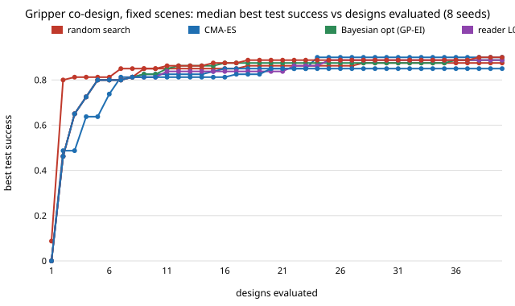

# Does diagnostic feedback help a gripper design loop once the task has headroom?

**Does diagnostic feedback help a gripper design loop once the task has headroom? Still no: fixing the scene bug raised every method's best test success by only 0.00 to 0.05, and the failure-summary and rollout-log readers still do not beat random search, CMA-ES or Bayesian optimisation.** (Stylised MuJoCo simulation, rule-based readers, not an LLM.)

Track 14 (agentic robot co-design, `codesign`). `../codesign-ceiling` found that the 0.85 plateau of `../codesign-diagnose` came from 10 of 140 scenes (spheres with the hand more than about 2 mm above their centre) that no design can hold, and its "Next steps" asked for the generator to be fixed and the ablation re-run. This does that and nothing else. Produced with AI assistance (Claude). No CU Boulder group's work is built on; no connection is claimed.

**Live page:** https://duncan-haywood.github.io/oss-monorepo/research/codesign-headroom/



## The one change
`scenarios()` caps the hand height `dz_mm` at the object's centre height (`centre_mm`). Every other draw (kind, size, mass, friction, lateral offset) is unchanged, so the train, test and fresh scenes are the same objects as in `codesign-diagnose` (a test checks this). Task, simulator, designs, readers, baselines, budget (40 designs) and 8 seeds are copied unchanged from `../codesign-diagnose`; the readers are rules written before any run.

## Results (`experiments/results.txt`; best feasible test success on 40 held-out scenes, median [min-max] over 8 seeds)
| method | n=10 | n=20 | n=40 | `codesign-diagnose` n=40 |
|---|---|---|---|---|
| random search | 0.850 [0.78-0.97] | 0.863 | 0.875 [0.85-0.97] | 0.850 |
| CMA-ES | 0.825 [0.55-0.95] | 0.850 | 0.900 [0.85-0.95] | 0.850 |
| Bayesian opt (GP-EI) | 0.825 [0.75-0.97] | 0.875 | 0.887 [0.80-0.97] | 0.850 |
| L0 score only | 0.812 [0.70-0.90] | 0.837 | 0.887 [0.82-0.97] | 0.863 |
| L1 failure summary | 0.850 [0.70-0.93] | 0.887 | 0.900 [0.82-0.93] | 0.850 |
| L2 full rollout logs | 0.812 [0.72-0.90] | 0.850 | 0.850 [0.80-0.93] | 0.837 |

- **Headroom helped a little, evenly.** Medians at n=40 rose by 0.00 to 0.05 for every method, and the ranking of methods is not resolved: with 40 test scenes the standard error is about 0.05, and the seed ranges overlap almost entirely.
- **Feedback still does not earn its tokens.** L1 ties CMA-ES at 0.900; L0 matches Bayesian optimisation; L2 is lowest (0.850) and has the lowest mean success among its feasible proposals (0.509 against 0.731 for L0), as before, because its rule moves overshoot.
- **Evaluations to reach 0.80:** medians 4.5 to 6.5 for all methods (8 of 8 seeds each), so the 0.80 target is still too easy to separate them.
- **Winner's curse remains.** On 100 fresh scenes the best designs drop by 0.05 to 0.06 on average (fresh medians 0.795 to 0.855), so the plateau is not only the 10 unreachable scenes: the test set is small and selection on it is noisy.
- Not checked: that the fix leaves *no* unreachable scene. `codesign-ceiling` showed the hand-height change makes its 10 scenes holdable (10 of 10 at table level, 8 of 10 at centre height); the oracle sweep was not re-run here, so remaining unreachable scenes are possible.

## Reproduce
```bash
pip install numpy scipy cma mujoco matplotlib pytest
cd research/codesign-headroom
python -m pytest -q tests          # 12 tests, about 15 s
python experiments/run.py          # about 37 minutes on 4 cores; writes experiments/results.{json,txt}
python experiments/figure.py       # writes experiments/best_so_far.svg
```

## Limitations
Everything in `codesign-diagnose` applies: author-written readers with untuned constants, not an LLM; 40 shared test scenes; 8 seeds; assumed costs and strengths; rigid fingers; three object shapes; nothing printed. Simulated is not real.

## Next steps
The study cannot separate methods at this test-set size: use 200+ test scenes or paired comparisons, a harder target than 0.80, and an LLM proposer once a key is available.

## Owner steps
None for the simulation.

## Outside dependencies (vitamins)
numpy, scipy, cma, mujoco, matplotlib. No model API is called. A real gripper would need a servo gripper base, a printer, PLA and TPU filament.

MIT.
