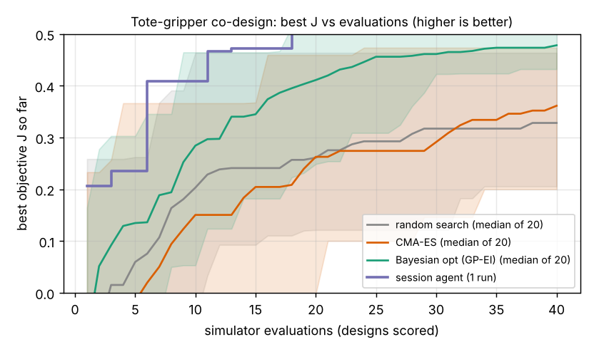

# Which suction gripper picks the most of a stylised mixed tote under an 80 USD cap, and does a session agent beat CMA-ES and Bayesian optimisation at 40 evaluations?

Fifth milestone of the agentic co-design track (`research/PROJECTS.md`, track 14, `codesign`; logistics domain). A low-cost suction gripper is described by five numbers (cup diameter, cups in a row, pump vacuum, pump flow, cup compliance) and scored on a fixed population of 600 simulated items (boxes, polybags, bottles). Produced with AI assistance (Claude).

**Live page:** https://duncan-haywood.github.io/oss-monorepo/research/codesign-logistics/



**Headline (simulated, stylised, one agent run, 20 seeds per baseline; all numbers from `experiments/results.txt`).**
- **The session agent led at every budget, but the margin is small and one baseline seed matched it.** Best J at 40 evaluations: session agent 0.519, Bayesian optimisation 0.478 (median; range 0.432 to 0.521), CMA-ES 0.361, random search 0.328. One of 20 Bayesian-optimisation seeds matched or beat the agent's best; no CMA-ES or random-search seed did. The model is noise-free, so these gaps are real in this model. The agent is one run, so its spread is unknown.
- **The agent got there faster.** It first reached J of at least 0.45 at evaluation 11; the median Bayesian-optimisation seed needed 22.5, CMA-ES 30 (15 of 20 seeds never), random search 13 (18 of 20 never).
- **Best design seen in any run:** two 18.5 mm cups, 80 kPa (upper bound), 60 L/min (upper bound), compliance 0.84, J = 0.521, 70 USD: 77% of items held with a fast pick, 20% too heavy for the hold force, 4% where no cup fits the item's flat patch.
- **A catalogue-default suction gripper scores 0.075** (one 30 mm cup, 60 kPa, 30 L/min, mid compliance, 48 USD): no item is picked fast, because pumping down a 30 mm cup at 30 L/min takes 1.5 s in this model, and 15% of items have no flat patch that large. This is a hand-picked reference, not a measured product.
- **Pick time was the surprise.** In round 1 most designs with cups of 18 mm or more had 57 to 76% of items held but too slowly (pick time over 1.2 s), not to dropped items; flow and vacuum at their bounds plus small cups fixed that. The trade is then small-cup speed and fit against large-cup hold force.
- **Not a result about language models.** I wrote the model and the proposals in one session, so the agent knew the model's structure. Treat the agent row as one worked example of a diagnostics-driven loop, not as evidence that an LLM beats Bayesian optimisation.

## What "agent" means here
The run environment has no model API key. The proposer is the **session agent itself**: 4 rounds of 10 designs, committed as `proposals/round1.json` to `round4.json`, each round written after reading the previous round's diagnostics from `experiments/diagnose.py` (outcome shares, pick time, median vacuum, cost). Round 1 was written before any evaluation. Baselines got no prior and 20 seeds each.

## Method
- **Design** (`src/codesign_logistics/tote.py`): cup diameter `d` 10 to 50 mm, cups in a row `n` 1 to 4 (rounded, so the objective has plateaus in that axis), pump vacuum `P` 20 to 80 kPa, pump free flow `Q` 5 to 60 L/min, bellows compliance `h` 0 to 1. Designs over 80 USD score J = -1 and still use an evaluation.
- **Items:** 600 drawn once (fixed seed): 50% boxes, 25% polybags, 25% bottles; mass lognormal (median 0.6 kg, 0.05 to 5 kg); flat-patch width, surface unevenness and per-cup leak by kind. All ASSUMED round numbers.
- **Physics, stated plainly:** (1) *fit*: `n` cups with 20% spacing must sit on the flat patch, and cups that do not fit stay off the item; no cup fits means a miss. (2) *vacuum*: leak per cup grows with cup diameter and with unevenness the bellows cannot follow (`6 h` mm); the vacuum reached is `P / (1 + k leak / Q)`. (3) *hold*: force is vacuum times engaged cup area, halved for a single cup under an item longer than 200 mm, and must be at least 1.5 times the load at 1 g of transport acceleration on top of gravity. (4) *time*: 0.3 s of arm motion plus pump-down proportional to cup volume over flow; a held item is worth `1/(1+(t/1.2)^4)`, so picks slower than about 1.2 s lose most of their value.
- **Objective** `J = mean pick value - 0.002 x cost`. Cost: pump 6 + 0.5 Q + 0.15 P USD, cups 1.5 + 0.04 d + 1.5 h USD each, 15 USD fixed.
- **Baselines** (`optimisers.py`, no language model): random search; CMA-ES (`cma`, population 6); Gaussian-process Bayesian optimisation (Matern 5/2, 8 Sobol points, then expected improvement). 40 evaluations, 20 seeds. The optimisers are the `codesign-agri` ones without the log scale.
- **Cost of the study:** about 1 ms per evaluation; the whole comparison runs in seconds on a CPU. There is no reinforcement learning: all five quantities are design variables, not a learned policy. The milestone's "policy per design" part is not done here.
- **Deviation from the milestone:** it asks for a comparison with a general-purpose arm at the same cost (as in `osrobot-specialise`). No arm is modelled here; the only reference is the hand-picked catalogue-default suction gripper above.

## Reproduce
```bash
cd research/codesign-logistics
PY=$(python3 ../../platform/ci/pyenv.py pytest numpy scipy cma matplotlib)
PYTHONPATH=src "$PY" -m unittest discover -s tests      # 7 tests
"$PY" experiments/run.py                                  # seconds -> results.txt, results.json
"$PY" experiments/figure.py                               # -> curves.png
"$PY" experiments/diagnose.py proposals/round1.json       # the per-round diagnostics the agent read
```

## Bill of materials (assumed, unsourced)
The cost model in `cost_usd` is a placeholder written for this study; none of its prices comes from a supplier quote or a dated source. The 80 USD cap is a modelling choice, not a priced build.

## Limitations
- Every constant is an assumed round number, not a measurement of any cup, pump or parcel. The item mix, leak rates and the 1.2 s time scale decide the ranking and have not been checked against warehouse or suction-cup data.
- Closed-form screening model: no cup deformation, no pump transients, no grasp-pose uncertainty, no slip along the cup and no tote clutter.
- Two design variables sit at their bounds in the best design (vacuum, flow), so the true optimum may lie outside the range, and a bigger pump costs more than the model's linear price.
- One agent run, written by the author of the model, and the agent saw the 40-design budget in advance. Only one Bayesian-optimisation seed matched it, but with 20 seeds that is a thin margin to read much into.
- **Simulation is not a safety case**; whether any design picks real parcels is an owner step.

## Lab tags
None fits closely; nothing of any lab is used or reproduced here and nothing is affiliated with or endorsed by one. Prior work: Ha, Xu and Song (2020), Fit2Form, gripper form design, CoRL; Lehman et al. (2022), evolution through large models. Companion projects: `codesign-agri`, `codesign-sar`, `codesign-gripper`.

## Next steps
Model a general-purpose arm at the same cost (milestone 5's comparison), calibrate leaks and mass distribution against published parcel data, add a learned approach policy in MuJoCo, and run the `codesign-transfer` test (does the winning design survive a widened item mix?).

## Owner steps
Price a real bill of materials with dated sources, build the top design from an off-the-shelf pump and cups, and count drops and slow picks on a real mixed tote.

## Outside dependencies (vitamins)
Open-source Python packages (numpy, scipy, cma, matplotlib). No model API is called. A real pump, cups, valve and controller would be bought.

MIT.
