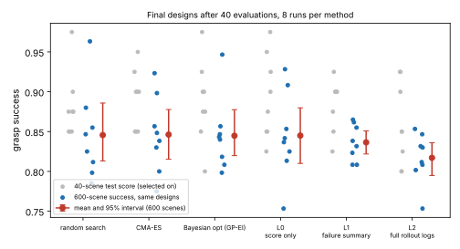

# codesign-power: which gripper co-design method finds the best design, measured on 600 scenes instead of 40?

Track 14 (agentic robot co-design, `codesign`). `../codesign-headroom` could not rank its six methods because 40 test scenes give a standard error of about 0.05, and its "Next steps" asked for a larger test set. This project does that without re-running any optimisation: it takes the 144 final designs those runs handed over (6 methods × 8 seeds × checkpoints at 10, 20 and 40 designs; 77 are distinct) and scores each on 600 new scenes from the same generator. Produced with AI assistance (Claude). No CU Boulder group's work is built on; no connection is claimed.

**Live page:** https://duncan-haywood.github.io/oss-monorepo/research/codesign-power/



## Headline
With 600 scenes the methods are still **not separable, and none beats random search**: after 40 designs the mean true success is 0.846 (random search), 0.846 (CMA-ES), 0.845 (Bayesian opt), 0.845 (score-only reader), 0.836 (failure-summary reader) and 0.817 (rollout-log reader). The seed-to-seed spread of the designs, not scene noise, is what remains. The only direction the data leans is **against** richer feedback: the rollout-log reader is 0.029 below random search (95% interval −0.073 to +0.010), and 0.019 below the failure-summary reader (−0.045 to +0.005). Neither interval excludes zero.

## Method
- Scenes: `scenarios(600, 4004)` from `../codesign-headroom` (same generator, hand height capped at the object's centre); a test checks they share no object with its train, test or fresh sets.
- Designs: for each run and checkpoint n, the feasible design with the highest 40-scene test score among the first n evaluated (what the run would hand over), with the grasp force trained for it. Nothing is re-optimised or re-trained.
- Statistics: percentile bootstrap (10,000 resamples) over the 8 runs per method. Runs of different methods are resampled independently, since different seeds give different designs. Scene noise for one design is about 0.015 (binomial, 600 scenes).

## Results (`experiments/results.txt`)
| method | test (40 scenes), n=40 | true (600 scenes), n=40 [95% CI] | optimism (test − true) |
|---|---|---|---|
| random search | 0.881 | 0.846 [0.813, 0.886] | 0.036 |
| CMA-ES | 0.891 | 0.846 [0.815, 0.878] | 0.044 |
| Bayesian opt (GP-EI) | 0.887 | 0.845 [0.820, 0.877] | 0.043 |
| L0 score only | 0.894 | 0.845 [0.810, 0.880] | 0.049 |
| L1 failure summary | 0.884 | 0.836 [0.822, 0.851] | 0.048 |
| L2 full rollout logs | 0.859 | 0.817 [0.795, 0.836] | 0.042 |

- **The 40-scene test score is optimistic by 0.04 to 0.05 for the designs chosen on it** (winner's curse), roughly twice at n=40 what it is at n=10 (0.00 to 0.025), because more candidates mean a luckier winner. This is measured on 600 scenes, not 100.
- **Search past about 20 designs buys almost nothing here.** True success at n=10, 20 and 40 is 0.79–0.83, 0.82–0.84 and 0.82–0.85 across methods; for random search 0.831, 0.835, 0.846.
- **The test score is a mediocre guide to quality**: Spearman 0.63 between 40-scene and 600-scene success over the 77 distinct designs. Designs range from 0.607 to 0.963 true success, so there is real quality to find; the methods just do not find it at different rates.
- The rollout-log reader's lower result matches `codesign-diagnose` and `codesign-headroom` (its rules overshoot); with 8 runs the evidence is suggestive, not conclusive.

## Reproduce
```bash
pip install numpy scipy cma mujoco matplotlib pytest
cd research/codesign-power
python -m pytest -q tests            # 9 tests, a few seconds
python experiments/run.py            # about 4 minutes on 4 cores; reads ../codesign-headroom/experiments/results.json
python experiments/figure.py
```
The project imports the simulator from `../codesign-headroom/src` by relative path.

## Limitations
Only 8 runs per method, so the interval on a method mean is about ±0.03 whatever the scene count; more scenes cannot fix that, more seeds can. The readers are author-written rules, not an LLM. Designs were selected on the 40 test scenes, so the re-score measures them honestly but does not say what selecting on 600 scenes would have found. Assumed costs and strengths, rigid fingers, three object shapes, nothing printed. Simulated is not real.

## Next steps
Spend the budget on seeds, not scenes: 30+ runs per method would resolve differences of about 0.02. Select designs on a larger or resampled scene set inside the loop, and try an LLM proposer once a key is available.

## Owner steps
None for the simulation.

## Outside dependencies (vitamins)
numpy, scipy, cma, mujoco, matplotlib. No model API is called. A real gripper would need a servo gripper base, a printer, PLA and TPU filament.

MIT.
